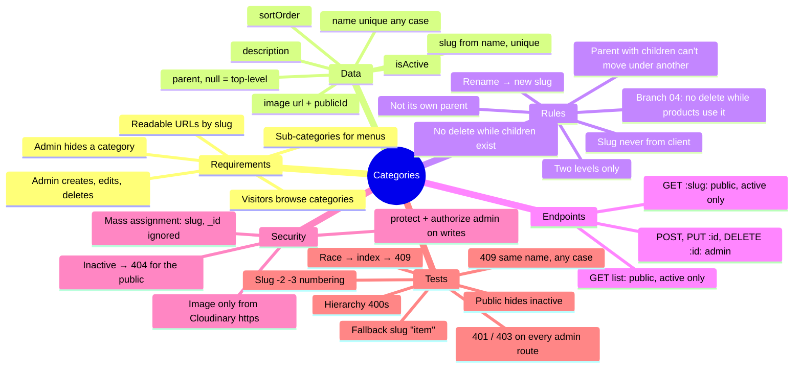

# Mind map – 03 Categories

## Thinking steps (how this module was reasoned out)

1. **Who and what?** Anyone (even without logging in) browses categories. Only **admins** change them. That is the first time a module mixes **public** and **admin** routes. See [concept 15](../concepts/15-slugs-and-public-vs-admin-apis.md).
2. **What do we store?** `name`, a generated `slug`, `description`, an optional `parent` (another category), an optional `image`, `isActive` and `sortOrder`. `children` is a _virtual_ (computed by a query, not stored), so the tree has a single source of truth: each child's `parent`.
3. **What must ALWAYS be true?**
   - Names are unique **ignoring case**. "Shoes" and "SHOES" would confuse customers. → unique index with a case-insensitive `collation`, plus a service check for a friendly 409.
   - Every category has a unique, valid slug. → model hook + unique index.
   - At most two levels. → three checks in the service.
   - A category with children is never deleted. Products come in branch 04 and get the same rule.
4. **Who may call what?** Reads: nobody needs a token. Writes: `protect` + `authorize('admin')`. Customers get **403**, visitors **401**.
5. **What do customers see?** Only active categories. An inactive one is **404**, the same answer as a missing one.
6. **What can go wrong?**
   - Two different names with the same slug → `uniqueSlug()` adds `-2`, `-3`.
   - Two admins save at the same instant → the unique indexes refuse the second → **409**.
   - The body contains `slug`, `_id`, `productCount` → copied by name only, so ignored.
   - An image URL from any website → the URL must start with `https://res.cloudinary.com/`.
   - A third level, a loop (own parent), or moving a parent under another category → **400**.
7. **Make it testable.** `createCategory(overrides)` builds any tree in one line. `slugify` is a pure function, so it gets fast unit tests. `uniqueSlug` is tested with a fake model.

## Decision log

| Decision                                                    | Why                                                                                 | Trade-off                                                   |
| ----------------------------------------------------------- | ----------------------------------------------------------------------------------- | ----------------------------------------------------------- |
| Slug generated in a model hook                              | Works for every way of saving (service, seed script, tests)                         | One extra `exists()` query per save                         |
| Unique name with `collation: { locale: 'en', strength: 2 }` | "Shoes" = "shoes" for humans                                                        | Accents still count ("Cafe" ≠ "Café")                       |
| Service pre-check for names **and** the index               | Friendly 409 message; the index handles races                                       | Two places to keep in mind                                  |
| Hierarchy rules in the service, not in the model hook       | Clear 400 `ApiError`; a hook throwing a plain `Error` became a 500 in the reference | Code that bypasses the service (scripts) is not checked     |
| Read by slug, write by id                                   | Readable public links; a rename never breaks the admin's URLs                       | Old public links break on rename (no redirects yet)         |
| Inactive → 404 publicly                                     | Hidden things simply don't exist for customers                                      | Admins need their own list to see inactive ones (branch 10) |
| `PUT` is a partial update                                   | "Switch off" sends just `{ isActive: false }`                                       | Validation needs two rule sets (create vs update)           |
| Image stored as `{ url, publicId }` only                    | Uploads and Cloudinary clean-up need the SDK (branch 04)                            | An admin must paste an already-uploaded image for now       |
| Flat public list (with `parent`)                            | One query; the frontend builds the menu tree                                        | The client does a little grouping                           |

## Now read

- The module guide: [docs/modules/03-categories.md](../modules/03-categories.md)
- The concept: [15 – Slugs and public vs admin APIs](../concepts/15-slugs-and-public-vs-admin-apis.md)
- Then the code in build order: `config/constants.js` → `db/utils/slugify.js` → `db/schemas/image.schema.js` → `category.model.js` → `category.validation.js` → `category.service.js` → `category.controller.js` → `category.routes.js` → `app.js`
