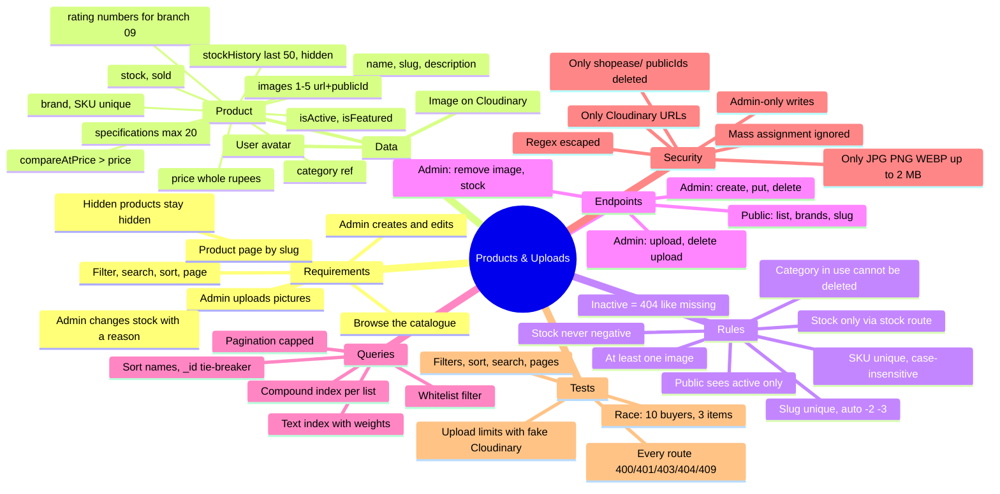

# Mind map – 04 Products & Uploads

## Thinking steps (how this module was reasoned out)

1. **Who and what?** _Everyone_ (even without an account) browses products. Only _admins_ create, change and delete them, upload pictures and correct stock.
2. **What do we store?** A `Product` with a readable `slug` for its URL, a unique `sku` for the warehouse, a whole-number `price`, 1–5 `images` and a `stock` count. Images themselves live on Cloudinary. We keep only `{ url, publicId }`. Rating fields exist now (default 0) so branch 09 only has to fill them.
3. **What must ALWAYS be true?**
   - The public never sees an inactive product (the filter _always_ starts with `isActive: true`).
   - Two products never share a SKU or a slug (unique indexes, plus a friendly 409 check for SKU).
   - Stock is never negative, and is never oversold, even when requests arrive at the same moment. Condition and change go in **one** atomic command.
   - A product always has at least one image.
4. **How will the shop LIST products?** Write the queries first, then add an index for each: newest, price, rating, popular, featured, category + price, and a text index for keyword search. The client can only pick from whitelisted filters and sort names.
5. **How do files get in?** Multipart is a different body format, so it gets its own small module (`/api/uploads`) that returns `{ url, publicId }`. The product routes stay pure JSON.
6. **What can go wrong?**
   - Query injection (`?isActive=false`, `?price[$gt]=0`) → whitelist.
   - Regex DoS through `brand` or admin `search` → escape the user's text.
   - Huge or dangerous files → multer limits, type whitelist, admin-only.
   - Deleting someone else's Cloudinary file → only `shopease/…` publicIds.
   - Cloudinary down → upload 502; deletes never fail the request.
   - Same price on many products → pages overlap → `_id` tie-breaker.
   - Deleting a category that products use → refused with 400.
7. **Make it testable.** `createProduct()` builds any state in one line. `cloudinaryClient` is stubbed, so upload tests run offline and can check exactly what would have been sent.

## Decision log

| Decision                                                                    | Why                                                           | Trade-off                                                 |
| --------------------------------------------------------------------------- | ------------------------------------------------------------- | --------------------------------------------------------- |
| Prices as whole rupees (integers)                                           | Floats can't store money exactly                              | No paisa (fine for PKR)                                   |
| Slug from the name, regenerated on rename                                   | Readable URLs; same helper as categories                      | Old product URLs break after a rename                     |
| `PUT` replaces the whole product (same rules as create)                     | The admin form always sends everything                        | No partial updates                                        |
| `stock` only on create and via `PATCH /:id/stock`                           | Every later change has a reason and an author (history)       | One more request for the admin                            |
| Stock history inside the product, last 50, `select: false`                  | One atomic write; no extra collection                         | Older history is lost; big arrays avoided by `$slice`     |
| Text index (whole words, stems) for the shop; escaped regex for the admin   | Ranked, indexed search for shoppers; "contains" for SKUs      | No "search as you type" in the shop                       |
| Inactive product → 404 (not 403)                                            | Doesn't reveal hidden products                                | –                                                         |
| Uploads in their own module, two-step flow                                  | Product routes stay JSON; reusable for categories             | Unused uploads can be left behind (frontend deletes them) |
| `cloudinaryClient` object instead of calling the SDK directly               | Tests stub it, no network                                     | One extra small layer                                     |
| `deleteImage` never throws, runs after the DB write                         | Never fails a saved change; never deletes images still in use | Possible orphan files on Cloudinary                       |
| Admin list / low-stock / detail handlers written here, mounted in branch 10 | Same layout as the reference app (`/api/admin/products`)      | Tested through a tiny test app until branch 10            |
| Hard delete now; soft delete when orders exist (branch 07)                  | No orders yet                                                 | Branch 07 must add the check                              |
| `avatar` on User (Google photo), no upload route yet                        | The field is needed by the reference frontend                 | Customers can't upload their own picture yet              |

## Now read

- The module guide: [docs/modules/04-products-uploads.md](../modules/04-products-uploads.md)
- The concepts: [16 – Catalog queries](../concepts/16-catalog-queries.md), [17 – File uploads and a CDN](../concepts/17-file-uploads-and-cdn.md)
- Then the code in build order: `config/constants.js` → `utils/pagination.js` → `config/cloudinary.js` → `middleware/upload.middleware.js` → `modules/uploads/*` → `product.model.js` → `product.query.js` → `product.validation.js` → `product.service.js` → `product.controller.js` → `product.routes.js` → `app.js`
