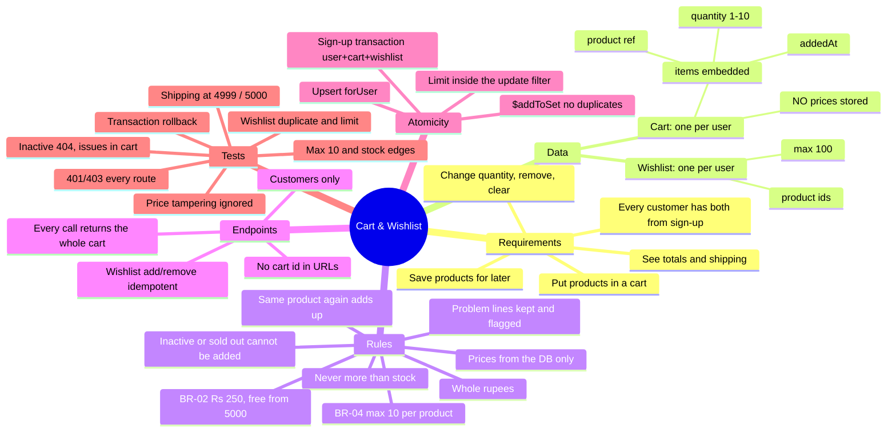

# Mind map – 05 Cart & Wishlist

## Thinking steps (how this module was reasoned out)

1. **Who and what?** Only **customers** shop. Admins get 403, like addresses. A customer has ONE cart and ONE wishlist, so the URLs need no id: "my cart" is found through the token. That also makes IDOR impossible by design.
2. **What do we store?**
   - A cart is small, always read whole and its lines never live alone → **embed** the lines (`items: [{ product, quantity, addedAt }]`) in one cart document.
   - **No prices** in the cart. A price stored at "add" time goes stale and, worse, could be sent by the client. We store only "which product, how many".
   - The wishlist is a list of product ids in one document.
3. **What must ALWAYS be true (invariants)?**
   - one cart / one wishlist per user → unique index on `user`;
   - 1 ≤ quantity ≤ 10 and quantity ≤ stock (BR-04);
   - one line per product;
   - no duplicate in the wishlist, at most 100 ids;
   - totals are computed from current database prices.
4. **When are the cart and wishlist created?** At sign-up, so the frontend never sees "no cart". That is three writes (user, cart, wishlist) → a **transaction**, so a crash never leaves a user without a cart. For older users (created before this branch) `forUser` **upserts** on first use.
5. **What about products that change after being added?** The price is read live, so price changes are automatic. If a product is switched off, sells out or drops below the quantity, we do **not** silently delete the line: we flag it (`issue`), leave it out of the totals and set `hasIssues`, so the UI can explain it and block checkout. A deleted product's line is removed.
6. **What can go wrong?**
   - The client sends `price: 1` → never read; prices come from the database.
   - Adding 6 + 6 of the same product → the **sum** is checked against 10 and stock.
   - Double-click on the heart icon → `$addToSet` makes the add **idempotent**.
   - Two parallel wishlist adds at 99 items → the limit lives in the update **filter** (atomic).
   - The cart write fails during sign-up → the transaction rolls back the user too, and no email is sent.
7. **Make it testable.** Pure pricing helpers (unit tests at 4,999 / 5,000), factories `addToCart` and `createWishlist` that write directly to the DB to set up any state (e.g. "stock dropped after adding"), and `jest.spyOn(Model, 'create').mockRejectedValueOnce()` to force a rollback.

## Decision log

| Decision                                                    | Why                                                           | Trade-off                                                       |
| ----------------------------------------------------------- | ------------------------------------------------------------- | --------------------------------------------------------------- |
| Embed cart lines in the cart                                | One read, atomic one-document updates, lines never live alone | Cart must stay small (it does: one line per product, ≤ 10 each) |
| Store no prices in the cart                                 | Price can never be stale or tampered                          | One populate per cart read                                      |
| Every route returns the whole recalculated cart             | UI redraws from one response; totals always fresh             | Slightly bigger responses                                       |
| Same product again **adds** quantities                      | What shoppers expect from "Add to cart"                       | `POST /cart/items` is not idempotent (by design)                |
| Inactive product → **404** on add                           | Hidden products should look like they do not exist            | –                                                               |
| Problem lines kept + `issue` + `hasIssues`                  | Customer understands what changed                             | Frontend must show issues and block checkout                    |
| Remove from cart / wishlist is idempotent (200 when absent) | Safe to retry; the result "not there" is the same             | No 404 to tell "it was never there"                             |
| Cart and wishlist created in the sign-up **transaction**    | No half-made accounts                                         | Needs a replica set (Atlas, Docker and tests have one)          |
| `forUser` upsert as a fallback                              | Older users and the admin seed have no cart                   | –                                                               |
| Wishlist limit checked in the update filter                 | Race-free, no transaction needed                              | Slightly unusual query (`products.99`)                          |
| A full wishlist still accepts an already-saved product      | Idempotency beats the limit check                             | Needs an "already saved?" read first                            |
| Shipping on the subtotal of lines **without** issues        | You pay only for what can be shipped                          | Total can change when an issue is fixed                         |

## Now read

- The module guide: [docs/modules/05-cart-wishlist.md](../modules/05-cart-wishlist.md)
- The concept: [18 – Transactions, atomic updates and server-side prices](../concepts/18-transactions-and-atomic-updates.md)
- Then the code in build order: `config/constants.js` → `utils/pricing.js` → `cart.model.js` → `wishlist.model.js` → `cart.validation.js` → `cart.service.js` → `wishlist.service.js` → controllers → routes → `app.js` → `auth.service.js` (transaction)
