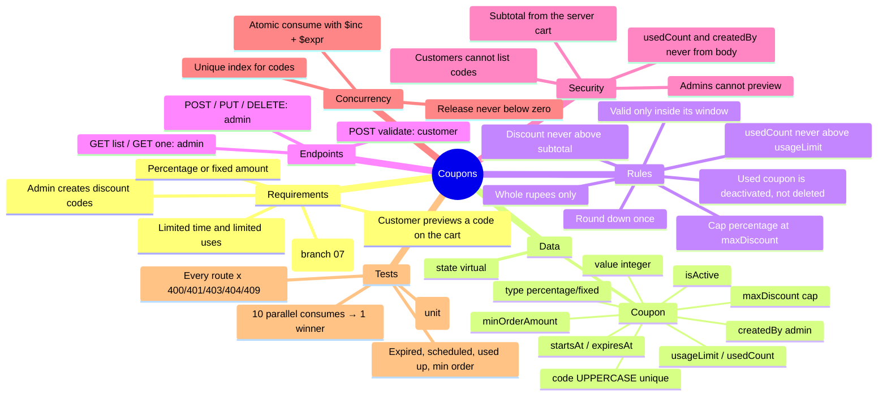

# Mind map – 06 Coupons

## Thinking steps

1. **Who and what?** An **admin** creates codes such as `EID25`. A **customer** types one at checkout and wants to see the new total before paying. The real "use" happens when the order is placed, in branch 07.
2. **What do we store?** One `Coupon` document per code: what kind of discount (`type`, `value`, optional `maxDiscount`), when it applies (`minOrderAmount`, `startsAt`, `expiresAt`), how often (`usageLimit`, `usedCount`) and an off switch (`isActive`). The **status** (`active`, `scheduled`, `expired`…) is *computed*, not stored, because it changes with the clock.
3. **What must ALWAYS be true?**
   - Codes are unique, whatever the case → store them **uppercase** + a **unique index**.
   - Money is a **whole number** → integer validators, `Math.floor`, multiply before divide.
   - The discount is **never more than the subtotal**, and a percentage discount never exceeds its cap.
   - `usedCount ≤ usageLimit`, even under concurrency → an **atomic** conditional `$inc`.
4. **Where does each rule live?** Pure rules about one coupon (`checkUsable`, `calculateDiscount`) go on the **model**, so the preview (branch 06) and checkout (branch 07) share them. The **service** loads the cart, turns a failed check into an `ApiError(400)` and builds totals with `calcTotals`.
5. **Who may call what?** Previewing needs a cart, so it's **customers only**. Listing, creating, changing and deleting are **admin only**, because a public list would publish every secret code.
6. **What can go wrong?**
   - The client sends its own subtotal → **ignored**: the server reads the cart and today's product prices.
   - Two admins create `SALE10` at the same moment → the unique index refuses one (**409**).
   - Two customers race for the last use → the atomic `consume` lets exactly one win.
   - An admin deletes a coupon that orders still reference → it's **deactivated** instead.
   - A typo gives 900% off → refused: 1–90% and Rs 1–100,000 only.
7. **Make it testable.** `createCoupon(overrides)` builds any coupon in one line (expired, scheduled, used up…), and `checkUsable(subtotal, now)` takes the time as a parameter.

## Decision log

| Decision | Why | Trade-off |
|---|---|---|
| Admin CRUD under `/api/coupons` (reference uses `/api/admin/coupons`) | The contract gives each module its own prefix; the admin module (branch 10) doesn't exist yet | Branch 10 may also mount the same controllers under `/api/admin/coupons` for the reference frontend |
| `PUT` replaces the whole coupon | The admin form always sends every field; empty optional = removed | No partial update; a `PATCH` would need a second rules array |
| Preview returns 400 (not 404) for disabled/expired codes | The code exists; the customer needs the reason | Reveals that a disabled code once existed (acceptable: codes are marketing, not secrets once shared) |
| No per-customer limit | The reference has none; one-use-per-customer needs orders | Comes as an exercise in branch 07 (`Order.exists({ user, 'coupon.coupon': id })`) |
| Duplicate check in the service **and** the unique index | Clear 409 message in the normal case; the index covers the race | One extra query per create/update |
| Status as a virtual (`state`) | "Expired" depends on the clock, not on a write | Can't query by `state` directly (use `expiresAt`/`isActive` filters) |
