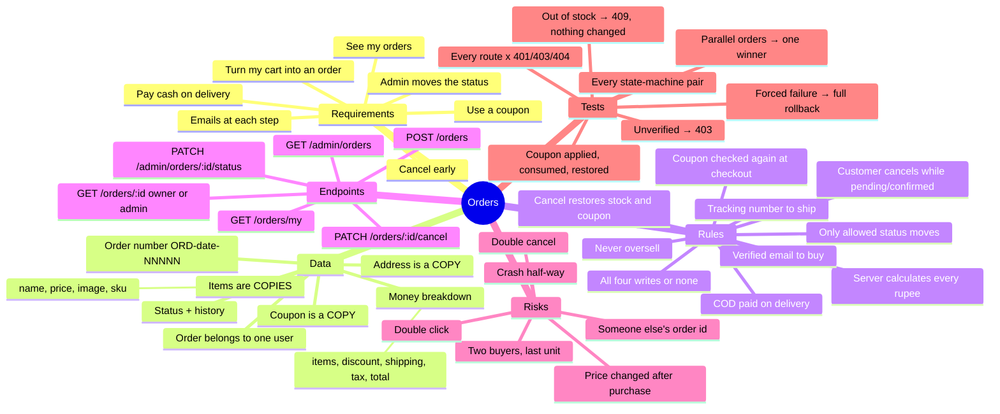

# Mind map – 07 Orders

## Thinking steps (how this module was reasoned out)

1. **Who and what?** A **verified** customer buys what is in their cart. We need their email to send the receipt and status updates, so unverified customers get 403 (BR-12). Admins don't buy; they run the shop and move orders along.
2. **What do we store?** An order is a **receipt**, so it must never change after the fact. Everything that can change elsewhere is **copied** into it: product name, price and image; the delivery address; the coupon's code and value. We still keep the ids (`product`, `coupon`) for reviews, reports and restoring stock. → [concept 21](../concepts/21-state-machines-and-snapshots.md)
3. **What must ALWAYS be true (invariants)?**
   - Stock is never negative, and we never sell more than we have.
   - `totalPrice = itemsPrice − discountPrice + shippingPrice + taxPrice`, all whole rupees. The model refuses to save anything else.
   - A coupon is never used more than its `usageLimit`.
   - An order is either fully placed (stock taken, coupon counted, cart empty) or not at all.
   - `status` only moves along the arrows of `ORDER_TRANSITIONS`.
4. **How do we keep "never oversell" true with many buyers at once?** Not with "read stock, check it in JavaScript, write stock − 1": two requests can both read 1. Instead, one **atomic conditional update**: `updateOne({ _id, stock: { $gte: qty } }, { $inc: { stock: -qty } })`. The database checks and writes in one step, and `modifiedCount` tells us whether we got the units. The coupon uses the same trick (`usedCount < usageLimit`). → [concept 20](../concepts/20-transactions-and-race-conditions.md)
5. **How do we keep "all or nothing" true?** The four writes (stock, coupon, order, cart) run inside **one transaction**. Any `throw` aborts it, and MongoDB undoes every write. Emails are sent **after** the commit, never inside.
6. **How do statuses move?** A **state machine**: a table of allowed next statuses (`ORDER_TRANSITIONS`) and one method (`changeStatus`) that is the only way to change `status`. The admin route, the customer cancel and later the Stripe webhook (branch 08) all go through it, so no route can invent its own rule.
7. **What can go wrong?**
   - Two buyers, last unit → the conditional update lets one win. The other gets **409** with the available quantity.
   - The server crashes after taking stock but before creating the order → the transaction never commits, so nothing changed.
   - Double click on "Place order" → the second request finds an empty cart → **400**. Only one order exists.
   - Two cancel requests → the status is re-checked inside the transaction, so stock comes back only once.
   - Customer B opens customer A's order id → **404** (owner in every query).
   - Client sends `totalPrice: 1` → ignored. Prices come from the database.
   - The coupon expired between preview and checkout → checked again → **400**, and the transaction undoes the reserved stock.
   - Random order number already used (very rare) → unique index error 11000 → retry once.
8. **Make it testable.** `createOrder(user, overrides)` builds any order state directly in the database ("a shipped order", "a paid CARD order"). `deliverOrder(order)` makes a delivered one (branch 09 reviews need it). `addToCart`, `createProduct` and `createCoupon` set up checkout in three lines. Concurrency is tested with `Promise.all` of real HTTP requests against an in-memory **replica set**.

## Decision log

| Decision                                                                  | Why                                                        | Trade-off                                                                                                           |
| ------------------------------------------------------------------------- | ---------------------------------------------------------- | ------------------------------------------------------------------------------------------------------------------- |
| Snapshots of items, address and coupon                                    | A receipt must not change when the catalogue does          | Data is duplicated (a few hundred bytes per order)                                                                  |
| Atomic `stock >= qty` update                                              | Correct under any number of parallel buyers, without locks | The "Only N left" message may show a slightly old N                                                                 |
| One transaction for stock + coupon + order + cart                         | All-or-nothing (Atomicity)                                 | Needs a replica set (Atlas and our tests have one); a bit slower                                                    |
| Collect every bad cart line, then fail with 409                           | The customer fixes the cart once, not line by line         | The transaction does some work that is thrown away                                                                  |
| Coupon re-checked inside the transaction                                  | A preview can be stale                                     | One extra query                                                                                                     |
| Emails after the commit                                                   | Never email about an order that was rolled back            | If the mail server is down, the order still exists without a mail (logged)                                          |
| State machine table in `constants.js` + one `changeStatus` method         | One place to read and change the rules                     | Every new status needs a constant and a test                                                                        |
| Customer cancel only while pending/confirmed; admin also while processing | Once packed, only the shop can decide                      | Customers must contact support later on                                                                             |
| Foreign order id → 404, admin may read any order                          | Same IDOR rule as addresses; admins need support access    | `GET /orders/:id` has no `authorize()`, so the service decides                                                      |
| Admin order routes exported from `order.routes.js`                        | The admin module (branch 10) doesn't exist yet             | Branch 10 must move two lines                                                                                       |
| `CARD` refused unless `PAYMENT_CARD_ENABLED=true`                         | Stripe arrives in branch 08                                | Card fields exist but are unused for now                                                                            |
| Order number = date + 5 random digits, retry on clash                     | Readable on the phone, not guessable                       | 90,000 numbers per day before clashes get frequent                                                                  |
| No `Idempotency-Key` header                                               | The empty cart already blocks a double submit              | A retried request after a network error gets 400 instead of the original order (see exercise 3 in the module guide) |

## Now read

- The module guide: [docs/modules/07-orders.md](../modules/07-orders.md)
- The concepts: [20 – Transactions, ACID and race conditions](../concepts/20-transactions-and-race-conditions.md), [21 – State machines and snapshots](../concepts/21-state-machines-and-snapshots.md)
- Then the code in build order: `config/constants.js` (orders block) → `address.model.js` (`toSnapshot`) → `order.model.js` → `order.validation.js` → `emails/templates.js` (orders block) → `order.service.js` → `order.controller.js` → `order.routes.js` → `app.js` → `order.docs.js`
