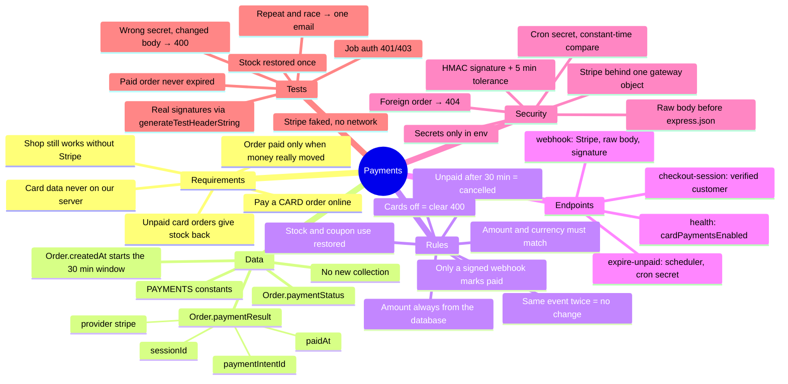

# Mind map – 08 Payments

## Thinking steps (how this module was reasoned out)

1. **Who and what?** A customer chose "CARD" at checkout (branch 07 already created the order and reserved stock). Now they must pay, and the shop must _know for sure_ that they paid. Admins don't pay. Stripe and a scheduler are two new kinds of **callers that are machines, not people**.
2. **Where does the card number go?** Not to us. Stripe's **hosted checkout** page takes it. Our server only asks Stripe for a page URL ("Checkout Session") with the amount _we_ computed. That removes a whole class of security and legal problems.
3. **Who is allowed to say "paid"?** List every possible source and ask "can it be faked?":
   - the browser → yes → never trusted;
   - the `success_url` redirect → yes (type the URL) → only shows a page;
   - Stripe's server → only if we can **prove** it's Stripe → the signed webhook.
     So `paymentStatus = 'paid'` for a card order has exactly one code path.
4. **How do we prove it's Stripe?** A shared secret plus HMAC over the **raw** body (the signature). That forces an architectural decision in `app.js`: this one route must be registered **before** the JSON parser.
5. **What can go wrong with the webhook?** Make a table and give each case an answer:
   - fake / changed / old → **400** (signature check);
   - not our event, not paid yet, unknown order → **200, ignore** (otherwise Stripe retries for days);
   - delivered twice, or twice _at the same time_ → **idempotent**: state check + atomic conditional update;
   - wrong amount → don't mark paid, log for a human;
   - paid after we already cancelled → record it, keep cancelled, refund by hand.
6. **What if they never pay?** Their stock stays reserved forever, unless something cleans up. Nobody sends a request for that, so we need a **scheduled job** (cron). It must be callable by the scheduler only (shared secret), safe to run twice, and must never cancel an order that was paid a millisecond earlier (repeat the "still unpaid" condition inside the cancel transaction). Because the free Vercel plan only runs it daily, checkout also refuses orders older than 30 minutes.
7. **How do we test something that lives on the internet?** Put Stripe behind one small object (`stripeGateway`), the same pattern as `googleVerifier` in branch 01. Replace only the network call in tests. Signatures are pure maths, so tests sign real webhooks with a test secret and run the real check.
8. **What if the shop owner has no Stripe account?** Feature flag `PAYMENT_CARD_ENABLED` (default false). Every card path answers a clear 400, and `/api/health` tells the frontend to hide the card option.

## Error-case table (before writing code)

| Situation                                                    | Answer                                 |
| ------------------------------------------------------------ | -------------------------------------- |
| no token / admin / unverified email on checkout              | 401 / 403 / 403                        |
| bad `orderId`                                                | 400 validation                         |
| cards off or no secret key                                   | 400 _Card payments are not configured_ |
| order missing or not mine                                    | 404                                    |
| COD order / already paid / not pending / older than 30 min   | 400 with a specific message            |
| Stripe down                                                  | 502                                    |
| webhook: no secret configured / no signature / bad signature | 400                                    |
| webhook: anything we handled or chose to ignore              | 200                                    |
| cron: no secret / wrong secret                               | 401 / 403                              |
