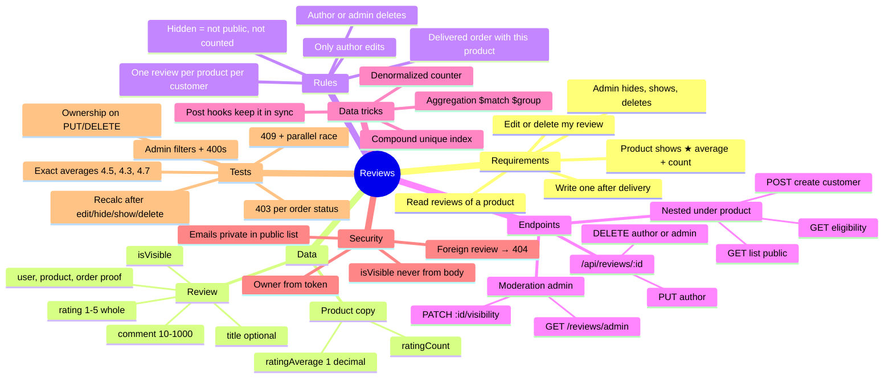

# Mind map – 09 Reviews

## Thinking steps (how this module was reasoned out)

1. **Who and what?** Shoppers trust other buyers. So reviews must come from **real buyers**, each buyer gets **one voice**, and the shop needs a way to remove abuse.
2. **What do we store?**
   - A **Review** is its own collection (many per product, each with its own id for edit/delete URLs). Embedding reviews inside the product would make the product document grow without limit.
   - The review stores the **order** that proved the purchase, which is useful for audits.
   - The product stores **`ratingAverage` and `ratingCount`**: a denormalized copy, so product cards and "sort by rating" stay fast.
3. **What must ALWAYS be true (invariants)?**
   - Every review belongs to a customer with a **delivered** order containing that product.
   - At most **one** review per (product, customer).
   - `product.ratingAverage/ratingCount` = the average/count of that product's **visible** reviews, rounded to one decimal.
4. **How do we make them hold?**
   - Delivered rule: a query on `orders` (`user`, `status: 'delivered'`, `'items.product'`) in the service → 403.
   - One review: a friendly `exists` check (409), **plus** the compound unique index for races (11000 → 409).
   - The copy: Mongoose **post hooks** on `save`, `findOneAndUpdate` and `findOneAndDelete` re-run an **aggregation pipeline**. They recalculate from scratch, so the copy self-heals.
5. **Who may call what?** Reading is public. Writing is for customers (`authorize('customer')`). Editing is for the author (`{ _id, user }` filter). Deleting is for the author or an admin. Moderation is admin only. Route guards check roles; the **service** checks ownership.
6. **Where do the URLs live?** List and create need a product, so they're **nested** under `/api/products/:id/reviews`. Once a review exists it has its own id, so `/api/reviews/:id`. The reference keeps moderation in the admin module (branch 10). Until then it lives in `review.routes.js`.
7. **What can go wrong?**
   - A customer reviews before delivery, or reviews someone else's purchase → 403.
   - Double-click on Submit → race → unique index.
   - The body tries `isVisible: true` or `user: <someone>` → ignored (mass assignment).
   - Customer B edits A's review by id → 404 (IDOR).
   - Forgetting to update the product copy on some write path → tests check the **exact** average after every kind of write.
8. **Make it testable.** `createReview(user, product)` creates the delivered order it needs, so a test reads "Ali reviewed the mug" in one line.

## Decision log

| Decision                                       | Why                                                              | Trade-off                                            |
| ---------------------------------------------- | ---------------------------------------------------------------- | ---------------------------------------------------- |
| Separate `reviews` collection                  | Unbounded list, own ids, own indexes                             | Listing needs a second query                         |
| Store avg/count on Product (denormalize)       | Product cards and rating sort without aggregation                | Must recalc on every write; bulk ops skip hooks      |
| Recalculate from scratch (not `+1/-1`)         | Self-healing, simple, correct with hide/show                     | One small aggregation per review write               |
| Recalc in **model hooks** (as the reference)   | Can't be forgotten by a new service function                     | "Magic" for beginners: commented heavily             |
| Only **visible** reviews count                 | Moderation must affect the number too                            | A hidden 1-star review raises the average (intended) |
| Delivered order required (not just paid)       | You can't judge what you haven't received                        | COD buyers wait for delivery (same for everyone)     |
| Unique index + friendly check                  | Clear 409 normally, race-proof always                            | Two places express one rule                          |
| Foreign review → 404                           | Doesn't confirm the id exists                                    | Less specific for debugging                          |
| Admin may DELETE but not PUT                   | Moderators hide or remove; they never rewrite a customer's words | Typos can't be fixed by staff                        |
| Moderation routes under `/api/reviews` for now | Admin module comes in branch 10                                  | Branch 10 may add `/api/admin` aliases               |
| Product not found → 404 on the public list     | A wrong id ≠ "no reviews"                                        | Differs from the reference (empty list)              |

## Now read

- The module guide: [docs/modules/09-reviews.md](../modules/09-reviews.md)
- The concept: [23 – Ratings: aggregation, denormalized counters, compound unique indexes, moderation](../concepts/23-ratings-aggregation-moderation.md)
- Then the code in build order: `config/constants.js` (`REVIEW`) → `review.model.js` → `review.validation.js` → `review.service.js` → `review.controller.js` → `review.routes.js` → `products/product.routes.js` (nested routes) → `app.js`
