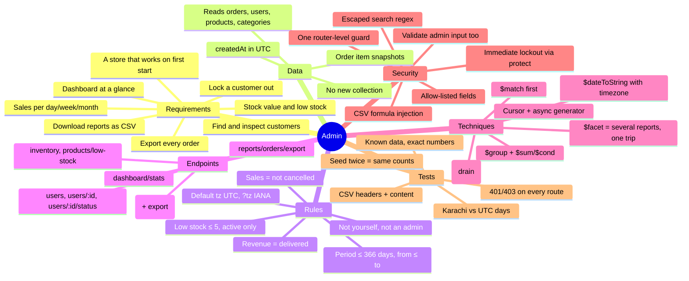

# Mind map – 10 Admin

## Thinking steps (how this module was reasoned out)

1. **Who and what?** Only the **admin**. They need _answers_, not records: "how much did we sell?", "what's running out?", "who is this customer?". So the module mostly **reads and summarises**; the only write is a customer's `isActive` flag.
2. **Where does each number come from?**
   - Revenue → `orders.totalPrice` of **delivered** orders (pending ones may still be cancelled).
   - Sales report → **non-cancelled** orders (demand, including what's not delivered yet).
   - Top products → order **item snapshots** (name and price at sale time), not the live product.
   - Stock value → `price × stock` of **active** products.
     Writing these definitions down first prevents three screens showing three different "revenues".
3. **How do we compute them?** In the database, with **aggregation pipelines**: `$match` first (uses the `createdAt` index), then `$group`. When several reports share the same input, one `$facet` runs them all in a single round trip. Independent dashboard numbers run in parallel with `Promise.all`.
4. **Which day is an order on?** MongoDB stores UTC; people think in local days. `?tz=` (IANA name) controls both the period boundaries (`startOfDayInZone`) and the buckets (`$dateToString … timezone`). The default `UTC` keeps the reference's numbers.
5. **What could hurt the database?** "All orders since 1970", `?limit=1000000`, a regex like `(((((`. So: max 366-day period, max page size 100, escaped search, a hard cap on low-stock rows. Admin input is validated like any other input.
6. **Files, not just JSON.** Spreadsheet users want CSV. Small report → build a string. Possibly huge order list → **stream** it from a cursor through an async generator, respecting backpressure. Validate **before** the first byte, because a sent 200 can't become a 400. Defuse **formula injection**, because customers control their names.
7. **Customer management = least privilege.** Customers only (admins → 404), never yourself, never another admin. Deactivation must bite **immediately**: `protect` already reloads the user on every request, so a deactivated customer's token gets 403 with no extra code.
8. **First start.** An empty shop teaches nothing. `npm run seed` creates the admin, categories, 30 products and coupons, and is **idempotent** (natural keys, insert-only) so it can run any number of times.
9. **Make it testable.** Tests create tiny known data sets and assert exact numbers. The seed exposes `seedStore()`, and the period logic is a pure function (`resolvePeriod`) with unit tests.

## Decision log

| Decision                                         | Why                                                                 | Trade-off                                                             |
| ------------------------------------------------ | ------------------------------------------------------------------- | --------------------------------------------------------------------- |
| Revenue = delivered; sales = not cancelled       | Matches the reference; "sure money" vs "demand"                     | Two definitions to explain (done in docs and OpenAPI)                 |
| `$facet` for the sales report and inventory      | One round trip; the input is filtered once                          | A `$facet` result must fit in one 16 MB document (fine for summaries) |
| Optional `tz`, default `UTC`                     | Same numbers as the reference; correct local days on request        | Clients must pass `tz` to get local days                              |
| Calendar-day `from`/`to` (no times)              | Reports cover whole days; simpler validation                        | No "last 6 hours" report                                              |
| 400 for unknown `range`/`groupBy`/`limit`        | Bugs surface instead of silently wrong charts                       | Stricter than the reference                                           |
| Streamed orders CSV via cursor + async generator | Flat memory for any export size                                     | Errors after the first byte can only abort the download               |
| UTF-8 BOM in CSV files                           | Excel shows non-ASCII names correctly                               | Some tools show the BOM as a stray character                          |
| Customer management in the admin module          | All admin-only logic in one folder; users module stays "my account" | Reference had it in `users` (route URLs are identical)                |
| Admin id on `/admin/users/:id` → 404             | Customer screens are for customers (least privilege)                | Admins can't view other admins here                                   |
| Self/admin status change → 400                   | Same as the reference; avoids lockouts                              | 403 could also be argued                                              |
| Seed: "exists → skip, else create"               | Idempotent, validated, hooks run, admin edits survive               | A changed seed row doesn't update existing data (by design)           |
| Low-stock list in admin with `?threshold`        | Admin-only feature; flexible                                        | Overlaps with products module in the reference (merge at stacking)    |

## Now read

- The module guide: [docs/modules/10-admin.md](../modules/10-admin.md)
- The concept: [24 – Reporting: aggregation, time zones, CSV, admin lists, seeding](../concepts/24-reporting-aggregation-and-csv.md)
- Then the code in build order: `config/constants.js` → `utils/dates.js` → `utils/csv.js` → `admin.validation.js` → `admin.service.js` → `admin.controller.js` → `admin.routes.js` → `app.js` → `admin.docs.js` → `db/scripts/seed.js`
