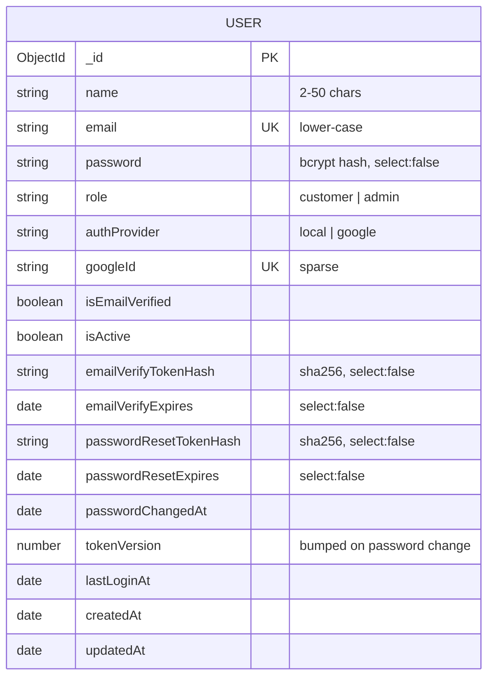
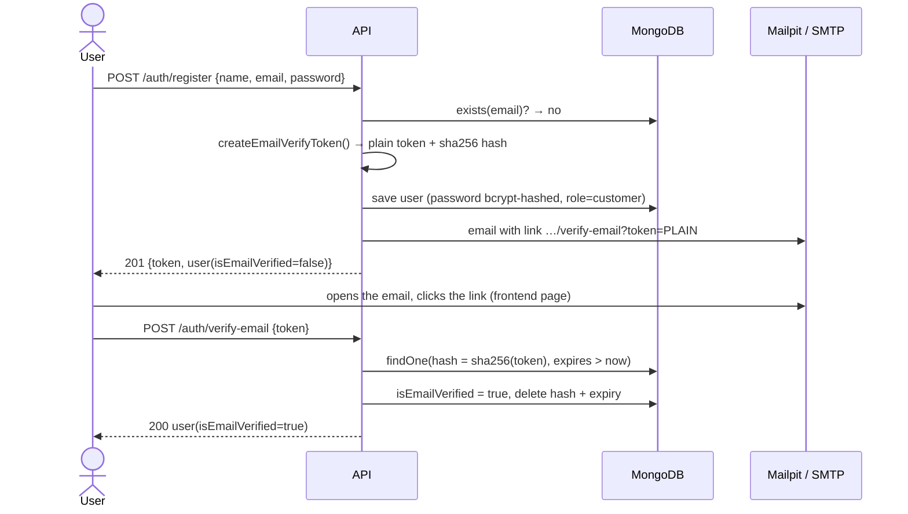
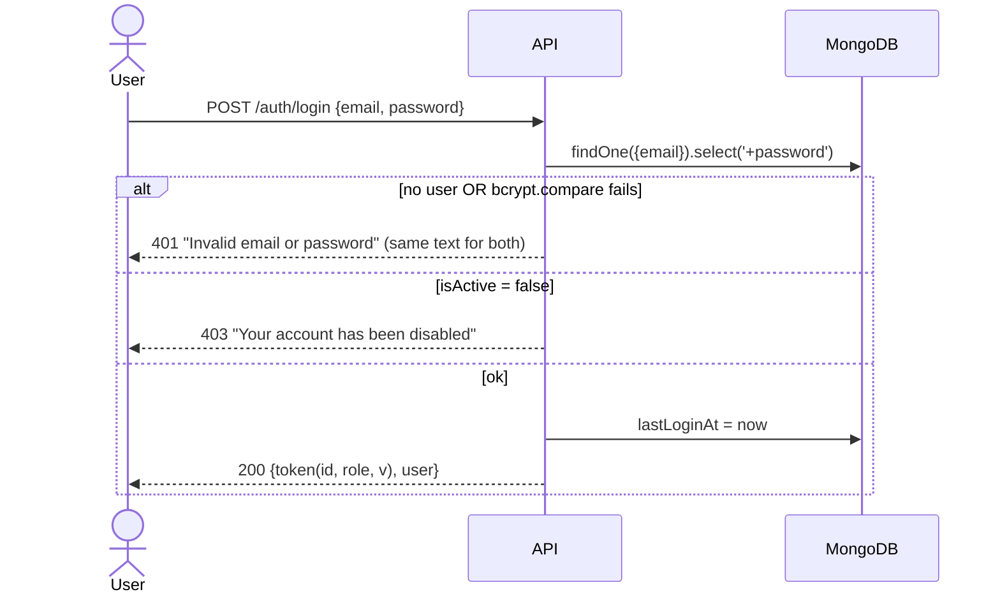
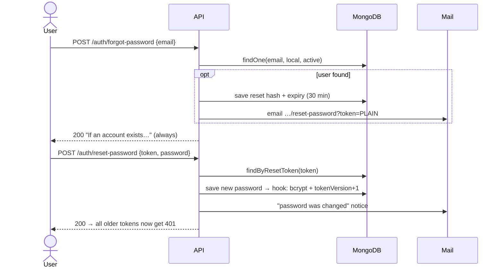
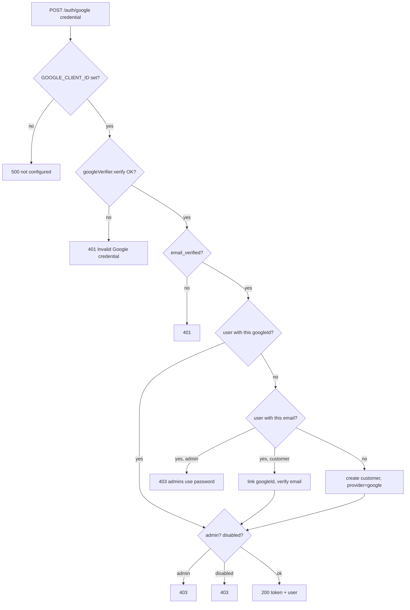
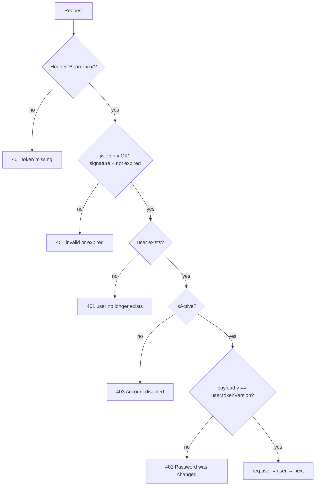

# Module 01 – Authentication & Authorization

**Branch:** `main` · **Folders:** `server/src/modules/auth`, `server/src/modules/users`, `server/src/middleware/auth.middleware.js`

This module lets people create an account, prove who they are, and get a token. Every later module uses its guards (`protect`, `authorize`, `requireVerifiedEmail`).

## Endpoints

All paths start with `/api`. "Limiter" = rate limit per IP.

| Method | Path | Access | Limiter | Success | Errors |
|---|---|---|---|---|---|
| POST | `/auth/register` | public | auth (10/15 min) | 201 `{token, user}` | 400, 409, 429 |
| POST | `/auth/login` | public | auth | 200 `{token, user}` | 400, 401, 403 disabled, 429 |
| POST | `/auth/admin/login` | public (admins only pass) | adminLogin (5/15 min) | 200 `{token, user}` | 400, 401, 403 not admin, 429 |
| POST | `/auth/google` | public | auth | 200 `{token, user}` | 400, 401, 403, 500 not configured, 429 |
| POST | `/auth/logout` | logged in | – | 200 | 401 |
| GET | `/auth/me` | logged in | – | 200 user | 401, 403 |
| POST | `/auth/verify-email` | public (email link) | – | 200 user | 400 |
| POST | `/auth/resend-verification` | logged in | email (5/hour) | 200 | 400 already verified, 401, 429 |
| POST | `/auth/forgot-password` | public | email (5/hour) | 200 (always) | 400, 429 |
| POST | `/auth/reset-password` | public (email link) | auth | 200 | 400 |
| PUT | `/users/password` | logged in | – | 200 `{token}` (fresh) | 400, 401 |

Plus `GET /health`, `GET /docs` (Swagger UI) and `GET /docs.json` (OpenAPI spec). Every `/api` route also has the general limit of 300 requests / 15 min.

## Data model: User



| Field | Rules | Notes |
|---|---|---|
| `email` | required, unique, lower-case, regex | The login identity |
| `password` | required **only** if `authProvider = local` | Hashed in `pre('save')` |
| `role` | enum, default `customer` | Only the seed script makes admins |
| `googleId` | unique **sparse** | Google's `sub` id |
| `isActive` | default `true` | `false` blocks login and `protect` |
| token hash fields | hidden | Plain token goes by email only |
| `tokenVersion` | default `0` | JWT field `v` must equal it |

Indexes: `email` (unique), `googleId` (unique sparse), `role`, `emailVerifyTokenHash` (sparse), `passwordResetTokenHash` (sparse).

Methods: `comparePassword`, `isTokenOutdated`, `createEmailVerifyToken`, `createPasswordResetToken`. Statics: `findByEmailToken`, `findByResetToken`.

## Flows

### Register + verify email


### Login


### Forgot + reset password


### Google sign-in


### The `protect` decision


## Files map

| File | Role |
|---|---|
| `modules/users/user.model.js` | User schema, hooks, methods, indexes |
| `modules/auth/auth.validation.js` | Input rules (+ shared `passwordRule`) |
| `modules/auth/auth.service.js` | Register, login, verify, resend, forgot, reset, Google |
| `modules/auth/google.verifier.js` | Boundary to Google (stubbed in tests) |
| `modules/auth/auth.controller.js` | HTTP → service → `sendSuccess` |
| `modules/auth/auth.routes.js` | URLs + limiters + validation + `protect` |
| `modules/auth/auth.docs.js` | OpenAPI for auth routes (users routes moved to `user.docs.js` in branch 02) |
| `modules/users/user.{validation,service,controller,routes}.js` | Change password |
| `middleware/auth.middleware.js` | `protect`, `authorize`, `requireVerifiedEmail` |
| `emails/templates.js`, `emails/sendEmail.js` | Email content and sending |
| `utils/generateToken.js` | Signs the JWT |
| `db/scripts/seedAdmin.js` | Creates the admin |

## How to test

```bash
cd server
npm test                                  # everything
npm run test:unit                         # model/middleware/utils
npm run test:integration                  # all routes
npm test -- tests/integration/auth.test.js
npm test -- -t "reset"                    # only tests whose name contains "reset"
npm run test:coverage                     # with coverage report
```

Manual / E2E (server + Mailpit running, admin seeded, `RATE_LIMIT_ENABLED=false`):
- **Postman**: import `server/postman/*.json`, choose environment "ShopEase – local", run folder **01 Auth** in the Runner, or `npm run test:api`.
- **Bruno**: open the `server/bruno` folder, select env **local**, run folder **01 Auth**, or `npm run test:bruno`.
- **Swagger**: http://localhost:5000/api/docs

Details: [docs/testing/README.md](../testing/README.md).

## Exercises

1. **Account lockout.** After 5 wrong passwords, lock the account for 15 minutes (store `failedLogins`, `lockUntil`). Write the tests first.
2. **Logout everywhere.** Add `POST /api/auth/logout-all`, which bumps `tokenVersion`. Test that old tokens get 401.
3. **Stronger policy.** Require one uppercase letter. Which file changes? Which tests fail? Fix them.
4. **Break it on purpose.** Remove `role: 'customer'` from `registerUser` and send `role: 'admin'`. Which test catches it?
5. **Read the bug.** Check out the original `changedPasswordAfter` idea in [05-jwt-and-sessions](../concepts/05-jwt-and-sessions.md) and explain to a friend why a counter is safer.
