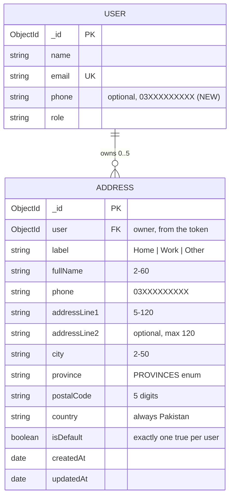
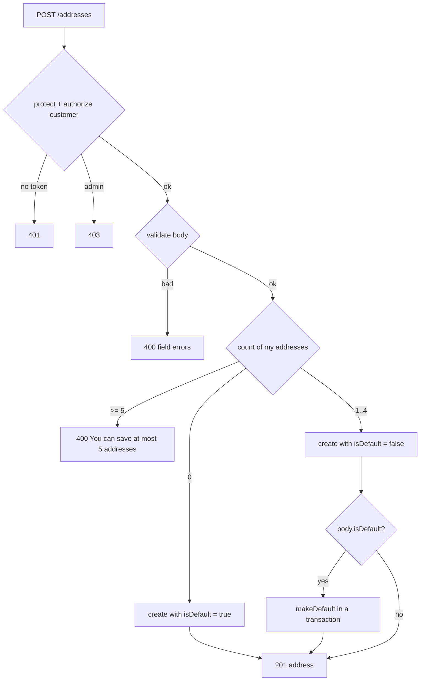
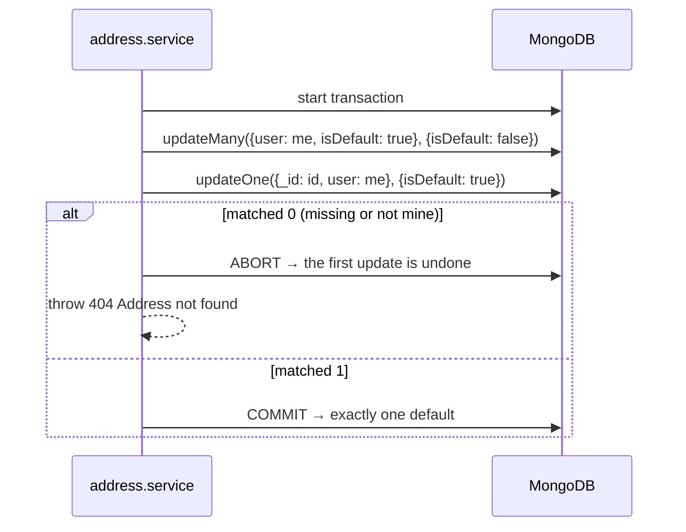
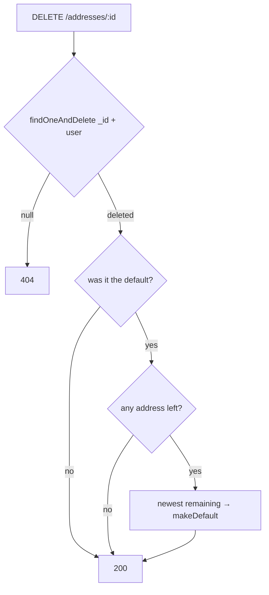
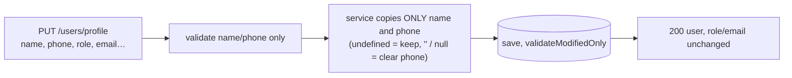

# Module 02 – Profile & Addresses

**Branch:** `02-profile-addresses` (from `main`) · **Folders:** `server/src/modules/users`, `server/src/modules/addresses`

A logged-in user can see and edit their **profile** (name, phone). A **customer** keeps up to five **delivery addresses**, and exactly one of them is the default for checkout. The new idea in this branch is **ownership**: a customer can only ever see or change *their own* addresses. See [concept 14](../concepts/14-authorization-ownership.md).

```bash
git diff main..02-profile-addresses --stat     # everything this branch added
git log --oneline main..02-profile-addresses   # the commits, in build order
```

## Endpoints

All paths start with `/api`. Every route needs `Authorization: Bearer <token>`.

| Method | Path | Access | Body | Success | Errors |
|---|---|---|---|---|---|
| GET | `/users/profile` | logged in (any role) | – | 200 user | 401 |
| PUT | `/users/profile` | logged in (any role) | `{ name?, phone? }` | 200 user | 400, 401 |
| PUT | `/users/password` | logged in | *(unchanged from 01)* | 200 `{token}` | 400, 401 |
| GET | `/addresses` | customer | – | 200 `[address]` (default first, then newest) | 401, 403 |
| POST | `/addresses` | customer | address | 201 address | 400 (incl. "at most 5"), 401, 403 |
| PUT | `/addresses/:id` | customer, **owner** | address | 200 address | 400, 401, 403, 404 |
| DELETE | `/addresses/:id` | customer, **owner** | – | 200 `data: null` | 400, 401, 403, 404 |
| PATCH | `/addresses/:id/default` | customer, **owner** | – | 200 `[address]` (updated list) | 400, 401, 403, 404 |

- **400 "Invalid id"**: `:id` isn't a 24-character ObjectId (`validateObjectId`).
- **403**: an admin calls an address route (customers only), or the account is disabled.
- **404**: the address doesn't exist **or belongs to someone else**. Both get the same answer on purpose.

Address body:

```json
{
  "label": "Home",
  "fullName": "Ali Khan",
  "phone": "03001234567",
  "addressLine1": "House 12, Street 4, Gulberg III",
  "addressLine2": "Near Liberty Market",
  "city": "Lahore",
  "province": "Punjab",
  "postalCode": "54000",
  "isDefault": true
}
```

| Field | Rule |
|---|---|
| `label` | optional, `Home` · `Work` · `Other` (default `Home`) |
| `fullName` | 2–60 chars |
| `phone` | `03XXXXXXXXX` (`REGEX.PK_PHONE`) |
| `addressLine1` | 5–120 chars |
| `addressLine2` | optional, max 120 |
| `city` | 2–50 chars |
| `province` | one of `PROVINCES`: Punjab, Sindh, KPK, Balochistan, Islamabad, GB, AJK |
| `postalCode` | 5 digits (`REGEX.POSTAL_CODE`) |
| `isDefault` | optional boolean: `true` = make this the default |
| `user`, `country`, `_id` | **ignored** if sent (owner comes from the token, country is always Pakistan) |

Profile body: `name` (2–50) and/or `phone` (`03XXXXXXXXX`; `""` or `null` removes it). Everything else (`email`, `role`, `isEmailVerified`, `isActive`, `password`…) is **ignored**.

## Data model



Indexes on `addresses`:

| Index | Why |
|---|---|
| `{ user: 1, createdAt: -1 }` | "my addresses, newest first" |
| `{ user: 1 }` **unique, partial** where `isDefault: true` (name `one_default_address_per_user`) | MongoDB itself refuses a second default for the same user. Non-default addresses aren't in this index at all |

## Flows

### Create an address


### Make an address the default (transaction)


Order matters: **unset first, then set**. In the other order, the unique partial index would see two defaults for a moment and refuse the write.

### Delete


### Update profile


## Files map

| File | Role |
|---|---|
| `config/constants.js` | `PROVINCES`, `ADDRESS_LABELS`, `LIMITS.MAX_ADDRESSES`, `REGEX.PK_PHONE`, `REGEX.POSTAL_CODE` |
| `middleware/validate.middleware.js` | **new** `validateObjectId(...names)` |
| `modules/users/user.model.js` | **new** optional `phone` |
| `modules/users/user.{validation,service,controller,routes}.js` | **new** `updateProfileRules`, `updateProfile`, `getProfile` + 2 routes |
| `modules/users/user.docs.js` | **new**: OpenAPI for `/users/*` (moved out of `auth.docs.js`) |
| `modules/addresses/address.model.js` | Schema, indexes (incl. the unique partial one) |
| `modules/addresses/address.validation.js` | `addressRules` |
| `modules/addresses/address.service.js` | list, create, update, delete, setDefault; `makeDefault` transaction; ownership in every query |
| `modules/addresses/address.controller.js` | Thin HTTP handlers |
| `modules/addresses/address.routes.js` | `protect`, `authorize('customer')`, `validateObjectId`, `validate` |
| `modules/addresses/address.docs.js` | OpenAPI for `/addresses/*` |
| `modules/models.js`, `app.js`, `docs/openapi.js` | One line each to plug the module in |

## How to test

```bash
cd server
npm test -- tests/integration/addresses.test.js
npm test -- tests/integration/profile.test.js
npm test -- tests/unit/address.model.test.js tests/unit/validateObjectId.test.js
npm test -- -t "IDOR"                  # only the ownership tests
npm run test:coverage
```

Manual / E2E (server + Mailpit running, admin seeded, `RATE_LIMIT_ENABLED=false`):
- **Postman**: run folder **02 Profile & Addresses** (`npm run test:api` runs every folder). It registers and verifies its own customer, so it doesn't depend on folder 01.
- **Bruno**: run folder **02 Profile & Addresses** (`npm run test:bruno`).
- **Swagger**: http://localhost:5000/api/docs → tags **Users** and **Addresses**.

## Differences from the reference app

| Reference | Here | Why |
|---|---|---|
| Max-5 check in the service **and** a model hook that threw a plain `Error` (→ 500) | Only in the service, as a 400 `ApiError` | One clear place. A 500 for a user mistake was wrong |
| "First address is default" in a `pre('validate')` hook | In the service (`isDefault: count === 0`) | Business rules live in services, and the count is already there |
| `Address.setDefault` static threw `Error` with `statusCode` | `makeDefault` in the service, using `connection.transaction()` and `ApiError(404)` | Services own business rules and errors; `transaction()` also retries |
| Sort by `createdAt` only | `createdAt` then `_id` | Stable order when two addresses share a millisecond |
| `mongoose.isValidObjectId` | `mongoose.isObjectIdOrHexString` | The first accepts any 12-character string |
| `validateObjectId` error had no `errors` | `errors: [{ field: 'id', message: 'Invalid id' }]` | Same shape as other validation errors (message unchanged) |
| `toSnapshot()` method on Address | not yet | Only orders use it, so it arrives in branch 07 |
| `avatar` on User | not yet | Needs uploads, branch 04 |
| Admin customer list/status in users module | not yet | Needs orders, branch 10 |

## Exercises

1. **Break ownership on purpose.** Replace `Address.findOne({ _id: id, user: userId })` in `updateAddress` with `Address.findById(id)`. Run the tests. Which ones fail? Undo it.
2. **Make the limit configurable.** Read `MAX_ADDRESSES` from an environment variable with a default of 5. Which files change? Write a test with a limit of 2.
3. **Partial address update.** Add `PATCH /api/addresses/:id` that accepts any subset of fields. Hint: make every rule `.optional()` in a second rules array.
4. **Race it.** Send 10 `POST /api/addresses` in parallel (`Promise.all`) for a new user. How many are saved? Why can it be more than 5? How would a transaction fix it?
5. **Phone verification (design only).** Sketch how you would verify the phone with an SMS code, reusing the hashed-token idea from branch 01.
