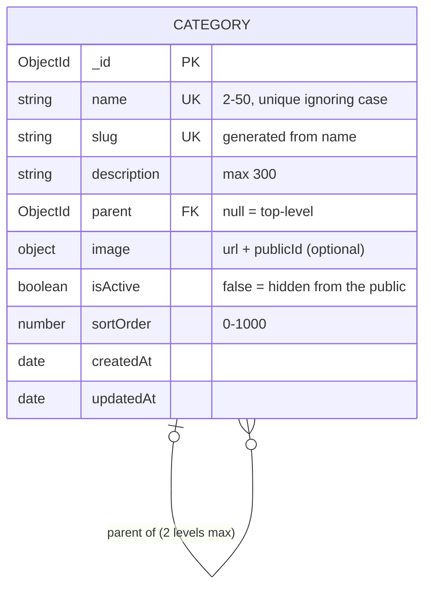
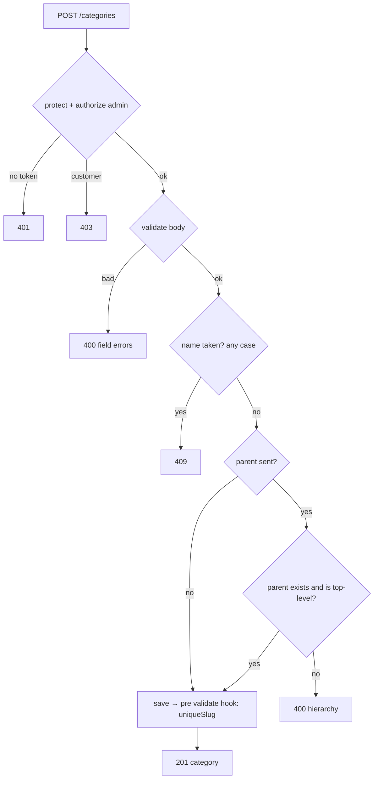
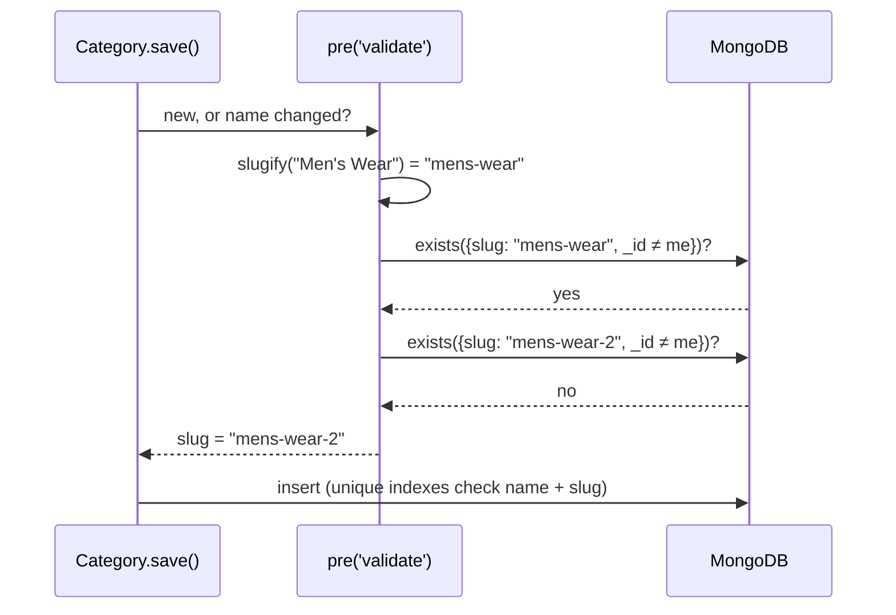
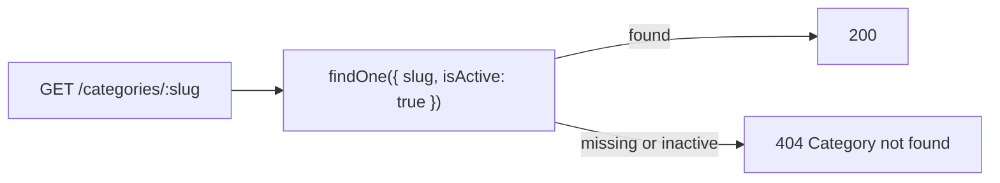
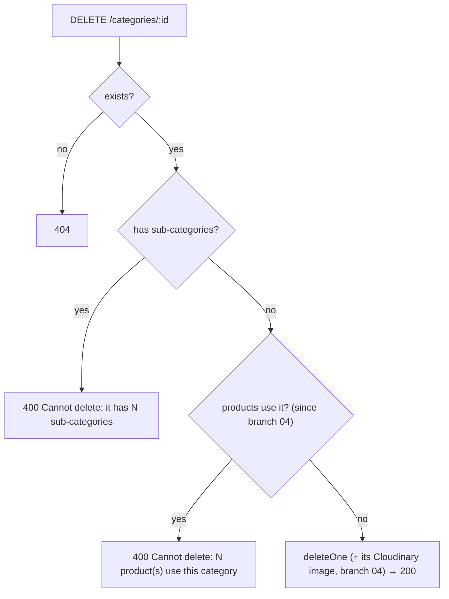

# Module 03 – Categories

**Branch:** `03-categories` (from `02-profile-addresses`) · **Folder:** `server/src/modules/categories`

Categories group the shop's products ("Electronics", "Men → Shoes"). Anyone can **read** them, without logging in. Only an **admin** can create, change or delete them. Two new ideas: **slugs** (readable URLs such as `/categories/mens-shoes`) and **public vs admin routes** on one resource. See [concept 15](../concepts/15-slugs-and-public-vs-admin-apis.md).

```bash
git diff 02-profile-addresses..03-categories --stat     # everything this branch added
git log --oneline 02-profile-addresses..03-categories   # the commits, in build order
```

## Endpoints

All paths start with `/api`.

| Method | Path                | Access     | Body                       | Success                                                    | Errors                                          |
| ------ | ------------------- | ---------- | -------------------------- | ---------------------------------------------------------- | ----------------------------------------------- |
| GET    | `/categories`       | **public** | –                          | 200 `[category]` (active only, by `sortOrder` then `name`) | –                                               |
| GET    | `/categories/:slug` | **public** | –                          | 200 category                                               | 404 (missing **or inactive**)                   |
| POST   | `/categories`       | admin      | category (`name` required) | 201 category                                               | 400, 401, 403, 409                              |
| PUT    | `/categories/:id`   | admin      | any subset of the fields   | 200 category                                               | 400, 401, 403, 404, 409                         |
| DELETE | `/categories/:id`   | admin      | –                          | 200 `data: null`                                           | 400 (incl. "has sub-categories"), 401, 403, 404 |

- **400 "Invalid id"**: `:id` isn't a 24-character ObjectId (`validateObjectId`).
- **400 hierarchy**: `Parent category not found`, `Only two category levels are allowed`, `A category cannot be its own parent`, `This category has sub-categories, so it cannot become a sub-category`.
- **401**: no or bad token on an admin route. **403**: a customer on an admin route.
- **409**: `A category with this name already exists` (same name in any upper/lower case). A race that slips past the check is caught by the unique index and is also a 409.

Category body:

```json
{
  "name": "Men's Shoes",
  "description": "Sneakers, formal shoes and sandals",
  "parent": "665f1c2e9b1e8a0012345680",
  "image": {
    "url": "https://res.cloudinary.com/demo/image/upload/v1/shopease/categories/shoes.jpg",
    "publicId": "shopease/categories/shoes"
  },
  "isActive": true,
  "sortOrder": 0
}
```

| Field                        | Rule                                                                                                 |
| ---------------------------- | ---------------------------------------------------------------------------------------------------- |
| `name`                       | 2–50 chars, trimmed, unique ignoring case. **Required on create**, optional on update                |
| `description`                | optional, max 300 (default `""`)                                                                     |
| `parent`                     | optional ObjectId of a **top-level** category. `null` / `""` = top-level                             |
| `image`                      | optional `{ url, publicId }`. `url` must start with `https://res.cloudinary.com/`. `null` removes it |
| `isActive`                   | optional boolean (default `true`). `false` hides it from the public                                  |
| `sortOrder`                  | optional integer 0–1000 (default 0). Lower comes first                                               |
| `slug`, `_id`, anything else | **ignored**. The slug is always generated from the name                                              |

## Data model



`children` is a **virtual**: not stored, filled on demand with `.populate('children')` ("categories whose `parent` is me").

Indexes on `categories`:

| Index                                                               | Why                                                           |
| ------------------------------------------------------------------- | ------------------------------------------------------------- |
| `{ name: 1 }` **unique**, collation `{ locale: 'en', strength: 2 }` | "Shoes" and "SHOES" can't both exist                          |
| `{ slug: 1 }` **unique**                                            | `GET /categories/:slug` finds exactly one; catches slug races |
| `{ parent: 1, sortOrder: 1 }`                                       | "children of X in menu order" and "does X have children?"     |

## Flows

### Create



### Slug generation (model hook)



### Public read



### Delete



## Files map

| File                                             | Role                                                                                                         |
| ------------------------------------------------ | ------------------------------------------------------------------------------------------------------------ |
| `config/constants.js`                            | **new** `REGEX.SLUG`, `REGEX.CLOUDINARY_URL`                                                                 |
| `db/utils/slugify.js`                            | **new** `slugify(text)` and `uniqueSlug(Model, base, excludeId)`                                             |
| `db/schemas/image.schema.js`                     | **new** reusable `{ url, publicId }` sub-schema (products reuse it in 04)                                    |
| `modules/categories/category.model.js`           | Schema, indexes, `children` virtual, slug hook, `CASE_INSENSITIVE` collation                                 |
| `modules/categories/category.validation.js`      | `createCategoryRules`, `updateCategoryRules`                                                                 |
| `modules/categories/category.service.js`         | `listActive`, `getBySlug`, `createCategory`, `updateCategory`, `deleteCategory`; name check, two-level rules |
| `modules/categories/category.controller.js`      | Thin HTTP handlers                                                                                           |
| `modules/categories/category.routes.js`          | Public GETs; `protect` + `authorize('admin')` on writes                                                      |
| `modules/categories/category.docs.js`            | OpenAPI for `/categories/*`                                                                                  |
| `modules/models.js`, `app.js`, `docs/openapi.js` | One line each to plug the module in (+ shared `Category`/`Image` schemas)                                    |

## How to test

```bash
cd server
npm test -- tests/integration/categories.test.js
npm test -- tests/unit/slugify.test.js tests/unit/category.model.test.js
npm test -- -t "slug"                 # only the slug tests
npm run test:coverage
```

Manual / E2E (server running, admin seeded, `RATE_LIMIT_ENABLED=false`, no email needed):

- **Postman**: run folder **03 Categories** (`npm run test:api` runs every folder). It logs in the admin, registers its own customer for the 403 checks, uses a unique name per run and deletes what it created.
- **Bruno**: run folder **03 Categories** (`npm run test:bruno`).
- **Swagger**: http://localhost:5000/api/docs → tag **Categories**.

## Differences from the reference app

| Reference                                                                           | Here                                                                                                                               | Why                                                                                      |
| ----------------------------------------------------------------------------------- | ---------------------------------------------------------------------------------------------------------------------------------- | ---------------------------------------------------------------------------------------- |
| Hierarchy checks in the model hook (plain `Error` → 500) **and** in the service     | Only in the service, as 400 `ApiError`s                                                                                            | A user mistake must not be a 500; one clear place                                        |
| Duplicate name only via the unique index (`name already exists`)                    | Service check with `A category with this name already exists` + `errors: [{ field: 'name' }]`; the index still catches races (409) | Friendlier message, same status                                                          |
| Schema-wide `collation` option                                                      | Collation only on the name index and the name query                                                                                | The schema option only applies when Mongoose creates the collection; explicit is clearer |
| `PUT` used the create rules (`name` required)                                       | `updateCategoryRules`: every field optional                                                                                        | "Switch off" can send just `{ isActive: false }`. Full bodies still work                 |
| `image` rules didn't require `url`/`publicId` together                              | Both required when an image object is sent                                                                                         | Otherwise a half image reached the model and failed later                                |
| `listActive`/`getBySlug` used `.lean()`                                             | Full documents                                                                                                                     | `.lean()` skips the toJSON plugin, so `__v` leaked                                       |
| `deleteCategory` counted products; delete/update removed old images from Cloudinary | Added in branch 04 (`Product` count → 400, `deleteImage` on replace/remove/delete)                                                 | No `Product` model and no Cloudinary SDK yet                                             |
| `adminList` with product counts (`/api/admin/categories`)                           | `listAllWithCounts()` added in branch 04, mounted by the admin module (10)                                                         | Needs products (04) and the admin module (10)                                            |

## Exercises

1. **Break the case rule.** Remove `collation` from the name index and from `assertNameFree`. Which tests fail? Why does "SHOES" now get in?
2. **Nested response.** Add `GET /api/categories/tree` that returns top-level categories with their `children` populated (active only). Hint: `.populate({ path: 'children', match: { isActive: true } })`, and register the route **before** `/:slug`, or Express treats `tree` as a slug.
3. **Redirect old slugs.** Store previous slugs in `oldSlugs: [String]`. When `GET /:slug` finds a category by an old slug, answer `301` with the new URL. Write the test first.
4. **Deeper trees (design only).** What would you change to allow three levels? Look at `checkParent`. How would you stop loops (A → B → A) at any depth?
5. **Race it.** Send 5 `POST /api/categories` with the name "Race" in parallel. How many succeed? Which line of code (or index) stops the rest?
