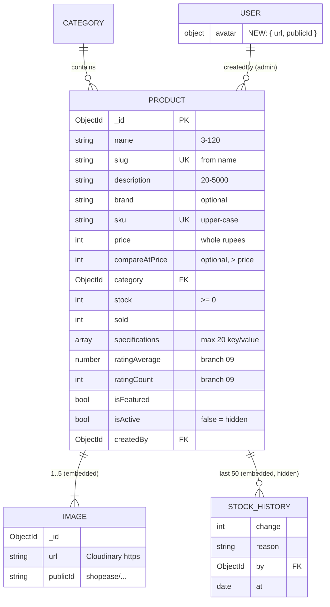
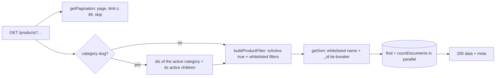
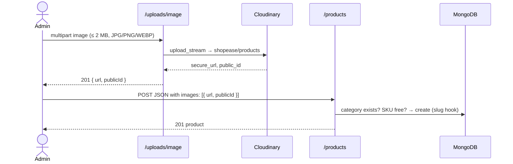
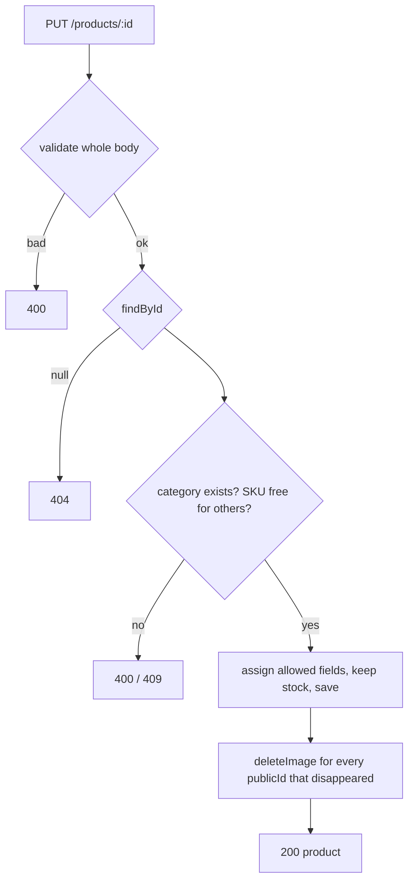
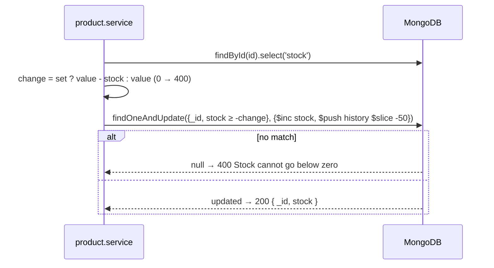

# Module 04 – Products & Uploads

**Branch:** `04-products-uploads` (from `03-categories`) · **Folders:** `server/src/modules/products`, `server/src/modules/uploads`

The shop gets its **catalogue**. Anyone can browse products with filters, keyword search, sorting and pagination. Admins create and edit products, upload pictures to **Cloudinary**, and correct stock with a reason that is kept in a history. New ideas: [16 – Catalog queries](../concepts/16-catalog-queries.md) (pagination, filtering, sorting, text search, indexes, atomic stock) and [17 – File uploads and a CDN](../concepts/17-file-uploads-and-cdn.md) (multipart, multer, Cloudinary, testable external services).

```bash
git diff 03-categories..04-products-uploads --stat     # everything this branch added
git log --oneline 03-categories..04-products-uploads   # the commits, in build order
```

## Endpoints

All paths start with `/api`.

| Method | Path                                         | Access | Body / query                                                                                   | Success                                                        | Errors                                                                                                             |
| ------ | -------------------------------------------- | ------ | ---------------------------------------------------------------------------------------------- | -------------------------------------------------------------- | ------------------------------------------------------------------------------------------------------------------ |
| GET    | `/products`                                  | public | `keyword, category, minPrice, maxPrice, rating, inStock, isFeatured, brand, sort, page, limit` | 200 `[card]` + `meta`                                          | –                                                                                                                  |
| GET    | `/products/brands`                           | public | –                                                                                              | 200 `["Adidas", …]`                                            | –                                                                                                                  |
| GET    | `/products/:slug`                            | public | –                                                                                              | 200 product (category populated, `inStock`, `discountPercent`) | 404 (missing **or inactive**)                                                                                      |
| POST   | `/products`                                  | admin  | product                                                                                        | 201 product                                                    | 400, 401, 403, 409 SKU                                                                                             |
| PUT    | `/products/:id`                              | admin  | product (whole)                                                                                | 200 product                                                    | 400, 401, 403, 404, 409 SKU                                                                                        |
| DELETE | `/products/:id`                              | admin  | –                                                                                              | 200 `{ softDeleted }` (true = hidden, used in orders)          | 400, 401, 403, 404                                                                                                 |
| DELETE | `/products/:id/images/:imageId`              | admin  | –                                                                                              | 200 product                                                    | 400 (bad id / last image), 401, 403, 404                                                                           |
| PATCH  | `/products/:id/stock`                        | admin  | `{ mode, value, reason }`                                                                      | 200 `{ _id, stock }`                                           | 400 (below zero / no change), 401, 403, 404                                                                        |
| POST   | `/uploads/image?folder=products\|categories` | admin  | multipart, field `image`                                                                       | 201 `{ url, publicId }`                                        | 400 (no file, type, > 2 MB, 2 files, wrong field, folder), 401, 403, 500 (not configured), 502 (Cloudinary failed) |
| DELETE | `/uploads/image`                             | admin  | `{ publicId: "shopease/…" }`                                                                   | 200 `{ deleted }`                                              | 400, 401, 403                                                                                                      |

Handlers for the **admin module (branch 10)** are ready in `product.controller.js`: `adminList` (all products, `search/category/status/sort=stock`), `lowStock` (stock ≤ 5) and `adminGet` (with stock history). Branch 10 mounts them at `/api/admin/products…`.

### List query

| Param                    | Meaning                                                                | Example        |
| ------------------------ | ---------------------------------------------------------------------- | -------------- |
| `keyword`                | text search (name 10×, brand 5×, description 1×; whole words, stems)   | `cotton shirt` |
| `category`               | category **slug**; a parent includes its sub-categories                | `men`          |
| `minPrice` / `maxPrice`  | inclusive range                                                        | `500` / `3000` |
| `rating`                 | minimum average rating                                                 | `4`            |
| `inStock` / `isFeatured` | `true` to switch on                                                    | `true`         |
| `brand`                  | exact, case-insensitive                                                | `khaadi`       |
| `sort`                   | `newest` (default) · `price_asc` · `price_desc` · `rating` · `popular` | `price_asc`    |
| `page` / `limit`         | page (from 1) / per page (default 12, max 48)                          | `2` / `12`     |

Anything else is ignored, and `isActive` can't be changed from the URL.

### Product body (create and update)

```json
{
  "name": "Blue Cotton Shirt",
  "description": "A soft, breathable cotton shirt for summer.",
  "brand": "Khaadi",
  "sku": "shirt-blu-m",
  "price": 1999,
  "compareAtPrice": 2500,
  "category": "665f1c2e9b1e8a0012345670",
  "stock": 20,
  "images": [
    {
      "url": "https://res.cloudinary.com/…/abc.jpg",
      "publicId": "shopease/products/abc"
    }
  ],
  "specifications": [{ "key": "Material", "value": "Cotton" }],
  "isFeatured": true,
  "isActive": true
}
```

| Field                                                                       | Rule                                                                                       |
| --------------------------------------------------------------------------- | ------------------------------------------------------------------------------------------ |
| `name`                                                                      | 3–120 chars → `slug` generated (`blue-cotton-shirt`, `-2` if taken), regenerated on rename |
| `description`                                                               | 20–5000 chars                                                                              |
| `brand`                                                                     | optional, max 50                                                                           |
| `sku`                                                                       | `REGEX.SKU` after upper-casing: A–Z, 0–9, `-`, 3–30. Unique → 409                          |
| `price`                                                                     | whole number 1 – 10,000,000                                                                |
| `compareAtPrice`                                                            | optional whole number **> price**; `""`/`null`/missing on update removes it                |
| `category`                                                                  | an existing category id → else 400                                                         |
| `stock`                                                                     | **create only**, whole number ≥ 0 (default 0). Ignored by `PUT`                            |
| `images`                                                                    | 1–5 items, `url` on `https://res.cloudinary.com/`, `publicId` required                     |
| `specifications`                                                            | optional, max 20, `key` ≤ 40, `value` ≤ 200                                                |
| `isFeatured`, `isActive`                                                    | optional booleans                                                                          |
| `slug`, `sold`, `ratingAverage`, `ratingCount`, `stockHistory`, `createdBy` | **ignored** if sent                                                                        |

### Stock body

| `mode`   | `value`      | Effect                                      |
| -------- | ------------ | ------------------------------------------- |
| `adjust` | `+20` / `-3` | add / subtract (400 if it would go below 0) |
| `set`    | `30`         | new total (history stores the difference)   |

`reason` (3–100 chars) is required and saved with the admin's id and the time.

## Data model



Indexes on `products`: `slug` unique, `sku` unique, `{isActive, createdAt}`, `{isActive, price}`, `{isActive, ratingAverage}`, `{isActive, sold}`, `{isActive, isFeatured}`, `{isActive, stock}`, `{category, isActive, price}` and the text index `product_text_search`. The reasons are in [concept 16](../concepts/16-catalog-queries.md#5-indexes-for-queries-match-the-index-to-the-list).

## Flows

### Public list



### Create a product with a picture



### Update and image clean-up



### Stock change (atomic)



## Files map

| File                                                                      | Role                                                                                                                                   |
| ------------------------------------------------------------------------- | -------------------------------------------------------------------------------------------------------------------------------------- |
| `config/constants.js`                                                     | `LIMITS.MAX_PRODUCT_IMAGES/MAX_SPECIFICATIONS/STOCK_HISTORY_KEEP/LOW_STOCK_THRESHOLD/MAX_IMAGE_BYTES`, `REGEX.SKU`, `IMAGE_MIME_TYPES` |
| `config/env.js`, `.env.example`                                           | optional `CLOUDINARY_CLOUD_NAME`, `CLOUDINARY_API_KEY`, `CLOUDINARY_API_SECRET`                                                        |
| `config/cloudinary.js`                                                    | `cloudinaryClient` (stubbable), `uploadBuffer`, `deleteImage`, `IMAGE_FOLDERS`                                                         |
| `middleware/upload.middleware.js`                                         | multer: memory storage, 1 file, 2 MB, JPG/PNG/WEBP                                                                                     |
| `middleware/error.middleware.js`                                          | `MulterError` → 400                                                                                                                    |
| `utils/pagination.js`                                                     | `getPagination`, `buildMeta`                                                                                                           |
| `modules/products/product.model.js`                                       | schema, virtuals, slug hook, indexes, `reserveStock`/`releaseStock`/`adjustStock`                                                      |
| `modules/products/product.query.js`                                       | `buildProductFilter`, `getSort`, `SORTS`, `escapeRegex`                                                                                |
| `modules/products/product.{validation,service,controller,routes,docs}.js` | the layers                                                                                                                             |
| `modules/uploads/upload.{validation,controller,routes,docs}.js`           | upload / delete an image                                                                                                               |
| `modules/categories/category.service.js`                                  | **edited**: delete refused while products use the category; old images deleted from Cloudinary; `listAllWithCounts`                    |
| `modules/users/user.model.js`, `modules/auth/auth.service.js`             | `avatar`, filled from the Google photo                                                                                                 |
| `modules/models.js`, `app.js`, `docs/openapi.js`                          | plug the modules in (`Product`, `Image`, `PageMeta` schemas)                                                                           |

## How to test

```bash
cd server
npm test -- tests/integration/products.test.js
npm test -- tests/integration/uploads.test.js tests/unit/cloudinary.test.js
npm test -- tests/integration/product.model.db.test.js -t "oversell"   # the stock race
npm test -- tests/unit/product.query.test.js tests/unit/pagination.test.js
npm run test:coverage
```

Manual / E2E (server running, admin seeded, `RATE_LIMIT_ENABLED=false`; Cloudinary keys optional):

- **Postman**: folder **04 Products & Uploads** (`npm run test:api`). It logs in the admin, registers its own customer, creates its own category and products and deletes them at the end.
- **Bruno**: folder **04 Products & Uploads** (`npm run test:bruno`).
- **Swagger**: http://localhost:5000/api/docs → tags **Products** and **Uploads**. The upload route shows a file picker.

## Differences from the reference app

| Reference                                                                        | Here                                                                                                               | Why                                     |
| -------------------------------------------------------------------------------- | ------------------------------------------------------------------------------------------------------------------ | --------------------------------------- |
| Duplicate SKU only caught by the unique index (409 "sku already exists")         | Friendly check first: 409 "A product with this SKU already exists" with `field: 'sku'` (index still the guarantee) | Clear message for the admin             |
| Sorts without a tie-breaker                                                      | Every sort ends with `_id`                                                                                         | Stable pagination                       |
| `compareAtPrice` validator also read update queries                              | Only document saves (the service always saves documents)                                                           | Simpler; one code path                  |
| No `{ isActive, price }` index                                                   | Added                                                                                                              | `sort=price_asc` on the whole catalogue |
| Upload routes written inline in `upload.routes.js`                               | `upload.controller.js` + `upload.validation.js`                                                                    | Same layers as every module             |
| `?folder=` unknown → silently products                                           | 400                                                                                                                | Typos are visible                       |
| `DELETE /uploads/image` accepted any publicId                                    | Must start with `shopease/` (400 otherwise)                                                                        | Can't delete other files of the account |
| `MulterError` mapping without `errors`                                           | `errors: [{ field, message }]`                                                                                     | Same shape as other 400s                |
| Cloudinary SDK called directly                                                   | Through `cloudinaryClient`                                                                                         | Offline tests                           |
| `deleteProduct` soft-deletes when orders exist; cleans carts, wishlists, reviews | Soft delete when orders exist (since 07); carts/wishlists cleaned (since 05); reviews deleted (since 09)           | Those modules don't exist yet           |
| Nested review routes in `product.routes.js`                                      | Added in branch 09 (nested routes)                                                                                 | –                                       |
| Brands sorted with `sort()`                                                      | `localeCompare`                                                                                                    | Correct A→Z for mixed case              |

## Exercises

1. **Relevance sort.** When `keyword` is set, add `sort=relevance` that sorts by `{ score: { $meta: 'textScore' } }`. Which test would you write first?
2. **Explain a query.** Run `Product.find({ isActive: true }).sort({ price: 1 }).explain('executionStats')` in a script. Find `IXSCAN`. Drop the `{ isActive, price }` index and compare.
3. **Keep old URLs.** Store previous slugs in `oldSlugs: [String]` and make `GET /products/:slug` find a product by an old slug too (and tell the frontend to redirect).
4. **Magic numbers.** In `upload.middleware.js`, also check that a PNG really starts with the bytes `89 50 4E 47`. Write the test with a fake `.png` that is actually text.
5. **Partial update.** Add `PATCH /api/products/:id` for `{ isActive }` only, so the admin can hide a product without sending the whole form.
