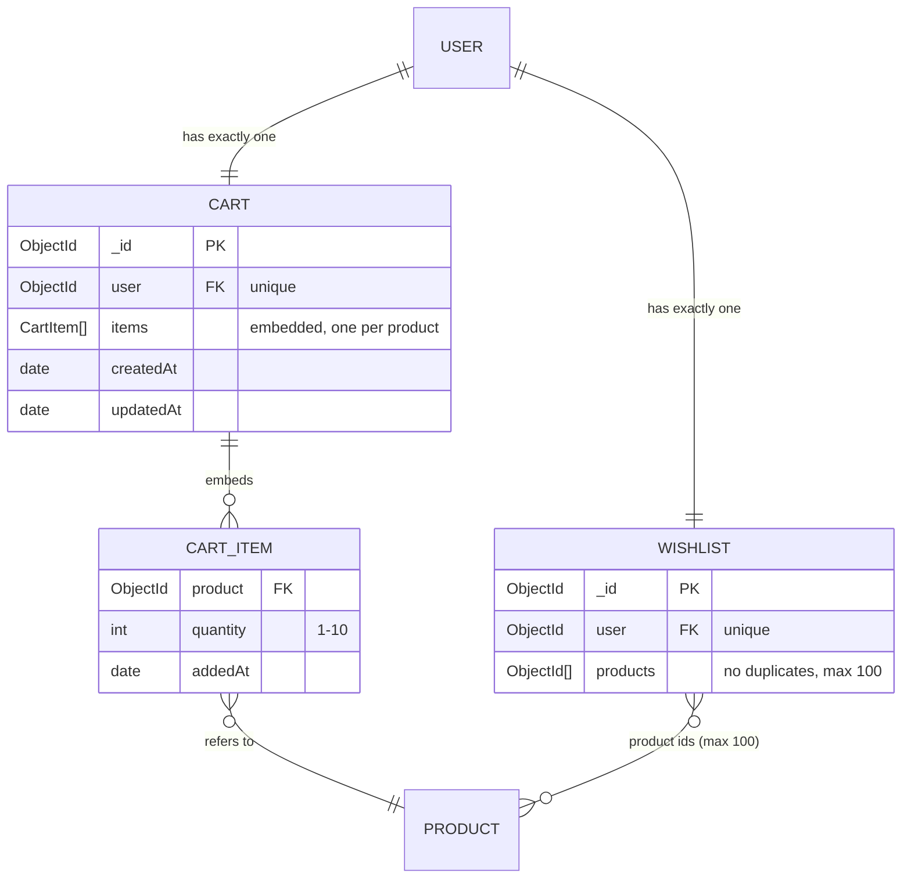
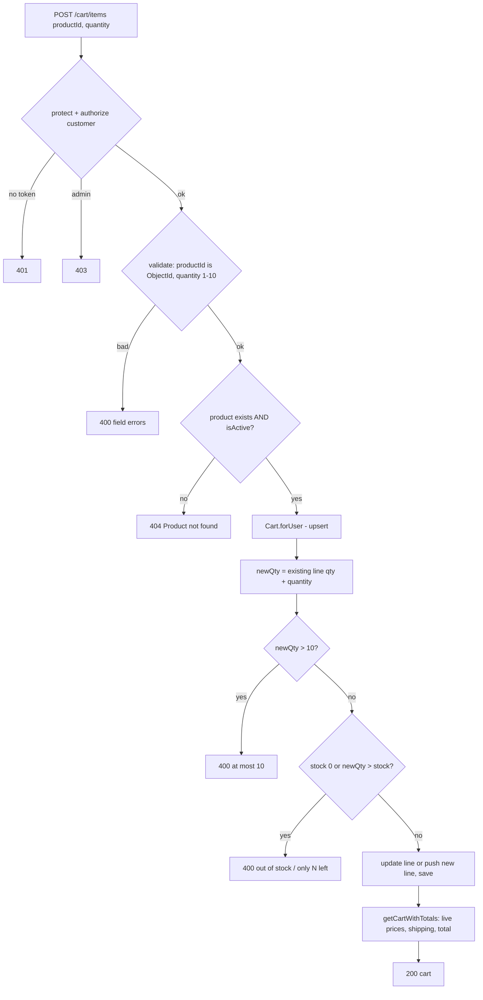
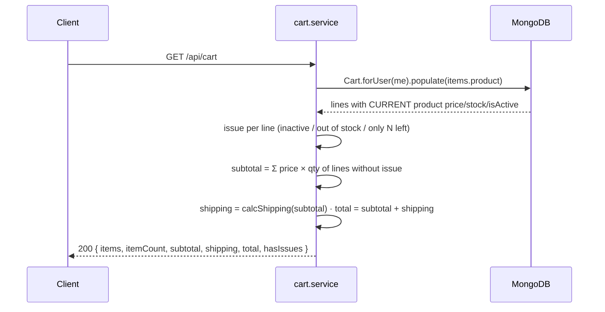
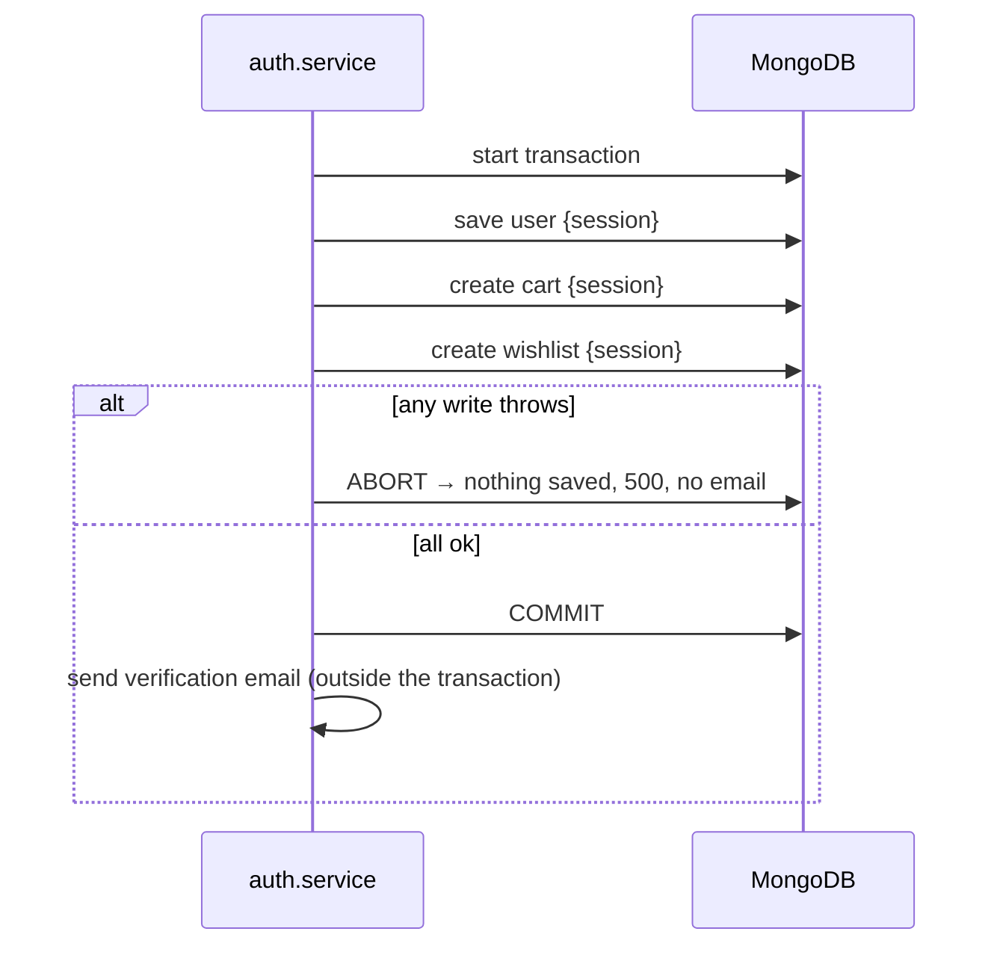
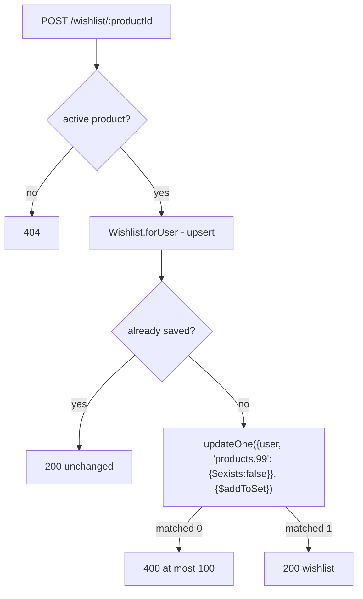

# Module 05 – Cart & Wishlist

**Branch:** `05-cart-wishlist` (from `04-products-uploads`) · **Folders:** `server/src/modules/cart`, `server/src/modules/wishlist`, `server/src/utils/pricing.js`

A **customer** puts products in a **cart** (with quantities) and saves products for later in a **wishlist**. The server reads every price from the database and calculates line totals, shipping and the total itself. Every new customer gets an empty cart and wishlist at sign-up, created in **one MongoDB transaction** with the user.

New ideas: **embedded sub-documents**, **server-side price calculation**, **transactions / atomicity**, **idempotent add**, **upserts**. See [concept 18](../concepts/18-transactions-and-atomic-updates.md).

```bash
git diff 04-products-uploads..05-cart-wishlist --stat     # everything this branch added
git log --oneline 04-products-uploads..05-cart-wishlist   # the commits, in build order
```

## Endpoints

All paths start with `/api`. Every route needs `Authorization: Bearer <token>` of a **customer** (admins get 403). There is no cart or wishlist id in any URL: "mine" always comes from the token.

| Method | Path                     | Body                      | Success                   | Errors                                                                                         |
| ------ | ------------------------ | ------------------------- | ------------------------- | ---------------------------------------------------------------------------------------------- |
| GET    | `/cart`                  | –                         | 200 cart                  | 401, 403                                                                                       |
| POST   | `/cart/items`            | `{ productId, quantity }` | 200 cart                  | 400 (validation, > 10 in total, > stock, sold out), 401, 403, 404 (unknown / inactive product) |
| PUT    | `/cart/items/:productId` | `{ quantity }`            | 200 cart                  | 400 (bad id, quantity, > stock), 401, 403, 404 (product unknown / inactive / not in my cart)   |
| DELETE | `/cart/items/:productId` | –                         | 200 cart (idempotent)     | 400 (bad id), 401, 403                                                                         |
| DELETE | `/cart`                  | –                         | 200 empty cart            | 401, 403                                                                                       |
| GET    | `/wishlist`              | –                         | 200 wishlist              | 401, 403                                                                                       |
| POST   | `/wishlist/:productId`   | –                         | 200 wishlist (idempotent) | 400 (bad id, already 100), 401, 403, 404 (unknown / inactive)                                  |
| DELETE | `/wishlist/:productId`   | –                         | 200 wishlist (idempotent) | 400 (bad id), 401, 403                                                                         |

The cart response (every number calculated on the server):

```json
{
  "items": [
    {
      "product": {
        "_id": "…",
        "name": "Ceramic Mug",
        "slug": "ceramic-mug",
        "price": 1200,
        "compareAtPrice": 1500,
        "image": "https://res.cloudinary.com/…",
        "stock": 20,
        "isActive": true
      },
      "quantity": 2,
      "lineTotal": 2400,
      "issue": null
    }
  ],
  "itemCount": 2,
  "subtotal": 2400,
  "shipping": 250,
  "total": 2650,
  "hasIssues": false,
  "freeShippingMin": 5000
}
```

The wishlist response: `{ "productIds": ["…"], "items": [ product cards ] }`.

### Business rules

| Rule                                                                                                                                                                                           | Where                                                                                                         |
| ---------------------------------------------------------------------------------------------------------------------------------------------------------------------------------------------- | ------------------------------------------------------------------------------------------------------------- |
| **BR-04** at most `LIMITS.MAX_CART_QTY` (10) of one product, and never more than its stock. Adding a product already in the cart **adds** the quantities, and the sum must respect both limits | `cart.validation.js` (1–10), `cart.service.js` `checkQuantity` (sum + stock), `cart.model.js` (1–10, integer) |
| One line per product                                                                                                                                                                           | `cart.service.js` (adds to the existing line) + array validator in `cart.model.js`                            |
| **Prices always from the database**; `price`/`total` in a request body are ignored; the cart stores no prices                                                                                  | `cart.service.js` `getCartWithTotals`                                                                         |
| **BR-02** shipping Rs 250, free from Rs 5,000 (inclusive); empty cart → 0                                                                                                                      | `utils/pricing.js` `calcShipping`                                                                             |
| **BR-01** whole rupees only                                                                                                                                                                    | product price is an integer; integer × integer                                                                |
| Inactive / sold-out products cannot be added (404 / 400)                                                                                                                                       | `cart.service.js` `loadActiveProduct`, `checkQuantity`                                                        |
| A line whose product became inactive, sold out or short of stock is **kept**, marked with `issue`, left out of the totals, and `hasIssues: true`                                               | `cart.service.js` `lineIssue`                                                                                 |
| A line whose product was **deleted** is removed on the next read                                                                                                                               | `cart.service.js`                                                                                             |
| Wishlist: no duplicates (idempotent add), max `LIMITS.MAX_WISHLIST` (100), inactive products hidden but kept                                                                                   | `wishlist.model.js`, `wishlist.service.js`                                                                    |
| Every new customer has exactly one cart and one wishlist, created **atomically** with the user                                                                                                 | `auth.service.js` `createUserWithCartAndWishlist` + unique index on `user`                                    |

## Data model



No price is stored anywhere in the cart. `itemCount` is a **virtual** on the model (computed, not stored).

Indexes: `{ user: 1 }` **unique** on both collections (one cart / one wishlist per user; also makes the upsert race-safe).

## Flows

### Add to cart



### Show the cart (server-side prices)



### Sign-up (transaction)



### Wishlist add (idempotent, atomic limit)



## Files map

| File                                                                                  | Role                                                                                                              |
| ------------------------------------------------------------------------------------- | ----------------------------------------------------------------------------------------------------------------- |
| `config/constants.js`                                                                 | **new** `LIMITS.MAX_CART_QTY`, `LIMITS.MAX_WISHLIST`, `PRICING` (`SHIPPING_FEE`, `FREE_SHIPPING_MIN`, `TAX_RATE`) |
| `utils/pricing.js`                                                                    | **new** `calcShipping`, `calcTotals` (pure, unit tested; `calcTotals` is used by orders in 07)                    |
| `modules/cart/cart.model.js`                                                          | Cart schema with embedded `cartItemSchema`, `itemCount` virtual, `Cart.forUser` upsert                            |
| `modules/cart/cart.validation.js`                                                     | `addItemRules`, `updateItemRules`                                                                                 |
| `modules/cart/cart.service.js`                                                        | `getCartWithTotals`, `addItem`, `updateItem`, `removeItem`, `clearCart`                                           |
| `modules/cart/cart.controller.js` / `cart.routes.js` / `cart.docs.js`                 | HTTP, routing (`protect`, `authorize('customer')`), OpenAPI                                                       |
| `modules/wishlist/wishlist.model.js`                                                  | Wishlist schema, `forUser` upsert, atomic `addProduct`, `removeProduct`                                           |
| `modules/wishlist/wishlist.service.js`                                                | `getWishlist`, `addProduct`, `removeProduct`                                                                      |
| `modules/wishlist/wishlist.controller.js` / `wishlist.routes.js` / `wishlist.docs.js` | HTTP, routing, OpenAPI                                                                                            |
| `modules/auth/auth.service.js`                                                        | `createUser` → **`createUserWithCartAndWishlist`** (transaction) for email and Google sign-up                     |
| `modules/models.js`, `app.js`, `docs/openapi.js`                                      | One/two lines each to plug the modules in                                                                         |

## How to test

```bash
cd server
npm test -- tests/integration/cart.test.js
npm test -- tests/integration/wishlist.test.js
npm test -- tests/integration/signupTransaction.test.js
npm test -- tests/unit/pricing.test.js tests/unit/cart.model.test.js
npm test -- -t "tampering"            # only the price-tampering test
npm run test:coverage
```

Test factories: `addToCart(user, product, quantity = 1)` and `createWishlist(user, products = [])` (both write directly to the database), plus `createProduct()` / `createCategory()` from branches 03/04.

Manual / E2E (server + Mailpit running, admin seeded, `RATE_LIMIT_ENABLED=false`):

- **Postman**: folder **05 Cart & Wishlist**. Self-contained: it registers and verifies its own customer (Mailpit search by recipient), logs in the seeded admin and creates a category and three products through the API.
- **Bruno**: folder **05 Cart & Wishlist** (`npm run test:bruno`).
- **Swagger**: http://localhost:5000/api/docs → tags **Cart** and **Wishlist**.

## Differences from the reference app

| Reference                                                                                                                      | Here                                                                                           | Why                                                             |
| ------------------------------------------------------------------------------------------------------------------------------ | ---------------------------------------------------------------------------------------------- | --------------------------------------------------------------- |
| Wishlist logic inside `wishlist.routes.js`                                                                                     | Model → service → controller → routes like every module                                        | Same anatomy everywhere; testable service                       |
| `Wishlist.addProduct` used an upsert with `$addToSet` and never checked `MAX_WISHLIST` (the validator does not run on updates) | `forUser` upsert, then atomic `updateOne` with `products.99: {$exists: false}` → 400 when full | The limit is really enforced, race-free                         |
| Quantity rule hard-coded `max: 10` in routes                                                                                   | `LIMITS.MAX_CART_QTY` everywhere                                                               | One place to change a business number                           |
| `session.withTransaction()` with manual `startSession/endSession`                                                              | `mongoose.connection.transaction()`                                                            | Same as branch 02; Mongoose also resets document state on retry |

## Exercises

1. **Break the transaction.** Remove `{ session }` from `Cart.create` in `auth.service.js`. Run `npm test -- signupTransaction`. Which assertion fails? Undo it.
2. **Merge guest carts.** Design `POST /api/cart/merge` that takes `[{ productId, quantity }]` from a browser's local storage after login. Which rules must it reuse? What if a line would exceed 10?
3. **Price-drop badge.** Store `priceWhenAdded` on each cart line (display only!) and show "price dropped" in the response. Why must it never be used for the total?
4. **Move to wishlist.** Add `POST /api/cart/items/:productId/move-to-wishlist`. Should it be a transaction? (Two documents change.)
5. **Race the wishlist.** Replace the atomic `addProduct` with "find, check length, push, save" and fire 5 parallel requests at a list with 98 items. Count the result.
