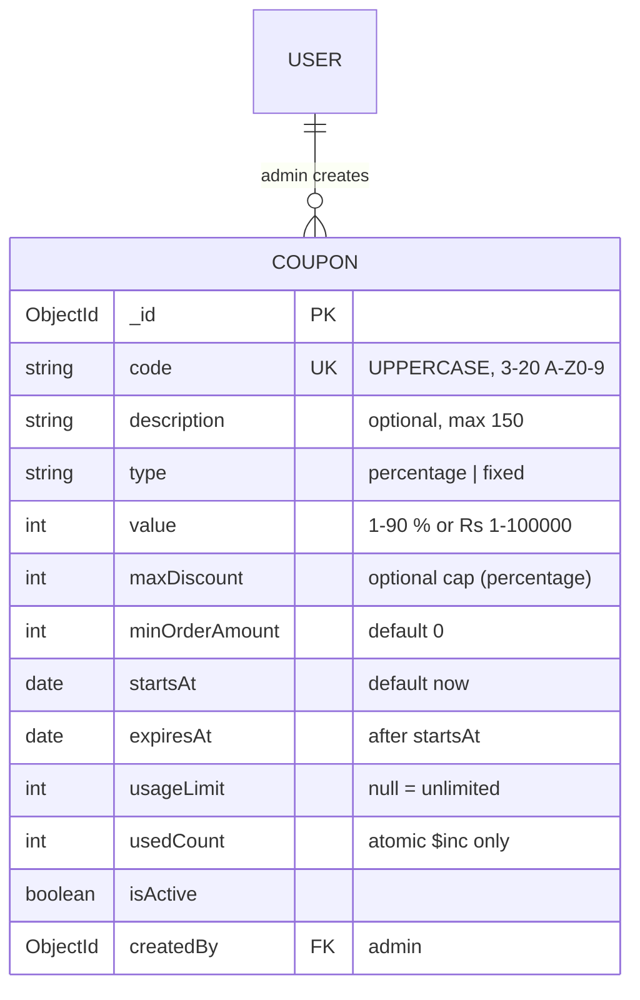
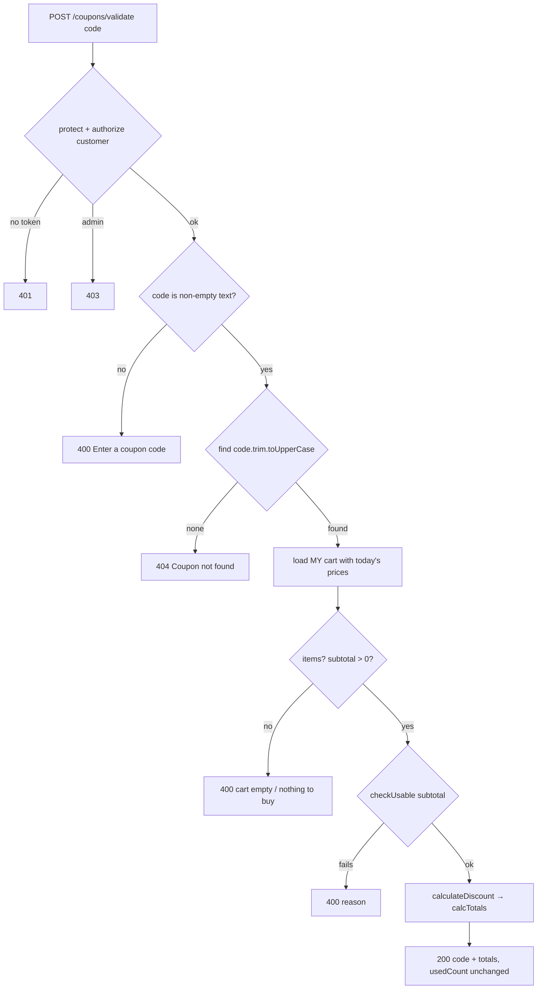
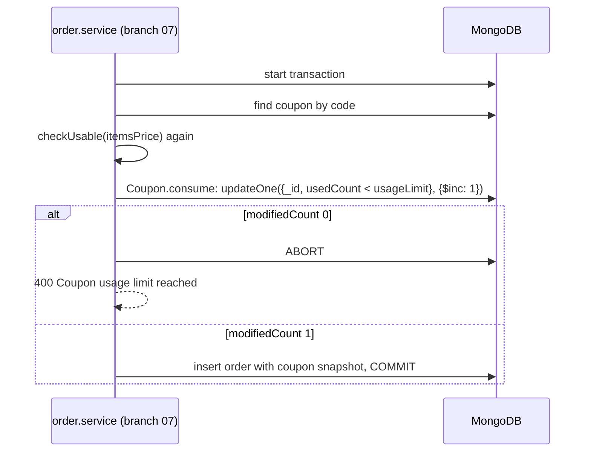
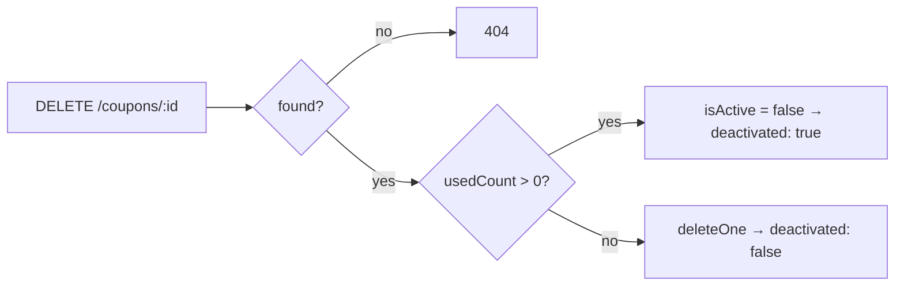

# Module 06 – Coupons

**Branch:** `06-coupons` (from `05-cart-wishlist`) · **Folder:** `server/src/modules/coupons`

Admins create **discount codes** (percentage or fixed amount) with a minimum order, an optional cap, a **validity window** and an optional **usage limit**. A customer can **preview** a code on their current cart and see the discount and the new totals. The coupon is only *used* when an order is placed (branch 07). New ideas in this branch: **integer money math**, **validity windows**, **case-insensitive codes** and **atomic counters** that survive race conditions. See [concept 19](../concepts/19-coupons-money-math-and-atomic-counters.md).

```bash
git diff 05-cart-wishlist..06-coupons --stat     # everything this branch added
git log --oneline 05-cart-wishlist..06-coupons   # the commits, in build order
```

## Endpoints

All paths start with `/api`. Every route needs `Authorization: Bearer <token>`.

| Method | Path | Access | Body | Success | Errors |
|---|---|---|---|---|---|
| POST | `/coupons/validate` | customer | `{ code }` | 200 code + totals | 400, 401, 403, 404 |
| GET | `/coupons` | admin | – | 200 `[coupon]` (newest first, with `state`) | 401, 403 |
| GET | `/coupons/:id` | admin | – | 200 coupon | 400, 401, 403, 404 |
| POST | `/coupons` | admin | coupon | 201 coupon | 400, 401, 403, **409** |
| PUT | `/coupons/:id` | admin | coupon (whole form) | 200 coupon | 400, 401, 403, 404, **409** |
| DELETE | `/coupons/:id` | admin | – | 200 `{ deactivated }` | 400, 401, 403, 404 |

- **400 on validate**: no code, empty cart, nothing in the cart can be bought, or the coupon can't be used: `Coupon is not active`, `Coupon is not active yet`, `Coupon expired`, `Coupon usage limit reached`, `Minimum order is Rs 3,000`.
- **404 on validate**: no coupon with that code (case and spaces don't matter).
- **409**: `Coupon code already exists` (also for `eid25` when `EID25` exists).
- **DELETE**: a coupon that was never used is deleted (`deactivated: false`). A used one is only **deactivated** (`deactivated: true`), so order history keeps it.

Preview response (`20%`, cap Rs 500, cart Rs 4,000):

```json
{
  "code": "EID20",
  "type": "percentage",
  "value": 20,
  "description": "Eid sale",
  "itemsPrice": 4000,
  "discountPrice": 500,
  "shippingPrice": 250,
  "taxPrice": 0,
  "totalPrice": 3750
}
```

Coupon body (admin):

| Field | Rule |
|---|---|
| `code` | 3–20 letters/digits (`REGEX.COUPON_CODE`), stored **UPPERCASE**, unique |
| `description` | optional, max 150 |
| `type` | `percentage` · `fixed` (`COUPON_TYPES`) |
| `value` | whole number: percentage 1–90, fixed Rs 1–100,000 (`LIMITS.COUPON_MAX_*`) |
| `maxDiscount` | optional whole number ≥ 1, caps a **percentage** discount; empty = no cap |
| `minOrderAmount` | optional whole number ≥ 0 (default 0) |
| `startsAt` | optional ISO date (default: now) |
| `expiresAt` | required ISO date, after `startsAt` |
| `usageLimit` | optional whole number ≥ 1; empty = unlimited |
| `isActive` | optional boolean (default `true`) |
| `usedCount`, `createdBy`, `_id` | **ignored** if sent (counter changes only at checkout, creator from the token) |

## Data model



`state` (virtual, in JSON): `disabled` → `used-up` → `scheduled` → `expired` → `active` (first match wins).

| Index | Why |
|---|---|
| `{ code: 1 }` **unique** | One coupon per code; stops duplicates even when two admins save at once |
| `{ isActive: 1, expiresAt: 1 }` | "Which coupons are running?" (dashboards, branch 10) |

Model API (shared with checkout in branch 07):

| Member | Does |
|---|---|
| `coupon.checkUsable(subtotal, now?)` | `{ ok: true }` or `{ ok: false, reason }` |
| `coupon.calculateDiscount(subtotal)` | whole-rupee discount: floor, cap, never above subtotal |
| `Coupon.consume(id, session?)` | atomic `usedCount + 1` only if under the limit → `true`/`false` |
| `Coupon.release(id, session?)` | atomic `usedCount − 1`, never below 0 |

## Flows

### Preview a coupon on my cart


### Use at checkout (branch 07, already built here)


### Delete


## Files map

| File | Role |
|---|---|
| `config/constants.js` | **new** `COUPON_TYPES`, `REGEX.COUPON_CODE`, `LIMITS.COUPON_MAX_PERCENT`, `LIMITS.COUPON_MAX_FIXED` |
| `utils/pricing.js` | **new** `calcTotals(itemsPrice, discountPrice)` |
| `modules/coupons/coupon.model.js` | Schema, indexes, `state` virtual, `checkUsable`, `calculateDiscount`, `consume`, `release` |
| `modules/coupons/coupon.validation.js` | `validateCouponRules`, `couponRules` |
| `modules/coupons/coupon.service.js` | `previewCoupon`, `listCoupons`, `getCoupon`, `createCoupon`, `updateCoupon`, `deleteCoupon` |
| `modules/coupons/coupon.controller.js` | Thin HTTP handlers |
| `modules/coupons/coupon.routes.js` | customer `POST /validate`; admin CRUD |
| `modules/coupons/coupon.docs.js` | OpenAPI for `/coupons/*` + the `Coupon` schema |
| `modules/models.js`, `app.js`, `docs/openapi.js` | One line each to plug the module in |

## How to test

```bash
cd server
npm test -- tests/unit/coupon.model.test.js        # discount math, windows, limits, calcTotals
npm test -- tests/integration/coupons.test.js      # every route
npm test -- -t "race"                              # the atomic counter under concurrency
npm run test:coverage
```

Manual / E2E (server + Mailpit running, admin seeded, `RATE_LIMIT_ENABLED=false`):
- **Postman**: folder **06 Coupons**. Self-contained: admin creates a category, a product and two coupons; a fresh customer registers and verifies (Mailpit search by address), fills the cart and previews coupons; the admin cleans up.
- **Bruno**: folder **06 Coupons** (`npm run test:bruno`).
- **Swagger**: http://localhost:5000/api/docs → tag **Coupons**.

## Differences from the reference app

| Reference | Here | Why |
|---|---|---|
| Admin CRUD at `/api/admin/coupons` (in `admin.routes.js`) | `/api/coupons` (GET, GET `:id`, POST, PUT, DELETE) | Each module owns its prefix; branch 10 can mount the same controllers under `/admin` |
| No "get one" route | `GET /api/coupons/:id` | The edit form can load one coupon |
| Duplicate code → generic `code already exists` (index only) | `Coupon code already exists` 409 from the service, index as safety net | Clearer message; the index still covers the race |
| Percentage/fixed limits hard-coded (90, 100,000) | `LIMITS.COUPON_MAX_PERCENT`, `LIMITS.COUPON_MAX_FIXED` | No magic numbers |
| Validation checked only `value ≥ 1` | Range per type + `expiresAt > startsAt` in validation | Field errors before the database |
| Preview accepted a cart whose items were all unavailable | 400 `Your cart has no items that can be bought` | A Rs 0 subtotal has nothing to discount |
| `deleteCoupon` also checks `Order.exists` | Same since branch 07 (`usedCount > 0` or an order references it → deactivate) | – |

## Exercises

1. **One use per customer.** In branch 07, refuse a code the customer already used on a non-cancelled order. Where does the check go: model, service or order service? Write the test first.
2. **Partial update.** Add `PATCH /api/coupons/:id/status` that only toggles `isActive`. Which rules does it need?
3. **Free shipping coupon.** Add a third type, `shipping`, that sets `shippingPrice` to 0. Which files change? (`COUPON_TYPES`, model validator, `calcTotals`…)
4. **Break the counter.** Replace `consume` with "find, check, `save()`" and run the race test. Explain the result with a timeline.
5. **Time travel.** Write a unit test that a coupon is usable at exactly `expiresAt` but not one millisecond later.
