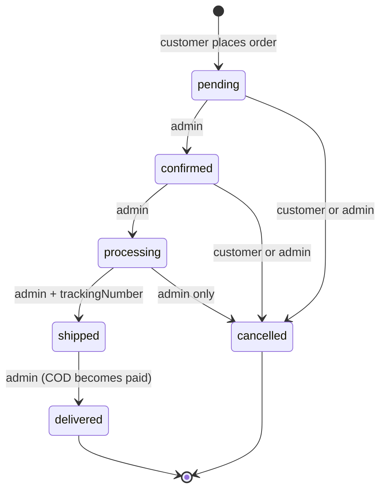
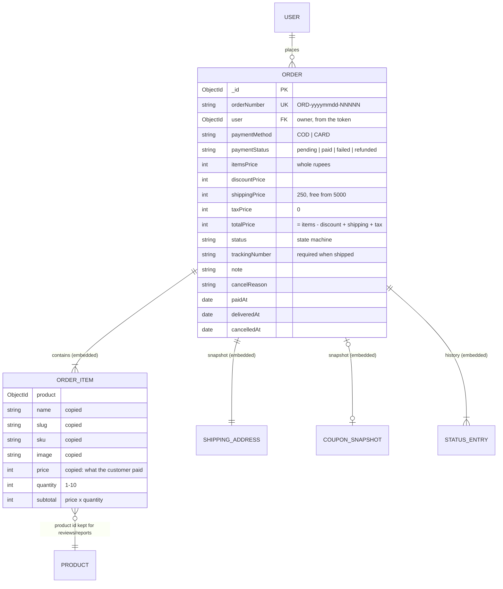
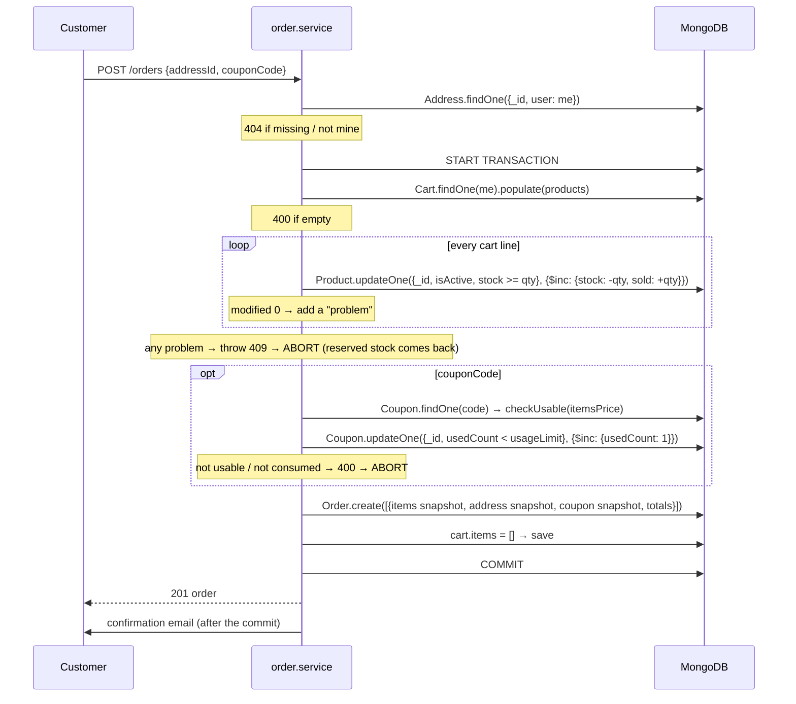
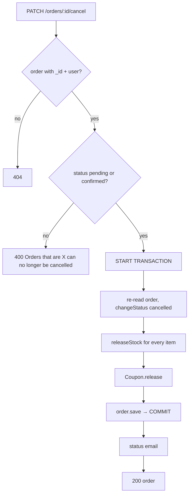

# Module 07 – Orders (checkout)

**Branch:** `07-orders` (from `06-coupons`) · **Folder:** `server/src/modules/orders`

A verified customer turns their cart into an **order**. This is the hardest module of the course, because one click changes four collections at once: the **products** lose stock, the **coupon** counts one more use, a new **order** is created and the **cart** is emptied. All four writes run inside one MongoDB **transaction**: they all happen or none of them do. Then the order moves through a small **state machine** (pending → confirmed → processing → shipped → delivered, or cancelled), driven by the admin. A customer may cancel early, and cancelling gives the stock and the coupon use back.

New ideas: [concept 20 – transactions, ACID and race conditions](../concepts/20-transactions-and-race-conditions.md) and [concept 21 – state machines and snapshots](../concepts/21-state-machines-and-snapshots.md).

```bash
git diff 06-coupons..07-orders --stat     # everything this branch added
git log --oneline 06-coupons..07-orders   # the commits, in build order
```

## Endpoints

All paths start with `/api`. Every route needs `Authorization: Bearer <token>`.

| Method | Path                       | Access                       | Body / query                                        | Success                              | Errors                  |
| ------ | -------------------------- | ---------------------------- | --------------------------------------------------- | ------------------------------------ | ----------------------- |
| POST   | `/orders`                  | customer, **verified email** | `{ addressId, paymentMethod?, couponCode?, note? }` | 201 order                            | 400, 401, 403, 404, 409 |
| GET    | `/orders/my`               | customer                     | `?page&limit&status`                                | 200 `[order summary]` + `meta`       | 400, 401, 403           |
| GET    | `/orders/:id`              | the **owner** or an admin    | –                                                   | 200 order (user + history populated) | 400, 401, 404           |
| PATCH  | `/orders/:id/cancel`       | customer, **owner**          | `{ reason? }`                                       | 200 order                            | 400, 401, 403, 404      |
| GET    | `/admin/orders`            | admin                        | `?page&limit&status&paymentStatus&from&to&search`   | 200 `[order summary]` + `meta`       | 400, 401, 403           |
| PATCH  | `/admin/orders/:id/status` | admin                        | `{ status, note?, trackingNumber? }`                | 200 order                            | 400, 401, 403, 404      |

- **403 on POST /orders**: an admin (customers only), **or** a customer whose email is not verified yet (`requireVerifiedEmail`, BR-12: "Please verify your email address to continue").
- **404**: the order (or the address) doesn't exist **or belongs to someone else**. Same answer on purpose (no IDOR, see [concept 14](../concepts/14-authorization-ownership.md)).
- **409 on POST /orders**: some cart lines can't be sold (out of stock, inactive/deleted product, more than 10). `errors` lists each line: `{ product, name, reason, available? }`. Nothing was changed.
- **400 on POST /orders**: validation, empty cart, coupon not found/expired/inactive/used up/under the minimum, or `CARD` while card payments are off.
- `/admin/orders/*` lived in `order.routes.js` (`adminOrderRoutes`) in this branch; branch 10 moved them into `admin.routes.js` with the same URLs and handlers.

Place-order body:

```json
{
  "addressId": "665f1c2e9b1e8a0012345679",
  "paymentMethod": "COD",
  "couponCode": "SAVE10",
  "note": "Please call before delivery"
}
```

| Field                                      | Rule                                                                                           |
| ------------------------------------------ | ---------------------------------------------------------------------------------------------- |
| `addressId`                                | required ObjectId of one of **my** addresses                                                   |
| `paymentMethod`                            | optional, `COD` (default) or `CARD` (refused until branch 08 sets `PAYMENT_CARD_ENABLED=true`) |
| `couponCode`                               | optional text, max 20; checked **again** inside the transaction                                |
| `note`                                     | optional text, max 300                                                                         |
| `items`, prices, totals, `user`, `status`… | **ignored**. The server reads the cart and calculates every rupee                              |

Admin status body: `status` (one of `ORDER_STATUS`), `note?` (max 200), `trackingNumber?` (max 50, **required** for `shipped`).

## The state machine (BR-08)



- Allowed arrows live in **one** place: `ORDER_TRANSITIONS` in `config/constants.js`.
- `order.changeStatus(next)` is the **only** code that changes `status`. It refuses every other move with 400 "Cannot change status from X to Y" and appends to `statusHistory` (who, when, note).
- Customers may cancel only while `pending` or `confirmed` (`CUSTOMER_CANCELLABLE`, BR-06).
- Cancelling (customer or admin) restores stock (BR-05) and the coupon use, in a transaction.
- Emails: confirmation after a COD order; status mail for confirmed, shipped (with tracking number), delivered and cancelled. `processing` is internal and sends nothing.

## Data model



Indexes on `orders`:

| Index                                                  | Why                                                             |
| ------------------------------------------------------ | --------------------------------------------------------------- |
| `{ orderNumber: 1 }` unique                            | Human order numbers must never repeat (a clash is retried once) |
| `{ user: 1, createdAt: -1 }`                           | "My orders, newest first"                                       |
| `{ status: 1, createdAt: -1 }`                         | Admin list filtered by status                                   |
| `{ createdAt: -1 }`                                    | Admin list, reports (branch 10)                                 |
| `{ paymentMethod: 1, paymentStatus: 1, createdAt: 1 }` | Branch 08: find unpaid CARD orders to expire                    |
| `{ 'items.product': 1, user: 1, status: 1 }`           | Branch 09: "did this customer buy this product?"                |
| `{ 'paymentResult.sessionId': 1 }` sparse              | Branch 08: Stripe webhook lookup                                |

## Flows

### Place an order (one transaction)



If two transactions touch the same product at the same moment, MongoDB stops one of them with a **write conflict**. `withTransaction()` then runs our whole function again, which now sees the new stock. That is why the concurrency test always ends with exactly one winner for the last unit.

### Cancel (customer or admin)



The status is re-checked **inside** the transaction. Two cancel requests at once can't both pass: the second sees `cancelled` and `changeStatus` refuses it, so stock is restored only once.

## Files map

| File                                             | Role                                                                                                                                                      |
| ------------------------------------------------ | --------------------------------------------------------------------------------------------------------------------------------------------------------- |
| `config/constants.js`                            | **new** `ORDER_STATUS`, `ORDER_TRANSITIONS`, `CUSTOMER_CANCELLABLE`, `PAYMENT_METHODS`, `PAYMENT_STATUS`                                                  |
| `config/env.js`, `.env.example`                  | **new** `PAYMENT_CARD_ENABLED` (default false)                                                                                                            |
| `modules/addresses/address.model.js`             | **new** `toSnapshot()` method                                                                                                                             |
| `modules/orders/order.model.js`                  | Schema with item/address/coupon snapshots, order number, totals check, state machine methods                                                              |
| `modules/orders/order.validation.js`             | `placeOrderRules`, `cancelRules`, `statusRules`, `listRules`                                                                                              |
| `modules/orders/order.service.js`                | `placeOrder` (transaction), `getMyOrders`, `getOrderById`, `cancelWithRestore`, `cancelMyOrder`, `adminListOrders`, `adminUpdateStatus`, `sendOrderEmail` |
| `modules/orders/order.controller.js`             | Thin handlers                                                                                                                                             |
| `modules/orders/order.routes.js`                 | Customer router (+ `adminOrderRoutes` until branch 10)                                                                                                    |
| `modules/orders/order.docs.js`                   | OpenAPI paths, tags and the `Order*` schemas                                                                                                              |
| `emails/templates.js`                            | **new** `orderConfirmationTemplate`, `orderStatusTemplate` (escaped)                                                                                      |
| `modules/models.js`, `app.js`, `docs/openapi.js` | One or two lines each to plug the module in                                                                                                               |

## How to test

```bash
cd server
npm test -- tests/integration/orders.test.js              # every route
npm test -- tests/integration/orders.transaction.test.js  # concurrency + rollback
npm test -- tests/unit/order.model.test.js                # state machine, totals, emails
npm test -- -t "ONE unit left"                            # just the race test
npm run test:coverage
```

Manual / E2E (server + Mailpit running, admin seeded, `RATE_LIMIT_ENABLED=false`):

- **Postman**: folder **07 Orders**. Self-contained: the admin creates a category and a product with stock 2, a fresh customer registers and verifies (Mailpit search by recipient), adds an address and the cart, places a COD order, views it, cancels it (stock back to 2), places a second order that the admin walks to delivered.
- **Bruno**: folder **07 Orders**, same story.
- **Swagger**: http://localhost:5000/api/docs → tags **Orders** and **Admin – Orders**.

## Differences from the reference app

| Reference                                              | Here                                                                               | Why                                                            |
| ------------------------------------------------------ | ---------------------------------------------------------------------------------- | -------------------------------------------------------------- |
| Admin order routes inside `admin/admin.routes.js`      | `adminOrderRoutes` exported from `order.routes.js`, mounted at `/api/admin/orders` | The admin module is branch 10; URLs are already the final ones |
| `changeStatus` threw a plain `Error` with `statusCode` | Throws `ApiError(400)`                                                             | Same response, clearer intent                                  |
| No explicit max-quantity check at checkout             | `quantity > LIMITS.MAX_CART_QTY` → 409 problem line                                | Clear message instead of a schema error                        |
| List filters silently ignored unknown values           | `listRules` → 400 for an unknown `status`/`paymentStatus`/date                     | Typos are noticed early; empty values still mean "all"         |
| Emails interpolated names/addresses raw                | Every user-typed value is `escapeHtml`-ed                                          | Same protection as the auth emails                             |
| Lists sorted by `createdAt`                            | `createdAt`, then `_id`                                                            | Stable order inside one millisecond                            |

## Exercises

1. **Break the atomic update.** In `Product.reserveStock`, replace the conditional `updateOne` with "`findById`, check `stock >= qty` in JavaScript, then `save()`". Run `orders.transaction.test.js`. Does it still pass? Why does the transaction alone _also_ protect you here, and why would it not without one?
2. **Remove the transaction.** Call the four writes without `session`. Which rollback tests fail? What exactly is left behind?
3. **Idempotency key.** Accept an `Idempotency-Key` header on `POST /orders`, store it on the order with a unique index, and return the existing order when the same key arrives again. Write a test that sends the same key twice in parallel.
4. **A new state.** Add `returned` after `delivered` (admin only, restores stock). Which files change? Write the state-machine unit test first.
5. **Partial fulfilment (design only).** The shop wants to ship what is in stock and back-order the rest. Sketch the data model change and the new states.
