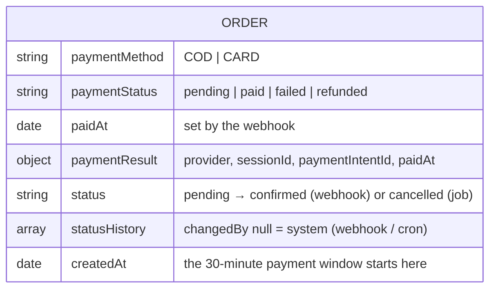
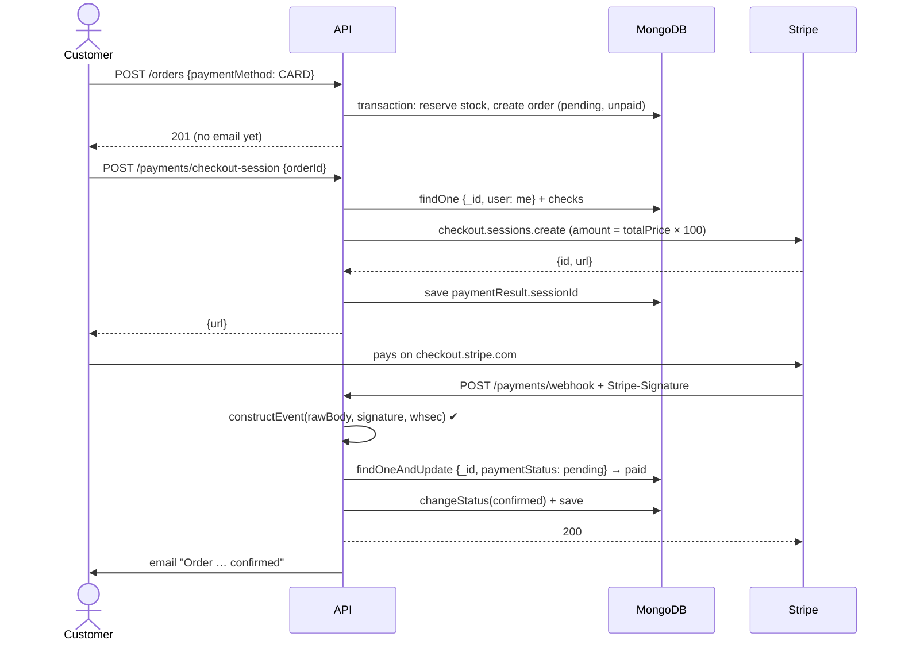
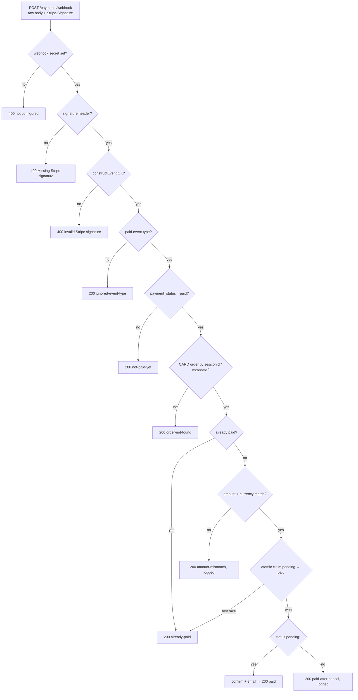
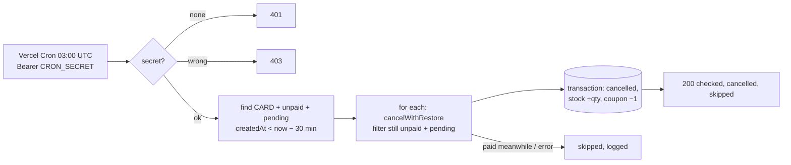

# Module 08 – Payments (Stripe card payments)

**Branch:** `08-payments` (from `07-orders`) · **Folder:** `server/src/modules/payments`

Customers can now pay for an order by **card**. We use **Stripe Checkout**, a payment page hosted by Stripe, so card numbers never reach our server. Stripe then tells us about the payment through a **signed webhook**, and that webhook is the **only** thing that can mark a card order as paid. A **cron job** cancels card orders nobody paid for and puts their stock back. New ideas: hosted checkout, webhooks, signatures, raw bodies, idempotency and cron jobs. See [concept 22](../concepts/22-webhooks-signatures-idempotency.md).

Card payments are **optional**. With `PAYMENT_CARD_ENABLED=false` (the default) the shop runs as Cash on Delivery only, and every card route answers with a clear 400.

```bash
git diff 07-orders..08-payments --stat     # everything this branch added
git log --oneline 07-orders..08-payments   # the commits, in build order
```

## Endpoints

All paths start with `/api`.

| Method | Path                         | Called by                   | Auth                                                     | Body                  | Success                                | Errors                  |
| ------ | ---------------------------- | --------------------------- | -------------------------------------------------------- | --------------------- | -------------------------------------- | ----------------------- |
| POST   | `/payments/checkout-session` | the frontend                | customer, verified email                                 | `{ orderId }`         | 200 `{ url, sessionId }`               | 400, 401, 403, 404, 502 |
| POST   | `/payments/webhook`          | **Stripe**                  | `Stripe-Signature` header                                | raw Stripe event JSON | 200 `{ received, handled, reason, … }` | 400                     |
| GET    | `/payments/expire-unpaid`    | **scheduler** (Vercel Cron) | `Authorization: Bearer <CRON_SECRET>` or `x-cron-secret` | –                     | 200 `{ checked, cancelled, skipped }`  | 401, 403                |
| POST   | `/payments/expire-unpaid`    | other schedulers            | same                                                     | –                     | same                                   | same                    |

Changed elsewhere:

| Route                                       | Change                                                                                                                                                                                                   |
| ------------------------------------------- | -------------------------------------------------------------------------------------------------------------------------------------------------------------------------------------------------------- |
| `POST /orders` with `paymentMethod: "CARD"` | 400 _Card payments are not available right now_ when cards are off. When on: stock is reserved, the order stays `pending` + unpaid, and **no** confirmation email is sent yet (it's sent by the webhook) |
| `GET /health`                               | new `data.cardPaymentsEnabled` (true/false), so the frontend can hide the card option                                                                                                                    |

### Checkout-session errors

| Status    | Message                                                    | When                                                                                                      |
| --------- | ---------------------------------------------------------- | --------------------------------------------------------------------------------------------------------- |
| 400       | Validation failed (`orderId`: Invalid order)               | `orderId` missing or not an ObjectId                                                                      |
| 400       | Card payments are not configured                           | `PAYMENT_CARD_ENABLED` is not `true` or `STRIPE_SECRET_KEY` is empty                                      |
| 404       | Order not found                                            | unknown id **or another customer's order** (no IDOR, see [14](../concepts/14-authorization-ownership.md)) |
| 400       | This order is not a card order                             | COD order                                                                                                 |
| 400       | This order is already paid                                 | –                                                                                                         |
| 400       | This order can no longer be paid                           | status isn't `pending` (cancelled, confirmed…)                                                            |
| 400       | The time to pay for this order is over, please order again | older than 30 minutes (even if the job hasn't run yet)                                                    |
| 502       | Could not reach the payment provider, please try again     | Stripe threw (network, bad key…)                                                                          |
| 401 / 403 | –                                                          | no token / admin or unverified email                                                                      |

### Webhook answers

Stripe only cares about the status code: **2xx = delivered**, anything else = "retry later".

| Status | `reason`             | Meaning                                                                                                                                |
| ------ | -------------------- | -------------------------------------------------------------------------------------------------------------------------------------- |
| 400    | –                    | webhook secret not configured, `Stripe-Signature` missing, or the signature is wrong (fake, changed body, too old)                     |
| 200    | `ignored-event-type` | not `checkout.session.completed` / `checkout.session.async_payment_succeeded`                                                          |
| 200    | `not-paid-yet`       | session completed but `payment_status` isn't `paid` (slow payment method)                                                              |
| 200    | `order-not-found`    | no CARD order with that session id / metadata (e.g. `stripe trigger` test events)                                                      |
| 200    | `amount-mismatch`    | amount or currency differs from the order. **Not** marked paid, error logged for a human                                               |
| 200    | `paid`               | ✅ order → `paymentStatus: paid`, `status: confirmed`, history entry by "system", confirmation email                                   |
| 200    | `already-paid`       | repeated delivery: nothing changes (**idempotent**)                                                                                    |
| 200    | `paid-after-cancel`  | the money arrived after the order was cancelled (expired). Recorded as paid, status stays cancelled. Refund it in the Stripe dashboard |

## Data model

No new collection. The payment lives on the order from branch 07:



Indexes used (defined in branch 07's order model):

| Index                                                  | Used by                    |
| ------------------------------------------------------ | -------------------------- |
| `{ paymentMethod: 1, paymentStatus: 1, createdAt: 1 }` | the expiry job's search    |
| `{ 'paymentResult.sessionId': 1 }` (sparse)            | the webhook's order lookup |

New constants in `config/constants.js` → `PAYMENTS`: `PROVIDER: 'stripe'`, `CURRENCY: 'pkr'`, `MINOR_UNITS_PER_RUPEE: 100`, `UNPAID_CARD_EXPIRY_MS: 30 min`, `PAID_EVENTS`.

## Flows

### Card payment, start to finish



### Webhook decision tree



### Expiry job



## Files map

| File                                            | Role                                                                                                                                                |
| ----------------------------------------------- | --------------------------------------------------------------------------------------------------------------------------------------------------- |
| `config/env.js`, `.env.example`                 | `PAYMENT_CARD_ENABLED`, `STRIPE_SECRET_KEY`, `STRIPE_WEBHOOK_SECRET`, `CRON_SECRET`                                                                 |
| `config/constants.js`                           | **new** `PAYMENTS`                                                                                                                                  |
| `modules/payments/stripe.gateway.js`            | The only file importing `stripe`. `isConfigured`, `getClient` (lazy), `createCheckoutSession`, `constructEvent`. Tests swap `createCheckoutSession` |
| `modules/payments/payment.service.js`           | `createCheckoutSession`, `handleWebhook` (+ private `markOrderPaid`), `expireUnpaidOrders`, helpers `toMinorUnits`, `isPaymentWindowOver`           |
| `modules/payments/cron.middleware.js`           | `requireCronSecret` (401/403), `safeEqual` (constant-time compare)                                                                                  |
| `modules/payments/payment.validation.js`        | `checkoutSessionRules`                                                                                                                              |
| `modules/payments/payment.controller.js`        | `createCheckoutSession`, `stripeWebhook`, `expireUnpaid`                                                                                            |
| `modules/payments/payment.routes.js`            | checkout-session + expire-unpaid (GET and POST)                                                                                                     |
| `modules/payments/payment.docs.js`              | OpenAPI paths + `cronSecret` security scheme                                                                                                        |
| `app.js`                                        | webhook route with `express.raw()` **before** `express.json()`; `/api/payments` mount; `cardPaymentsEnabled` in health                              |
| `vercel.json`                                   | `crons`: `/api/payments/expire-unpaid` daily at 03:00 UTC                                                                                           |
| `modules/orders/order.service.js` _(branch 07)_ | CARD refused while off; CARD orders get no email at placement; `cancelWithRestore`, `sendOrderEmail` reused here                                    |

## How to test

```bash
cd server
npm test -- tests/integration/payments.test.js tests/unit/payment.test.js
npm test -- -t "IDEMPOTENT"          # only the repeated-delivery tests
npm run test:coverage
```

No test touches the network. `stripeGateway.createCheckoutSession` is replaced by a fake. Webhooks are signed for real with `Stripe.webhooks.generateTestHeaderString({ payload, secret })`, so the real signature check runs.

Manual / E2E (server + Mailpit running, admin seeded, `RATE_LIMIT_ENABLED=false`, `CRON_SECRET=test-cron-secret`):

- **Postman**: folder **08 Payments** (`npm run test:api`). No Stripe account needed: it covers cards-off answers, webhook signature refusal and the cron secret.
- **Bruno**: folder **08 Payments** (`npm run test:bruno`).
- **Swagger**: http://localhost:5000/api/docs → tag **Payments**. The lock icon has a **cronSecret** field for the job.
- **The job by hand**: `curl -H "x-cron-secret: test-cron-secret" http://localhost:5000/api/payments/expire-unpaid`

### Real payments locally with the Stripe CLI (test mode, free)

1. Create a Stripe account and stay in **Test mode**. Dashboard → Developers → API keys → copy the **secret key** (`sk_test_…`).
2. Install the [Stripe CLI](https://docs.stripe.com/stripe-cli) and run `stripe login`.
3. Forward webhooks to your local API (keep this terminal open):
   ```bash
   stripe listen --forward-to localhost:5000/api/payments/webhook
   ```
   It prints `Ready! Your webhook signing secret is whsec_…`.
4. In `server/.env`:
   ```
   PAYMENT_CARD_ENABLED=true
   STRIPE_SECRET_KEY=sk_test_...
   STRIPE_WEBHOOK_SECRET=whsec_...   # the one `stripe listen` printed
   ```
   Restart `npm run dev`. `/api/health` now shows `"cardPaymentsEnabled": true`.
5. As a verified customer: add to cart → `POST /api/orders` with `"paymentMethod": "CARD"` → `POST /api/payments/checkout-session` with the order id → open `data.url` in the browser.
6. Pay with test card **4242 4242 4242 4242**, any future expiry date (e.g. 12/34), any CVC, any postcode. Other test cards: `4000 0000 0000 9995` (declined), `4000 0025 0000 3155` (asks for 3-D Secure).
7. In the `stripe listen` terminal you'll see `checkout.session.completed → POST … [200]`. The order is now `paid` + `confirmed`, and Mailpit has the confirmation email.
8. Try idempotency: `stripe events resend evt_…` (id from the listen output) → answer `already-paid`, no second email.
9. Try a fake: send the same JSON with Postman and a made-up `Stripe-Signature` → **400**.

### Deploying (Vercel)

- Add the four variables in Vercel. `CRON_SECRET` must be a long random string. Vercel Cron sends it automatically as `Authorization: Bearer <CRON_SECRET>`.
- Stripe Dashboard → Developers → Webhooks → **Add endpoint** `https://<your-api>/api/payments/webhook`, events `checkout.session.completed` and `checkout.session.async_payment_succeeded`. Use that endpoint's signing secret (not the CLI's) as `STRIPE_WEBHOOK_SECRET`.
- Vercel's free plan runs crons once a day (`0 3 * * *`). The checkout route also refuses orders older than 30 minutes, so late payments are blocked anyway. Use an external scheduler with `x-cron-secret` if you need the stock back sooner.
- If valid signatures fail **only** on Vercel, something parsed the body before Express. Set `NODEJS_HELPERS=0` in Vercel's environment variables so the raw body reaches `express.raw()`.

## Differences from the reference app

| Reference                                            | Here                                                                                   | Why                                                                                        |
| ---------------------------------------------------- | -------------------------------------------------------------------------------------- | ------------------------------------------------------------------------------------------ |
| `new Stripe(key)` at import time, inside the service | `stripe.gateway.js` with a lazy client                                                 | One seam for tests (no network); no client when cards are off                              |
| Webhook needed the card flag **and** the API key     | Webhook needs only `STRIPE_WEBHOOK_SECRET`                                             | A payment that already happened must be recorded even if cards were switched off meanwhile |
| Read, check "already paid", then `save()`            | Same check **plus** an atomic `findOneAndUpdate({ paymentStatus: 'pending' })`         | Two simultaneous deliveries could both pass the check and send two emails                  |
| Webhook answered `{ received: true }`                | Standard envelope with `received`, `handled`, `reason`                                 | Same shape as every route; easier to debug in `stripe listen` and tests                    |
| No amount check                                      | Amount and currency must equal the order                                               | Trust, but verify                                                                          |
| Wrong/missing cron secret → 401                      | missing → 401, wrong → 403; `timingSafeEqual`                                          | 401 = "send credentials", 403 = "these credentials aren't allowed"; no timing leaks        |
| Cron loop stopped at the first error                 | Each order in its own try/catch, counted as `skipped`; cancel re-checks "still unpaid" | One bad order can't block the others; never cancel an order paid a millisecond ago         |
| Checkout allowed any `pending` card order            | Also refuses orders older than 30 minutes                                              | The daily cron alone would leave a long window                                             |
| `metadata.orderId` only                              | also `client_reference_id`; metadata id validated before querying                      | Shows up in the Stripe dashboard; a malformed id can't cause a CastError                   |
| Only `checkout.session.completed`                    | also `checkout.session.async_payment_succeeded`                                        | Slow payment methods finish later                                                          |

## Exercises

1. **Break the raw body.** Move the webhook line in `app.js` below `express.json()`. Run `npm test -- -t webhook`. Which tests fail and why? Put it back.
2. **Remove the atomic claim.** Replace `findOneAndUpdate` in `markOrderPaid` with `order.paymentStatus = 'paid'; await order.save()`. Run the race test a few times. What do you see?
3. **Refund webhook.** Handle `charge.refunded`: find the order by `paymentResult.paymentIntentId` and set `paymentStatus: 'refunded'`. Write the test with `generateTestHeaderString` first.
4. **Event log.** Store every handled event id in a new `ProcessedEvent` collection (unique index on `eventId`) and skip ids you've already seen. Which is simpler, this or the state check? When would you need both?
5. **Configurable window.** Read the 30 minutes from an env var `CARD_PAYMENT_WINDOW_MIN` (default 30). Which files change? Which tests need a new `now`?
