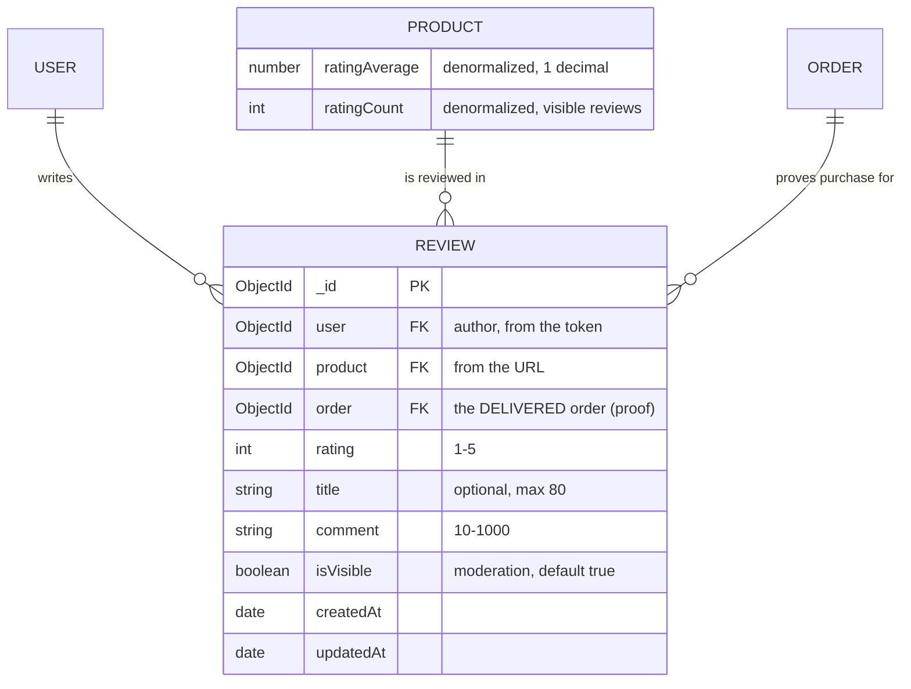
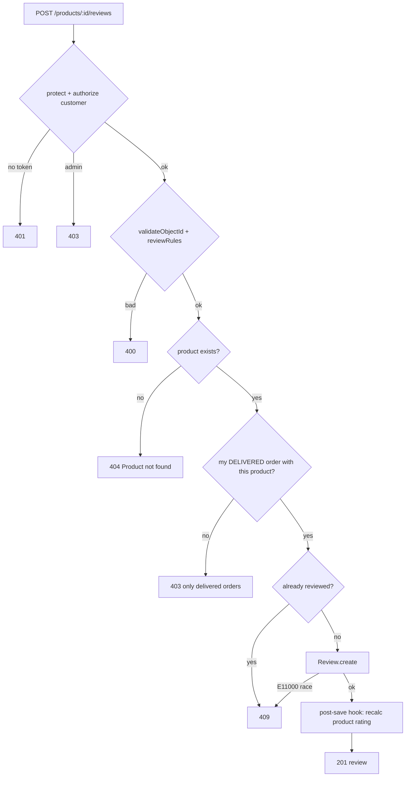
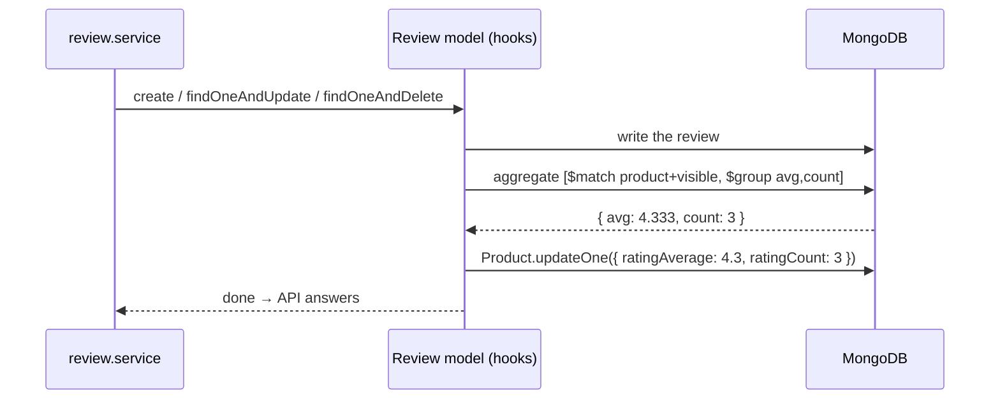
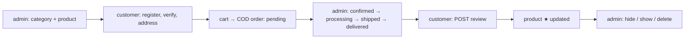

# Module 09 – Reviews

**Branch:** `09-reviews` (from `08-payments`) · **Folder:** `server/src/modules/reviews` (+ 3 nested routes in `server/src/modules/products/product.routes.js`)

Customers rate a product they **received** (1–5 stars, an optional title and a comment). Each customer gets **one** review per product, and only the author can edit it. The product keeps a ready-made **★ average and count** that updates after every change. Admins **moderate**: they list every review, hide or show one, or delete it.

New ideas: **compound unique index**, **aggregation pipeline**, **denormalized counter**, **moderation**. See [concept 23](../concepts/23-ratings-aggregation-moderation.md).

```bash
git diff 08-payments..09-reviews --stat     # everything this branch added
git log --oneline 08-payments..09-reviews   # the commits, in build order
```

## Endpoints

All paths start with `/api`.

| Method | Path                                | Access                        | Body / query                                                                    | Success                                                                    | Errors                  |
| ------ | ----------------------------------- | ----------------------------- | ------------------------------------------------------------------------------- | -------------------------------------------------------------------------- | ----------------------- |
| GET    | `/products/:id/reviews`             | **public**                    | `?page&limit` (5 per page, max 20)                                              | 200 `[review]` + `meta` (visible only, newest first, author **name** only) | 400, 404                |
| GET    | `/products/:id/reviews/eligibility` | logged in                     | –                                                                               | 200 `{ canReview, reason?, review? }`                                      | 400, 401, 404           |
| POST   | `/products/:id/reviews`             | customer, **delivered buyer** | review                                                                          | 201 review                                                                 | 400, 401, 403, 404, 409 |
| PUT    | `/reviews/:id`                      | customer, **author**          | review                                                                          | 200 review                                                                 | 400, 401, 403, 404      |
| DELETE | `/reviews/:id`                      | **author** or admin           | –                                                                               | 200 `data: null`                                                           | 400, 401, 404           |
| GET    | `/reviews/admin`                    | admin                         | `?rating=1..5&visibility=visible\|hidden&product=<id>&page&limit` (20, max 100) | 200 `[review]` + `meta` (with author email and product name)               | 400, 401, 403           |
| PATCH  | `/reviews/:id/visibility`           | admin                         | `{ isVisible: boolean }`                                                        | 200 review (`Review hidden` / `Review is visible`)                         | 400, 401, 403, 404      |

In the nested routes, `:id` is the **product** id. In `/reviews/...`, `:id` is the **review** id.

- **403 on POST**: an admin is calling, or the customer has **no DELIVERED order containing this product**. Pending, confirmed, processing, shipped and cancelled orders don't count, and neither do other people's orders.
- **409 on POST**: this customer has already reviewed this product. That's true even if they bought it twice, and even if two submits race each other.
- **404 on PUT/DELETE**: the review doesn't exist **or isn't yours**. Same answer on purpose (no IDOR, see [concept 14](../concepts/14-authorization-ownership.md)).

Review body:

```json
{
  "rating": 4,
  "title": "Boils fast",
  "comment": "Boils a full kettle in about three minutes."
}
```

| Field                                   | Rule (`REVIEW` in `config/constants.js`)                                           |
| --------------------------------------- | ---------------------------------------------------------------------------------- |
| `rating`                                | whole number 1–5 (`"4"` from a form is converted)                                  |
| `title`                                 | optional, max 80; `""` on PUT removes it                                           |
| `comment`                               | 10–1000 characters after trimming                                                  |
| `user`, `product`, `order`, `isVisible` | **ignored** if sent. They come from the token, the URL, the database and the admin |

## Data model



Indexes on `reviews`:

| Index                                                           | Why                                                   |
| --------------------------------------------------------------- | ----------------------------------------------------- |
| `{ product: 1, user: 1 }` **unique** (`one_review_per_product`) | One review per product per customer, race-proof       |
| `{ product: 1, isVisible: 1, createdAt: -1 }`                   | The public list: "visible reviews of X, newest first" |
| `{ isVisible: 1, rating: 1, createdAt: -1 }`                    | Admin moderation filters                              |

The eligibility lookup uses the order index `{ 'items.product': 1, user: 1, status: 1 }` (branch 07).

## Flows

### Write a review



### Keep the product rating in sync



### The whole journey (what Postman folder 09 does)



## Files map

| File                                             | Role                                                                                                         |
| ------------------------------------------------ | ------------------------------------------------------------------------------------------------------------ |
| `config/constants.js`                            | **new** `REVIEW` (rating range, text lengths, page sizes)                                                    |
| `modules/reviews/review.model.js`                | Schema, the compound unique index, `calcProductRating` (aggregation), post hooks                             |
| `modules/reviews/review.validation.js`           | `reviewRules`, `visibilityRules`, `adminListRules`                                                           |
| `modules/reviews/review.service.js`              | list, eligibility, create (delivered rule, 409 + race), update/delete (ownership), admin list, setVisibility |
| `modules/reviews/review.controller.js`           | Thin HTTP handlers (shared by both route files)                                                              |
| `modules/reviews/review.routes.js`               | `/api/reviews`: `GET /admin`, `PATCH /:id/visibility`, `PUT /:id`, `DELETE /:id`                             |
| `modules/products/product.routes.js`             | **edited**: 3 nested routes `/:id/reviews`, `/:id/reviews/eligibility`                                       |
| `modules/reviews/review.docs.js`                 | OpenAPI (tag **Reviews**)                                                                                    |
| `modules/models.js`, `app.js`, `docs/openapi.js` | One line each to plug the module in                                                                          |
| `tests/helpers/factories.js`                     | **new** `createReview(user, product, overrides)` (creates a delivered order as proof)                        |

## How to test

```bash
cd server
npm test -- tests/integration/reviews.test.js
npm test -- tests/unit/review.model.test.js
npm test -- -t "Rating aggregation"     # only the exact-average tests
npm run test:coverage
```

Manual / E2E (server + Mailpit running, admin seeded, `RATE_LIMIT_ENABLED=false`):

- **Postman**: folder **09 Reviews**. It's self-contained: it builds its own product, customer and delivered order.
- **Bruno**: folder **09 Reviews**.
- **Swagger**: http://localhost:5000/api/docs → tag **Reviews**.

## Differences from the reference app

| Reference                                                     | Here                                                          | Why                                                                                            |
| ------------------------------------------------------------- | ------------------------------------------------------------- | ---------------------------------------------------------------------------------------------- |
| Admin list/visibility at `/api/admin/reviews…` (admin module) | `GET /api/reviews/admin`, `PATCH /api/reviews/:id/visibility` | The admin module arrives in branch 10. It can add `/api/admin` aliases to the same controllers |
| List of a missing product → empty list                        | **404 Product not found** (list and eligibility)              | A wrong id should not look like "no reviews yet"                                               |
| Duplicate race → generic "product already exists" 409         | Caught `11000` → "You already reviewed this product"          | Same friendly message in both cases                                                            |
| Update sent `title: undefined`                                | Empty title → `$unset`                                        | Clear way to remove the headline                                                               |
| Admin list filters silently ignored bad values                | `adminListRules` → 400                                        | A typo should not return "everything"                                                          |
| Product lookup by `_id` in `aggregate` with a raw string      | `new ObjectId(String(id))`                                    | `aggregate` doesn't cast types                                                                 |

## Exercises

1. **Helpful votes.** Add `POST /api/reviews/:id/helpful` (one vote per user). Which compound unique index do you need?
2. **Star histogram.** Return `{ 5: 10, 4: 3, 3: 0, 2: 1, 1: 0 }` with the list. Write the pipeline (`$match` → `$group` by `$rating`).
3. **Edit window.** Allow edits only within 30 days of `createdAt`. Which layer owns this rule? Write the test first.
4. **Break the counter.** Replace `findOneAndDelete` in `deleteReview` with `deleteOne`. Which test fails, and why does the denormalized copy go stale?
5. **Report abuse (design only).** Let customers flag a review. Sketch the model change and how the admin list would filter "reported first".
