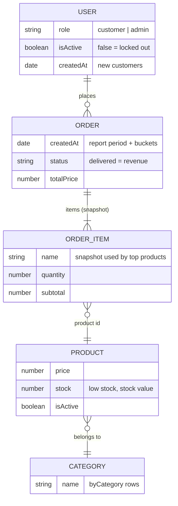
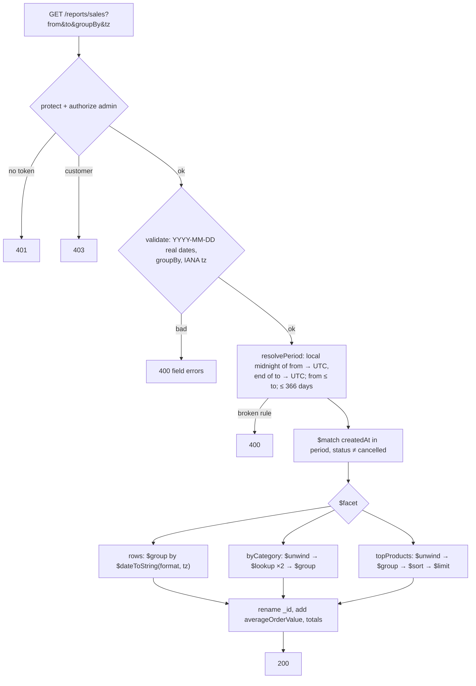
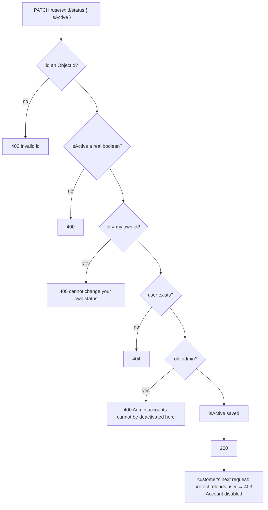

# Module 10 – Admin: dashboard, reports, exports, inventory and customers

**Branch:** `10-admin` (from `09-reviews`) · **Folder:** `server/src/modules/admin` · **Also:** `src/utils/dates.js`, `src/utils/csv.js`, `src/db/scripts/seed.js`

The last backend branch gives the shop owner a control room. The **dashboard** shows revenue, orders, customers and stock at a glance. **Sales reports** group sales by day, week or month, in any time zone, and download as **CSV**. Every order of a period can be exported as a **streamed** CSV. **Inventory** shows stock value per category and what's running low. **Customer management** lists, searches and inspects customers and can **deactivate** one, which locks them out immediately. A full **store seed** (`npm run seed`) fills an empty database with an admin, categories, 30 products and coupons.

New ideas: aggregation pipelines (`$match`/`$group`/`$facet`), time zones in reports, CSV export and streaming, pagination and search, least privilege, idempotent seeding. All are explained in [concept 24](../concepts/24-reporting-aggregation-and-csv.md).

```bash
git diff 09-reviews..10-admin --stat     # everything this branch added
git log --oneline 09-reviews..10-admin   # the commits, in build order
```

## Endpoints

All paths start with `/api/admin`. **Every** route needs `Authorization: Bearer <admin token>`: no token → **401**, a customer → **403** (one `router.use(protect, authorize('admin'))` guards them all).

| Method | Path                     | Query / body                                                                               | Success                         | Errors               |
| ------ | ------------------------ | ------------------------------------------------------------------------------------------ | ------------------------------- | -------------------- |
| GET    | `/dashboard/stats`       | `range` = `7d` · `30d` (default) · `12m`, `tz`                                             | 200 stats                       | 400, 401, 403        |
| GET    | `/reports/sales`         | `from`, `to` (`YYYY-MM-DD`), `groupBy` = `day` · `week` · `month`, `tz`                    | 200 report                      | 400, 401, 403        |
| GET    | `/reports/sales/export`  | same as above                                                                              | 200 **CSV file**                | 400 (JSON), 401, 403 |
| GET    | `/reports/orders/export` | `from`, `to`, `status`, `tz`                                                               | 200 **streamed CSV file**       | 400 (JSON), 401, 403 |
| GET    | `/inventory`             | –                                                                                          | 200 overview                    | 401, 403             |
| GET    | `/products/low-stock`    | `threshold` 0–1000 (default 5)                                                             | 200 `[product]`                 | 400, 401, 403        |
| GET    | `/users`                 | `search` (≤ 100), `status` = `active` · `inactive`, `page` ≥ 1, `limit` 1–100 (default 20) | 200 `[customer]` + `meta`       | 400, 401, 403        |
| GET    | `/users/:id`             | –                                                                                          | 200 `{ user, orders, summary }` | 400, 401, 403, 404   |
| PATCH  | `/users/:id/status`      | `{ "isActive": false }` (a real boolean)                                                   | 200 user                        | 400, 401, 403, 404   |

Business rules:

| Rule                          | Detail                                                                                                                                                       |
| ----------------------------- | ------------------------------------------------------------------------------------------------------------------------------------------------------------ |
| Dashboard **revenue**         | **Delivered** orders only (money we're sure about), inside the rolling window                                                                                |
| Sales report **sales**        | Every order **not cancelled** (pending orders are real demand)                                                                                               |
| **Top products**              | Summed from order-line snapshots; cancelled orders don't count                                                                                               |
| **Low stock**                 | Active products with `stock ≤ LIMITS.LOW_STOCK_THRESHOLD` (5), out-of-stock included                                                                         |
| **Stock value**               | Σ `price × stock` of **active** products                                                                                                                     |
| **Money spent** by a customer | Delivered orders only                                                                                                                                        |
| Report period                 | `from` ≤ `to`, at most **366 days**; `to` is included up to 23:59:59.999 in `tz`                                                                             |
| Default period                | Last 30 days until now                                                                                                                                       |
| Default `tz`                  | `UTC` (same numbers as the reference); `tz=Asia/Karachi` uses Pakistan's days                                                                                |
| Status change                 | Not your own account (400), not an admin (400). A deactivated customer's token gets **403 "Account disabled"** on the next request; reactivating restores it |
| Customer detail               | Customers only: an admin's id → **404**                                                                                                                      |

Example: `GET /api/admin/reports/sales?from=2026-01-01&to=2026-01-31&tz=Asia/Karachi`

```json
{
  "success": true,
  "message": "Sales report",
  "data": {
    "from": "2025-12-31T19:00:00.000Z",
    "to": "2026-01-31T18:59:59.999Z",
    "groupBy": "day",
    "timezone": "Asia/Karachi",
    "rows": [
      {
        "period": "2026-01-01",
        "orders": 1,
        "itemsSold": 1,
        "revenue": 1250,
        "averageOrderValue": 1250
      },
      {
        "period": "2026-01-06",
        "orders": 1,
        "itemsSold": 1,
        "revenue": 3250,
        "averageOrderValue": 3250
      }
    ],
    "totals": {
      "orders": 2,
      "itemsSold": 2,
      "revenue": 4500,
      "averageOrderValue": 2250
    },
    "byCategory": [
      { "category": "Audio", "revenue": 3000, "itemsSold": 1 },
      { "category": "Toys & Kids", "revenue": 1000, "itemsSold": 1 }
    ],
    "topProducts": [
      {
        "_id": "…",
        "name": "Bluetooth Earbuds Pro",
        "sold": 1,
        "revenue": 3000
      }
    ]
  }
}
```

`revenue` is the order total (items − discount + shipping); `byCategory` and `topProducts` add up item subtotals, so they don't include shipping.

CSV (`/reports/sales/export`), UTF-8 with BOM and CRLF line endings:

```
period,orders,itemsSold,revenue,averageOrderValue
2026-01-05,2,3,5500,2750
TOTAL,2,3,5500,2750
```

Orders CSV columns: `orderNumber, date (local "YYYY-MM-DD HH:mm"), customerName, customerEmail, status, paymentMethod, paymentStatus, items, itemsPrice, discountPrice, shippingPrice, totalPrice`.

## Data model

No new collection: the admin module **reads** the others.



Indexes the reports lean on (created by earlier branches): `orders { createdAt: -1 }`, `{ status: 1, createdAt: -1 }`, `{ user: 1, createdAt: -1 }`, `products { isActive: 1, stock: 1 }`, `users { role: 1 }`.

## Flows

### Sales report: one `$match`, three reports (`$facet`)



### Streamed orders export

```mermaid
sequenceDiagram
  participant A as Admin browser
  participant C as admin.controller
  participant S as admin.service
  participant DB as MongoDB
  A->>C: GET /reports/orders/export?from&to
  C->>S: prepareOrdersExport(query)
  S-->>C: 400 here if dates are wrong (nothing sent yet)
  S-->>C: { filename, lines (async generator) }
  C->>A: 200, text/csv, attachment; filename=…, BOM
  loop each batch of 200
    S->>DB: cursor.next()
    S-->>C: yield CSV line (formula-safe, quoted)
    C->>A: res.write (await 'drain' when the buffer is full)
  end
  C->>A: res.end()
  Note over C,A: database error half-way → res.destroy() (failed download, never a truncated "success")
```

### Deactivate a customer



## Files map

| File                                | Role                                                                                                                                                                                           |
| ----------------------------------- | ---------------------------------------------------------------------------------------------------------------------------------------------------------------------------------------------- |
| `config/constants.js`               | **new** `ADMIN_REPORTS` (ranges, group formats, default tz, limits), `PAGINATION` (customer list sizes)                                                                                        |
| `utils/dates.js`                    | **new** `isValidTimeZone`, `tzOffsetMs`, `startOfDayInZone`, `endOfDayInZone`, `dayInZone` (built-in `Intl`, no library)                                                                       |
| `utils/csv.js`                      | **new** `csvCell`, `csvRow`, `CSV_BOM`: RFC 4180 quoting + formula-injection guard                                                                                                             |
| `modules/admin/admin.validation.js` | `statsRules`, `salesReportRules`, `ordersExportRules`, `lowStockRules`, `listCustomersRules`, `statusRules`                                                                                    |
| `modules/admin/admin.service.js`    | `getDashboardStats`, `resolvePeriod`, `getSalesReport`, `getSalesReportCsv`, `prepareOrdersExport`, `getInventoryOverview`, `getLowStock`, `listCustomers`, `getCustomer`, `setCustomerStatus` |
| `modules/admin/admin.controller.js` | Thin handlers; CSV headers; streaming with backpressure                                                                                                                                        |
| `modules/admin/admin.routes.js`     | One router-level guard + 9 routes                                                                                                                                                              |
| `modules/admin/admin.docs.js`       | OpenAPI (tag **Admin**), merged in `docs/openapi.js`                                                                                                                                           |
| `db/scripts/seed.js`                | **new** `npm run seed`: admin, 14 categories, 30 products (Cloudinary demo images), 2 coupons, idempotent; `seedStore()` exported for tests                                                    |
| `app.js`                            | `app.use('/api/admin', adminRoutes)`                                                                                                                                                           |

## How to test

```bash
cd server
npm test -- tests/integration/admin.test.js   # every route, exact numbers, guards, CSV
npm test -- tests/unit/reporting.test.js      # dates/time zones, CSV escaping, period rules
npm test -- tests/integration/seed.test.js    # seed twice = same counts
npm run test:coverage
```

The integration tests build small, **known** data sets (e.g. four orders worth 2250, 3250, 1250 and 6000) and assert the statistics **exactly**: revenue 8250, top product sold 3, Karachi moves the 20:30 UTC order to the next day, and so on.

Manual / E2E (server running, `npm run seed` done, `RATE_LIMIT_ENABLED=false`):

- **Postman**: folder **10 Admin** (`npm run test:api`). Self-contained: logs in the seeded admin, registers its own customer, checks invariants that hold on any data, downloads both CSVs, deactivates the customer (their token → 403) and reactivates them.
- **Bruno**: folder **10 Admin** (`npm run test:bruno`).
- **Swagger**: http://localhost:5000/api/docs → tag **Admin**. CSV routes show the file in the response box.

## Differences from the reference app

| Reference                                                           | Here                                                          | Why                                                                                 |
| ------------------------------------------------------------------- | ------------------------------------------------------------- | ----------------------------------------------------------------------------------- |
| Unknown `range` / `groupBy` silently fell back to the default       | **400** with a field error                                    | Client bugs show up instead of hiding behind plausible numbers                      |
| Dates always UTC; `to` built as `${to}T23:59:59.999Z`               | Optional `tz` (IANA name), default `UTC`                      | Same numbers by default; correct local days when asked                              |
| Sales report: three separate aggregations                           | One `$match` + `$facet`                                       | One database round trip, same results                                               |
| `byCategory` dropped sales of deleted products/categories           | Kept in an **"Uncategorised"** row                            | Totals per category add up to the report total                                      |
| No CSV export                                                       | `/reports/sales/export` and streamed `/reports/orders/export` | The task: exports for spreadsheets, safely and at any size                          |
| No inventory overview                                               | `/inventory` (`$facet`: totals + per category)                | Stock value and per-category view for the inventory page                            |
| `/admin/products/low-stock` in the products module, fixed threshold | In the admin module, optional `?threshold`                    | Admin-only feature lives with the admin module; see INTEGRATION-NOTES for the merge |
| Customer list/detail/status in `users` module                       | In the admin module (`admin.service.js`)                      | All admin-only logic in one place; the users module stays "my account"              |
| `GET /admin/users/:id` returned admins too                          | Customers only (404 for admins)                               | Least privilege                                                                     |
| Customer detail `{ user, orders }`                                  | Adds `summary: { orderCount, totalSpent }`                    | The detail page needs the same numbers as the list                                  |
| `isActive` accepted `"true"`/`1` and converted                      | Must be a real JSON boolean                                   | A string `"false"` must never mean `true`                                           |
| List `?limit` silently clamped                                      | 400 above 100                                                 | Same reason as range                                                                |
| Seed: top-level script, `findOneAndUpdate` upserts                  | Exported `seedStore()`, "exists → skip, else `create()`"      | Testable (seed twice = same counts); `create()` runs validation and hooks           |

## Exercises

1. **Average order value per weekday.** Add `GET /api/admin/reports/weekdays` that groups non-cancelled orders by `$dayOfWeek` (with `timezone`). Which day sells most in your seeded data?
2. **Cursor pagination.** Replace `skip` in `listCustomers` with `?after=<lastId>`. Why is it faster on page 1000? What do you lose?
3. **Freeze the clock.** `getDashboardStats(query, now)` already accepts `now`. Write a unit-style test that calls the service directly with a fixed `now` and fixed order dates, and assert the exact `revenueSeries`.
4. **Inject a formula.** Register a customer named `=1+1`, place an order, export the orders CSV and open it in a spreadsheet. Then remove the guard in `csvCell` and try again. What changed?
5. **Slow client.** Use `curl --limit-rate 1k` on the orders export with 10 000 seeded orders. Watch the Node process's memory with and without the `drain` wait.
6. **Audit log.** Record who deactivated whom, and when, in a new `AdminAction` collection, and show it on the customer detail.
