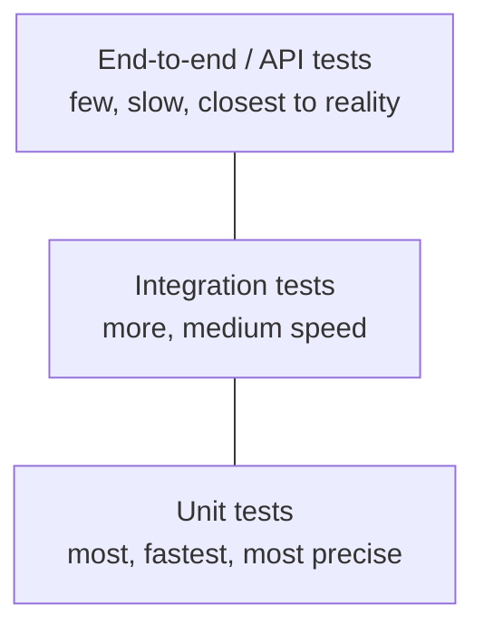
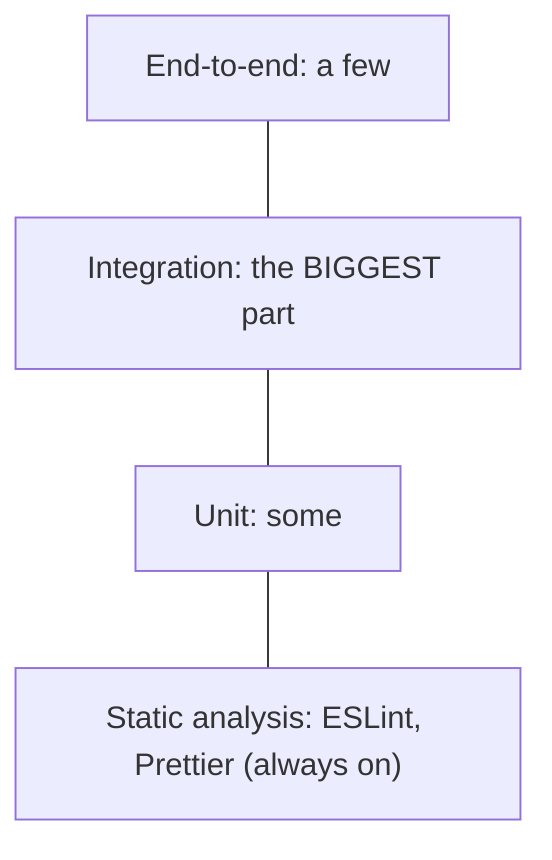

# What Is Testing?

**What you'll learn:** why professional teams write automated tests, how manual and automated testing differ,
the testing pyramid and the testing trophy, the main kinds of tests (unit, integration, API/end-to-end, contract,
smoke, regression, performance/load, security), the five kinds of **test doubles** (dummy, stub, fake, spy, mock)
with tiny examples, why some tests are "flaky", what a good test looks like, and where every one of these ideas
already lives in the ShopEase repo. No setup is needed for this chapter: you only read.

---

## 1. Why test at all?

A **test** is a piece of code (or a checklist) that runs your program with a known input and checks that the
output is what you expect. If it is not, the test **fails** and tells you.

Why bother? Because code changes all the time, and every change can break something that used to work.

| Without tests | With tests |
| --- | --- |
| You click through the app after every change (slow, boring, you forget steps) | `npm test` checks hundreds of cases in seconds |
| Bugs are found by users, in production | Bugs are found on your laptop, before `git commit` |
| You are afraid to refactor ("if it works, don't touch it") | You refactor freely; the tests tell you if you broke something |
| Knowledge lives in your head | Each `it('...')` sentence documents a promise the code makes |

A real example from this project: the tests caught a bug where an **old login token kept working after a password
change**. The fix was a `tokenVersion` field, and the test that guards it still runs on every commit
(`server/tests/integration/users.test.js`, branch `main`):

```js
it('invalidates the OLD token (other devices are logged out)', async () => {
```

That kind of test is called a **regression test**: it makes sure a bug that was fixed never comes back.

---

## 2. Manual vs automated testing

**Manual testing** = a human uses the app (Swagger UI, Postman, the browser) and looks at the result.
**Automated testing** = a program does the same thing and decides pass/fail by itself.

| | Manual | Automated |
| --- | --- | --- |
| Speed | Minutes per scenario | Milliseconds per scenario |
| Repeatable | Depends on the person | Identical every time |
| Cost | Cheap to start, expensive forever | Costs time to write, nearly free to run |
| Good at | Exploring, "does this feel right?", UX | Checking known rules over and over |
| In ShopEase | Swagger UI at `http://localhost:5000/api/docs`, clicking in Postman | Jest (`npm test`), Newman (`npm run test:api`), Bruno CLI (`npm run test:bruno`) |

You need both. Use manual testing to **explore** a new feature. As soon as you know what "correct" means, write
it down as an automated test so you never have to check it by hand again.

---

## 3. The testing pyramid and the testing trophy

Different tests have different costs. Two famous pictures describe how many of each you should write.

### The pyramid (Mike Cohn)



Many cheap, fast tests at the bottom; few expensive, slow tests at the top.

### The trophy (Kent C. Dodds)



The trophy says: for a web API, **integration tests give the most confidence per minute spent**, because they
test the pieces working together the way users actually use them. The base is **static analysis**: tools such as
ESLint that find bugs without running the code.

**ShopEase is shaped like the trophy.** On `10-admin` there are 18 unit test files and 29 integration test files,
ESLint runs on every commit, and Postman/Bruno form a thin end-to-end layer on top.

---

## 4. The kinds of tests

| Kind | What it checks | Speed | Typical tool |
| --- | --- | --- | --- |
| **Unit** | One small piece (a function, a model method, a middleware) **alone** | ~1 ms | Jest |
| **Integration** | Several real pieces **together** (route → controller → service → database) | 10–100 ms | Jest + Supertest + in-memory MongoDB |
| **API / end-to-end (E2E)** | The **running** server with real services, called over the network like a client | seconds | Postman + Newman, Bruno |
| **Contract** | That the API's **shape** (URLs, fields, types) matches a written agreement (e.g. OpenAPI) | fast | Jest checks on `/api/docs.json`; Pact or schema validators (not in repo) |
| **Smoke** | "Is it alive at all?" A tiny, quick check run first, often right after a deploy | ~1 s | `GET /api/health` |
| **Regression** | That an old bug has not come back | any | Any test written after fixing a bug |
| **Performance / load** | Speed and behaviour under many users at once | minutes | k6, Artillery (not in repo; see [chapter 10](./10-next-level-testing.md)) |
| **Security** | That attacks fail: injection, forged tokens, missing auth, brute force | any | Jest integration tests here; OWASP ZAP, `npm audit` elsewhere |

Notes on the words:

- **Unit vs integration** is about *how many real pieces* run, not about which tool you use. A test of a single
  middleware function with fake `req`/`res` objects is a unit test. A test that sends HTTP to the Express app and
  hits a database is an integration test, even though both use Jest.
- **End-to-end** in a backend-only project means "through the real running server". When the React frontend
  exists, E2E will also mean "through a real browser" (Playwright, Cypress).
- **Smoke** and **regression** describe a test's *purpose*, not its size. A regression test can be a unit test.

---

## 5. Test doubles

A **test double** is anything that stands in for a real dependency during a test, like a stunt double in a film.
We use them when the real thing is slow (a network call), costs money (Stripe), is not under our control
(Google), or is hard to make fail on purpose.

The names come from Gerard Meszaros' book *xUnit Test Patterns*. There are five.

| Double | What it does | One-line idea |
| --- | --- | --- |
| **Dummy** | Is passed around but never used | "Fills a parameter slot" |
| **Stub** | Returns a fixed, pre-programmed answer | "Always says yes" |
| **Fake** | A working, simplified implementation | "A real mini-version" |
| **Spy** | A real or fake function that **records** how it was called | "Remembers what happened" |
| **Mock** | A double with **expectations** about how it must be called; the test fails if they are not met | "Checks it was used correctly" |

### Dummy

From `server/tests/unit/middleware.test.js` (branch `main`). The middleware under test never touches `res`, so
an empty object `{}` is passed just to fill the slot:

```js
// Runs a middleware and resolves with whatever it passed to next() (undefined = allowed)
const run = (mw, req) => new Promise((resolve) => mw(req, {}, (err) => resolve(err)));
```

### Stub

From `server/tests/integration/google.test.js` (branch `main`). The real `googleVerifier.verify` would call
Google over the internet. The stub returns whatever payload the test needs:

```js
const realVerify = googleVerifier.verify; // keep the original to restore after each test

// Make the fake Google return this payload
const googleSays = (payload) => {
  googleVerifier.verify = async () => payload;
};
```

### Fake

Two fakes run in **every** ShopEase test:

1. **mongodb-memory-server**: a real MongoDB that lives only in memory and disappears after the run.
2. **The email outbox** in `server/src/emails/sendEmail.js` (branch `main`). In tests no email is sent; it is
   pushed into an array instead:

```js
export const outbox = [];
// ...
  if (env.isTest) {
    // Tests: remember the email instead of sending it
    outbox.push({ to, subject, html, text });
    return;
  }
```

### Spy

A spy records calls so you can check them afterwards. `jest.fn()` creates one. From
`server/tests/unit/utils.test.js` (branch `main`):

```js
it('forwards a rejected promise to next(err)', async () => {
  const boom = new Error('boom');
  const next = jest.fn();
  await asyncHandler(async () => {
    throw boom;
  })({}, {}, next);
  expect(next).toHaveBeenCalledWith(boom);
});
```

`jest.spyOn(object, 'method')` wraps an existing method instead. From
`server/tests/integration/payments.test.js` (branch `08-payments`), used to silence expected error logs:

```js
jest.spyOn(console, 'error').mockImplementation(() => {});
```

The hand-written fakes in `uploads.test.js` (branch `04-products-uploads`) are both a stub and a spy: they return
a fixed answer **and** record what they were given:

```js
cloudinaryClient.upload = async (buffer, folder) => {
  uploads.push({ buffer, folder });
  return {
    secure_url: `https://res.cloudinary.com/demo/image/upload/${folder}/fake${uploads.length}.jpg`,
    public_id: `${folder}/fake${uploads.length}`,
  };
};
```

### Mock

In strict terms, a mock is set up with expectations *before* the code runs and verifies them itself. Jest blurs
the words: anything made with `jest.fn()` is called a "mock function", and you add the expectation afterwards
with `expect(fn).toHaveBeenCalledWith(...)`. In daily speech, people say "mock" for any double. That is fine,
as long as you know the precise words when you read books or job interviews ask.

A forced failure is a common mock use. From `server/tests/integration/signupTransaction.test.js`
(branch `05-cart-wishlist`), the header explains the technique:

```js
 * The rollback tests make the LAST write (or the middle one) fail on purpose with
 * jest.spyOn(...).mockRejectedValueOnce(...). If the code were not atomic, the user (and
 * maybe the cart) would stay in the database. With the transaction, NOTHING stays.
```

> **Try it:** open `server/tests/integration/google.test.js` on `main`. Find the line that puts the real
> `verify` back after each test. What would go wrong in the *next test of the same file* if that line were
> missing? (Hint: each Jest test file gets its own copy of every module, but tests *inside* one file share it.)

### Why doubles need a "seam"

You can only swap a dependency if the code gives you a place to do it, called a **seam**. ShopEase creates seams
by putting every external service behind one small object:

| Wrapper (the seam) | Branch | Replaced in tests by |
| --- | --- | --- |
| `server/src/modules/auth/google.verifier.js` → `googleVerifier.verify` | `main` | A stub returning a Google payload |
| `server/src/config/cloudinary.js` → `cloudinaryClient.upload/destroy/isConfigured` | `04-products-uploads` | A stub + spy that records uploads |
| `server/src/modules/payments/stripe.gateway.js` → `stripeGateway.createCheckoutSession` | `08-payments` | A stub + spy that records the session params |

---

## 6. Deterministic vs flaky tests

A **deterministic** test gives the same result every time for the same code. A **flaky** test sometimes passes
and sometimes fails **without any code change**. Flaky tests are poison: people learn to ignore red runs, and
then real bugs slip through.

Usual causes, and how ShopEase avoids them:

| Cause of flakiness | Example | How this repo avoids it |
| --- | --- | --- |
| Shared state between tests | Test A creates `ali@test.com`, test B fails with "email already exists" | `afterEach(clearTestDB)` in `tests/helpers/db.js` empties every collection and the outbox |
| Parallel tests on one database | Two Jest workers delete each other's data | `tests/setup/env.js` gives each worker its own DB: `shopease_test_<JEST_WORKER_ID>` |
| Real network calls | Google is slow or down today | Wrappers + stubs; tests never touch the internet |
| Random or time-based data colliding | Two users created in the same millisecond | `uniqueEmail()` in `factories.js` adds `Date.now()` **and** a counter |
| Order dependence | Test passes alone but fails after another | Every test builds its own data with factories |
| Timing (`setTimeout`, "wait 1 s and hope") | Webhook arrives "later" | Tests `await` the real promise; race tests use `Promise.all` on purpose |

---

## 7. What a good test looks like

Good tests follow the **FIRST** idea plus readability:

| Property | Meaning | In ShopEase |
| --- | --- | --- |
| **Fast** | Runs in milliseconds, so you run it often | In-memory DB, no network |
| **Isolated** | Does not depend on other tests or their order | One DB per worker, clean after each test |
| **Repeatable** | Same result on every machine, every time | Fake env vars in `tests/setup/env.js`, no real `.env` needed |
| **Self-checking** | Decides pass/fail by itself, no human reading logs | `expect(...)` assertions |
| **Readable** | The name and body explain the rule being tested | `it('returns 409 when the email is already registered')` + Arrange–Act–Assert |

**Arrange – Act – Assert (AAA)** is the shape almost every test in this repo follows. From
`docs/concepts/11-testing-strategy.md` (branch `main`):

```js
it('returns 409 when the email is already registered', async () => {
  const existing = await createUser();                         // Arrange
  const res = await api().post('/api/auth/register')           // Act
    .send({ name: 'Ali', email: existing.email, password: PASSWORD });
  expect(res.status).toBe(409);                                // Assert
});
```

---

## 8. Where each kind of test lives in this repo

Paths are relative to the repository root. Click them to open the file on your current branch.

| Kind | Real file(s) | Branch | What it shows |
| --- | --- | --- | --- |
| Unit | [`server/tests/unit/user.model.test.js`](../../server/tests/unit/user.model.test.js) | `main` | Model defaults and validation with `new User(...)`, no database |
| Unit | [`server/tests/unit/middleware.test.js`](../../server/tests/unit/middleware.test.js) | `main` | Middleware called with fake `req`/`res` |
| Unit | [`server/tests/unit/utils.test.js`](../../server/tests/unit/utils.test.js) | `main` | `generateToken`, `ApiError`, `asyncHandler` with `jest.fn()` |
| Unit | `server/tests/unit/pricing.test.js`, `server/tests/unit/slugify.test.js` | `06-coupons`, `03-categories` | Pure functions: money maths, slugs |
| Integration | [`server/tests/integration/auth.test.js`](../../server/tests/integration/auth.test.js) | `main` | Every `/api/auth` route, `it.each` validation table |
| Integration | `server/tests/integration/orders.transaction.test.js` | `07-orders` | Transactions, rollback, no overselling |
| Integration (stub) | [`server/tests/integration/google.test.js`](../../server/tests/integration/google.test.js) | `main` | Google sign-in with a stubbed verifier |
| Integration (stub + spy) | `server/tests/integration/uploads.test.js` | `04-products-uploads` | Cloudinary replaced by a recording fake |
| API / E2E | [`server/postman/ShopEase.postman_collection.json`](../../server/postman/ShopEase.postman_collection.json) | `main` (grows per branch) | Real server + Mailpit, run by Newman |
| API / E2E | [`server/bruno/`](../../server/bruno/) | `main` (`01 Auth`) → `10-admin` (`10 Admin`) | Same story as Postman, plain-text `.bru` files |
| Contract (light) | [`server/tests/integration/app.test.js`](../../server/tests/integration/app.test.js) | `main` | Checks `/api/docs.json` is OpenAPI 3 and documents every auth route |
| Smoke | `server/bruno/01 Auth/01 Health.bru`, `app.test.js` → `GET /api/health answers ok` | `main` | "Is the API alive and the DB connected?" |
| Regression | [`server/tests/integration/users.test.js`](../../server/tests/integration/users.test.js) | `main` | Old token revoked after password change (`tokenVersion` bug) |
| Security | `auth.test.js` (NoSQL injection `{ "$ne": null }`, no user enumeration) | `main` | Attacks must fail |
| Security | [`server/tests/integration/rateLimit.test.js`](../../server/tests/integration/rateLimit.test.js) | `main` | 6th admin-login attempt → `429` |
| Security | `server/tests/integration/payments.test.js` | `08-payments` | Unsigned or tampered Stripe webhooks → `400` |
| Static analysis | [`server/eslint.config.js`](../../server/eslint.config.js) | `main` | ESLint + `eslint-plugin-jest` |
| Performance / load | — | — | **Not in the repo.** Chapter 10 shows how to add k6 |

> **Try it:** run only the unit tests, then only the integration tests, and compare the times Jest prints.
>
> ```powershell
> cd server
> npm run test:unit
> npm run test:integration
> ```
>
> The first integration run may take a minute because `mongodb-memory-server` downloads MongoDB once.

---

## Common mistakes

- **Calling everything a "unit test".** If it sends HTTP to the app and touches the database, it is an
  integration test. The name matters when you decide how many of each to write.
- **Mocking what you own.** Replace *external* services (Google, Stripe, Cloudinary, SMTP). Do not stub your own
  service functions in integration tests; then you are only testing your stubs.
- **Forgetting to restore a double.** Every stub in this repo is undone in `afterEach` (`googleVerifier.verify =
  realVerify`, `Object.assign(cloudinaryClient, real)`, `jest.restoreAllMocks()`). Leaving one in place makes the
  next test lie.
- **Accepting a flaky test.** "Just re-run it" hides a real problem. Find the shared state or timing issue.
- **Testing implementation instead of behaviour.** Assert on the HTTP status and response body, not on which
  private function was called. Behaviour tests survive refactors.

---

## Check yourself

1. What is the difference between a stub and a spy? Give one example of each from ShopEase.
2. Why is `{}` passed as `res` in `middleware.test.js` called a dummy, not a fake?
3. Name two things in `tests/setup/env.js` or `tests/helpers/db.js` that stop tests from being flaky.
4. Is `app.test.js`'s check of `/api/docs.json` a unit test, an integration test or a contract test? Could it be
   more than one?
5. Why does the testing trophy put integration tests in the biggest section for a web API?

---

**Next:** [02 – Tools in this project](./02-tools-in-this-project.md)
