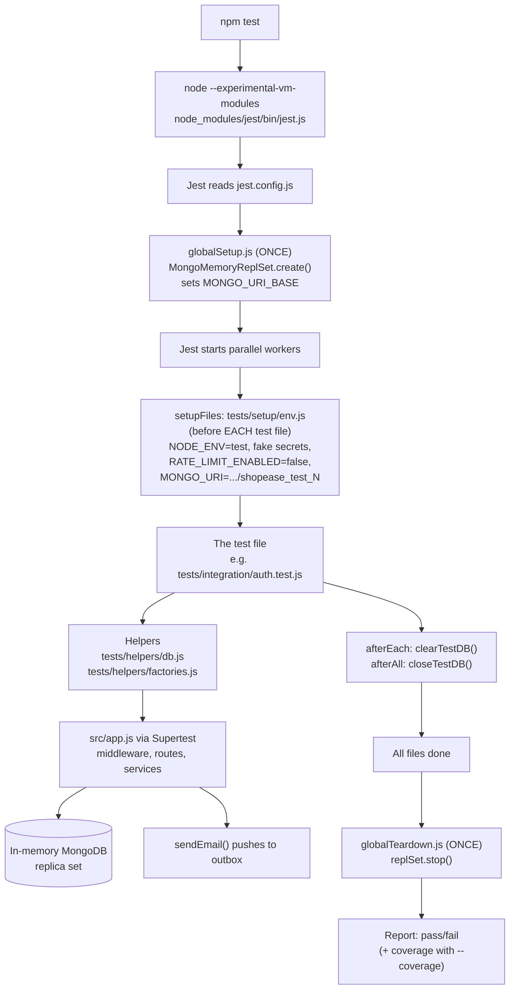

# Tools in This Project

**What you'll learn:** every testing and code-quality tool ShopEase uses, the problem each one solves, the exact
config file that controls it and the npm script that runs it. You will see what really happens, step by step,
when you type `npm test`, and why npm 11 asks you to approve some packages' install scripts. After this chapter
no file in `server/tests/` or the repo root should look mysterious.

All paths are relative to the repo root. Unless a section says otherwise, the code shown is from branch `main`.
Run every `npm` command **inside `server/`**.

---

## 1. The whole toolbox at a glance

| Tool | Problem it solves | Config file | npm script (in `server/`) |
| --- | --- | --- | --- |
| **Jest** | Finds, runs and reports tests; assertions; mocks | `server/jest.config.js` | `npm test`, `test:unit`, `test:integration`, `test:watch` |
| **Supertest** | Sends HTTP requests to the Express app without opening a port | none (used in `tests/helpers/factories.js`) | part of `npm test` |
| **mongodb-memory-server** | A real, throw-away MongoDB for every test run | `tests/setup/globalSetup.js`, `globalTeardown.js` | part of `npm test` |
| **Email outbox** | Read emails in tests without sending any | `server/src/emails/sendEmail.js` | part of `npm test` |
| **Injectable wrappers** | Replace Google / Cloudinary / Stripe with fakes | `google.verifier.js`, `cloudinary.js`, `stripe.gateway.js` | part of `npm test` |
| **Test factories** | Create users, products, orders in one line | `server/tests/helpers/factories.js` | part of `npm test` |
| **Coverage** | Measures which lines ran; fails the run below a threshold | `server/jest.config.js` (`coverageThreshold`) | `npm run test:coverage` |
| **ESLint + eslint-plugin-jest** | Finds likely bugs without running code | `server/eslint.config.js` | `npm run lint`, `lint:fix` |
| **Prettier** | One consistent code format, no arguments | `server/.prettierrc.json`, `.prettierignore` | `npm run format`, `format:check` |
| **Husky + lint-staged** | Runs checks automatically before every `git commit` | `server/.husky/pre-commit`, `package.json` → `lint-staged` | `prepare` (installs the hook) |
| **GitHub Actions** | Runs lint, format check and tests on every push | `.github/workflows/ci.yml` | runs `npm ci`, `lint`, `format:check`, `test:coverage` |
| **Postman + Newman** | Click-through API tests; Newman runs them from the terminal | `server/postman/*.json` | `npm run test:api` |
| **Bruno CLI** | Same as Postman, but plain-text files in git | `server/bruno/**` | `npm run test:bruno` |
| **Mailpit** | A fake SMTP server with a web inbox for development | `docker-compose.yml` | `docker compose up -d` (repo root) |
| **Swagger / OpenAPI** | Machine-readable API description + "try it" page | `server/src/docs/openapi.js`, `modules/*/*.docs.js` | served by `npm run dev` at `/api/docs` |

These are the scripts as written in `server/package.json` (branch `main`):

```json
"test": "node --experimental-vm-modules node_modules/jest/bin/jest.js",
"test:watch": "node --experimental-vm-modules node_modules/jest/bin/jest.js --watch",
"test:unit": "node --experimental-vm-modules node_modules/jest/bin/jest.js tests/unit",
"test:integration": "node --experimental-vm-modules node_modules/jest/bin/jest.js tests/integration",
"test:coverage": "node --experimental-vm-modules node_modules/jest/bin/jest.js --coverage",
"test:api": "newman run postman/ShopEase.postman_collection.json -e postman/ShopEase.local.postman_environment.json",
"test:bruno": "cd bruno && npx --yes @usebruno/cli@4.3.0 run --env local -r",
"lint": "eslint .",
"lint:fix": "eslint . --fix",
"format": "prettier --write .",
"format:check": "prettier --check .",
"prepare": "cd .. && husky server/.husky || true"
```

---

## 2. Jest (with native ES modules)

**What it is.** Jest is a **test runner** (finds `*.test.js` files and runs them), an **assertion library**
(`expect(x).toBe(y)`) and a **mocking library** (`jest.fn()`, `jest.spyOn()`) in one package.

**Problem it solves.** Without a runner you would write `if (result !== 5) throw ...` by hand and invent your own
reporting. Jest gives you `describe`/`it`, clear failure messages with diffs, parallel workers, watch mode and
coverage.

**Config:** `server/jest.config.js` (branch `main`, unchanged on every later branch):

```js
export default {
  testEnvironment: 'node', // we test a server, not a browser
  transform: {}, // run the code as-is (native ES modules, no Babel)
  setupFiles: ['<rootDir>/tests/setup/env.js'], // runs BEFORE each test file: sets test env vars
  globalSetup: '<rootDir>/tests/setup/globalSetup.js', // starts ONE in-memory MongoDB for the run
  globalTeardown: '<rootDir>/tests/setup/globalTeardown.js', // stops it at the end
  testMatch: ['<rootDir>/tests/**/*.test.js'], // test files end with .test.js
  testTimeout: 30000, // the first run downloads MongoDB, so be patient
  collectCoverageFrom: [
    'src/**/*.js',
    '!src/server.js', // starts a real server: checked manually, not in tests
    '!src/db/scripts/**', // one-off CLI scripts (seed, indexes)
    '!src/modules/models.js', // only re-exports, nothing to test
  ],
  coverageThreshold: {
    // The test run FAILS if coverage drops below these numbers (an industry "quality gate")
    global: { lines: 90, statements: 90, functions: 90, branches: 80 },
  },
};
```

### Why `--experimental-vm-modules`?

`server/package.json` has `"type": "module"`, so every file uses `import`/`export` (**ES modules**, ESM). Jest
was built for the older `require()` style (CommonJS) and normally converts ESM with Babel. ShopEase skips Babel
(`transform: {}`) and instead starts Jest with Node's `--experimental-vm-modules` flag, which lets Jest load ES
modules natively. Two consequences:

1. **Always run tests through npm scripts** (`npm test`), never plain `npx jest`, or you get
   `SyntaxError: Cannot use import statement outside a module`.
2. **The `jest` object must be imported** in a test file when you use it. `describe`, `it` and `expect` are still
   global. From `server/tests/unit/utils.test.js`:

   ```js
   // In ES-module mode the `jest` object must be imported (describe/it/expect are still global)
   import { jest } from '@jest/globals';
   ```

Node prints `ExperimentalWarning: VM Modules is an experimental feature`. That warning is expected and harmless.

> **Try it:** run one file, then only tests whose name matches a word.
>
> ```powershell
> cd server
> npm test -- tests/integration/users.test.js
> npm test -- -t "admin"
> ```
>
> The `--` tells npm "everything after this goes to Jest, not to npm".

---

## 3. Supertest

**What it is.** A library that sends HTTP requests to an Express `app` object and lets you assert on the response.

**Problem it solves.** You want to test real routes (middleware, validation, controllers, error handler) without
starting the server on port 5000 and without a network. Supertest binds the app to a temporary internal port for
each request and closes it afterwards. That is why `src/app.js` (builds the app) and `src/server.js` (calls
`listen`) are separate files: tests import `app.js` only.

**Where:** `server/tests/helpers/factories.js`:

```js
import request from 'supertest';
import app from '../../src/app.js';
// ...
/** The supertest client for our app (no real network port needed). */
export const api = () => request(app);
```

A test then reads like a sentence (`server/tests/integration/app.test.js`):

```js
const res = await api().get('/api/health');
expect(res.status).toBe(200);
expect(res.body.data.status).toBe('ok');
```

---

## 4. mongodb-memory-server (as a replica set)

**What it is.** An npm package that downloads a real MongoDB server binary and starts it with its data **in
memory**. When the run ends, everything is gone.

**Problem it solves.** Integration tests need a database, but you must never test against your real MongoDB
Atlas data, and you do not want every developer (or CI) to install MongoDB. This gives each run a clean, private,
real MongoDB with zero setup.

**Why a replica set, not a single server?** A **replica set** is a group of MongoDB servers that copy each other's
data. MongoDB **transactions** (several writes that succeed or fail together) only work on a replica set. The
`main` branch does not use transactions yet, but `05-cart-wishlist` (signup creates user + cart + wishlist
atomically), `07-orders` (checkout) and `08-payments` do. Starting a one-member replica set from day one means the
setup never has to change. `server/tests/setup/globalSetup.js`:

```js
import { MongoMemoryReplSet } from 'mongodb-memory-server';

export default async function globalSetup() {
  // Start a 1-member replica set (enough for transactions)
  const replSet = await MongoMemoryReplSet.create({ replSet: { count: 1 } });
  // Keep it on `globalThis` so globalTeardown can stop it
  globalThis.__MONGO_REPLSET__ = replSet;
  // Test workers start AFTER this, so they inherit this environment variable
  process.env.MONGO_URI_BASE = replSet.getUri();
}
```

`server/tests/setup/globalTeardown.js` stops it:

```js
export default async function globalTeardown() {
  await globalThis.__MONGO_REPLSET__?.stop();
}
```

**One database per Jest worker.** Jest runs test files in parallel **workers** (separate Node processes).
`server/tests/setup/env.js` gives each worker its own database name on the shared server, so parallel files
never delete each other's data:

```js
const worker = process.env.JEST_WORKER_ID || '1';
const base = process.env.MONGO_URI_BASE || 'mongodb://127.0.0.1:27017/';
const url = new URL(base);
url.pathname = `/shopease_test_${worker}`;
process.env.MONGO_URI = url.toString();
```

**Connect, clean, close.** `server/tests/helpers/db.js` exports three functions every integration file uses:

```js
beforeAll(connectTestDB); // connect + build indexes (e.g. unique email)
afterEach(clearTestDB);   // delete all documents AND empty the email outbox
afterAll(closeTestDB);    // drop this worker's database and disconnect
```

**First run:** the MongoDB binary (around 100 MB) is downloaded once and cached. That is why `testTimeout` is
30 seconds.

---

## 5. The email outbox (`sendEmail.js`)

**Problem it solves.** Registration and password reset send emails with a secret token in a link. A test must
read that token, exactly like a user clicking the link, but no real email may be sent.

**How.** `server/src/emails/sendEmail.js` checks `env.isTest` (true when `NODE_ENV=test`, which `env.js` sets):

```js
// In-memory "mailbox" used only by tests. Tests read it and empty it with clearOutbox().
export const outbox = [];
export const clearOutbox = () => outbox.splice(0, outbox.length); // empty the array in place
// ...
export default async function sendEmail({ to, subject, html, text }) {
  if (env.isTest) {
    // Tests: remember the email instead of sending it
    outbox.push({ to, subject, html, text });
    return;
  }
```

The factory `tokenFromLastEmail(email)` in `tests/helpers/factories.js` finds the newest email to that address
and extracts `token=<hex>` from the link. `clearTestDB()` calls `clearOutbox()` so emails never leak between
tests.

This is a **fake** (see [chapter 01](./01-what-is-testing.md#5-test-doubles)): a simple, working replacement for
the real SMTP server.

---

## 6. Injectable wrappers (seams for test doubles)

**Problem it solves.** Google, Cloudinary and Stripe live on the internet. Calling them in tests would be slow,
flaky, sometimes paid, and impossible to make fail on demand. ShopEase puts each one behind **one small object**
whose methods tests can overwrite, then restore.

| Wrapper | Branch | Methods tests replace | Test that uses it |
| --- | --- | --- | --- |
| `server/src/modules/auth/google.verifier.js` → `googleVerifier` | `main` | `verify` | `tests/integration/google.test.js` |
| `server/src/config/cloudinary.js` → `cloudinaryClient` | `04-products-uploads` | `isConfigured`, `upload`, `destroy` | `tests/unit/cloudinary.test.js`, `tests/integration/uploads.test.js` |
| `server/src/modules/payments/stripe.gateway.js` → `stripeGateway` | `08-payments` | `createCheckoutSession` | `tests/integration/payments.test.js` |

`google.verifier.js` (branch `main`):

```js
export const googleVerifier = {
  async verify(credential) {
    const ticket = await client.verifyIdToken({
      idToken: credential,
      audience: env.GOOGLE_CLIENT_ID, // the token must be meant for OUR app
    });
    return ticket.getPayload();
  },
};
```

The pattern in the test is always **save → replace → restore**:

```js
const realVerify = googleVerifier.verify;                  // save
googleVerifier.verify = async () => payload;               // replace (in a test)
afterEach(() => { googleVerifier.verify = realVerify; });  // restore (simplified)
```

Note that on `08-payments` only the network call is faked. Webhook **signature checking** is pure maths, so tests
sign payloads with Stripe's real helper and the real `constructEvent` runs (`payments.test.js`):

```js
const header = signature ?? Stripe.webhooks.generateTestHeaderString({ payload, secret });
```

---

## 7. Test factories

**Problem it solves.** Without factories, every test repeats ten lines to build a valid user. Factories let a
test say *what* it needs, not *how* to build it. From `server/tests/helpers/factories.js` (branch `main`):

| Helper | Returns |
| --- | --- |
| `api()` | A Supertest client for the app |
| `createUser(overrides)` | A saved, verified customer (any field can be overridden) |
| `createAdmin(overrides)` | A saved admin |
| `loggedIn(overrides)` | `{ user, auth }` where `auth` is `"Bearer <jwt>"` |
| `bearer(user)` | The `Authorization` header value for a user |
| `uniqueEmail(prefix)` | An email that never collides (time + counter) |
| `tokenFromLastEmail(email)` | The token from the newest email to that address |
| `PASSWORD` | `'secret123'`, a valid password |

Later branches add more, for example `createProduct`, `createCoupon`, `createAddress`, `addToCart` and
`createOrder` (all imported by `payments.test.js` on `08-payments`).

---

## 8. Coverage (Istanbul) and the quality gate

**What it is.** **Code coverage** measures which lines, statements, functions and branches (`if`/`else` sides)
ran during the tests. Jest's default coverage provider instruments the code with **Istanbul** (the
`coverageProvider` option is not set, so the default `"babel"` provider is used). Jest can also use Node's
built-in **V8** coverage with `coverageProvider: 'v8'`; ShopEase does not.

**Problem it solves.** Coverage shows code that **no test ever runs**. The `coverageThreshold` in
`jest.config.js` turns that into a **quality gate**: `npm run test:coverage` fails if global coverage is below
90% lines, 90% statements, 90% functions or 80% branches. CI runs exactly this command.

```powershell
cd server
npm run test:coverage
start coverage/lcov-report/index.html     # open the HTML report (PowerShell and Git Bash)
# macOS: open coverage/lcov-report/index.html     Linux: xdg-open coverage/lcov-report/index.html
```

High coverage does not prove the tests are good; it only proves the lines ran. Chapter
[07](./07-coverage-and-quality-gates.md) goes deeper.

---

## 9. ESLint + eslint-plugin-jest

**What it is.** ESLint reads your code and reports likely bugs: unused variables, undefined names, unreachable
code. `eslint-plugin-jest` adds rules that understand tests, such as "no `.only` left behind", "no disabled
tests", "`expect` must be called inside a test".

**Config:** `server/eslint.config.js` (flat config). The test-only block:

```js
// Test files also know Jest's globals (describe, it, expect…)
{
  files: ['tests/**/*.js'],
  ...jest.configs['flat/recommended'],
  languageOptions: { globals: { ...globals.node, ...globals.jest } },
},
```

`eslint-config-prettier` comes **last** so it can switch off every style rule that would fight Prettier.

**Scripts:** `npm run lint` (check), `npm run lint:fix` (fix what is safe).

---

## 10. Prettier

**What it is.** An opinionated **code formatter**: it rewrites spacing, quotes, commas and line breaks into one
style.

**Problem it solves.** No more style debates or noisy diffs. ESLint looks for bugs; Prettier only formats.

**Config:** `server/.prettierrc.json`:

```json
{
  "singleQuote": true,
  "semi": true,
  "trailingComma": "all",
  "printWidth": 100,
  "endOfLine": "lf"
}
```

`server/.prettierignore` skips `node_modules`, `coverage` and `package-lock.json`.
**Scripts:** `npm run format` (rewrite files), `npm run format:check` (only report; used in CI).

---

## 11. Husky + lint-staged

**What it is.** **Husky** installs **git hooks**: scripts git runs automatically at certain moments. ShopEase uses
the **pre-commit** hook, which runs before every `git commit`. **lint-staged** runs commands only on the files you
**staged** (`git add`), which keeps the hook fast.

**Problem it solves.** Broken or unformatted code never even gets committed.

**Install:** the `prepare` script runs automatically after `npm install`:
`cd .. && husky server/.husky || true`. The hooks live in `server/.husky/` because `package.json` is in `server/`
but the git repo root is one level up. `|| true` keeps `npm install` working where there is no `.git` folder.

**The hook:** `server/.husky/pre-commit`:

```sh
cd server
# 1) Lint + format only the files you staged (fast)
npx lint-staged
# 2) Run the whole test suite (unit + integration, in-memory DB)
npm test --silent
```

**lint-staged config** in `server/package.json`:

```json
"lint-staged": {
  "*.js": ["eslint --fix", "prettier --write"],
  "*.{json,md,yml}": ["prettier --write"]
}
```

If any step fails, the commit is cancelled. Fix the problem, `git add` again, and commit again.

---

## 12. GitHub Actions CI

**What it is.** **Continuous Integration (CI)**: a clean machine on GitHub runs your checks on every push and pull
request.

**Problem it solves.** The pre-commit hook can be skipped (`--no-verify`) or missing on another computer. CI is the
check nobody can skip, and it proves the project works on a fresh install, not only on your laptop.

**Config:** `.github/workflows/ci.yml` (repo root, branch `main`). The steps:

```yaml
steps:
  - uses: actions/checkout@v4 # download the code
  - uses: actions/setup-node@v4 # install Node.js
    with:
      node-version: 22
      cache: npm
      cache-dependency-path: server/package-lock.json
  - run: npm ci # clean install exactly what package-lock.json says
  - run: npm run lint # code quality
  - run: npm run format:check # formatting
  - run: npm run test:coverage # unit + integration tests with the coverage gate
```

It runs on `push` to every branch (`branches: ['**']`) and on every `pull_request`. Chapter
[09](./09-ci-cd-automation.md) explains it line by line.

---

## 13. Postman + Newman

**What it is.** **Postman** is a desktop app for sending HTTP requests by hand. Each request can have a **test
script** (JavaScript using `pm.test(...)`). **Newman** is Postman's command-line runner, installed as a
devDependency, so the same collection runs from the terminal.

**Problem it solves.** Jest tests the app in memory. Postman/Newman test the **real running server**, with the
real `.env`, the real MongoDB and Mailpit: an **end-to-end** check.

**Files:** `server/postman/ShopEase.postman_collection.json` (requests + scripts) and
`server/postman/ShopEase.local.postman_environment.json` (`baseUrl`, `mailpitUrl`, saved tokens). A test script
from the collection:

```js
pm.test('status is 201', () => pm.response.to.have.status(201));
const result = pm.response.json().data;
pm.test('role is customer', () => pm.expect(result.user.role).to.eql('customer'));
pm.test('no password in response', () => pm.expect(result.user.password).to.be.undefined);
pm.environment.set('token', result.token);
```

**Script:** `npm run test:api`. **Needs:** API running (`npm run dev`), Mailpit running, admin seeded
(`npm run seed:admin`), and `RATE_LIMIT_ENABLED=false` in `server/.env`.

---

## 14. Bruno CLI

**What it is.** **Bruno** is an open-source, offline alternative to Postman. Each request is a plain-text `.bru`
file, so collections live in git and show readable diffs. `@usebruno/cli` runs them from the terminal.

**Files:** `server/bruno/bruno.json`, `server/bruno/environments/local.bru`, and one folder per module
(`01 Auth` on `main`, up to `10 Admin` on `10-admin`). `server/bruno/01 Auth/05 Login.bru`:

```text
post {
  url: {{baseUrl}}/auth/login
  body: json
  auth: none
}

tests {
  test("status is 200", function () { expect(res.status).to.equal(200); });
  bru.setEnvVar("token", res.body.data.token);
}
```

**Script:** `npm run test:bruno` → `cd bruno && npx --yes @usebruno/cli@4.3.0 run --env local -r`. The CLI version
is **pinned** (`@4.3.0`) so a new release cannot silently change behaviour; `-r` runs folders recursively. Same
prerequisites as Newman.

---

## 15. Mailpit (Docker)

**What it is.** A fake SMTP (email) server with a web inbox. The API "sends" emails to it; you read them at
`http://localhost:8025`. Nothing reaches a real mailbox.

**Problem it solves.** In **development** (not in Jest) you need to click verification and reset links. The
Postman and Bruno collections also read tokens from Mailpit's API (`GET {{mailpitUrl}}/api/v1/message/latest`),
so email flows run fully automatically.

**Config:** `docker-compose.yml` at the repo root:

```yaml
services:
  mailpit:
    image: axllent/mailpit:latest
    container_name: shopease-mailpit
    restart: unless-stopped
    ports:
      - '8025:8025' # web inbox  → http://localhost:8025
      - '1025:1025' # SMTP port  → the API sends to localhost:1025 (SMTP_PORT in .env)
```

`server/.env.example` already points at it: `SMTP_HOST=localhost`, `SMTP_PORT=1025`.
**Commands (repo root, needs Docker Desktop):** `docker compose up -d` to start, `docker compose down` to stop.

---

## 16. Swagger / OpenAPI docs

**What it is.** **OpenAPI** is the standard format for describing a REST API: URLs, inputs, outputs, auth.
**Swagger UI** (`swagger-ui-express`) turns it into an interactive web page.

**Problem it solves.** Humans get a "try it out" page; tools (Postman, Bruno, contract tests) get a
machine-readable contract. In `server/src/app.js`:

```js
app.get('/api/docs.json', (_req, res) => res.json(openapiSpec)); // raw spec (Postman can import it)
app.use('/api/docs', swaggerUi.serve, swaggerUi.setup(openapiSpec));
```

The spec is merged in `server/src/docs/openapi.js` from one `*.docs.js` file per module (e.g.
`modules/auth/auth.docs.js`). `tests/integration/app.test.js` checks that `/api/docs.json` is OpenAPI 3 and lists
every auth route, so forgetting to document a route makes a test fail: a light **contract test**.

---

## 17. What happens when you run `npm test`



In words:

1. npm runs the `test` script, which starts Node with the ESM flag and then Jest.
2. Jest loads `jest.config.js`.
3. `globalSetup.js` runs **once** and starts the in-memory replica set. Its URI goes into `MONGO_URI_BASE`.
4. Jest starts workers. They inherit the environment, so they know `MONGO_URI_BASE`.
5. Before **each** test file, `env.js` sets fake config and a per-worker `MONGO_URI`.
6. The test file imports helpers, which import `src/app.js`; `src/config/env.js` reads the variables just set.
7. `beforeAll(connectTestDB)` connects; each test sends requests via Supertest; `afterEach(clearTestDB)` cleans.
8. `afterAll(closeTestDB)` drops this worker's database.
9. When every file is done, `globalTeardown.js` stops MongoDB and Jest prints the report.

> **Try it:** add `--verbose` to see every test name, and `--runInBand` to run files one at a time in a single
> process (useful when debugging):
>
> ```powershell
> cd server
> npm test -- --verbose --runInBand tests/unit
> ```

---

## 18. The npm 11 `allowScripts` note

Some packages run an **install script** after download. npm 11 blocks these scripts unless you approve them,
because a malicious package could run any code on your machine during `npm install`. ShopEase approves exactly
two, pinned to exact versions, in `server/package.json`:

```json
"allowScripts": {
  "bcrypt@6.0.0": true,
  "mongodb-memory-server@11.3.0": true
}
```

| Package | Why its install script is needed |
| --- | --- |
| `bcrypt` | Password hashing in native (C++) code; the script picks a prebuilt binary for your OS or compiles one |
| `mongodb-memory-server` | Its script pre-downloads the MongoDB binary used by the tests (otherwise the first test run downloads it) |

Other warnings such as `npm warn install-scripts … @parcel/watcher … @scarf/scarf` are safe to ignore (as the repo's
own README and `docs/guides/troubleshooting.md` on `10-admin` say). If you upgrade `bcrypt` or
`mongodb-memory-server`, update the version in `allowScripts` too, or the script will be blocked again.

---

## Common mistakes

- **`npx jest` → "Cannot use import statement outside a module".** Use `npm test` (it adds the ESM flag).
- **`ReferenceError: jest is not defined`.** Add `import { jest } from '@jest/globals';` at the top of the file.
- **Running `npm test` from the repo root.** There is no `package.json` there. `cd server` first.
- **Running Newman or Bruno without the server, Mailpit or seeded admin.** They test the *running* API; Jest does
  not need any of these.
- **`429 Too Many Requests` in Postman/Bruno.** Set `RATE_LIMIT_ENABLED=false` in `server/.env` and restart
  `npm run dev`. (Jest already turns limits off in `tests/setup/env.js`.)
- **Forgetting to restore a wrapper method after replacing it.** The next test then uses your fake by accident.
- **First run "hangs".** It is downloading MongoDB (~100 MB). Wait; later runs are fast.

---

## Check yourself

1. Why does ShopEase start a MongoDB **replica set** in `globalSetup.js` even though `main` has no transactions?
2. Which file runs once per test **file**, and which runs once per test **run**? What does each do?
3. Where do emails go during `npm test`, and how does a test read the verification token?
4. What is the difference between `npm run format` and `npm run format:check`, and which one does CI use? Why?
5. Which two packages are listed under `allowScripts`, and what would break if their scripts were blocked?

---

**Next:** [03 – Setup from scratch](./03-setup-from-scratch.md)
