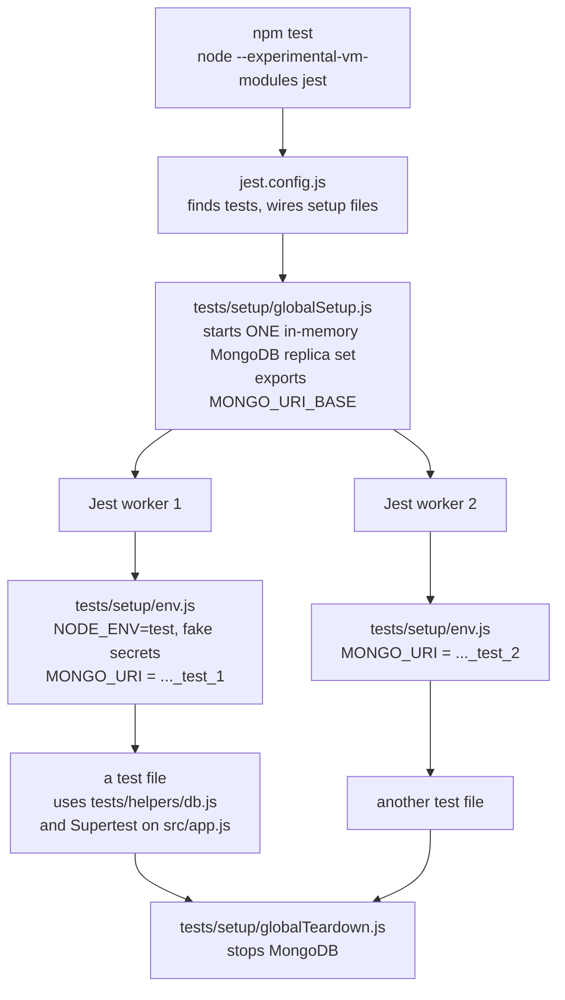
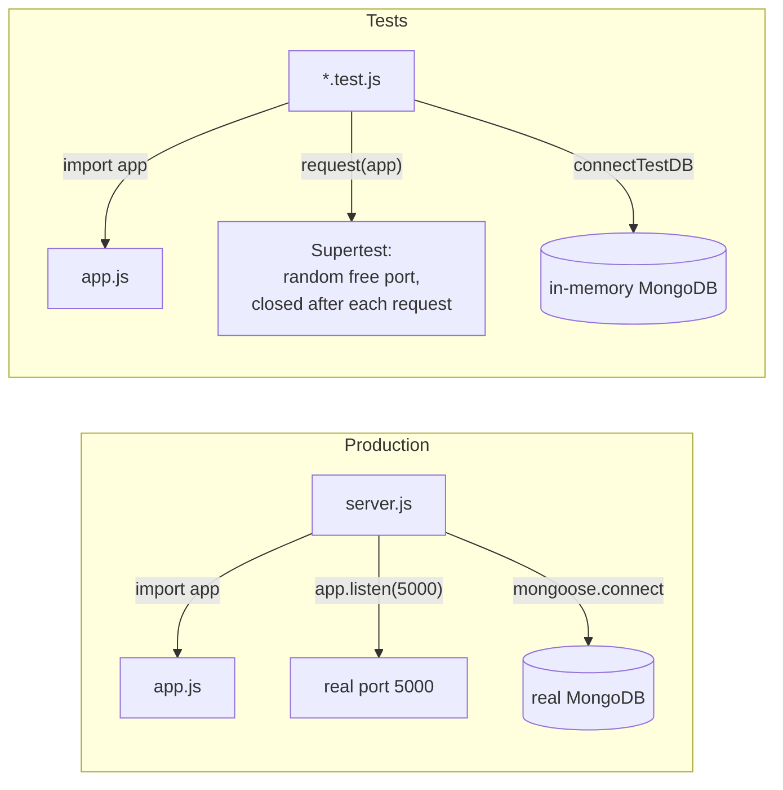
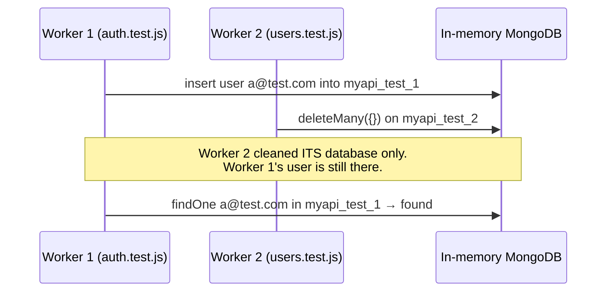

# 03 – Set up the test harness from scratch

**What you'll learn:** how to add the exact ShopEase testing setup to a **brand-new** Express + Mongoose project
that uses ES modules. You will start from an empty folder and finish with: Jest running native ES modules,
Supertest calling your app without opening a port, a throw-away MongoDB **replica set** in memory, a separate
database per Jest worker, helpers that connect/clean/close the database, a first unit test, a first integration
test, a coverage report with a "quality gate" (threshold), and ESLint that understands Jest. Every config file is
shown in full and matches the real file on the `main` branch of the repo, line by line, with an explanation of
each line. Do this once on a practice project and you will be able to repeat it on every future project.

---

## The big picture

Before typing anything, look at what we are building. Each box is one file you will create.



| Word | Meaning |
| --- | --- |
| **Jest** | The test runner: finds `*.test.js` files, runs them, prints pass/fail, measures coverage. |
| **Supertest** | Sends real HTTP requests to your Express `app` object without you starting a server. |
| **mongodb-memory-server** | Downloads a real `mongod` binary once and starts it in a temp folder for the test run. |
| **Replica set** | A group of MongoDB servers that copy each other. Even a 1-member set unlocks **transactions**. |
| **Jest worker** | Jest runs test files in parallel in several child processes. Each one is a worker. |
| **ESM** | ES modules: `import`/`export` syntax, switched on by `"type": "module"` in `package.json`. |

> The finished folder will look like this:
>
> ```text
> my-api/
> ├─ package.json
> ├─ jest.config.js
> ├─ eslint.config.js
> ├─ .gitignore
> ├─ src/
> │  ├─ app.js            ← builds the Express app (no listen)
> │  ├─ server.js         ← connects to MongoDB and calls app.listen
> │  ├─ config/env.js     ← reads settings from process.env
> │  └─ models/task.model.js
> └─ tests/
>    ├─ setup/env.js
>    ├─ setup/globalSetup.js
>    ├─ setup/globalTeardown.js
>    ├─ helpers/db.js
>    ├─ helpers/factories.js
>    ├─ unit/task.model.test.js
>    ├─ integration/tasks.test.js
>    └─ integration/health.test.js   ← added in Step 13
> ```

The tiny "tasks" app (`src/*`, the three test files and the small `factories.js`) is **practice code written for this
tutorial**. It is not in the ShopEase repo, but it follows the same patterns. Every **test-infrastructure** file
(`jest.config.js`, `tests/setup/*`, `tests/helpers/db.js`, `eslint.config.js`, the npm scripts) is copied from
`main` in the repo.

---

## Step 0 – Check your tools

```powershell
node -v    # must be 20 or newer (the repo says "engines": { "node": ">=20" })
npm -v     # 10 or 11 both work; npm 11 needs one extra step in Step 3
git --version
```

Same commands on Git Bash, macOS and Linux.

---

## Step 1 – Create the project and switch on ES modules

```powershell
mkdir my-api
cd my-api
git init
npm init -y
npm pkg set type=module
```

- `npm init -y` writes a default `package.json` without asking questions (`-y` = "yes to everything").
- `npm pkg set type=module` sets `"type": "module"` in `package.json` (npm 11's `npm init -y` already writes
  `"type": "commonjs"`; this command switches it). From now on every `.js` file in this
  project is an **ES module**: you write `import x from 'y'`, not `require('y')`.

Open `package.json`. You should see `"type": "module"`. If `npm pkg` is not available, add the line by hand.

Create a `.gitignore` (same lines the repo uses for these folders):

```text
# Installed packages: recreated by `npm install`, never committed
node_modules/
# Real secrets live in .env files
.env
# Generated reports
coverage/
```

---

## Step 2 – Install the app's own dependencies

```powershell
npm install express@4.22.3 mongoose@8.24.10 dotenv@18.0.10
```

These are the exact versions in the repo's `server/package-lock.json` on `main`. Pinning versions in a tutorial
means the output you see matches the output described here.

---

## Step 3 – Install the test tools (and approve install scripts on npm 11)

```powershell
npm install --save-dev jest@30.5.2 supertest@7.3.2 mongodb-memory-server@11.3.0
```

`--save-dev` (or `-D`) puts them under `devDependencies`: tools you need while developing, never in production.

| Package | Job |
| --- | --- |
| `jest` | Test runner, assertions (`expect`), mocks (`jest.fn`), coverage. Also brings `@jest/globals`. |
| `supertest` | `request(app).get('/api/health')` → real HTTP request into your app, no port needed. |
| `mongodb-memory-server` | Starts a real MongoDB for tests. Its install script downloads the `mongod` binary. |

### npm 11: approve the install script

npm 11 **blocks package install scripts** unless you approve them. You will see a warning like
`npm warn install-scripts … not yet covered by allowScripts`. `mongodb-memory-server` has an install script that
downloads MongoDB, so we approve it. The repo does this in `server/package.json`:

```json
  "allowScripts": {
    "bcrypt@6.0.0": true,
    "mongodb-memory-server@11.3.0": true
  }
```

In your new project you only need the second line (add `bcrypt` too if you install it later). Add this block to
`package.json` (top level, next to `"devDependencies"`), then run the script that was skipped:

```powershell
npm rebuild mongodb-memory-server
```

`npm rebuild` re-runs a package's install scripts. If you skip this, nothing breaks: the binary is downloaded
the **first time** your tests start a database instead (that first run is just slower).

On npm 10 or older, install scripts run automatically and there is nothing to approve.

> Other `install-scripts` warnings for packages you did not choose (the repo's README names `@parcel/watcher` and
> `@scarf/scarf`) are safe to ignore.

---

## Step 4 – Add the test scripts

Open `package.json` and set `"scripts"` to the test lines from the repo (`server/package.json` on `main`):

```json
  "scripts": {
    "dev": "node --watch src/server.js",
    "start": "node src/server.js",
    "test": "node --experimental-vm-modules node_modules/jest/bin/jest.js",
    "test:watch": "node --experimental-vm-modules node_modules/jest/bin/jest.js --watch",
    "test:unit": "node --experimental-vm-modules node_modules/jest/bin/jest.js tests/unit",
    "test:integration": "node --experimental-vm-modules node_modules/jest/bin/jest.js tests/integration",
    "test:coverage": "node --experimental-vm-modules node_modules/jest/bin/jest.js --coverage"
  },
```

(The repo's `dev` script uses `nodemon`; `node --watch` is built into Node 20+ and saves one dependency in a
practice project.)

**Why `node --experimental-vm-modules node_modules/jest/bin/jest.js` instead of just `jest`?**

- Jest was born in the CommonJS (`require`) world. To run **native ES modules** without Babel (a code
  translator), Jest needs Node's `vm` module API for ES modules, which is behind the
  `--experimental-vm-modules` flag.
- We pass the flag to `node` directly and point it at Jest's start file. This works the same in PowerShell,
  Git Bash, macOS and Linux. (The other common trick, `NODE_OPTIONS=--experimental-vm-modules jest`, does not
  work in PowerShell without extra tools.)
- Because the flag is in the scripts, **always run tests with `npm test`**, never with plain `npx jest`.

Each run prints `ExperimentalWarning: VM Modules is an experimental feature…`. That is normal.

| Script | When you use it |
| --- | --- |
| `npm test` | Everything. Also what the pre-commit hook and CI run. |
| `npm run test:watch` | While coding: re-runs tests when you save a file. |
| `npm run test:unit` / `test:integration` | Only one folder. The extra argument is a path filter. |
| `npm run test:coverage` | Everything + a coverage report + the coverage gate (Step 13). |

To pass more options to Jest, put them after `--`: `npm test -- tests/unit/task.model.test.js` or
`npm test -- -t "creates a task"` (`-t` = only tests whose name matches).

---

## Step 5 – Write a small app, split into `app.js` and `server.js`

Create the folders:

```powershell
# PowerShell
New-Item -ItemType Directory -Force src/config, src/models, tests/setup, tests/helpers, tests/unit, tests/integration
```

```bash
# Git Bash / macOS / Linux
mkdir -p src/config src/models tests/setup tests/helpers tests/unit tests/integration
```

### `src/config/env.js` (practice version of the repo's file)

```js
/**
 * src/config/env.js – the ONE place that reads settings from process.env.
 */
import dotenv from 'dotenv';

dotenv.config({ quiet: true }); // copy .env into process.env (never overwrites values already set)

const REQUIRED = ['MONGO_URI'];
const missing = REQUIRED.filter((key) => !process.env[key]);
if (missing.length) {
  console.error(`Missing required environment variables: ${missing.join(', ')}`);
  process.exit(1); // fail fast
}

const env = {
  NODE_ENV: process.env.NODE_ENV || 'development',
  PORT: Number(process.env.PORT) || 5000,
  MONGO_URI: process.env.MONGO_URI,
};
env.isTest = env.NODE_ENV === 'test';

export default env;
```

This is a shortened copy of `server/src/config/env.js` on `main` (which also has JWT, SMTP, Google and rate-limit
settings). Two details matter for testing:

1. It **exits** when `MONGO_URI` is missing. In tests, `tests/setup/env.js` (Step 7) sets it **before** this file
   is ever imported, so the app starts happily.
2. `dotenv` never overwrites variables that already exist. So your personal `.env` file cannot leak a real
   database URL into a test run: the test values were set first.

### `src/models/task.model.js`

```js
/**
 * src/models/task.model.js – one to-do item.
 */
import mongoose from 'mongoose';

const taskSchema = new mongoose.Schema(
  {
    title: {
      type: String,
      required: [true, 'Title is required'],
      trim: true,
      minlength: [3, 'Title must be at least 3 characters'],
      maxlength: [100, 'Title must be at most 100 characters'],
    },
    done: { type: Boolean, default: false },
    doneAt: Date,
  },
  { timestamps: true }, // adds createdAt and updatedAt
);

// `now` is a parameter so tests can pass a fixed date (no clock tricks needed)
taskSchema.methods.markDone = function markDone(now = new Date()) {
  this.done = true;
  this.doneAt = now;
  return this;
};

export default mongoose.model('Task', taskSchema);
```

### `src/app.js` – builds the app, never listens

```js
/**
 * src/app.js – builds the Express application: middleware + routes.
 * It does NOT call app.listen(). server.js does that, so tests can import the app.
 */
import express from 'express';
import mongoose from 'mongoose';
import env from './config/env.js';
import Task from './models/task.model.js';

const app = express();
app.use(express.json({ limit: '100kb' })); // parse JSON bodies; refuse huge ones

app.get('/api/health', (_req, res) => {
  const database = mongoose.connection.readyState === 1 ? 'connected' : 'not connected';
  res.json({ success: true, data: { status: 'ok', environment: env.NODE_ENV, database } });
});

app.post('/api/tasks', async (req, res, next) => {
  try {
    // Pick ONLY the fields a client may set (mass-assignment protection)
    const task = await Task.create({ title: req.body.title });
    res.status(201).json({ success: true, data: task });
  } catch (err) {
    next(err); // Express 4 does not catch async errors by itself
  }
});

app.get('/api/tasks', async (_req, res, next) => {
  try {
    const tasks = await Task.find().sort({ createdAt: -1, _id: -1 }); // newest first
    res.json({ success: true, data: tasks });
  } catch (err) {
    next(err);
  }
});

// No route matched → 404 in the same JSON shape as other errors
app.use((req, res) => {
  res.status(404).json({ success: false, message: `Route not found: ${req.method} ${req.originalUrl}` });
});

// Central error handler: Express knows it by its FOUR parameters
app.use((err, _req, res, _next) => {
  if (err.name === 'ValidationError') {
    const errors = Object.values(err.errors).map((e) => ({ field: e.path, message: e.message }));
    return res.status(400).json({ success: false, message: 'Validation failed', errors });
  }
  return res.status(500).json({ success: false, message: 'Something went wrong' });
});

export default app;
```

### `src/server.js` – the only file that opens a port

```js
/**
 * src/server.js – connect to MongoDB, then start listening.
 */
import mongoose from 'mongoose';
import env from './config/env.js';
import app from './app.js';

await mongoose.connect(env.MONGO_URI); // top-level await works in ES modules
app.listen(env.PORT, () => console.log(`API on http://localhost:${env.PORT}/api`));
```

The repo's real `server/src/server.js` adds error handling and a graceful shutdown on Ctrl+C. Look at it later.

### Why split `app.js` from `server.js`?

The repo explains it at the top of `server/src/app.js`:

> It does NOT call app.listen(). server.js does that. Keeping them apart means tests (Supertest) and Vercel can
> import the app without opening a network port.



If `app.js` called `listen(5000)`:

- every test file would try to open port 5000 → `EADDRINUSE` ("address already in use") as soon as two files run
  in parallel, or while your dev server is running;
- the open server would keep Jest from exiting ("open handle");
- importing the app would also connect to the **real** database from `.env`.

With the split, Supertest takes the bare `app`, starts it on a temporary port for one request and closes it again.

---

## Step 6 – `jest.config.js` (first version)

Create `jest.config.js` in the project root. Start with the repo's file **without** the two coverage settings
(we add them in Step 13):

```js
/**
 * jest.config.js – how Jest finds and runs our tests.
 *
 * Our code uses ES modules ("type": "module"), so the npm scripts start Jest with
 * `node --experimental-vm-modules`. No Babel transform is needed.
 */
export default {
  testEnvironment: 'node', // we test a server, not a browser
  transform: {}, // run the code as-is (native ES modules, no Babel)
  setupFiles: ['<rootDir>/tests/setup/env.js'], // runs BEFORE each test file: sets test env vars
  globalSetup: '<rootDir>/tests/setup/globalSetup.js', // starts ONE in-memory MongoDB for the run
  globalTeardown: '<rootDir>/tests/setup/globalTeardown.js', // stops it at the end
  testMatch: ['<rootDir>/tests/**/*.test.js'], // test files end with .test.js
  testTimeout: 30000, // the first run downloads MongoDB, so be patient
};
```

Line by line:

| Line | What it does | Why |
| --- | --- | --- |
| `export default {…}` | The config is an ES module too | `"type": "module"` makes every `.js` file ESM |
| `testEnvironment: 'node'` | Tests run in plain Node | The other option, `jsdom`, fakes a browser; a server needs none |
| `transform: {}` | Turns off Jest's default Babel transform | Node already understands `import`; Babel would only slow things down and can break top-level `await` |
| `setupFiles` | Runs `tests/setup/env.js` inside each worker, before each test file | Environment variables must exist before `src/config/env.js` is imported |
| `globalSetup` | Runs once, in the main process, before any worker starts | Start one database for the whole run, not one per file |
| `globalTeardown` | Runs once after all files | Stop that database so Jest can exit |
| `testMatch` | Only files under `tests/` ending in `.test.js` are tests | Helpers like `tests/helpers/db.js` are never run as tests |
| `testTimeout: 30000` | Each test (and hook) may take up to 30 s | Default is 5 s. The very first run downloads MongoDB; transactions can be slow on CI |

`<rootDir>` is Jest's name for the folder that contains `jest.config.js`.

---

## Step 7 – `tests/setup/env.js`: fake settings + one database per worker

Here is the file exactly as it is on `main` (`server/tests/setup/env.js`):

```js
/**
 * tests/setup/env.js – runs before EVERY test file (Jest "setupFiles").
 *
 * Sets the environment variables our app needs, so `src/config/env.js` does not
 * exit with "missing variables". All values here are fake and only for tests.
 */
process.env.NODE_ENV = 'test'; // email goes to the in-memory outbox, logs are quiet
process.env.JWT_SECRET = 'test-secret-that-is-long-enough-for-hs256-signing';
process.env.JWT_EXPIRES_IN = '1h';
process.env.CLIENT_URL = 'http://localhost:5173';
process.env.GOOGLE_CLIENT_ID = 'test-google-client-id.apps.googleusercontent.com';
process.env.ADMIN_EMAIL = 'admin@test.local';
process.env.ADMIN_PASSWORD = 'Admin12345';
// Rate limits are OFF in tests by default, so tests can call routes many times.
// tests/integration/rateLimit.test.js switches them back ON to prove they work.
process.env.RATE_LIMIT_ENABLED = 'false';

// Every Jest worker (parallel process) gets its OWN database, so test files never clash.
const worker = process.env.JEST_WORKER_ID || '1';
const base = process.env.MONGO_URI_BASE || 'mongodb://127.0.0.1:27017/';
const url = new URL(base);
url.pathname = `/shopease_test_${worker}`;
process.env.MONGO_URI = url.toString();
```

| Line(s) | Meaning |
| --- | --- |
| `NODE_ENV = 'test'` | The app checks `env.isTest` to stay quiet and to store emails in memory instead of sending them |
| `JWT_SECRET`, `JWT_EXPIRES_IN` | Fake secret so login tokens can be signed and checked. Never a real secret |
| `CLIENT_URL`, `GOOGLE_CLIENT_ID`, `ADMIN_*` | Fake values for features that read them |
| `RATE_LIMIT_ENABLED = 'false'` | Tests call the same route dozens of times; real limits would answer 429 |
| `JEST_WORKER_ID` | Jest sets this to `1`, `2`, `3`… in each worker. `|| '1'` covers running in-band |
| `MONGO_URI_BASE` | Set by `globalSetup.js` (next step): the address of the in-memory MongoDB |
| `new URL(base)` … `url.pathname = …` | Keep host, port and query (e.g. `?replicaSet=…`), replace only the **database name** |
| `MONGO_URI = url.toString()` | The final address, e.g. `mongodb://127.0.0.1:53211/shopease_test_2?replicaSet=testset` |

**Your version.** In the tasks project you only need `NODE_ENV` and the database lines. Rename the prefix so it
matches your project:

```js
/**
 * tests/setup/env.js – runs before EVERY test file (Jest "setupFiles").
 * All values here are fake and only for tests.
 */
process.env.NODE_ENV = 'test';

// Every Jest worker (parallel process) gets its OWN database, so test files never clash.
const worker = process.env.JEST_WORKER_ID || '1';
const base = process.env.MONGO_URI_BASE || 'mongodb://127.0.0.1:27017/';
const url = new URL(base);
url.pathname = `/myapi_test_${worker}`;
process.env.MONGO_URI = url.toString();
```

When your app grows (JWT, email, rate limits), add the matching fake variables here, exactly like the repo.

### Why one database per worker?



Test files run **at the same time** in different workers. If they shared one database, file B's `clearTestDB()`
could delete the user that file A created a millisecond earlier. That gives **flaky** tests: tests that pass or
fail at random. One MongoDB server, many databases, is cheap and removes the problem.

---

## Step 8 – `globalSetup.js` and `globalTeardown.js`

`tests/setup/globalSetup.js` (identical to `main`):

```js
/**
 * tests/setup/globalSetup.js – runs ONCE before all test files.
 *
 * Starts a throw-away MongoDB *replica set* in memory. A replica set (not a single
 * server) is used because later modules (orders) need MongoDB transactions, and
 * transactions only work on replica sets. Your real Atlas database is never touched.
 */
import { MongoMemoryReplSet } from 'mongodb-memory-server';

export default async function globalSetup() {
  // Start a 1-member replica set (enough for transactions)
  const replSet = await MongoMemoryReplSet.create({ replSet: { count: 1 } });
  // Keep it on `globalThis` so globalTeardown can stop it
  globalThis.__MONGO_REPLSET__ = replSet;
  // Test workers start AFTER this, so they inherit this environment variable
  process.env.MONGO_URI_BASE = replSet.getUri();
}
```

| Line | Meaning |
| --- | --- |
| `import { MongoMemoryReplSet }` | The replica-set flavour. There is also `MongoMemoryServer` (single server, no transactions) |
| `export default async function globalSetup()` | Jest calls the default export once and waits for it |
| `MongoMemoryReplSet.create({ replSet: { count: 1 } })` | Downloads `mongod` if needed, starts **one** member and makes it primary |
| `globalThis.__MONGO_REPLSET__ = replSet` | `globalSetup` and `globalTeardown` share the same `globalThis`, so this is how we hand over the object |
| `process.env.MONGO_URI_BASE = replSet.getUri()` | Workers are child processes started later; they copy this process's environment, so `env.js` can read it |

Why a replica set from day one, even if your first app has no transactions? Because switching later means every
test that suddenly needs `session.withTransaction()` fails with
`Transaction numbers are only allowed on a replica set member or mongos`. In ShopEase, transactions arrive on
`05-cart-wishlist` (signup creates user + cart + wishlist atomically) and `07-orders` (checkout). The setup never
had to change.

`tests/setup/globalTeardown.js` (identical to `main`):

```js
/**
 * tests/setup/globalTeardown.js – runs ONCE after all test files: stops the in-memory MongoDB.
 */
export default async function globalTeardown() {
  await globalThis.__MONGO_REPLSET__?.stop();
}
```

`?.` ("optional chaining") means: if setup failed and there is no replica set, do nothing instead of crashing.
`stop()` shuts down `mongod` and deletes its temporary data folder.

---

## Step 9 – `tests/helpers/db.js`: connect, clear, close

The `main` version (`server/tests/helpers/db.js`):

```js
/**
 * tests/helpers/db.js – connect, clean and disconnect the in-memory test database.
 *
 * Usage in an integration test file:
 *   beforeAll(connectTestDB); afterEach(clearTestDB); afterAll(closeTestDB);
 *
 * WHY CLEAN AFTER EACH TEST? Tests must be INDEPENDENT. One test's leftover data must
 * never make another test pass or fail by accident, whatever order they run in.
 */
import mongoose from 'mongoose';
import { clearOutbox } from '../../src/emails/sendEmail.js';

export async function connectTestDB() {
  await mongoose.connect(process.env.MONGO_URI); // URI set by tests/setup/env.js
  // Build every model's indexes (e.g. unique email) before tests rely on them
  await Promise.all(Object.values(mongoose.models).map((m) => m.syncIndexes()));
}

export async function clearTestDB() {
  const { collections } = mongoose.connection;
  // Delete all documents but keep collections + indexes (faster than dropping)
  await Promise.all(Object.values(collections).map((c) => c.deleteMany({})));
  clearOutbox(); // and forget the emails "sent" by the previous test
}

export async function closeTestDB() {
  await mongoose.connection.dropDatabase(); // remove this worker's database
  await mongoose.disconnect();
}
```

| Function | Hook | What and why |
| --- | --- | --- |
| `connectTestDB` | `beforeAll` | Connects Mongoose to this worker's database. `syncIndexes()` builds every model's indexes **now**, so a test that expects "409 email already exists" does not race the background index build |
| `clearTestDB` | `afterEach` | `deleteMany({})` on every collection: fast, keeps indexes. Also empties the email outbox (ShopEase-specific) |
| `closeTestDB` | `afterAll` | Drops the worker's database and disconnects. Without `disconnect()`, Jest waits for the open socket ("open handle") |

**Your version.** Your project has no email outbox yet, so remove the `clearOutbox` import and call:

```js
/**
 * tests/helpers/db.js – connect, clean and disconnect the in-memory test database.
 * Usage: beforeAll(connectTestDB); afterEach(clearTestDB); afterAll(closeTestDB);
 */
import mongoose from 'mongoose';

export async function connectTestDB() {
  await mongoose.connect(process.env.MONGO_URI); // URI set by tests/setup/env.js
  // Build every model's indexes (e.g. unique fields) before tests rely on them
  await Promise.all(Object.values(mongoose.models).map((m) => m.syncIndexes()));
}

export async function clearTestDB() {
  const { collections } = mongoose.connection;
  // Delete all documents but keep collections + indexes (faster than dropping)
  await Promise.all(Object.values(collections).map((c) => c.deleteMany({})));
}

export async function closeTestDB() {
  await mongoose.connection.dropDatabase(); // remove this worker's database
  await mongoose.disconnect();
}
```

When you add emails later, copy the repo's idea: in test mode `sendEmail()` pushes into an exported `outbox`
array instead of sending, and `clearTestDB()` empties it. Chapter [05](./05-integration-tests.md) shows how tests
read tokens from that outbox.

---

## Step 10 – A tiny factory file

The repo's `server/tests/helpers/factories.js` grows on every branch. Its smallest useful piece is `api()`:

```js
/**
 * tests/helpers/factories.js – small helpers that create test data.
 */
import request from 'supertest';
import app from '../../src/app.js';
import Task from '../../src/models/task.model.js';

/** The supertest client for our app (no real network port needed). */
export const api = () => request(app);

/** Saves a task directly in the database (fast, skips the HTTP layer). */
export const createTask = (overrides = {}) => Task.create({ title: 'Write tests', ...overrides });
```

`api` is copied from `main`. `createTask` follows the same shape as the repo's `createUser(overrides)`: good
defaults, and every field can be overridden by the test.

---

## Step 11 – Your first unit test

A **unit test** checks one small piece alone, with no database and no network. Mongoose documents can be built
in memory with `new Model()` and validated with `validateSync()`, exactly like
`server/tests/unit/user.model.test.js` on `main`.

`tests/unit/task.model.test.js`:

```js
/**
 * UNIT tests for the Task model. No database: documents are built in memory, never saved.
 */
import Task from '../../src/models/task.model.js';

describe('Task model', () => {
  it('defaults new tasks to not done', () => {
    const task = new Task({ title: 'Buy milk' });
    expect(task.done).toBe(false);
    expect(task.doneAt).toBeUndefined();
  });

  it('requires a title of at least 3 characters', () => {
    expect(new Task({}).validateSync().errors.title.message).toBe('Title is required');
    expect(new Task({ title: 'ab' }).validateSync().errors.title.message).toBe(
      'Title must be at least 3 characters',
    );
    expect(new Task({ title: 'abc' }).validateSync()).toBeUndefined(); // undefined = valid
  });

  it('trims the title', () => {
    expect(new Task({ title: '  Buy milk  ' }).title).toBe('Buy milk');
  });

  it('markDone sets done and the given time', () => {
    const now = new Date('2026-01-01T10:00:00Z'); // fixed date: the test never depends on the clock
    const task = new Task({ title: 'Buy milk' }).markDone(now);
    expect(task.done).toBe(true);
    expect(task.doneAt).toEqual(now);
  });
});
```

Run only the unit tests:

```powershell
npm run test:unit
```

`describe`, `it` and `expect` are **globals** that Jest provides; you do not import them. The `globalSetup` still
starts MongoDB (it runs for every Jest command), but these tests never connect to it.

> **Try it:** change `minlength: [3, …]` in the model to `4` and run `npm run test:unit` again. Read the red
> output: Jest names the failing test and check (`expect(received).toBeUndefined()`) and shows what it
> received instead (`ValidationError: … Title must be at least 3 characters`). Change it back.

---

## Step 12 – Your first integration test

An **integration test** sends a real HTTP request through the whole stack: route → handler → Mongoose → MongoDB.
`tests/integration/tasks.test.js`:

```js
/**
 * INTEGRATION tests for /api/tasks: real HTTP (Supertest) → app → Mongoose → in-memory MongoDB.
 */
import { connectTestDB, clearTestDB, closeTestDB } from '../helpers/db.js';
import { api, createTask } from '../helpers/factories.js';
import Task from '../../src/models/task.model.js';

beforeAll(connectTestDB); // connect once per file
afterEach(clearTestDB); // clean after EVERY test (isolation)
afterAll(closeTestDB); // drop this worker's DB and disconnect

describe('GET /api/health', () => {
  it('answers ok in the test environment', async () => {
    const res = await api().get('/api/health');
    expect(res.status).toBe(200);
    expect(res.body.data).toEqual({ status: 'ok', environment: 'test', database: 'connected' });
  });
});

describe('POST /api/tasks', () => {
  it('creates a task and returns 201', async () => {
    const res = await api().post('/api/tasks').send({ title: 'Buy milk' });

    expect(res.status).toBe(201);
    expect(res.body.data).toMatchObject({ title: 'Buy milk', done: false });
    expect(await Task.countDocuments()).toBe(1); // it really is in the database
  });

  it('returns 400 with field errors for a too-short title', async () => {
    const res = await api().post('/api/tasks').send({ title: 'ab' });
    expect(res.status).toBe(400);
    expect(res.body.errors).toEqual([
      { field: 'title', message: 'Title must be at least 3 characters' },
    ]);
  });

  it('ignores fields the client must not set (mass assignment)', async () => {
    const res = await api().post('/api/tasks').send({ title: 'Sneaky', done: true });
    expect(res.status).toBe(201);
    expect(res.body.data.done).toBe(false);
  });
});

describe('GET /api/tasks', () => {
  it('lists tasks newest first', async () => {
    const older = await createTask({ title: 'Older' });
    const newer = await createTask({ title: 'Newer' });

    const res = await api().get('/api/tasks');
    expect(res.status).toBe(200);
    expect(res.body.data.map((t) => t._id)).toEqual([String(newer._id), String(older._id)]);
  });

  it('returns an empty list when there are no tasks (the previous test was cleaned up)', async () => {
    expect((await api().get('/api/tasks')).body.data).toEqual([]);
  });
});

describe('Unknown routes', () => {
  it('return 404 in the standard error shape', async () => {
    const res = await api().get('/api/nope');
    expect(res.status).toBe(404);
    expect(res.body).toEqual({ success: false, message: 'Route not found: GET /api/nope' });
  });
});
```

Things to notice:

- `beforeAll` / `afterEach` / `afterAll` take the helper functions directly. Jest awaits the promise they return.
- `api().post(...).send({...})` sends JSON. `await` gives you the response: `res.status`, `res.body`,
  `res.headers`, `res.text`.
- The last `GET /api/tasks` test passes only because `afterEach(clearTestDB)` removed the two tasks from the test
  before it. That is **isolation** in action.

Run everything:

```powershell
npm test
```

The first run downloads MongoDB (about 100 MB, as the repo's `docs/testing/README.md` warns) and can take a
minute. Later runs reuse the binary and take a few seconds. A green run ends with a summary like
`Test Suites: 2 passed, 2 total` and `Tests: 11 passed, 11 total`.

> **Try it:** comment out `afterEach(clearTestDB);` and run `npm run test:integration`. Two tests fail:
> "newest first" (it finds the tasks the `POST` tests left behind, not just its own two) and "empty list". The
> previous tests' tasks are still there. Put the line back. You just saw why isolation matters.

---

## Step 13 – Coverage, then the coverage gate

**Coverage** measures which lines of `src/` actually ran during the tests.

```powershell
npm run test:coverage
```

Jest prints a table (`% Stmts`, `% Branch`, `% Funcs`, `% Lines`, `Uncovered Line #s`) and writes an HTML report
to `coverage/lcov-report/index.html`. Open it in your browser and click a file: red lines never ran.

You will notice two problems in the table. Only files that some test imported appear at all: `src/server.js` is
missing (no test imports it), so a forgotten file would never show up as 0%. And `tests/helpers/db.js` and
`factories.js` are counted as if they were app code. Fix both by telling Jest **which** files count. Then add a
**threshold**: if coverage drops under these numbers, the test run **fails**, even if every test passed. That is a
quality gate.

Here is the final `jest.config.js`, identical to `server/jest.config.js` on `main`:

```js
/**
 * jest.config.js – how Jest finds and runs our tests.
 *
 * Our code uses ES modules ("type": "module"), so the npm scripts start Jest with
 * `node --experimental-vm-modules`. No Babel transform is needed.
 */
export default {
  testEnvironment: 'node', // we test a server, not a browser
  transform: {}, // run the code as-is (native ES modules, no Babel)
  setupFiles: ['<rootDir>/tests/setup/env.js'], // runs BEFORE each test file: sets test env vars
  globalSetup: '<rootDir>/tests/setup/globalSetup.js', // starts ONE in-memory MongoDB for the run
  globalTeardown: '<rootDir>/tests/setup/globalTeardown.js', // stops it at the end
  testMatch: ['<rootDir>/tests/**/*.test.js'], // test files end with .test.js
  testTimeout: 30000, // the first run downloads MongoDB, so be patient
  collectCoverageFrom: [
    'src/**/*.js',
    '!src/server.js', // starts a real server: checked manually, not in tests
    '!src/db/scripts/**', // one-off CLI scripts (seed, indexes)
    '!src/modules/models.js', // only re-exports, nothing to test
  ],
  coverageThreshold: {
    // The test run FAILS if coverage drops below these numbers (an industry "quality gate")
    global: { lines: 90, statements: 90, functions: 90, branches: 80 },
  },
};
```

| New setting | Meaning |
| --- | --- |
| `collectCoverageFrom: ['src/**/*.js', …]` | Count **every** file in `src/`, even files no test imports (they show 0% and pull the total down, which is honest) |
| `'!src/server.js'` | `!` excludes a pattern. The startup file is checked by hand, not by tests |
| `'!src/db/scripts/**'`, `'!src/modules/models.js'` | ShopEase-specific exclusions. In the tasks project these folders do not exist; the patterns simply match nothing, so you may keep or delete them |
| `coverageThreshold.global` | Minimum percentages over all counted files together. Branches are 80 because some defensive `if`s are hard to reach |

Run `npm run test:coverage` again. All 11 tests pass, but the gate **fails** (exit code 1). That is expected:
the tests from Steps 11–12 never reach a few lines. The end of the output looks like this:

```text
All files       |   89.18 |    54.54 |     100 |   88.57 |
  app.js        |    91.3 |       50 |     100 |    90.9 | 33,48
  env.js        |   77.77 |    66.66 |     100 |      75 | 11-12
  task.model.js |     100 |        0 |     100 |     100 | 22
Jest: Coverage for statements (89.18%) does not meet "global" threshold (90%)
Jest: Coverage for branches (54.54%) does not meet "global" threshold (80%)
Jest: Coverage for lines (88.57%) does not meet "global" threshold (90%)
```

Fix it by writing tests for the red lines, never by lowering the number without a reason. Three small tests are
enough:

1. `task.model.js` line 22: `markDone()` was never called **without** a date. Add this test inside the
   `describe` of `tests/unit/task.model.test.js`:

   ```js
   it('markDone uses the current time when no date is given', () => {
     const before = Date.now();
     const task = new Task({ title: 'Buy milk' }).markDone();
     expect(task.doneAt.getTime()).toBeGreaterThanOrEqual(before);
   });
   ```

2. `app.js` lines 33 and 48: the `500` path never ran, because the database never failed. Make it fail with a
   **spy** (`jest.spyOn` replaces a function for one test). In `tests/integration/tasks.test.js`, add
   `import { jest } from '@jest/globals'; // in ESM the jest object must be imported` as the first import, and
   this block at the end of the file:

   ```js
   describe('When something goes wrong', () => {
     afterEach(() => jest.restoreAllMocks()); // undo every spy, so other tests see the real code

     it('answers 500 without leaking error details', async () => {
       jest.spyOn(Task, 'find').mockImplementation(() => {
         throw new Error('database exploded');
       });
       const res = await api().get('/api/tasks');
       expect(res.status).toBe(500);
       expect(res.body).toEqual({ success: false, message: 'Something went wrong' });
     });
   });
   ```

3. `app.js` branch `'not connected'` in `/api/health`: every test that calls it is connected. Each test file gets
   its own fresh copy of the modules, so a file that **never** calls `connectTestDB` sees a disconnected Mongoose.
   Create `tests/integration/health.test.js`:

   ```js
   /**
    * /api/health WITHOUT a database: this file never calls connectTestDB.
    */
   import { api } from '../helpers/factories.js';

   describe('GET /api/health without a database', () => {
     it('still answers, and reports the database as not connected', async () => {
       const res = await api().get('/api/health');
       expect(res.status).toBe(200);
       expect(res.body.data.database).toBe('not connected');
     });
   });
   ```

Run `npm run test:coverage` once more. Now it ends with `Test Suites: 3 passed, 3 total`,
`Tests: 14 passed, 14 total`, no threshold message, and exit code 0 (`All files` ≈ 94.6% statements,
81.8% branches, 100% functions, 94.3% lines). Only `env.js` lines 11–12 (the "missing variables" exit) stay red,
which is fine: the gate is about the total, not every line. Chapter [07](./07-coverage-and-quality-gates.md)
explains how to read the report.

> Coverage tells you which lines **ran**, not that they are **correct**. A test with no `expect` still gives
> coverage. Treat the gate as a minimum.

---

## Step 14 – ESLint that understands Jest

**ESLint** reads your code and reports likely bugs. Without help it complains that `describe`, `it` and `expect`
are "not defined" in test files. `eslint-plugin-jest` teaches it about tests and adds test-specific rules (for
example "this test has no `expect`", or "you left a `.only`").

```powershell
npm install --save-dev eslint@10.15.0 @eslint/js@10.0.1 globals@17.14.0 eslint-plugin-jest@29.17.1 eslint-config-prettier@10.1.8
npm pkg set scripts.lint="eslint ." scripts.lint:fix="eslint . --fix"
```

`eslint.config.js` (identical to `server/eslint.config.js` on `main`):

```js
/**
 * eslint.config.js – ESLint "flat config".
 *
 * WHAT: ESLint reads our code and reports likely bugs (unused variables, undefined names…).
 * WHY:  Catching mistakes automatically is cheaper than finding them in production.
 * HOW:  `npm run lint` checks everything, `npm run lint:fix` fixes what it safely can.
 *       Formatting (spaces, quotes) is Prettier's job, so `eslint-config-prettier`
 *       switches off every ESLint rule that would argue with Prettier.
 */
import js from '@eslint/js'; // ESLint's own recommended rules
import globals from 'globals'; // lists of known global variables (process, describe…)
import jest from 'eslint-plugin-jest'; // extra rules that understand Jest tests
import prettier from 'eslint-config-prettier'; // turns off style rules Prettier handles

export default [
  // Folders ESLint should never look at
  { ignores: ['node_modules/**', 'coverage/**'] },

  // Base: the recommended JavaScript rules
  js.configs.recommended,

  // Our code runs in Node.js and uses ES modules (import/export)
  {
    files: ['**/*.js'],
    languageOptions: {
      ecmaVersion: 'latest',
      sourceType: 'module',
      globals: { ...globals.node },
    },
    rules: {
      // Allow unused names that start with "_" (e.g. Express's `_req`, `_next`)
      'no-unused-vars': ['error', { argsIgnorePattern: '^_', varsIgnorePattern: '^_' }],
    },
  },

  // Test files also know Jest's globals (describe, it, expect…)
  {
    files: ['tests/**/*.js'],
    ...jest.configs['flat/recommended'],
    languageOptions: { globals: { ...globals.node, ...globals.jest } },
  },

  // Must be LAST so it can switch off conflicting style rules
  prettier,
];
```

| Block | Meaning |
| --- | --- |
| `ignores` | Never lint installed packages or the generated coverage report |
| `js.configs.recommended` | ESLint's core rules: undefined variables, unreachable code, … |
| `files: ['**/*.js']` block | All files are ES modules running in Node (`process`, `console` are known globals) |
| `no-unused-vars` with `^_` | Express error handlers need 4 params; naming one `_next` says "unused on purpose" |
| `files: ['tests/**/*.js']` + `jest.configs['flat/recommended']` | Only test files get the Jest rules and the Jest globals |
| `prettier` last | Turns off style rules so ESLint and Prettier never fight. Harmless even if you do not use Prettier yet |

```powershell
npm run lint
```

> **Try it:** change one `it(` in `tasks.test.js` to `it.only(` and run `npm run lint`. The Jest plugin reports
> `jest/no-focused-tests`: a forgotten `.only` would silently skip every other test in the file. Undo it.

---

## Step 15 – Commit

```powershell
git add .
git commit -m "Add Jest + Supertest + in-memory MongoDB test setup"
```

Chapter [09](./09-ci-cd-automation.md) adds the Husky pre-commit hook and GitHub Actions CI from the repo, so these
tests run automatically before every commit and on every push.

---

## Troubleshooting

| Symptom | Cause | Fix |
| --- | --- | --- |
| First `npm test` sits for a minute at the start, or prints download progress | `mongodb-memory-server` downloads the `mongod` binary (~100 MB) on first use | Wait once. Later runs reuse the cached binary. On npm 11, approve its install script (Step 3) so the download happens during `npm install` instead |
| `thrown: "Exceeded timeout of 5000 ms for a hook"` | `testTimeout` missing, so the download or replica-set start hits Jest's 5 s default | Keep `testTimeout: 30000` in `jest.config.js`. For one slow test only: `it('...', async () => {…}, 60000)` |
| `ReferenceError: jest is not defined` | In ESM mode `describe`/`it`/`expect` are global, but the **`jest` object is not** | Add `import { jest } from '@jest/globals';` at the top (as `tests/unit/utils.test.js` on `main` does) |
| `Must use import to load ES Module: …` (Jest 30) or `SyntaxError: Cannot use import statement outside a module` | Jest ran without the ESM flag, or `"type": "module"` is missing | Run `npm test` (not `npx jest`); check `package.json` has `"type": "module"` and `transform: {}` |
| `Jest did not exit one second after the test run has completed` / "open handles" | Something is still open: a Mongoose connection without `closeTestDB`, a `setInterval`, or an `app.listen()` | Make sure every integration file has `afterAll(closeTestDB)`. Never call `listen()` in `app.js`. Find the culprit with `npm test -- --detectOpenHandles` |
| `EADDRINUSE: address already in use :::5000` during tests | A test (or `app.js`) calls `app.listen(5000)`, often while `npm run dev` is also running | Keep `listen()` only in `server.js`; tests use `request(app)` which picks a free port |
| `EADDRINUSE` when starting `npm run dev` | Another dev server is still running | Stop it (Ctrl+C), or find it: PowerShell `Get-NetTCPConnection -LocalPort 5000`, macOS/Linux `lsof -i :5000` |
| `Missing required environment variables: MONGO_URI` and the run exits | `tests/setup/env.js` is not wired up, or it does not set `MONGO_URI` | Check `setupFiles` in `jest.config.js` and the last line of `env.js` |
| `Transaction numbers are only allowed on a replica set member or mongos` | Tests started a single `MongoMemoryServer` | Use `MongoMemoryReplSet.create({ replSet: { count: 1 } })` as in Step 8 |
| All tests pass but `npm run test:coverage` exits 1 with `Jest: Coverage for lines (88.57%) does not meet "global" threshold (90%)` | The coverage gate in `jest.config.js` (Step 13) | Write tests for the red lines listed under `Uncovered Line #s` (Step 13 shows three) |
| `E11000 duplicate key` in a test that should pass | Two tests reuse the same unique value, or data leaked from a previous test | Keep `afterEach(clearTestDB)`; generate unique values (the repo's `uniqueEmail()`) |
| A unique-index test (expects 409) passes alone but fails in the full run | Indexes were still building in the background | `connectTestDB` calls `syncIndexes()` on every model; make sure models are imported before `beforeAll` runs (import them at the top of the test file or through the app) |
| `npm warn install-scripts … not yet covered by allowScripts` | npm 11 blocks install scripts | Add the package to `"allowScripts"` (Step 3). Warnings for packages you did not ask for are safe to ignore |
| Download fails behind a proxy or on a locked-down network | `mongod` cannot be fetched | Ask for proxy settings or run once on an open network. Run with `MONGOMS_DEBUG=1` (a `mongodb-memory-server` setting, not used in the repo) to see what it tries |

---

## Common mistakes

- **Calling `app.listen()` in `app.js`.** Tests then fight over ports and never exit. Split the files (Step 5).
- **Forgetting `afterEach(clearTestDB)`.** Tests start to depend on each other and fail only in some orders.
- **Pointing tests at a real database.** Never put an Atlas URL in `tests/setup/env.js`. The in-memory server
  exists so a test can never delete real data.
- **Using `MongoMemoryServer` "because it is simpler".** You will need transactions later; start with the replica
  set.
- **Running `npx jest`.** Without `--experimental-vm-modules`, ES modules do not load. Use the npm scripts.
- **Lowering the coverage threshold to make CI green.** Write the missing test instead.
- **Importing `jest` from nowhere.** In ESM you must `import { jest } from '@jest/globals'` before using
  `jest.fn()` or `jest.spyOn()`.

---

## Check yourself

1. Why does the replica set start in `globalSetup.js` and not in each test file?
2. How does a worker learn the address of the in-memory MongoDB, and why does that work?
3. What would go wrong if all workers used the same database name?
4. Give two concrete reasons why `app.js` must not call `app.listen()`.
5. Your new test uses `jest.fn()` and crashes with `jest is not defined`. What do you add?

---

**Next:** [04 – Unit tests](./04-unit-tests.md)
