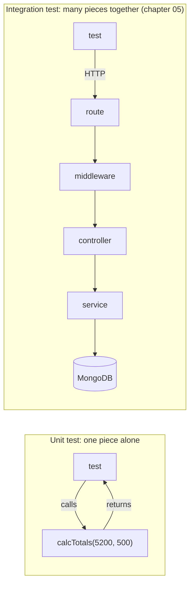
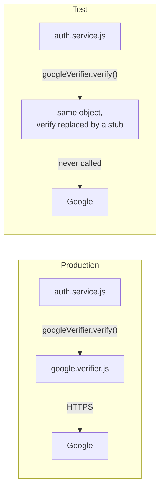

# 04 – Unit tests

**What you'll learn:** what a "unit" is in a backend project, how to structure every test with
Arrange–Act–Assert, how to name tests so a failure explains itself, and how to unit-test the four kinds of code
ShopEase has: **pure functions** (pricing and coupon math), **Mongoose model methods without a database**
(`new User()`, `validateSync()`), **Express middleware** with fake `req`/`res`/`next`, and code that talks to the
outside world. You will learn the Jest tools that make this possible: `jest.fn`, `jest.spyOn`, fake timers,
`it.each` tables, and testing thrown errors and rejected promises. Finally you will see why the repo replaces
external services through small **injectable wrappers** (`google.verifier.js`) instead of ESM module mocking
(`jest.unstable_mockModule`). Every repo example names its branch and file.

---

## What is a "unit"?

A **unit** is the smallest piece of code that has one clear job and that you can call directly: a function, a
model method, one middleware. A **unit test** calls that piece **alone**:

- no database connection,
- no network, no real HTTP request,
- no files on disk, no real clock (when it matters).

So unit tests are **fast** (milliseconds), **precise** (when one fails you know exactly which function broke) and
**deterministic** (same result every run).



| Unit-test it | Leave it to integration tests (chapter [05](./05-integration-tests.md)) |
| --- | --- |
| Money math, slug generation, pagination math | "Does `POST /api/orders` save an order?" |
| Model defaults, validators, instance methods | Unique indexes (they live in the database) |
| Middleware decisions (`authorize('admin')` → 403?) | The order of middleware on a real route |
| Error-handler mapping (`CastError` → 400) | Transactions and rollback |

On `main`, unit tests live in `server/tests/unit/`: `user.model.test.js`, `middleware.test.js`,
`utils.test.js`. Run them alone with:

```powershell
npm run test:unit
```

---

## Arrange – Act – Assert

Every good test has three parts, in this order:

1. **Arrange**: build the inputs and the world the test needs.
2. **Act**: do **one** thing, the behaviour under test.
3. **Assert**: check the result with `expect`.

From `main`, `server/tests/unit/user.model.test.js`:

```js
it('isTokenOutdated compares the token version with the user version', () => {
  const user = new User({ name: 'Ali', email: 'a@b.co', password: 'x' }); // Arrange
  expect(user.tokenVersion).toBe(0);
  expect(user.isTokenOutdated(0)).toBe(false); // current token           // Act + Assert
  expect(user.isTokenOutdated(undefined)).toBe(true); // token without a version

  user.tokenVersion = 1; // password changed once                        // Arrange again
  expect(user.isTokenOutdated(0)).toBe(true); // old token
  expect(user.isTokenOutdated(1)).toBe(false); // fresh token
});
```

When the act is a single expression, it is fine to put Act and Assert on one line, as above. When it is longer,
keep the three blocks visibly separate with a blank line.

---

## Naming tests

A test name is a **sentence about behaviour**. When it fails, CI prints it, and you should understand the bug
without opening the file.

| Weak name | Strong name (real, from the repo) |
| --- | --- |
| `test 1` | `defaults new users to role "customer", local provider, unverified and active` |
| `works` | `rounds DOWN to whole rupees (15% of 999 = 149.85 → 149)` (`06-coupons`, `coupon.model.test.js`) |
| `error case` | `turns duplicate-key errors into 409` (`main`, `middleware.test.js`) |
| `edge` | `is free at exactly Rs 5,000 and above` (`05-cart-wishlist`, `pricing.test.js`) |

Rules that the repo follows:

- `describe('<thing under test>')`: a function, method or middleware name, e.g. `describe('authorize(...roles)')`.
- `it('<does what> <when>')`: present tense, the promise the code makes.
- Put the **interesting number or edge** in the name: "exactly Rs 5,000", "the 6th attempt", "10 minutes ago".

---

## 1. Pure functions: numbers in, numbers out

A **pure function** returns the same output for the same input and changes nothing outside itself. It is the
easiest code to test: no fakes needed.

From `05-cart-wishlist`, `server/tests/unit/pricing.test.js`:

```js
/**
 * UNIT tests for src/utils/pricing.js (pure functions: numbers in, numbers out).
 *
 * Money rules are tested at their EDGES: just below, exactly at and just above the
 * free-shipping threshold, because "off by one" mistakes hide exactly there.
 */
import { calcShipping, calcTotals } from '../../src/utils/pricing.js';
import { PRICING } from '../../src/config/constants.js';

describe('calcShipping (BR-02)', () => {
  it('charges nothing for an empty cart', () => {
    expect(calcShipping(0)).toBe(0);
    expect(calcShipping(-5)).toBe(0); // defensive: a negative amount never adds a fee
  });

  it('charges Rs 250 below Rs 5,000', () => {
    expect(calcShipping(1)).toBe(250);
    expect(calcShipping(4999)).toBe(PRICING.SHIPPING_FEE);
  });

  it('is free at exactly Rs 5,000 and above', () => {
    expect(calcShipping(5000)).toBe(0);
    expect(calcShipping(5001)).toBe(0);
    expect(calcShipping(250000)).toBe(0);
  });
});
```

and further down the same file:

```js
  it('looks at the amount AFTER the discount for free shipping', () => {
    // 5,200 - 500 = 4,700 → below 5,000 → shipping is charged again
    const totals = calcTotals(5200, 500);
    expect(totals.shippingPrice).toBe(250);
    expect(totals.totalPrice).toBe(4950);
  });

  it('keeps every amount a whole number of rupees', () => {
    const totals = calcTotals(1999 * 3, 100);
    Object.values(totals).forEach((v) => expect(Number.isInteger(v)).toBe(true));
  });
```

**Boundary-value testing.** For any rule with a limit ("free from 5,000"), test **just below**, **exactly at**
and **just above**: 4999, 5000, 5001. That is where `<` vs `<=` bugs live.

The coupon math on `06-coupons` (`server/tests/unit/coupon.model.test.js`) does the same for discounts:

```js
describe('coupon.calculateDiscount (integer money math)', () => {
  it('takes a percentage of the subtotal', () => {
    expect(coupon({ value: 10 }).calculateDiscount(4000)).toBe(400);
  });

  it('rounds DOWN to whole rupees (15% of 999 = 149.85 → 149)', () => {
    expect(coupon({ value: 15 }).calculateDiscount(999)).toBe(149);
  });

  it('caps a percentage discount at maxDiscount', () => {
    const c = coupon({ value: 50, maxDiscount: 1000 });
    expect(c.calculateDiscount(10_000)).toBe(1000); // 50% would be 5,000
    expect(c.calculateDiscount(1000)).toBe(500); // under the cap → normal 50%
  });

  it('never gives more than the subtotal (fixed coupon bigger than the cart)', () => {
    expect(coupon({ type: 'fixed', value: 5000 }).calculateDiscount(3000)).toBe(3000);
  });
```

> **Try it:** read `src/utils/pricing.js` on `05-cart-wishlist` without switching branches:
> `git show 05-cart-wishlist:server/src/utils/pricing.js`. Find the line that decides free shipping and say which
> of the three boundary tests would fail if `>=` became `>`.

---

## 2. Mongoose models without a database

A Mongoose model is a class. `new User({...})` builds a **document in memory**. Nothing is saved until you call
`.save()`. Most of what a model promises can be checked in memory:

| Model feature | How to test it without a DB |
| --- | --- |
| Defaults (`default: 'customer'`) | Read the field right after `new User(...)` |
| Validators (`required`, `minlength`, `match`, custom) | `doc.validateSync()` → `undefined` when valid, else an error with `.errors.<field>` |
| Setters (`lowercase`, `trim`, `uppercase`) | Read the field after construction |
| Instance methods (`comparePassword`, `markDone`) | Call them |
| `toJSON` transforms (hide secrets) | Call `doc.toJSON()` |
| `pre('validate')` hooks | `await doc.validate()` (async, still no DB) |

What you **cannot** test in memory: unique indexes, queries, `pre('save')` hooks that read other documents. Those
go to integration tests. (The repo even names such a file `product.model.db.test.js` on `04-products-uploads` and
keeps it in `tests/integration/`.)

From `main`, `server/tests/unit/user.model.test.js`:

```js
/**
 * UNIT tests for the User model's methods.
 * Unit = test one small piece in isolation. These do not even need a database:
 * we create documents in memory with `new User(...)` and never save them.
 */
import bcrypt from 'bcrypt';
import { User } from '../../src/modules/models.js';

describe('User model', () => {
  it('defaults new users to role "customer", local provider, unverified and active', () => {
    const user = new User({ name: 'Ali', email: 'ali@example.com', password: 'x' });
    expect(user.role).toBe('customer');
    expect(user.authProvider).toBe('local');
    expect(user.isEmailVerified).toBe(false);
    expect(user.isActive).toBe(true);
  });

  it('requires a password for local accounts but not for Google accounts', () => {
    const local = new User({ name: 'Ali', email: 'ali@example.com' });
    expect(local.validateSync().errors.password).toBeDefined();

    const google = new User({ name: 'Ali', email: 'ali@example.com', authProvider: 'google' });
    expect(google.validateSync()).toBeUndefined();
  });

  it('rejects invalid emails and too-short names', () => {
    const user = new User({ name: 'A', email: 'not-an-email', password: 'x' });
    const { errors } = user.validateSync();
    expect(errors.email.message).toBe('Email is invalid');
    expect(errors.name.message).toBe('Name must be at least 2 characters');
  });

  it('comparePassword returns true only for the right password', async () => {
    const user = new User({ name: 'Ali', email: 'a@b.co' });
    user.password = await bcrypt.hash('secret123', 4); // low cost = fast test
    await expect(user.comparePassword('secret123')).resolves.toBe(true);
    await expect(user.comparePassword('wrong')).resolves.toBe(false);
  });
```

Notes:

- `bcrypt.hash('secret123', 4)`: cost factor **4** instead of the model's real `SALT_ROUNDS = 10`. Each +1 doubles
  the work, so cost 4 is about 64 times faster than 10. The test checks *logic*, not hash strength.
- Assert on the **message**, not just "there is an error". `errors.email.message` proves the right validator
  fired.

And the secrets test from the same file, which protects against leaking data in API responses:

```js
  it('hides secrets when converted to JSON', () => {
    const user = new User({ name: 'Ali', email: 'a@b.co', password: 'hash' });
    user.createEmailVerifyToken();
    const json = user.toJSON();
    expect(json.password).toBeUndefined();
    expect(json.emailVerifyTokenHash).toBeUndefined();
    expect(json.__v).toBeUndefined();
    expect(json.id).toBeUndefined(); // only _id is kept
    expect(json._id).toBeDefined();
  });

  it('marks Google users as verified before validation', async () => {
    const user = new User({ name: 'Ali', email: 'a@b.co', authProvider: 'google' });
    await user.validate();
    expect(user.isEmailVerified).toBe(true);
  });
```

### A test-only factory for in-memory documents

On `06-coupons`, `coupon.model.test.js` builds a valid coupon with one helper and lets each test override fields:

```js
const DAY = 24 * 60 * 60 * 1000;
const now = new Date('2026-06-15T12:00:00Z'); // a fixed "today" so tests never depend on the clock

// A coupon in memory (never saved). Valid by default: 10% off, window around `now`.
const coupon = (overrides = {}) =>
  new Coupon({
    code: 'EID10',
    type: COUPON_TYPES.PERCENTAGE,
    value: 10,
    startsAt: new Date(now.getTime() - DAY),
    expiresAt: new Date(now.getTime() + DAY),
    createdBy: new mongoose.Types.ObjectId(),
    ...overrides,
  });
```

Each test then reads like a sentence: `coupon({ isActive: false }).checkUsable(1000, now)`.

---

## 3. Middleware with fake `req`, `res` and `next`

Express middleware is just a function `(req, res, next)`. You do not need Express to call it. You pass plain
objects and look at what it did:

- called `next()` with nothing → "allowed",
- called `next(err)` → "blocked", and `err` tells you why,
- called `res.status(...).json(...)` → it answered.

From `main`, `server/tests/unit/middleware.test.js`:

```js
// Runs a middleware and resolves with whatever it passed to next() (undefined = allowed)
const run = (mw, req) => new Promise((resolve) => mw(req, {}, (err) => resolve(err)));

// A fake Express `res` that records the status and JSON body
const fakeRes = () => {
  const res = {};
  res.status = (code) => {
    res.statusCode = code;
    return res;
  };
  res.json = (body) => {
    res.body = body;
    return res;
  };
  return res;
};

describe('authorize(...roles)', () => {
  it('lets listed roles through', async () => {
    expect(await run(authorize('admin'), { user: { role: 'admin' } })).toBeUndefined();
    expect(
      await run(authorize('admin', 'customer'), { user: { role: 'customer' } }),
    ).toBeUndefined();
  });

  it('blocks other roles with 403', async () => {
    const err = await run(authorize('admin'), { user: { role: 'customer' } });
    expect(err).toBeInstanceOf(ApiError);
    expect(err.statusCode).toBe(403);
  });
});
```

Why does `run` return a **Promise**? Some middleware is async (`validate(rules)` runs express-validator, which is
async). Wrapping `next` in a promise lets the test simply `await` until `next` is called, whether that happens now
or later.

`res.status` returns `res` so that `res.status(400).json({...})` chains, exactly like real Express. The error
handler tests use it:

```js
describe('errorHandler', () => {
  const handle = (err) => {
    const res = fakeRes();
    errorHandler(err, {}, res, () => {});
    return res;
  };

  it('turns CastError (bad id) into 400', () => {
    const res = handle({ name: 'CastError', path: '_id' });
    expect(res.statusCode).toBe(400);
    expect(res.body.message).toBe('Invalid _id');
  });

  it('turns duplicate-key errors into 409', () => {
    const res = handle({ code: 11000, keyValue: { email: 'a@b.co' } });
    expect(res.statusCode).toBe(409);
    expect(res.body.message).toBe('email already exists');
  });
```

Notice the "errors" passed in are plain objects shaped like the real ones (`{ code: 11000, keyValue }`). The
handler only reads those fields, so a plain object is a perfectly good **fake**. No need to make MongoDB really
throw a duplicate-key error.

---

## 4. `jest.fn()`: a function that remembers its calls

A **mock function** (`jest.fn()`) is a fake function that records every call: how many times, with which
arguments, what it returned. Use it when the thing you care about is "was this called, and how?".

In ES-module mode the `jest` object is **not global**. Import it:

```js
import { jest } from '@jest/globals';
```

From `main`, `server/tests/unit/utils.test.js`:

```js
// In ES-module mode the `jest` object must be imported (describe/it/expect are still global)
import { jest } from '@jest/globals';
// ...
describe('asyncHandler', () => {
  it('forwards a rejected promise to next(err)', async () => {
    const boom = new Error('boom');
    const next = jest.fn();
    await asyncHandler(async () => {
      throw boom;
    })({}, {}, next);
    expect(next).toHaveBeenCalledWith(boom);
  });
});
```

From `08-payments`, `server/tests/unit/payment.test.js`, reading the recorded call directly:

```js
  // Runs the middleware with fake headers and returns what it passed to next()
  const run = (headers) => {
    const next = jest.fn();
    requireCronSecret({ headers }, {}, next);
    return next.mock.calls[0][0]; // undefined = allowed, ApiError = blocked
  };
```

`next.mock.calls` is an array of calls; each call is an array of arguments. `[0][0]` = first call, first argument.

| Matcher / API | Checks |
| --- | --- |
| `expect(fn).toHaveBeenCalled()` | Called at least once |
| `expect(fn).toHaveBeenCalledTimes(2)` | Exactly twice |
| `expect(fn).toHaveBeenCalledWith(a, b)` | At least one call had exactly these arguments |
| `fn.mock.calls` | Every call's arguments, for custom checks |
| `jest.fn(() => 42)` / `.mockReturnValue(42)` | Make it return something |
| `.mockResolvedValue(x)` / `.mockRejectedValue(err)` | Make it return a resolved / rejected promise |

---

## 5. `jest.spyOn()`: watch or replace ONE method of a real object

`jest.spyOn(object, 'method')` wraps an existing method. By default the real method still runs and the spy only
records calls. Add `.mockResolvedValue(...)`, `.mockReturnValueOnce(...)` etc. to replace what it does.

From `08-payments`, `server/tests/unit/payment.test.js`:

```js
  it('createCheckoutSession passes the params to Stripe and returns its answer', async () => {
    env.STRIPE_SECRET_KEY = 'sk_test_fake';
    const fake = { id: 'cs_test_1', url: 'https://checkout.stripe.com/c/pay/cs_test_1' };
    // Replace ONLY the network call; everything else is the real library
    const create = jest
      .spyOn(stripeGateway.getClient().checkout.sessions, 'create')
      .mockResolvedValue(fake);
    await expect(stripeGateway.createCheckoutSession({ mode: 'payment' })).resolves.toBe(fake);
    expect(create).toHaveBeenCalledWith({ mode: 'payment' });
  });
```

**Always restore spies.** A spy stays in place until restored and can leak into the next test. The same file does:

```js
// Remember the real settings so every test can change them and we can put them back
const original = { ...env };
afterEach(() => {
  Object.assign(env, original);
  jest.restoreAllMocks();
});
```

`jest.restoreAllMocks()` puts every `spyOn`-wrapped method back. Note how the file also **saves and restores**
the `env` object: several tests change settings (`env.STRIPE_SECRET_KEY = ''`), and `afterEach` puts them back.

`spyOn` with `...Once` is also how the repo makes **one** call fail on purpose. From `08-payments`,
`server/tests/integration/orders.test.js` (an integration test, but the technique is the same):

```js
    const spy = jest.spyOn(crypto, 'randomInt').mockReturnValueOnce(digits);
    try {
      // ... place an order, expect a retry ...
    } finally {
      spy.mockRestore();
    }
```

`mockReturnValueOnce` affects only the next call; later calls use the real `crypto.randomInt`.

---

## 6. Time: inject `now`, or use fake timers

Code that reads the clock (`Date.now()`, `new Date()`) gives different results every run. Two ways to control
time:

### 6a. The repo's way: pass `now` as a parameter

The repo designs time-dependent functions to **accept** the current time, with the real clock as default. From
`06-coupons`, `coupon.model.test.js`:

```js
  it('refuses an expired coupon', () => {
    const c = coupon({
      startsAt: new Date(now.getTime() - 2 * DAY),
      expiresAt: new Date(now.getTime() - DAY),
    });
    expect(c.checkUsable(1000, now).reason).toBe('Coupon expired');
  });

  it('includes both edges of the window (start and expiry moments)', () => {
    const c = coupon({ startsAt: now, expiresAt: new Date(now.getTime() + DAY) });
    expect(c.checkUsable(1000, now).ok).toBe(true);
    expect(c.checkUsable(1000, c.expiresAt).ok).toBe(true);
  });
```

And from `08-payments`, `payment.test.js`:

```js
  it('knows when the payment window of an order is over', () => {
    const now = new Date('2026-01-01T12:00:00Z');
    const justInside = new Date(now.getTime() - PAYMENTS.UNPAID_CARD_EXPIRY_MS);
    const tooOld = new Date(now.getTime() - PAYMENTS.UNPAID_CARD_EXPIRY_MS - 1);
    expect(isPaymentWindowOver({ createdAt: justInside }, now)).toBe(false);
    expect(isPaymentWindowOver({ createdAt: tooOld }, now)).toBe(true);
    // Default `now` = the real clock: a brand-new order is never expired
    expect(isPaymentWindowOver({ createdAt: new Date() })).toBe(false);
  });
```

This is simple, needs no Jest magic, and tests the boundary to the **millisecond** (`- 1`).

### 6b. Jest fake timers (not used in the repo)

> The repo has **no** test that uses fake timers. This section shows the Jest API so you recognise it and can use
> it in your own projects. It works with the Jest version the repo pins (`jest@30.5.2`), nothing to install.

Use fake timers when you cannot change the function's signature, e.g. code with `setTimeout`, or library code
that calls `Date.now()` internally:

```js
import { jest } from '@jest/globals';

// Example function (not in the repo): calls `fn` once, `ms` after the last call
function debounce(fn, ms) {
  let timer;
  return (...args) => {
    clearTimeout(timer);
    timer = setTimeout(() => fn(...args), ms);
  };
}

describe('debounce', () => {
  beforeEach(() => jest.useFakeTimers()); // setTimeout, setInterval and Date are now fake
  afterEach(() => jest.useRealTimers()); // ALWAYS switch back

  it('calls the function once, after the quiet period', () => {
    const fn = jest.fn();
    const debounced = debounce(fn, 300);

    debounced('a');
    debounced('b');
    jest.advanceTimersByTime(299);
    expect(fn).not.toHaveBeenCalled();

    jest.advanceTimersByTime(1);
    expect(fn).toHaveBeenCalledTimes(1);
    expect(fn).toHaveBeenCalledWith('b');
  });

  it('can pin "now" to a fixed date', () => {
    jest.setSystemTime(new Date('2026-06-15T12:00:00Z'));
    expect(new Date().toISOString()).toBe('2026-06-15T12:00:00.000Z');
  });
});
```

Keep fake timers to **unit** tests. In integration tests, faking the clock can freeze the MongoDB driver's own
timers and make tests hang. That is one more reason the repo prefers injecting `now`.

---

## 7. `it.each`: one test, many rows

When the same check runs on many inputs, write a **table**. Each row becomes its own test with its own name, so a
failure tells you exactly which row broke. `%s` / `%p` in the title are replaced by the row's values.

From `03-categories` (still there on later branches), `server/tests/unit/slugify.test.js`:

```js
describe('slugify', () => {
  it.each([
    ['Electronics', 'electronics'],
    ['Men’s Shoes', 'mens-shoes'],
    ["Men's Shoes", 'mens-shoes'],
    ['  Home   &   Kitchen  ', 'home-kitchen'],
    ['Café Crème', 'cafe-creme'],
    ['snake_case_name', 'snake-case-name'],
    ['--Already-Dashed--', 'already-dashed'],
    ['T-Shirts 2025', 't-shirts-2025'],
    ['UPPER lower', 'upper-lower'],
    [123, '123'],
  ])('%p → %p', (input, expected) => {
    expect(slugify(input)).toBe(expected);
  });
```

From `06-coupons`, `coupon.model.test.js`, rows that hold a label and an override object:

```js
  it.each([
    ['percentage above the maximum', { value: LIMITS.COUPON_MAX_PERCENT + 1 }],
    ['percentage of zero', { value: 0 }],
    ['fixed above the maximum', { type: 'fixed', value: LIMITS.COUPON_MAX_FIXED + 1 }],
    ['a decimal value', { value: 12.5 }],
  ])('rejects %s', (_name, overrides) => {
    expect(coupon(overrides).validateSync().errors.value).toBeDefined();
  });
```

The first column is only used in the title, so the parameter is named `_name` (the leading `_` tells ESLint it is
unused on purpose). `%p` pretty-prints any value; `%s` prints a string.

---

## 8. Thrown errors and rejected promises

| Code under test | How to assert |
| --- | --- |
| Synchronous function that throws | `expect(() => fn()).toThrow()` — wrap it in an arrow function |
| …with a specific message | `.toThrow('boom')` (substring) or `.toThrow(/tolerance/i)` (regex) |
| Async function that rejects | `await expect(promise).rejects.toThrow('boom')` |
| Async function that resolves | `await expect(promise).resolves.toBe(true)` |
| A function that *returns* an error object | Just check the object: `expect(err.statusCode).toBe(403)` |

Synchronous throws, from `08-payments`, `payment.test.js`:

```js
  it('constructEvent throws for a wrong secret, a changed body or a garbage header', () => {
    const payload = JSON.stringify({ id: 'evt_1' });
    const header = Stripe.webhooks.generateTestHeaderString({ payload, secret });
    expect(() => stripeGateway.constructEvent(payload, header, 'whsec_other')).toThrow();
    expect(() => stripeGateway.constructEvent(`${payload} `, header, secret)).toThrow();
    expect(() => stripeGateway.constructEvent(payload, 'nonsense', secret)).toThrow();
  });

  it('constructEvent rejects an old signature (replay protection, 5 minute tolerance)', () => {
    const payload = JSON.stringify({ id: 'evt_old' });
    const timestamp = Math.floor(Date.now() / 1000) - 10 * 60; // signed 10 minutes ago
    const header = Stripe.webhooks.generateTestHeaderString({ payload, secret, timestamp });
    expect(() => stripeGateway.constructEvent(payload, header, secret)).toThrow(/tolerance/i);
  });
```

Async rejection, from `04-products-uploads`, `server/tests/unit/cloudinary.test.js`:

```js
  it('upload() rejects when the SDK reports an error', async () => {
    cloudinary.uploader.upload_stream = (_opts, callback) => ({
      end: () => callback(new Error('boom')),
    });
    await expect(cloudinaryClient.upload(Buffer.from('a'), 'f')).rejects.toThrow('boom');
  });
```

The two classic mistakes:

```js
expect(fn()).toThrow();                // WRONG: fn() throws BEFORE expect runs → the test crashes
expect(() => fn()).toThrow();          // right

expect(promise).rejects.toThrow();     // WRONG: no await → the test ends before the check runs
await expect(promise).rejects.toThrow(); // right
```

---

## 9. Replacing a dependency: ESM module mocking vs the repo's injectable wrapper

Sometimes the unit you test calls something you must **not** run in a test: Google's servers, Cloudinary,
Stripe. You need a **test double** (a stand-in). In an ES-module project there are two ways.

### Option A – ESM module mocking with `jest.unstable_mockModule` (not used in the repo)

> Not in the repo. Shown so you understand the trade-off and can recognise it in other projects.

Jest can replace a whole module before it is loaded. In ESM this needs the special API
`jest.unstable_mockModule` **and** dynamic `await import(...)` for everything loaded afterwards, because normal
`import` lines run before any of your code:

```js
// Example only – not in the repo
import { jest } from '@jest/globals';

// 1) Register the fake module FIRST
jest.unstable_mockModule('../../src/modules/auth/google.verifier.js', () => ({
  googleVerifier: {
    verify: jest.fn(async () => ({ sub: 'g-1', email: 'a@gmail.com', email_verified: true })),
  },
}));

// 2) Only now load the modules that import it (a top-of-file `import` would be too early)
const { googleVerifier } = await import('../../src/modules/auth/google.verifier.js');
const { default: app } = await import('../../src/app.js');
```

Downsides:

- The name says it: **unstable**. The API may change between Jest versions.
- Import order is a trap: a single static `import` of the app above the mock silently loads the **real** module.
- The path string must match exactly, and every test in the file shares the same fake module.
- It mocks a whole file, so it is easy to fake more than you meant to.

### Option B – the repo's choice: a small injectable wrapper

The repo puts every external service behind **one small object** in its own file. Production code calls the
service only through that object. Tests replace one property of the object. From `main`,
`server/src/modules/auth/google.verifier.js`:

```js
/**
 * src/modules/auth/google.verifier.js – checks a Google sign-in token with Google's library.
 *
 * WHY A SEPARATE FILE? It is a boundary to an EXTERNAL service. Keeping it in one small
 * object means tests can replace `googleVerifier.verify` with a fake ("test double")
 * and test our login logic without calling Google over the internet.
 */
import { OAuth2Client } from 'google-auth-library';
import env from '../../config/env.js';

// One client for the app. It caches Google's public keys used to check signatures.
const client = new OAuth2Client(env.GOOGLE_CLIENT_ID);

export const googleVerifier = {
  /**
   * Verifies the ID token and returns its payload: { sub, email, email_verified, name, … }.
   * Throws if the token is fake, expired, or was made for a different app ("audience").
   */
  async verify(credential) {
    const ticket = await client.verifyIdToken({
      idToken: credential,
      audience: env.GOOGLE_CLIENT_ID, // the token must be meant for OUR app
    });
    return ticket.getPayload();
  },
};
```

The service calls it as `googleVerifier.verify(credential)` (`main`, `auth.service.js`), i.e. it looks the
method up **at call time**. So a test can swap it, with normal static imports. From `main`,
`server/tests/integration/google.test.js`:

```js
const realVerify = googleVerifier.verify; // keep the original to restore after each test

// Make the fake Google return this payload
const googleSays = (payload) => {
  googleVerifier.verify = async () => payload;
};
// ...
afterEach(async () => {
  googleVerifier.verify = realVerify;
  await clearTestDB();
});
```

The same pattern appears for Cloudinary (`cloudinaryClient` on `04-products-uploads`) and Stripe
(`stripeGateway` on `08-payments`).



| | `jest.unstable_mockModule` | Injectable wrapper (repo) |
| --- | --- | --- |
| Stable API | No ("unstable") | Plain JavaScript |
| Import order matters | Yes, must use `await import()` | No, normal imports |
| Different fake per test | Awkward | Easy: assign a new function in each test |
| Restore | Reset module registry | `obj.method = real` or `jest.restoreAllMocks()` |
| Also improves design | No | Yes: one file owns the external service, easy to swap providers |
| Can test the real wrapper too | No (it is replaced) | Yes: `google.test.js` still checks `realVerify('not-a-real-jwt')` rejects |

**Rule for your projects:** wrap each external service in a tiny object in its own file, call it through the
object, and stub that object in tests. Reach for module mocking only for code you cannot change.

---

## Common mistakes

- **Testing implementation, not behaviour.** Assert on what the function returns or decides, not on which private
  helpers it called. Then you can refactor without rewriting tests.
- **One giant test.** If a test checks five unrelated things, the first failure hides the other four. Split by
  behaviour.
- **Forgetting to restore.** Every `spyOn`, every replaced method, every changed `env` value must be put back in
  `afterEach`, or the next test inherits it.
- **Using the real clock in assertions.** `expect(order.createdAt).toEqual(new Date())` fails by a millisecond.
  Inject `now`, or compare with a range as `user.model.test.js` does (`toBeGreaterThanOrEqual(before + day - 1000)`).
- **Missing `await` before `expect(...).resolves/rejects`.** The test passes without checking anything.
- **Calling a DB-dependent method in a unit test.** `User.findOne()` without a connection waits for Mongoose's
  command buffer to time out (about 10 seconds) and then errors. Move that test to `tests/integration/`.
- **`jest is not defined`.** Add `import { jest } from '@jest/globals';`.

---

## Exercises

Do these on a practice branch of your own (`git switch -c practice/unit-tests main`), never on the learning
branches.

1. **Boundary table (easy).** In a new file `tests/unit/practice.test.js`, write an `it.each` table for
   `calcShipping` (branch `05-cart-wishlist`) with rows `[0, 0]`, `[1, 250]`, `[4999, 250]`, `[5000, 0]`.
   Make one row wrong on purpose, read the failure, then fix it.
2. **Middleware matrix (easy).** Rewrite the `requireVerifiedEmail` tests on `main` as one `it.each` over
   `[role, isEmailVerified, expectedStatus]` rows, with `undefined` meaning "allowed".
3. **Error handler in production (medium).** `errorHandler` hides 5xx messages when `env.isProduction` is true.
   Write a test that sets `env.isProduction = true`, passes `new Error('db password is hunter2')` and expects the
   message `'Something went wrong'` and no `stack`. Restore `env` in `afterEach` like `payment.test.js` does.
4. **`jest.fn` for the happy path (easy).** The `asyncHandler` test on `main` only covers a rejected promise.
   Add one where the wrapped function resolves normally, and assert with `jest.fn()` that `next` was **not**
   called (`expect(next).not.toHaveBeenCalled()`).
5. **Fake timers (medium, outside the repo).** Write the `debounce` example from section 6b in your
   chapter-03 practice project and make it pass. Then delete `jest.useRealTimers()` and observe what happens to
   later tests in the same file.
6. **Design for testability (hard).** `createEmailVerifyToken()` in `main`'s `user.model.js` calls `Date.now()`
   directly, which is why its test can only check a time *range*. Sketch how an optional `now` parameter (default
   `new Date()`) would let the test assert the exact expiry, without changing any caller.

---

## Check yourself

1. What makes a test a *unit* test rather than an integration test? Give two things a unit test must not touch.
2. Which three values would you test for the rule "free shipping from Rs 5,000", and why those?
3. What does `validateSync()` return for a valid document, and what does it return for an invalid one?
4. Why does `run()` in `middleware.test.js` wrap `next` in a Promise?
5. Name two reasons the repo stubs `googleVerifier.verify` instead of using `jest.unstable_mockModule`.

---

**Next:** [05 – Integration tests](./05-integration-tests.md)
