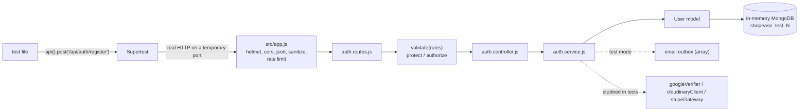
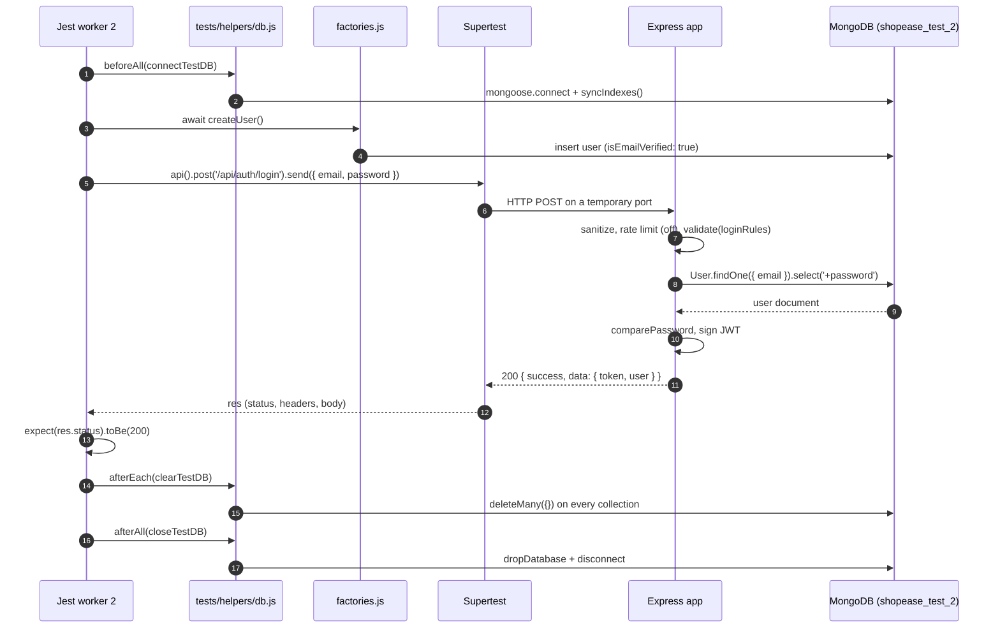
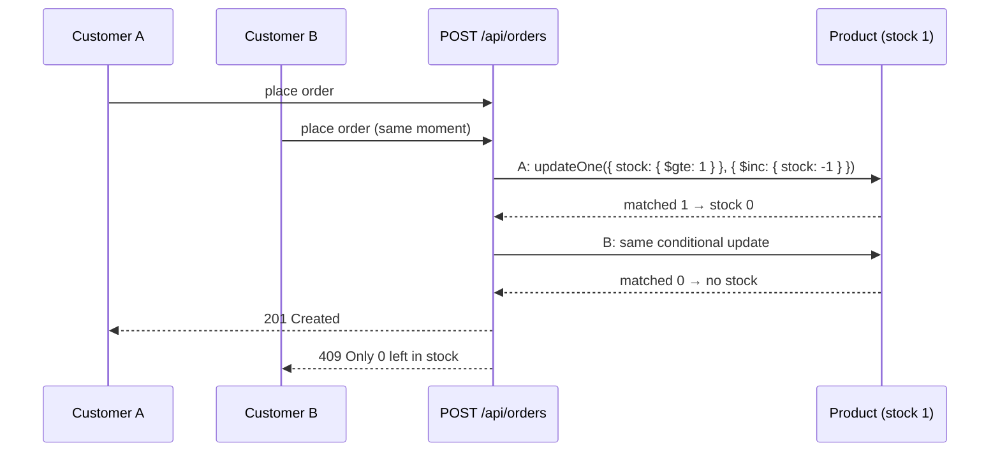

# 05 – Integration tests

**What you'll learn:** what "integration test" means in ShopEase (a real HTTP request through route → middleware →
controller → service → model → an in-memory MongoDB, sent by Supertest); how one test file is built, using
`server/tests/integration/auth.test.js` on `main` as the model; how tests stay independent with `clearTestDB`;
how factories (`createUser`, `loggedIn`, `bearer`, `createProduct`, …) keep tests short; and how to test every
kind of promise an API makes: auth (401/403 matrix), validation (400), ownership / IDOR (404), conflicts (409),
emails (outbox + `tokenFromLastEmail`), external services through stubs (Google, Cloudinary, Stripe webhook
signatures), transactions and rollback, **race conditions** with `Promise.all`, rate limits, and security
attacks (NoSQL injection, mass assignment). Every example is real code with its branch and file.

---

## What "integration" means here

A unit test calls one function. An integration test checks that **many pieces work together**. In ShopEase that
means one real HTTP request travels the same path it would in production, except that the database is the
in-memory MongoDB started by `tests/setup/globalSetup.js` and external services are replaced by stubs.



What an integration test catches that unit tests cannot:

- a route registered without `protect`, or with middleware in the wrong order,
- a validator that rejects good input,
- a unique index that is missing, a query that returns another user's data,
- a transaction that does not roll back,
- the exact JSON shape and status code the frontend relies on.

Integration tests live in `server/tests/integration/` and run with:

```powershell
npm run test:integration
npm test -- tests/integration/auth.test.js   # one file
npm test -- -t "NoSQL"                       # only tests whose name contains "NoSQL"
```

---

## One test run, step by step



**How Supertest works.** `request(app)` receives the Express app (a plain function). For each request it starts
the app on a free temporary port, sends a real HTTP request, collects the response and closes the server again.
That is why `app.js` must never call `listen()` itself (see [03](./03-setup-from-scratch.md)).

---

## Anatomy of `auth.test.js` (branch `main`)

Open `server/tests/integration/auth.test.js`. Every integration file in the repo has the same four parts.

### 1. Header comment: what and how

```js
/**
 * INTEGRATION tests for /api/auth/*.
 *
 * Integration = test many pieces TOGETHER: route → middleware → controller → service
 * → model → (in-memory) MongoDB, through real HTTP requests made by Supertest.
 * Each `describe` block is one endpoint; each `it` is one behaviour we promise.
 */
```

### 2. Imports: helpers first, then app internals the test reads directly

```js
import jwt from 'jsonwebtoken';
import { connectTestDB, clearTestDB, closeTestDB } from '../helpers/db.js';
import {
  api,
  createUser,
  createAdmin,
  bearer,
  loggedIn,
  uniqueEmail,
  tokenFromLastEmail,
  PASSWORD,
} from '../helpers/factories.js';
import { User } from '../../src/modules/models.js';
import { outbox } from '../../src/emails/sendEmail.js';
```

The test imports `User` to **look inside the database** after a request ("is the password really hashed?"), and
`outbox` to read the emails the app "sent".

### 3. Lifecycle hooks: connect once, clean after each test, close at the end

```js
beforeAll(connectTestDB);
afterEach(clearTestDB);
afterAll(closeTestDB);
```

### 4. One `describe` per endpoint, one `it` per promise

```js
describe('POST /api/auth/register', () => {
  const valid = () => ({ name: 'Ali Khan', email: uniqueEmail(), password: PASSWORD });

  it('creates a customer, returns a token and sends a verification email', async () => {
    const input = valid();
    const res = await api().post('/api/auth/register').send(input);

    expect(res.status).toBe(201);
    expect(res.body.success).toBe(true);
    expect(res.body.data.token).toEqual(expect.any(String));
    expect(res.body.data.user).toMatchObject({
      name: 'Ali Khan',
      email: input.email,
      role: 'customer',
      isEmailVerified: false,
    });
    // The password (even hashed) must never be in a response
    expect(res.body.data.user.password).toBeUndefined();
    // One verification email with a token link
    expect(outbox).toHaveLength(1);
    expect(tokenFromLastEmail(input.email)).toMatch(/^[a-f0-9]{64}$/);
  });

  it('stores the password hashed, never as plain text', async () => {
    const input = valid();
    await api().post('/api/auth/register').send(input);
    const saved = await User.findOne({ email: input.email }).select('+password');
    expect(saved.password).not.toBe(PASSWORD);
    expect(saved.password).toMatch(/^\$2[aby]\$/); // bcrypt hash prefix
  });
```

Useful matchers seen here:

| Matcher | Use it for |
| --- | --- |
| `toBe(201)` | Exact primitive values (status codes, strings, booleans) |
| `toEqual(expect.any(String))` | "Some string, I don't care which" (tokens, ids) |
| `toMatchObject({...})` | The object **contains** these fields (extra fields allowed) |
| `toEqual({...})` | The object is **exactly** this (no extra fields) |
| `toMatch(/regex/)` | Shape of a string (hash prefix, 64 hex chars) |
| `toBeUndefined()` | A secret is **absent** from the response |

The full `main` file covers: register, login, admin login, `GET /me` (the `protect` middleware), logout, email
verification, resend verification, forgot/reset password. Use it as the checklist for any auth system you build.

---

## Isolation with `clearTestDB`

**Isolation** means every test passes alone, in any order, and in parallel with other files. The repo gets it
from two layers (both set up in [03](./03-setup-from-scratch.md)):

| Layer | Mechanism | Protects against |
| --- | --- | --- |
| Between files | Each Jest worker has its own database (`shopease_test_<JEST_WORKER_ID>`) | Two files running at the same time |
| Between tests | `afterEach(clearTestDB)`: `deleteMany({})` on every collection + `clearOutbox()` | Leftover users, carts, emails from the previous test |

Because of `clearOutbox()`, this assertion from `auth.test.js` can say "zero emails", not "the same number as
before":

```js
  it('answers the same for unknown emails and sends nothing', async () => {
    const res = await api().post('/api/auth/forgot-password').send({ email: 'ghost@test.com' });
    expect(res.status).toBe(200);
    expect(res.body.message).toMatch(/If an account exists/);
    expect(outbox).toHaveLength(0);
  });
```

When a file also changes **shared objects** (stubs, `env`, spies), its `afterEach` restores them **before**
clearing the database. From `05-cart-wishlist`, `signupTransaction.test.js`:

```js
afterEach(async () => {
  jest.restoreAllMocks(); // undo every spyOn, so other tests see the real functions
  googleVerifier.verify = realVerify;
  await clearTestDB();
});
```

> **Try it:** run one test alone with `npm test -- tests/integration/auth.test.js -t "same link cannot be used"`.
> It passes alone because it builds everything it needs itself. That is what isolation buys you.

---

## Factories: say WHAT you need, not HOW to build it

A **factory** is a small function that creates valid test data with good defaults and lets the test override any
field. They live in `server/tests/helpers/factories.js` and grow with each branch.

On `main`:

```js
export const PASSWORD = 'secret123'; // a valid password used across tests

let counter = 0;
// A unique email per call, so tests never collide on the unique index
export const uniqueEmail = (prefix = 'user') => `${prefix}${Date.now()}${(counter += 1)}@test.com`;

/** Creates a user directly in the database (fast, skips the HTTP layer). */
export async function createUser(overrides = {}) {
  return new User({
    name: 'Test User',
    email: uniqueEmail(),
    password: PASSWORD,
    isEmailVerified: true,
    ...overrides, // let each test change any field
  }).save();
}

/** Creates an admin. */
export const createAdmin = (overrides = {}) =>
  createUser({ name: 'Admin', role: 'admin', ...overrides });

/** Returns a ready-to-use "Bearer <jwt>" header value for a user. */
export const bearer = (user) => `Bearer ${generateToken(user)}`;

/** Creates a user and returns { user, auth } where auth is the Authorization header. */
export async function loggedIn(overrides = {}) {
  const user = await createUser(overrides);
  return { user, auth: bearer(user) };
}

/** The supertest client for our app (no real network port needed). */
export const api = () => request(app);
```

| Factory | Branch added | Returns |
| --- | --- | --- |
| `api()` | `main` | A Supertest client for the app |
| `createUser(overrides)` / `createAdmin(overrides)` | `main` | A saved, **verified** user (password `PASSWORD`) |
| `bearer(user)` | `main` | `"Bearer <jwt>"` for that user, without calling the login route |
| `loggedIn(overrides)` | `main` | `{ user, auth }` in one line |
| `uniqueEmail()`, `tokenFromLastEmail(email)` | `main` | Unique address; token from the newest email to that address |
| `validAddress()`, `createAddress(user, …)` | `02-profile-addresses` | A valid address body; a saved address |
| `createCategory()`, `validProduct()`, `createProduct()`, `fakeImage()` | `03-categories` / `04-products-uploads` | Catalogue data |
| `addToCart(user, product, qty)`, `createWishlist()` | `05-cart-wishlist` | Cart state without HTTP |
| `createCoupon(overrides)`, `uniqueCouponCode()` | `06-coupons` | An active 10% coupon by default |
| `createOrder(user, …)`, `deliverOrder(order)` | `07-orders` | An order snapshot without running checkout |

Two design rules worth copying:

1. **Factories write straight to the database** ("skips the HTTP layer"). Only the endpoint **under test** goes
   through HTTP. That keeps tests fast and lets you set up states the API would refuse ("already 5 addresses").
2. **Unique values on every call** (`uniqueEmail`, SKU with `Date.now()` and a counter) so unique indexes never
   collide, even inside one test.

From `08-payments` (unchanged since `04-products-uploads`), the product factory creates its own category when you
don't pass one:

```js
export async function createProduct(overrides = {}) {
  const category = overrides.category ?? (await createCategory())._id;
  return Product.create({
    ...validProduct(category),
    category,
    isActive: true,
    // The creator must be an admin id; a fresh id is enough for most tests
    createdBy: new mongoose.Types.ObjectId(),
    ...overrides,
  });
}
```

Files also define **local request helpers** so each test reads like a sentence. From `02-profile-addresses`,
`addresses.test.js`:

```js
const list = (auth) => api().get('/api/addresses').set('Authorization', auth);
const create = (auth, body = validAddress()) =>
  api().post('/api/addresses').set('Authorization', auth).send(body);
const update = (auth, id, body = validAddress()) =>
  api().put(`/api/addresses/${id}`).set('Authorization', auth).send(body);
```

---

## Testing authentication and authorisation: the 401/403 matrix

- **401 Unauthorized** = "I don't know who you are" (no token, bad token, expired, forged, user deleted).
- **403 Forbidden** = "I know who you are, but you may not do this" (wrong role, disabled, email not verified).

Token problems, from `main`, `auth.test.js` (`describe('GET /api/auth/me (the protect middleware)')`):

```js
  it('returns 401 for a token signed with another secret (forged)', async () => {
    const user = await createUser();
    const forged = jwt.sign({ id: user._id.toString(), role: 'admin' }, 'not-our-secret');
    const res = await api().get('/api/auth/me').set('Authorization', `Bearer ${forged}`);
    expect(res.status).toBe(401);
  });

  it('returns 401 for an expired token', async () => {
    const user = await createUser();
    const expired = jwt.sign(
      { id: user._id.toString(), role: 'customer' },
      process.env.JWT_SECRET,
      {
        expiresIn: -10, // already expired 10 seconds ago
      },
    );
    const res = await api().get('/api/auth/me').set('Authorization', `Bearer ${expired}`);
    expect(res.status).toBe(401);
    expect(res.body.message).toBe('Not authorised, token invalid or expired');
  });

  it('returns 403 when the account was disabled after the token was issued', async () => {
    const { user, auth } = await loggedIn();
    await User.updateOne({ _id: user._id }, { isActive: false });
    const res = await api().get('/api/auth/me').set('Authorization', auth);
    expect(res.status).toBe(403);
  });
```

For a whole router, test **every route** with a table. From `02-profile-addresses`, `addresses.test.js`:

```js
describe('Access control (all /api/addresses routes)', () => {
  const routes = [
    ['GET', (r) => r.get('/api/addresses')],
    ['POST', (r) => r.post('/api/addresses').send(validAddress())],
    ['PUT', (r) => r.put(`/api/addresses/${missingId()}`).send(validAddress())],
    ['DELETE', (r) => r.delete(`/api/addresses/${missingId()}`)],
    ['PATCH default', (r) => r.patch(`/api/addresses/${missingId()}/default`)],
  ];

  it.each(routes)('%s returns 401 without a token', async (_name, send) => {
    const res = await send(api());
    expect(res.status).toBe(401);
  });

  it.each(routes)('%s returns 403 for an admin (customers only)', async (_name, send) => {
    const admin = await createAdmin();
    const res = await send(api()).set('Authorization', bearer(admin));
    expect(res.status).toBe(403);
    expect(res.body.message).toBe('Access denied');
  });
```

Each row holds a **function** that builds the request, so the same table works for "no token" and "admin
token". When someone adds a sixth route and forgets `protect`, adding one row to this table catches it.

| Who calls | Expected |
| --- | --- |
| No `Authorization` header | 401 |
| `Authorization: Token abc` (not Bearer) | 401 |
| Forged / expired token | 401 |
| Valid token, user deleted since | 401 |
| Valid token, password changed since (old `tokenVersion`) | 401 |
| Wrong role (admin on a customer route, customer on an admin route) | 403 |
| Disabled account | 403 |
| Unverified email on a route that needs it | 403 |

---

## Validation: 400 with field errors

Validation failures return **400** with `message: 'Validation failed'` and an `errors` array of
`{ field, message }`. A table covers every rule. From `main`, `auth.test.js`:

```js
  it.each([
    ['missing name', { name: undefined }, 'name'],
    ['short name', { name: 'A' }, 'name'],
    ['bad email', { email: 'nope' }, 'email'],
    ['short password', { password: 'abc1' }, 'password'],
    ['password without a number', { password: 'abcdefgh' }, 'password'],
    ['password without a letter', { password: '12345678' }, 'password'],
  ])('returns 400 for %s', async (_label, change, field) => {
    const res = await api()
      .post('/api/auth/register')
      .send({ ...valid(), ...change });
    expect(res.status).toBe(400);
    expect(res.body.message).toBe('Validation failed');
    expect(res.body.errors.map((e) => e.field)).toContain(field);
  });
```

The trick: start from a **valid** body and change **one** field per row. Then you know exactly which rule caused
the 400. Also test broken JSON (same file):

```js
  it('returns 400 for a body that is not valid JSON', async () => {
    const res = await api()
      .post('/api/auth/register')
      .set('Content-Type', 'application/json')
      .send('{"name": ');
    expect(res.status).toBe(400);
    expect(res.body.message).toBe('Invalid JSON body');
  });
```

---

## Ownership and IDOR: another user's resource is a 404

**IDOR** (Insecure Direct Object Reference) is a top API vulnerability: user A changes the id in the URL and
reads or edits user B's data. The rule in ShopEase: someone else's resource behaves as if it **does not exist**:
404, never 200, and not 403 either (a 403 would confirm that the id exists).

From `02-profile-addresses`, `addresses.test.js`:

```js
  it("returns 404 for ANOTHER customer's address and leaves it untouched (no IDOR)", async () => {
    const owner = await loggedIn();
    const address = await createAddress(owner.user, { isDefault: true, city: 'Lahore' });
    const attacker = await loggedIn();

    const res = await update(attacker.auth, address._id, validAddress({ city: 'Hacked' }));
    expect(res.status).toBe(404);
    expect(res.body.message).toBe('Address not found');
    expect((await Address.findById(address._id)).city).toBe('Lahore');
  });
```

Note the last line: the test checks the **database**, not only the status code. A buggy endpoint could return 404
*after* saving the change.

Every IDOR test has the same shape: **two users**, the owner's resource, the attacker's token, then check status
**and** that nothing changed. The same file repeats it for `DELETE` and `PATCH …/default`; `07-orders` does it for
orders.

---

## Conflicts: 409

**409 Conflict** = the request is valid but clashes with existing data, usually a unique value. From `main`,
`auth.test.js`:

```js
  it('returns 409 when the email is already registered', async () => {
    const existing = await createUser();
    const res = await api()
      .post('/api/auth/register')
      .send({ ...valid(), email: existing.email });
    expect(res.status).toBe(409);
    expect(res.body.errors[0].field).toBe('email');
  });
```

From `06-coupons`, `coupons.test.js`, the case-insensitive version and the race version:

```js
    await create(auth, validCoupon({ code: 'DUPE10' }));
    const res = await create(auth, validCoupon({ code: 'dupe10' }));
    expect(res.status).toBe(409);
    expect(res.body.message).toBe('Coupon code already exists');
```

```js
  it('the unique index stops two identical codes created at the same instant', async () => {
    const auth = await adminAuth();
    const results = await Promise.all([
      create(auth, validCoupon({ code: 'RACE1' })),
      create(auth, validCoupon({ code: 'RACE1' })),
    ]);
    const statuses = results.map((r) => r.status).sort();
    expect(statuses).toEqual([201, 409]);
    expect(await Coupon.countDocuments({ code: 'RACE1' })).toBe(1);
  });
```

The second test proves the **unique index** is the real guard. A "check then insert" in code would let both
requests pass the check; only the database can stop the second insert. This is why `connectTestDB()` runs
`syncIndexes()` before any test.

---

## Emails: the outbox and `tokenFromLastEmail`

In test mode `sendEmail()` sends nothing. From `main`, `src/emails/sendEmail.js`:

```js
export const outbox = [];
export const clearOutbox = () => outbox.splice(0, outbox.length); // empty the array in place
// ...
  if (env.isTest) {
    // Tests: remember the email instead of sending it
    outbox.push({ to, subject, html, text });
    return;
  }
```

`tokenFromLastEmail(email)` (in `factories.js`) finds the newest email to that address and pulls `token=<hex>` out
of the link, just like a user clicking it:

```js
export function tokenFromLastEmail(email) {
  const mail = [...outbox].reverse().find((m) => m.to === email);
  if (!mail) throw new Error(`No email sent to ${email}`);
  const match = mail.text.match(/token=([a-f0-9]+)/);
  return match ? match[1] : null;
}
```

So a whole user journey becomes one test. From `main`, `auth.test.js`:

```js
  it('forgot → token from email → reset → login with the new password', async () => {
    const user = await createUser();
    const forgot = await api().post('/api/auth/forgot-password').send({ email: user.email });
    expect(forgot.status).toBe(200);

    const token = tokenFromLastEmail(user.email);
    const reset = await api()
      .post('/api/auth/reset-password')
      .send({ token, password: 'newpass123' });
    expect(reset.status).toBe(200);

    // A "password changed" notice was emailed
    expect(outbox.at(-1).subject).toMatch(/password was changed/);
    // Old password fails, new one works
    expect(
      (await api().post('/api/auth/login').send({ email: user.email, password: PASSWORD })).status,
    ).toBe(401);
    expect(
      (await api().post('/api/auth/login').send({ email: user.email, password: 'newpass123' }))
        .status,
    ).toBe(200);
  });
```

To test **expiry** without waiting 24 hours, move the expiry date into the past directly in the database
(same file):

```js
    // Move the expiry date into the past, as if 24 hours had gone by
    await User.updateOne({ email }, { emailVerifyExpires: new Date(Date.now() - 1000) });
```

The running server sends real emails to Mailpit instead; chapter [06](./06-api-testing-postman-bruno.md) tests
that path.

---

## External services: stubs

A **stub** is a fake that returns canned answers. ShopEase wraps each external service in one small object
(chapter [04](./04-unit-tests.md#9-replacing-a-dependency-esm-module-mocking-vs-the-repos-injectable-wrapper)
explains why) and tests replace its methods.

### Google sign-in (`main`, `google.test.js`)

```js
const realVerify = googleVerifier.verify; // keep the original to restore after each test

// Make the fake Google return this payload
const googleSays = (payload) => {
  googleVerifier.verify = async () => payload;
};
const payloadFor = (email, extra = {}) => ({
  sub: `google-${email}`, // Google's id for the person
  email,
  email_verified: true,
  name: 'Google Person',
  ...extra,
});

beforeAll(connectTestDB);
afterEach(async () => {
  googleVerifier.verify = realVerify;
  await clearTestDB();
});
afterAll(closeTestDB);

const login = () => api().post('/api/auth/google').send({ credential: 'fake-id-token' });

  it('refuses admins (they must use email + password)', async () => {
    await createAdmin({ email: 'boss@gmail.com' });
    googleSays(payloadFor('boss@gmail.com'));
    expect((await login()).status).toBe(403);
  });

  it('returns 401 when Google says the token is invalid', async () => {
    googleVerifier.verify = async () => {
      throw new Error('Wrong recipient');
    };
    const res = await login();
    expect(res.status).toBe(401);
    expect(res.body.message).toBe('Invalid Google credential');
  });
```

A stub can also **throw**, to test how your code handles the service failing.

### Cloudinary uploads (`04-products-uploads`, `uploads.test.js`)

This stub also **records** what it received (a stub that records is often called a **spy** or **fake**):

```js
// Keep the real methods so every test can start from them again
const real = { ...cloudinaryClient };
let uploads; // what the fake "Cloudinary" received
let destroyed;

// Turn the fake Cloudinary on: configured, uploads succeed, deletes succeed
function fakeCloudinary() {
  uploads = [];
  destroyed = [];
  cloudinaryClient.isConfigured = () => true;
  cloudinaryClient.upload = async (buffer, folder) => {
    uploads.push({ buffer, folder });
    return {
      secure_url: `https://res.cloudinary.com/demo/image/upload/${folder}/fake${uploads.length}.jpg`,
      public_id: `${folder}/fake${uploads.length}`,
    };
  };
  cloudinaryClient.destroy = async (publicId) => {
    destroyed.push(publicId);
    return { result: 'ok' };
  };
}
```

`Object.assign(cloudinaryClient, real)` in `afterEach` puts all real methods back at once. Files are sent with
Supertest's `.attach('image', buffer, { filename, contentType })`.

### Stripe webhooks with real signatures (`08-payments`, `payments.test.js`)

A **webhook** is Stripe calling **your** server ("payment succeeded"). Anyone on the internet could call that URL,
so the server must check the `Stripe-Signature` header, an HMAC of the exact body bytes made with a shared secret.

The repo stubs only the **network** call (creating a Checkout Session) and runs the **real** signature check.
Stripe's library ships `Stripe.webhooks.generateTestHeaderString`, which signs a payload exactly like Stripe does:

```js
// Sends a webhook exactly like Stripe: raw JSON body + Stripe-Signature header
function sendWebhook(event, { secret = WEBHOOK_SECRET, signature, body } = {}) {
  const payload = JSON.stringify(event);
  const header = signature ?? Stripe.webhooks.generateTestHeaderString({ payload, secret });
  const req = api().post('/api/payments/webhook').set('Content-Type', 'application/json');
  if (header) req.set('Stripe-Signature', header);
  return req.send(body ?? payload); // a string is sent byte-for-byte
}
```

Now the attacks are easy to write:

```js
  it('400 for a signature made with the WRONG secret (a faker) – order stays unpaid', async () => {
    const { order } = await orderWithSession();
    const res = await sendWebhook(eventFor(sessionFor(order)), { secret: 'whsec_attacker' });
    expect(res.status).toBe(400);
    expect(res.body.message).toBe('Invalid Stripe signature');
    expect((await Order.findById(order._id)).paymentStatus).toBe('pending');
  });

  it('400 when the body was changed after signing (e.g. a smaller amount)', async () => {
    const { order } = await orderWithSession();
    const event = eventFor(sessionFor(order));
    const payload = JSON.stringify(event);
    const signature = Stripe.webhooks.generateTestHeaderString({ payload, secret: WEBHOOK_SECRET });
    const tampered = payload.replace('"paid"', '"paid" ');
    const res = await sendWebhook(event, { signature, body: tampered });
    expect(res.status).toBe(400);
  });
```

And **idempotency** (the same event delivered twice must change the order once):

```js
  it('IDEMPOTENT: the same event delivered twice changes the order once, one email', async () => {
    const { user, order } = await orderWithSession();
    const event = eventFor(sessionFor(order));
    const first = await sendWebhook(event);
    const second = await sendWebhook(event);
    expect(first.body.data.reason).toBe('paid');
    expect(second.status).toBe(200); // still 2xx, so Stripe stops retrying
    expect(second.body.data.reason).toBe('already-paid');

    const saved = await Order.findById(order._id);
    expect(saved.statusHistory.filter((h) => h.status === 'confirmed')).toHaveLength(1);
    expect(outbox.filter((m) => m.to === user.email)).toHaveLength(1);
  });
```

The file's `beforeEach` turns card payments on with fake keys (`Object.assign(env, {...})`), silences expected
error logs with `jest.spyOn(console, 'error').mockImplementation(() => {})`, and installs the fake
`stripeGateway.createCheckoutSession`; `afterEach` restores all three.

---

## Transactions and rollback

A **transaction** groups several writes so that **all** succeed or **none** do. To test the "none" half, make one
write fail **on purpose** in the middle and check that the earlier writes disappeared. The tool is
`jest.spyOn(...).mockRejectedValueOnce(...)`: the next call fails, later calls are real.

### Signup creates user + cart + wishlist atomically (`05-cart-wishlist`, `signupTransaction.test.js`)

```js
describe('Transaction rollback (all or nothing)', () => {
  it('a failing wishlist write rolls back the user AND the cart', async () => {
    jest.spyOn(Wishlist, 'create').mockRejectedValueOnce(new Error('disk full'));
    const email = uniqueEmail();

    const res = await register(email);
    expect(res.status).toBe(500);
    // Nothing from this attempt is left behind
    expect(await User.countDocuments({ email })).toBe(0);
    expect(await Cart.countDocuments()).toBe(0);
    expect(await Wishlist.countDocuments()).toBe(0);
    // And no verification email went out for an account that does not exist
    expect(outbox).toHaveLength(0);
  });

  it('after a rolled-back attempt the same email can register normally', async () => {
    jest.spyOn(Wishlist, 'create').mockRejectedValueOnce(new Error('temporary'));
    const email = uniqueEmail();
    await register(email);

    const res = await register(email); // the real Wishlist.create runs this time
    expect(res.status).toBe(201);
    expect(await countsFor(email)).toEqual({ user: 1, cart: 1, wishlist: 1 });
  });
```

### Checkout rollback (`07-orders`, `orders.transaction.test.js`)

The test takes a **snapshot** of everything checkout touches, breaks one step, and compares:

```js
  it('creating the order fails AFTER stock and coupon were taken → all undone', async () => {
    const product = await createProduct({ stock: 5 });
    const coupon = await createCoupon({ code: 'ROLLBACK', usageLimit: 5 });
    const me = await buyer(product, 2);
    const before = await snapshot(me.user, product, coupon);

    // Simulate a crash at step 3 (stock and coupon were already changed in the transaction)
    jest.spyOn(Order, 'create').mockRejectedValueOnce(new Error('Database hiccup'));
    const res = await place(me.auth, { ...me.body, couponCode: 'ROLLBACK' });

    expect(res.status).toBe(500);
    expect(await snapshot(me.user, product, coupon)).toEqual(before);
    expect(outbox).toHaveLength(0); // no confirmation for an order that does not exist
  });
```

`snapshot()` reads stock, sold count, cart lines, coupon uses and order count with one `Promise.all`. Comparing
whole snapshots with `toEqual` means you cannot forget a field.

These tests only work because the test database is a **replica set** (see `globalSetup.js`). On a single
`mongod`, transactions throw.

---

## Concurrency: race conditions with `Promise.all`

A **race condition** is a bug that appears only when two requests run at the same moment. Example: one unit left,
two customers press "Place order"; code that does "read stock → check → write stock - 1" lets **both** pass the
check. Sequential tests (`await a; await b;`) never find it.

`Promise.all([...])` starts several requests **without waiting** between them, so they really overlap inside the
server and the database.



From `07-orders`, `orders.transaction.test.js`:

```js
// Sorts the status codes so the assertion does not depend on who won the race
const statuses = (responses) => responses.map((r) => r.status).sort();

describe('Concurrency: no overselling', () => {
  it('two customers, ONE unit left: exactly one order succeeds', async () => {
    const product = await createProduct({ stock: 1 });
    const a = await buyer(product);
    const b = await buyer(product);

    // Fire both requests at the same time
    const results = await Promise.all([place(a.auth, a.body), place(b.auth, b.body)]);

    expect(statuses(results)).toEqual([201, 409]);
    const loser = results.find((r) => r.status === 409);
    expect(loser.body.errors[0].reason).toMatch(/^Only \d+ left in stock$/);
    const fresh = await Product.findById(product._id);
    expect(fresh.stock).toBe(0); // never negative
    expect(fresh.sold).toBe(1);
    expect(await Order.countDocuments()).toBe(1);
  });
```

Note the **Arrange** step uses `await` one by one (setting up buyers must not race), and only the **Act** step uses
`Promise.all`. Assertions never depend on *who* wins: `.sort()` the statuses, or count with `filter`.

The coupon version, same file:

```js
  it('a coupon with ONE use left is consumed only once', async () => {
    const product = await createProduct({ stock: 10 });
    const coupon = await createCoupon({ code: 'LASTONE', usageLimit: 1 });
    const a = await buyer(product);
    const b = await buyer(product);

    const results = await Promise.all([
      place(a.auth, { ...a.body, couponCode: 'LASTONE' }),
      place(b.auth, { ...b.body, couponCode: 'LASTONE' }),
    ]);

    expect(statuses(results)).toEqual([201, 400]);
    expect(results.find((r) => r.status === 400).body.message).toBe('Coupon usage limit reached');
    expect((await Coupon.findById(coupon._id)).usedCount).toBe(1);
    expect((await Product.findById(product._id)).stock).toBe(9); // the loser's unit came back
  });
```

On `06-coupons`, before checkout exists, `coupons.test.js` hammers the model's atomic counter directly with ten
parallel calls:

```js
  it('never goes over the usage limit when many checkouts race for the last use', async () => {
    const coupon = await createCoupon({ usageLimit: 1 });
    // 10 "customers" try to use the single remaining use at the same moment
    const results = await Promise.all(Array.from({ length: 10 }, () => Coupon.consume(coupon._id)));
    expect(results.filter(Boolean)).toHaveLength(1); // exactly ONE winner
    expect((await Coupon.findById(coupon._id)).usedCount).toBe(1);
  });
```

Other race tests worth reading on `07-orders`: "five customers, three units", "a double click by the SAME
customer creates only one order", "two parallel cancels give the stock back only once". On `08-payments`:
"IDEMPOTENT under a race: two deliveries at the same moment → exactly one wins".

> **Try it:** read `Coupon.consume` on `06-coupons` (`git show 06-coupons:server/src/modules/coupons/coupon.model.js`)
> and find the single `findOneAndUpdate`/`updateOne` filter that makes it safe. Then imagine it written as
> `find` → `if (usedCount < usageLimit)` → `save`, and explain which assertion in the test above would fail.

---

## Rate limits: switching a setting before the app loads

`tests/setup/env.js` turns rate limits **off** for every test file (`RATE_LIMIT_ENABLED=false`). One file proves
they work by turning them **on** before the app is loaded. From `main`, `rateLimit.test.js`:

```js
/**
 * INTEGRATION test proving the rate limits really work.
 *
 * tests/setup/env.js turns limits OFF for all other tests. Here we switch them ON
 * BEFORE the app is loaded. That's why we use `await import()` instead of a normal
 * import at the top: normal imports would load the app before this line runs.
 * (Each Jest test file gets its own fresh copy of every module.)
 */
process.env.RATE_LIMIT_ENABLED = 'true';
const { default: request } = await import('supertest');
const { default: app } = await import('../../src/app.js');

describe('Rate limiting', () => {
  it('blocks the 6th admin-login attempt within 15 minutes with 429', async () => {
    const attempt = () =>
      request(app).post('/api/auth/admin/login').send({ email: 'x@test.com', password: '' });

    // The first 5 attempts reach validation (400); the limiter counts them anyway
    for (let i = 0; i < 5; i += 1) {
      expect((await attempt()).status).toBe(400);
    }
    const blocked = await attempt();
    expect(blocked.status).toBe(429);
    expect(blocked.body.message).toBe('Too many attempts, try again later');
    // Standard headers tell the client its quota
    expect(blocked.headers['ratelimit-limit']).toBeDefined();
  });
});
```

Why `await import()`? In ES modules, all static `import` lines are executed **before** any other code in the file.
`src/config/env.js` reads `RATE_LIMIT_ENABLED` once, when it is first loaded. A static import would load it while
the variable is still `'false'`. A dynamic `await import()` runs in order, after the assignment. Because each test
file gets its own fresh module registry, this change cannot leak into other files.

Also note: this file needs no database. The attempts fail validation (empty password) before any query, so
there is no `connectTestDB`.

---

## Security tests

### NoSQL injection (`main`, `auth.test.js`)

An attacker sends an **object** where you expect a string. `{ "$ne": null }` means "not equal to null", which
matches any user.

```js
  it('blocks NoSQL-injection attempts like { "$ne": null }', async () => {
    await createUser();
    const res = await api()
      .post('/api/auth/login')
      .send({ email: { $ne: null }, password: { $ne: null } });
    expect(res.status).toBe(400); // sanitised to {} → fails validation, never logs anyone in
  });
```

`app.js` runs `express-mongo-sanitize`, which strips keys starting with `$`; the validator then rejects the
empty value. The test protects both layers: delete either and the status changes.

### Mass assignment (`main`, `auth.test.js`; `02-profile-addresses`, `addresses.test.js`)

**Mass assignment** = the server copies the whole request body into the database, so a client can set fields it
must not touch (`role: 'admin'`).

```js
  it('ignores role/isEmailVerified sent by the client (mass-assignment protection)', async () => {
    const input = { ...valid(), role: 'admin', isEmailVerified: true };
    const res = await api().post('/api/auth/register').send(input);
    expect(res.status).toBe(201);
    expect(res.body.data.user.role).toBe('customer');
    expect(res.body.data.user.isEmailVerified).toBe(false);
  });
```

```js
  it('cannot move my address into another account by sending `user`', async () => {
    const { user, auth } = await loggedIn();
    const victim = await loggedIn();
    const address = await createAddress(user, { isDefault: true });

    await update(auth, address._id, { ...validAddress(), user: String(victim.user._id) });
    expect(String((await Address.findById(address._id)).user)).toBe(String(user._id));
  });
```

### User enumeration (`main`, `auth.test.js`)

```js
  it('gives the SAME 401 message for a wrong password and an unknown email', async () => {
    // ...
    expect(wrongPassword.body.message).toBe(unknownEmail.body.message); // no user enumeration
  });
```

If the messages differed, an attacker could find out which emails have accounts.

---

## Checklist for every new endpoint

Copied from the repo's `docs/testing/README.md`: **happy path · 400 · 401 · 403 · 404 · 409 · security cases**.
Expanded:

| Case | Example assertion |
| --- | --- |
| Happy path | status, `toMatchObject` on `data`, **and** the database state |
| 400 | `it.each` over each rule; broken JSON |
| 401 | no token, malformed header, forged, expired |
| 403 | wrong role, disabled, unverified (if required) |
| 404 | missing id, **another user's id (IDOR)**; 400 for a malformed id |
| 409 | duplicate unique value, including a `Promise.all` race |
| Security | mass assignment, NoSQL injection, no secrets in the response |
| Side effects | emails in `outbox`, stock/counters, nothing left after a failure |

---

## Common mistakes

- **Checking only the status code.** `404` after the data was already changed is still a bug. Read the database
  back.
- **Building test data through HTTP.** Use factories; only the endpoint under test goes through Supertest.
- **Forgetting `await` on a Supertest call.** Without `await`, `res` is a pending request, `res.status` is
  `undefined`, and the request may run after the test ended.
- **Races in Arrange.** Set-up steps whose order matters must run one after another. `addresses.test.js` creates
  five addresses in a loop with `await` and says why: "One after another (not in parallel), so 'the first one is
  the default' holds".
- **Asserting who wins a race.** Sort the statuses or count them; never expect `results[0]` to be the 201.
- **Not restoring stubs and spies.** Restore in `afterEach`, not at the end of the test: a failing `expect` stops
  the test before your cleanup line.
- **Hard-coded emails.** `'test@test.com'` in two tests in the same file collides on the unique index if cleanup
  ever fails. Use `uniqueEmail()`.
- **Importing the app statically when the test must change `process.env` first.** Use `await import()` like
  `rateLimit.test.js`.

---

## Exercises

Work on your own practice branch (e.g. `git switch -c practice/integration 02-profile-addresses`).

1. **401 matrix (easy).** On `main`, write an `it.each` over `GET /api/auth/me`, `POST /api/auth/logout`,
   `POST /api/auth/resend-verification` and `PUT /api/users/password` that expects 401 without a token.
2. **Malformed header (easy).** Add a row to your table that sends `Authorization: Bearer` (no token at all).
   Predict the status before running it.
3. **IDOR for reading (medium).** On `07-orders`, write a test where customer B requests customer A's order by id
   and gets 404, and A's order is unchanged. Use `createOrder(user)` from the factories.
4. **Email journey (medium).** On `main`, test: register → resend verification twice → only the **last** token
   works. Use `tokenFromLastEmail` and check `outbox.length`.
5. **Your own race (medium).** On `05-cart-wishlist`, fire two `POST /api/cart` requests for the same product at
   once with `Promise.all` and decide what the correct final quantity is. Write the test first, then check if the
   code agrees.
6. **Rollback (hard).** On `07-orders`, `placeOrder` in `order.service.js` calls `Coupon.consume(coupon._id, session)`
   after reserving stock. Use `jest.spyOn(Coupon, 'consume').mockRejectedValueOnce(new Error('boom'))` and prove
   that checkout answers 500 and leaves stock, cart and coupon untouched (reuse the `snapshot()` idea). Restore
   with `jest.restoreAllMocks()` in `afterEach`.
7. **Webhook replay (hard).** On `08-payments`, sign an event with a `timestamp` 10 minutes in the past using
   `generateTestHeaderString({ payload, secret, timestamp })` and send it through `sendWebhook`. Expect 400.

---

## Check yourself

1. List, in order, the layers one Supertest request passes through in ShopEase.
2. Why does accessing another customer's address return 404 and not 403?
3. Why must the race tests use `Promise.all` only in the **Act** step, and why do they sort the status codes?
4. In `rateLimit.test.js`, what would happen with a normal `import app from '../../src/app.js'` at the top?
5. The Stripe webhook test stubs `createCheckoutSession` but not `constructEvent`. Why?

---

**Next:** [06 – API testing with Postman and Bruno](./06-api-testing-postman-bruno.md)
