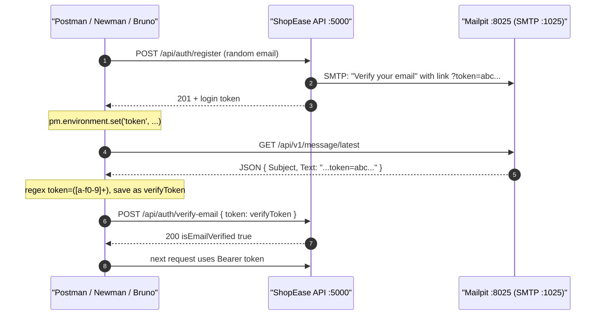
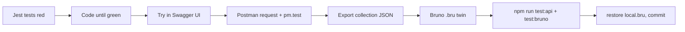

# API Testing with Postman, Newman and Bruno

**What you'll learn:** how to test the ShopEase API while it is **really running** on your computer, the way a
frontend or a customer would use it. You will prepare everything the server needs (Atlas database, Mailpit, a
seeded admin, rate limits off), import the Postman collection and run whole folders in the Collection Runner,
read the real test scripts in `server/postman/` (how `pm.test` checks a response, how `pm.environment.set` passes
a token to the next request, and how a request reads a verification token out of Mailpit's inbox), run the same
collection from the terminal with **Newman** (and in CI), run the **Bruno** copy of the collection with
`npm run test:bruno`, use **Swagger UI** at `/api/docs` for quick manual checks, and finally add a brand-new
request with tests for a brand-new endpoint, step by step.

---

## 1. Where API tests fit

Chapters [04](./04-unit-tests.md) and [05](./05-integration-tests.md) ran the code **inside Jest**: no real
server, no real network port, an in-memory MongoDB and an in-memory email outbox. That is fast and isolated, but
it never proves that the **real** server starts, connects to the **real** database, and sends **real** emails.

**API tests** (also called **end-to-end** or **E2E** tests here) close that gap. They send real HTTP requests to
`http://localhost:5000/api` and check the answers.

| | Jest integration tests (ch. 05) | API tests (this chapter) |
| --- | --- | --- |
| Server | `app` object in memory (Supertest) | Real process: `npm run dev` |
| Database | `mongodb-memory-server`, wiped after each test | Your **Atlas** database (data stays) |
| Email | `outbox` array in memory | **Mailpit** (fake SMTP server in Docker) |
| Speed | milliseconds per test | a few seconds per folder |
| Run by | `npm test`, pre-commit hook, CI | You, by hand, or `npm run test:api` / `npm run test:bruno` |
| Finds | logic bugs, wrong status codes | config bugs, CORS, wrong `.env`, SMTP problems, "it works in tests but not for real" |

Two tools hold the **same** requests:

- **Postman** (desktop app) + **Newman** (Postman's command-line runner): files in
  [`server/postman/`](../../server/postman/).
- **Bruno** (open-source, offline app) + **Bruno CLI**: plain-text files in [`server/bruno/`](../../server/bruno/).

You only need one of them. The repo ships both so you can pick.

The trick that makes the whole thing automatic is **Mailpit**: register sends a verification email, a request
reads that email through Mailpit's own HTTP API, pulls out the token, and the next request uses it.



---

## 2. Prerequisites (do these once per session)

API tests need a **running** server and its helpers. Work through this list from top to bottom. Every command
runs in a terminal; the ones marked "repo root" run in the folder that contains `docker-compose.yml`, the others
in `server/`.

| # | What | Command / action | Why |
| --- | --- | --- | --- |
| 1 | `server/.env` exists | `Copy-Item .env.example .env` (PowerShell) or `cp .env.example .env` (Git Bash, macOS, Linux) | The server refuses to start without `MONGO_URI` and `JWT_SECRET` (`src/config/env.js`) |
| 2 | `MONGO_URI` points at **Atlas** | Paste your Atlas connection string, with `/shopease` after the host | API tests use a real database. See `docs/guides/setup-atlas.md` |
| 3 | Rate limits off | In `.env`: `RATE_LIMIT_ENABLED=false` | Login/register return **429 Too Many Requests** after 10 tries otherwise. Only the exact text `false` turns limits off |
| 4 | Cron secret (branch 08+) | In `.env`: `CRON_SECRET=test-cron-secret` | Folder **08 Payments** sends this value; it must match |
| 5 | Mailpit running | `docker compose up -d` (repo root) | Catches every email. Inbox: http://localhost:8025 |
| 6 | Admin exists | `npm run seed:admin` (on `main`…`09-reviews`) or `npm run seed` (on `10-admin`, also creates categories, products, coupons) | Many folders log in as `admin@shopease.pk` / `Admin12345`. Folder **10 Admin** needs the full seed |
| 7 | Server running | `npm run dev` | Keep this terminal open. You should see `✔ MongoDB connected` and `✔ API running on http://localhost:5000/api` |

The admin email and password in `.env` (`ADMIN_EMAIL`, `ADMIN_PASSWORD`) must match the collection variables
`adminEmail` and `adminPassword`. The defaults already match.

Quick health check before you run anything (open a **second** terminal):

```powershell
# PowerShell
Invoke-RestMethod http://localhost:5000/api/health | ConvertTo-Json -Depth 5
```

```bash
# Git Bash / macOS / Linux
curl -s http://localhost:5000/api/health
```

You want `"status": "ok"` and `"database": "connected"`. That is exactly what the first Postman request checks.

> **Try it:** open http://localhost:8025 in a browser. The Mailpit inbox should be empty or show old emails.
> Leave the tab open while you run the collection and watch emails arrive live.

---

## 3. Postman: import and run

### 3.1 The two files

| File | What it is |
| --- | --- |
| `server/postman/ShopEase.postman_collection.json` | The **collection**: every request, one **folder** per module (01 Auth … 10 Admin), each with test scripts |
| `server/postman/ShopEase.local.postman_environment.json` | The **environment** "ShopEase – local": variables such as `baseUrl`, `mailpitUrl`, `adminEmail`, `adminPassword`, plus empty slots the scripts fill (`token`, `verifyToken`, `adminToken`, …) |

A **variable** is a named value you write as `{{name}}` in a URL, header or body. Postman replaces it before
sending. An **environment** is a set of variables you can switch between (for example *local* and *staging*), so
the same requests hit different servers.

The first values in the environment file (branch `10-admin`):

```json
{ "key": "baseUrl",       "value": "http://localhost:5000/api", "type": "default", "enabled": true },
{ "key": "mailpitUrl",    "value": "http://localhost:8025",     "type": "default", "enabled": true },
{ "key": "adminEmail",    "value": "admin@shopease.pk",         "type": "default", "enabled": true },
{ "key": "adminPassword", "value": "Admin12345",                "type": "default", "enabled": true },
```

### 3.2 Import

1. Open the Postman desktop app (the web version cannot reach `localhost` without the Postman Agent).
2. **Import** (top left) → drag in **both** files from `server/postman/`.
3. Top right, in the environment dropdown, choose **ShopEase – local**. If this says "No environment", every
   `{{baseUrl}}` stays unresolved and requests fail with "Invalid URL".

### 3.3 Run a folder in the Collection Runner

The **Collection Runner** sends every request in a folder **in order** and runs each request's tests.

1. In the sidebar, hover the collection **ShopEase API** → **⋯** → **Run collection**. Or right-click one folder,
   e.g. **01 Auth**, → **Run folder**.
2. Keep the order as it is. Order matters: "Verify email" needs the token the previous request saved.
3. Press **Run ShopEase API**.
4. Each request shows green **PASS** / red **FAIL** lines, one per `pm.test`.

Every folder is **self-contained**: it registers its own customer, logs in the admin itself, creates the data it
needs (with `Date.now()` in names so they never clash) and, where it makes sense, deletes it again. So you can run
just **05 Cart & Wishlist** without running 01–04 first.

| Folder | Appears on branch | Needs Mailpit | Needs |
| --- | --- | --- | --- |
| 01 Auth | `main` | yes | seeded admin |
| 02 Profile & Addresses | `02-profile-addresses` | yes | seeded admin |
| 03 Categories | `03-categories` | no | seeded admin |
| 04 Products & Uploads | `04-products-uploads` | no | seeded admin (no Cloudinary keys: it only tests 400/401/403 on uploads) |
| 05 Cart & Wishlist … 09 Reviews | their branches | yes | seeded admin |
| 08 Payments | `08-payments` | yes | `CRON_SECRET=test-cron-secret`; no Stripe account |
| 10 Admin | `10-admin` | no | `npm run seed` (full store seed) |

> **Try it:** run only folder **01 Auth**. Then open Mailpit: you should see a "verify" email and a "reset"
> email for an address like `postman1794…@example.com`. Then open the environment (eye icon, top right) and
> see that `token`, `verifyToken`, `resetToken` and `adminToken` now have values.

---

## 4. How the test scripts work

Every request can have two scripts:

- **Pre-request script** (tab *Pre-request Script* or *Scripts → Pre-request*): runs **before** the request is
  sent. Used to prepare variables.
- **Test script** (tab *Tests* or *Scripts → Post-response*): runs **after** the response arrives. Used to check
  the response and save values for later requests.

Both are JavaScript, run inside Postman's sandbox, with a global object called `pm`.

| You write | Meaning |
| --- | --- |
| `pm.test('name', () => { ... })` | One named check. If the function throws, that check is **FAIL** |
| `pm.response.to.have.status(201)` | Assertion: the status code must be 201 |
| `pm.response.json()` | The response body parsed as JSON |
| `pm.response.code` | The status code as a number |
| `pm.expect(x).to.eql(y)` | Chai-style assertion: deep equal |
| `pm.expect(x).to.include('verify')` | String or array contains |
| `pm.environment.set('k', v)` | Save a value into the active environment |
| `pm.environment.get('k')` | Read it back |
| `pm.sendRequest({...}, cb)` | Send an **extra** request from inside a script |

### 4.1 Checking a response: `pm.test`

Folder **01 Auth**, request **Health check** (`GET {{baseUrl}}/health`), test script, branch `main`:

```js
pm.test('status is 200', () => pm.response.to.have.status(200));
pm.test('database connected', () => pm.expect(pm.response.json().data.database).to.eql('connected'));
```

Two separate `pm.test` calls give two separate PASS/FAIL lines. If the database is down you see exactly which
promise broke, not just "something failed".

### 4.2 Fresh data every run: pre-request script

Request **Register – success** (`POST {{baseUrl}}/auth/register`). Its body uses variables:

```json
{
  "name": "Postman User",
  "email": "{{email}}",
  "password": "{{password}}"
}
```

Pre-request script:

```js
// A fresh random email every run, so the collection can be run many times
pm.environment.set('email', 'postman' + Date.now() + '@example.com');
pm.environment.set('password', 'secret123');
```

Without this, the second run would get **409 Conflict** (email already registered), because the Atlas database
keeps the user from the first run.

### 4.3 Chaining tokens: `pm.environment.set`

Same request, test script:

```js
pm.test('status is 201', () => pm.response.to.have.status(201));
const result = pm.response.json().data;
pm.test('role is customer', () => pm.expect(result.user.role).to.eql('customer'));
pm.test('no password in response', () => pm.expect(result.user.password).to.be.undefined);
pm.environment.set('token', result.token);
```

The last line is **chaining**: it saves the login token. Later requests send it in a header:

```text
Authorization: Bearer {{token}}
```

Request **Me – with token** (`GET {{baseUrl}}/auth/me`) then proves the token belongs to the user we created:

```js
pm.test('status is 200', () => pm.response.to.have.status(200));
pm.test('is me', () => pm.expect(pm.response.json().data.email).to.eql(pm.environment.get('email')));
```

The best chain in the collection is the **old token after a password reset**. Request **Reset password**, pre-request
script, keeps a copy of the current token before resetting:

```js
pm.environment.set('oldToken', pm.environment.get('token'));
pm.environment.set('password', 'newpass123');
```

and the next request, **Me – old token after reset → 401**, sends `Authorization: Bearer {{oldToken}}`:

```js
pm.test('status is 401 (old sessions are logged out)', () => pm.response.to.have.status(401));
```

That is the same `tokenVersion` promise the Jest test in `users.test.js` guards (see
[08](./08-tdd-and-daily-workflow.md#4-write-a-failing-test-for-every-bug-first)), now checked against the real
server.

### 4.4 Reading Mailpit: getting verify and reset tokens

Mailpit has an HTTP API next to its web inbox. Two endpoints are used:

| Mailpit endpoint | Returns |
| --- | --- |
| `GET {{mailpitUrl}}/api/v1/message/latest` | The newest email (fields such as `Subject`, `Text`, `HTML`) |
| `GET {{mailpitUrl}}/api/v1/search?query=to:<address>` | A list `messages[]` of emails to that address (each with `ID`, `Created`) |
| `GET {{mailpitUrl}}/api/v1/message/<ID>` | One email by id |

**Simple version** (folder 01 Auth, request **Mailpit – read verification email**, branch `main`):

```js
// Reads the newest email from Mailpit and copies the token from its link
pm.test('an email arrived in Mailpit', () => pm.response.to.have.status(200));
const mail = pm.response.json();
pm.test('it is the verify email', () => pm.expect(mail.Subject.toLowerCase()).to.include('verify'));
const match = (mail.Text || '').match(/token=([a-f0-9]+)/);
pm.test('the email contains a token link', () => pm.expect(match).to.not.equal(null));
pm.environment.set('verifyToken', match[1]);
```

Line by line:

1. The request itself is `GET {{mailpitUrl}}/api/v1/message/latest`.
2. `mail.Text` is the plain-text body, containing a link like
   `http://localhost:5173/verify-email?token=7508eb0c…`.
3. The **regular expression** `/token=([a-f0-9]+)/` finds `token=` followed by hex characters. The part in
   brackets is **captured** and lands in `match[1]`.
4. The token is saved as `verifyToken`. The next request, **Verify email**, has the body
   `{ "token": "{{verifyToken}}" }`.

The reset flow does the same with `'reset'` in the subject check and `resetToken` as the variable.

**Safer version** (folder 05 Cart & Wishlist, branch `05-cart-wishlist` onwards). `latest` is risky: if a second
run, or Bruno, or a teammate sends an email at the same moment, "latest" may be **someone else's** email. So later
folders search by recipient and take the newest match. Request **Mailpit – find my verification email**
(`GET {{mailpitUrl}}/api/v1/search?query=to:{{cartEmail}}`):

```js
const status = pm.response.code;
const j = pm.response.json();
// Search ONLY the emails sent to our customer (Mailpit is shared, so never use "latest"),
// then take the newest one.
const msgs = (j.messages || []).slice().sort((a, b) => new Date(b.Created) - new Date(a.Created));
pm.test("status is 200", () => pm.expect(status).to.eql(200));
pm.test("an email to our customer arrived", () => pm.expect(msgs.length > 0).to.eql(true));
pm.environment.set('mailId', msgs[0].ID);
```

Then **Mailpit – read verification email** (`GET {{mailpitUrl}}/api/v1/message/{{mailId}}`) extracts the token
with the same regex as above.

### 4.5 Extra setup requests: `pm.sendRequest`

Folder **02 Profile & Addresses** must prove that a 6th address is refused (`LIMITS.MAX_ADDRESSES` is 5). Instead of
five near-identical requests, the request **Addresses – fill up to 5** creates two addresses from its pre-request
script (branch `02-profile-addresses`):

```js
// We have 2 addresses. Add 2 more here (one after the other), then this request saves the 5th.
const add = (city, done) =>
  pm.sendRequest(
    {
      url: pm.environment.get('baseUrl') + '/addresses',
      method: 'POST',
      header: {
        'Content-Type': 'application/json',
        Authorization: 'Bearer ' + pm.environment.get('customerToken'),
      },
      body: {
        mode: 'raw',
        raw: JSON.stringify({ fullName: 'Postman Customer', phone: '03001234567', addressLine1: 'House 1, Main Road', city, province: 'Punjab', postalCode: '54000' }),
      },
    },
    (err, res) => {
      pm.test('setup address ' + city + ' saved', () => pm.expect(err ? 0 : res.code).to.eql(201));
      if (done) done();
    },
  );
add('Faisalabad', () => add('Rawalpindi'));
```

The second `add` runs inside the first one's callback, so the two requests happen **one after the other**, not at
the same time.

---

## 5. Newman: the collection from the terminal

**Newman** is Postman's command-line runner. It reads the same two JSON files and prints PASS/FAIL. It is already a
dev dependency (`"newman": "^6.2.3"` in `server/package.json`), so there is nothing to install.

The script in `server/package.json`:

```json
"test:api": "newman run postman/ShopEase.postman_collection.json -e postman/ShopEase.local.postman_environment.json"
```

| Part | Meaning |
| --- | --- |
| `newman run <collection>` | Run every request of the collection in order |
| `-e <environment file>` | Use this environment (same as choosing it in the dropdown) |

Run it (server, Mailpit and seed ready, see section 2):

```bash
cd server
npm run test:api
```

Newman ends with a summary table (iterations, requests, test-scripts, assertions, failures) and an **exit code**:
`0` when every assertion passed, non-zero when any failed. That exit code is what makes it usable in CI.

### 5.1 Useful options

Everything after `--` is passed from npm to Newman. These are Newman's own flags:

```bash
# Only one folder
npm run test:api -- --folder "01 Auth"

# Another server, without editing the environment file
npm run test:api -- --env-var "baseUrl=http://localhost:5001/api" --env-var "mailpitUrl=http://localhost:8025"

# Stop at the first failure (faster feedback)
npm run test:api -- --bail

# Save the variables the scripts set (handy to debug a chain)
npm run test:api -- --export-environment newman/env-after-run.json
```

`--env-var` **overrides** a variable from the environment file for this run only. This is how one collection can
target your laptop, a staging server or a CI job.

On PowerShell, quote any value that contains `&` or spaces, exactly as shown above.

### 5.2 Reporters

A **reporter** decides how results are written. Newman has these built in: `cli` (the default table), `json`,
`junit`, `progress` and `emojitrain`.

```bash
# Terminal table + a JUnit XML file (CI systems can display JUnit XML as test results)
npm run test:api -- --reporters cli,junit --reporter-junit-export newman/results.xml

# Terminal table + full JSON (every request and response)
npm run test:api -- --reporters cli,json --reporter-json-export newman/results.json
```

The `newman/` folder is already in the root `.gitignore`, so reports never get committed.

**Not in this repo (optional):** a nice HTML report with the community reporter `newman-reporter-htmlextra`.

```bash
cd server
npm install --save-dev newman-reporter-htmlextra@1.23.1
npm run test:api -- --reporters cli,htmlextra --reporter-htmlextra-export newman/report.html
# open server/newman/report.html in a browser
```

### 5.3 Newman in CI

Newman needs a **running server**, a database and Mailpit, so it cannot simply be added to the existing
`npm run test:coverage` step. Chapter [09](./09-ci-cd-automation.md#7-optional-upgrade-run-newman-in-ci) contains
a complete, optional GitHub Actions job that starts MongoDB and Mailpit, seeds the admin, starts the API in the
background, waits for `/api/health` and then runs:

```bash
npm run test:api -- --reporters cli,junit --reporter-junit-export newman/results.xml
```

---

## 6. Bruno: the same tests as plain text

**Bruno** is an open-source, offline API client. Every request is a small text file (`.bru`), so a change to a
request shows up in `git diff` like code. The folder [`server/bruno/`](../../server/bruno/) mirrors the Postman
collection folder by folder.

```text
server/bruno/
├── bruno.json                 # the collection: { "version": "1", "name": "ShopEase API", "type": "collection", ... }
├── environments/local.bru     # variables (baseUrl, mailpitUrl, adminEmail, adminPassword, ...)
├── 01 Auth/
│   ├── folder.bru
│   ├── 01 Health.bru
│   ├── 02 Register.bru
│   ├── 03 Mailpit verify email.bru
│   └── ...
└── 02 Profile & Addresses/ ... 10 Admin/
```

### 6.1 Open it in the app

1. Install Bruno from https://www.usebruno.com.
2. **Open Collection** → choose the folder `server/bruno` (the one containing `bruno.json`).
3. Top right: environment **local**.
4. Right-click the collection or a folder (e.g. **01 Auth**) → **Run**.

### 6.2 Reading a `.bru` file

`server/bruno/01 Auth/02 Register.bru` (branch `main`):

```text
meta {
  name: Register
  type: http
  seq: 2
}

post {
  url: {{baseUrl}}/auth/register
  body: json
  auth: none
}

body:json {
  {
    "name": "Bruno User",
    "email": "{{email}}",
    "password": "{{password}}"
  }
}

script:pre-request {
  bru.setEnvVar("email", "bruno" + Date.now() + "@example.com");
  bru.setEnvVar("password", "secret123");
}

tests {
  test("status is 201", function () { expect(res.status).to.equal(201); });
  bru.setEnvVar("token", res.body.data.token);
}
```

| Block | Postman equivalent |
| --- | --- |
| `meta { seq: 2 }` | Position in the folder (run order) |
| `post { url: ... }` | Method + URL |
| `body:json { ... }` | Body → raw → JSON |
| `auth:bearer { token: {{cartToken}} }` (used in later folders) | Authorization tab → Bearer Token |
| `script:pre-request { ... }` | Pre-request script |
| `tests { ... }` | Tests script |
| `bru.setEnvVar("k", v)` | `pm.environment.set('k', v)` |
| `test("name", fn)` + `expect(...)` | `pm.test('name', fn)` + `pm.expect(...)` |
| `res.status`, `res.body` | `pm.response.code`, `pm.response.json()` |

The Mailpit step is the same idea as in Postman. `server/bruno/01 Auth/03 Mailpit verify email.bru`:

```text
get {
  url: {{mailpitUrl}}/api/v1/message/latest
  body: none
  auth: none
}

tests {
  test("status is 200", function () { expect(res.status).to.equal(200); });
  const match = (res.body.Text || '').match(/token=([a-f0-9]+)/);
  test("email has a token link", function () { expect(match).to.not.equal(null); });
  bru.setEnvVar("verifyToken", match[1]);
}
```

### 6.3 `npm run test:bruno`

```json
"test:bruno": "cd bruno && npx --yes @usebruno/cli@4.3.0 run --env local -r"
```

| Part | Meaning |
| --- | --- |
| `cd bruno` | The Bruno CLI must run inside the collection folder (where `bruno.json` is) |
| `npx --yes @usebruno/cli@4.3.0` | Download (once) and run the Bruno CLI, **pinned** to version 4.3.0 so everyone gets the same behaviour. `--yes` skips the "install?" question |
| `run` | Run requests |
| `--env local` | Use `environments/local.bru` |
| `-r` | **Recursive**: also run the requests inside sub-folders (all of `01 Auth/`, `02 …/`, …) |

Run one folder only:

```bash
cd server/bruno
npx --yes @usebruno/cli@4.3.0 run "01 Auth" --env local
```

Override a variable for one run (like Newman's `--env-var`):

```bash
npx --yes @usebruno/cli@4.3.0 run --env local -r --env-var baseUrl=http://localhost:5001/api
```

Flags differ between Bruno CLI versions; run `npx --yes @usebruno/cli@4.3.0 run --help` to see the exact list
for the pinned version (it also lists the JSON/JUnit/HTML reporter options).

### 6.4 Why `npm run test:bruno` rewrites `local.bru`

After a CLI run, `git status` shows `server/bruno/environments/local.bru` as **modified**. The CLI writes the
variables the scripts set with `bru.setEnvVar(...)` back into the environment file. This repo learned that the
hard way: its first commits accidentally included a `local.bru` filled by a real run (a later commit, "chore: remove Bruno run values from local.bru", cleaned it, but the old
values are still visible in git history), for example

```text
  email: bruno1794929990017@example.com
  password: changed123
  token: eyJhbGciOiJIUzI1NiIsInR5cCI6IkpXVCJ9.eyJpZCI6...
```

`changed123` is the password set by the **Change password** request near the end of folder 01, so this is the
state the file had after a full Auth run.

What to do about it:

- **Do not commit** those changes. Before you commit, restore the file:

  ```bash
  git restore server/bruno/environments/local.bru      # Git 2.23+
  # or: git checkout -- server/bruno/environments/local.bru
  ```

- Only commit `local.bru` when you **add a new variable** on purpose (and then leave it empty, like
  `cartToken: `).
- These are tokens for a throw-away local user signed with your local `JWT_SECRET`, so they are harmless here.
  On a real project, an environment file that collects live tokens is a **secret leak** waiting to happen.
  Treat it like `.env`.

---

## 7. Swagger UI: the quick manual tester

When you just want to poke one endpoint, you do not need a collection. The server serves **Swagger UI** (an
interactive page built from the OpenAPI description in `src/docs/openapi.js`):

- http://localhost:5000/api/docs: the interactive page
- http://localhost:5000/api/docs.json: the raw OpenAPI spec (Postman and Bruno can import it)

From `server/src/app.js` (branch `10-admin`):

```js
// Open http://localhost:5000/api/docs to read and TRY every endpoint in the browser.
app.get('/api/docs.json', (_req, res) => res.json(openapiSpec)); // raw spec (Postman can import it)
app.use('/api/docs', swaggerUi.serve, swaggerUi.setup(openapiSpec));
```

How to call a protected route:

1. Open `/api/docs`, expand **POST /auth/admin/login**, press **Try it out**, enter `admin@shopease.pk` /
   `Admin12345`, **Execute**.
2. Copy `data.token` from the response.
3. Press **Authorize** (top right, the padlock), paste the token (without `Bearer `), **Authorize**.
4. Now every route marked with a padlock sends `Authorization: Bearer <token>`.

Swagger UI has **no assertions** and **no chaining**: you read the answer with your eyes. Use it to explore; use
Postman/Bruno to check the same thing again and again.

> **Try it:** in Swagger UI, log in as the admin, then call **GET /auth/me**. Now press **Authorize** →
> **Logout** and call it again: 401. You just tested the auth guard by hand.

---

## 8. Step by step: a new request and test for a new endpoint

> **Example only.** `GET /api/wishlist/count` does **not** exist in the repo. It is a small invented endpoint
> (on top of branch `05-cart-wishlist` or later) so you can practise the full routine. The test code is real,
> working Postman/Bruno syntax.

The invented endpoint: `GET /api/wishlist/count`, customers only, answers
`200 { success: true, message: 'Wishlist count', data: { count: <number> } }`.

**Step 1: write the Jest tests first.** API tests do not replace Jest tests. Add `it(...)` cases to
`tests/integration/wishlist.test.js` (200 with the right count, 401 without a token, 403 for an admin) and build
the endpoint until they pass. Chapter [08](./08-tdd-and-daily-workflow.md) shows this loop in detail.

**Step 2: check it by hand in Swagger UI** (if you documented it in `wishlist.docs.js`), or with `curl`.

**Step 3: add the Postman request.** In Postman, inside folder **05 Cart & Wishlist**, duplicate the request
**Wishlist – add A** (right-click → **Duplicate**), drag the copy right below the original, and set:

- Name: `Wishlist – count`
- Method/URL: `GET {{baseUrl}}/wishlist/count`
- Header: `Authorization: Bearer {{cartToken}}`
- Tests:

```js
pm.test('status is 200', () => pm.response.to.have.status(200));
const data = pm.response.json().data;
pm.test('count is a number', () => pm.expect(data.count).to.be.a('number'));
pm.test('counts the product we just added', () => pm.expect(data.count).to.eql(1));
```

Add two negative cases right after it, because every route gets them:

```js
// "Wishlist – count without token → 401"   (no Authorization header)
pm.test('status is 401', () => pm.response.to.have.status(401));
```

```js
// "Wishlist – count as admin → 403"        (Authorization: Bearer {{adminToken}})
pm.test('status is 403', () => pm.response.to.have.status(403));
```

**Step 4: export back into the repo.** Postman keeps your edits in its own storage, not in the repo file. Right-click
the collection → **Export** → *Collection v2.1* → save over `server/postman/ShopEase.postman_collection.json`. If
you added a variable, also export the environment (and **empty** any token values before saving).

**Step 5: add the Bruno twin.** Bruno runs a folder in `seq` order. Insert the new request right after
`26 Wishlist add.bru`: create `server/bruno/05 Cart & Wishlist/27 Wishlist count.bru` with `seq: 27`, and add 1 to
the file number and the `seq` of every request after it (old 27 becomes 28, and so on):

```text
meta {
  name: Wishlist – count
  type: http
  seq: 27
}

get {
  url: {{baseUrl}}/wishlist/count
  body: none
  auth: bearer
}

auth:bearer {
  token: {{cartToken}}
}

tests {
  test("status is 200", function () { expect(res.status).to.eql(200); });
  test("counts the product we just added", function () { expect(res.body.data.count).to.eql(1); });
}
```

**Step 6: run both, then commit.**

```bash
cd server
npm run test:api -- --folder "05 Cart & Wishlist"
npm run test:bruno
git restore bruno/environments/local.bru     # throw away the values the run wrote
git add postman bruno
git commit -m "test(api): Postman and Bruno request for GET /wishlist/count"
```



---

## Common mistakes

- **Server not running, or the wrong branch running.** Newman then shows `ECONNREFUSED` for every request. Start
  `npm run dev` and check `/api/health` first. Running the 10-admin collection against a `main` server gives
  404s for every route that does not exist yet.
- **No environment selected in Postman.** URLs stay `{{baseUrl}}/health` and Postman says "Invalid URL".
- **Rate limits on.** After about 10 logins you get **429**. Set `RATE_LIMIT_ENABLED=false` in `server/.env` and
  **restart** the server (`.env` is only read at start).
- **Mailpit not running.** Register still answers 201 (the email error is logged), but the Mailpit request fails
  with `ECONNREFUSED`, and `match[1]` then throws "Cannot read properties of null". Run `docker compose up -d`.
- **Running requests out of order.** "Verify email" sends `{{verifyToken}}`. If you never ran the Mailpit request,
  it sends an old or empty token and gets 400.
- **Using `message/latest` while two runs are going.** You may read someone else's email. Copy the search-by-recipient
  pattern from folder 05.
- **Committing `bruno/environments/local.bru` after a run.** It now contains tokens. Restore it.
- **Editing the collection in Postman and forgetting to export.** The repo file still has the old version, so
  Newman and your teammates never see your new request.
- **Admin login fails with 401.** The seed was never run against **this** Atlas database, or `ADMIN_PASSWORD` in
  `.env` differs from `adminPassword` in the environment.

---

## Check yourself

1. What is the difference between a pre-request script and a test script? Give one example of each from folder
   01 Auth.
2. How does the token from the verification email get from Mailpit into the "Verify email" request? Name the
   endpoint, the regex and the variable.
3. Why do folders 05 and later search Mailpit by recipient instead of reading `message/latest`?
4. What does `--env-var "baseUrl=…"` do in Newman, and why is that useful in CI?
5. After `npm run test:bruno`, `git status` shows `local.bru` as modified. Why, and what should you do?

---

**Next:** [07 – Coverage and quality gates](./07-coverage-and-quality-gates.md)
