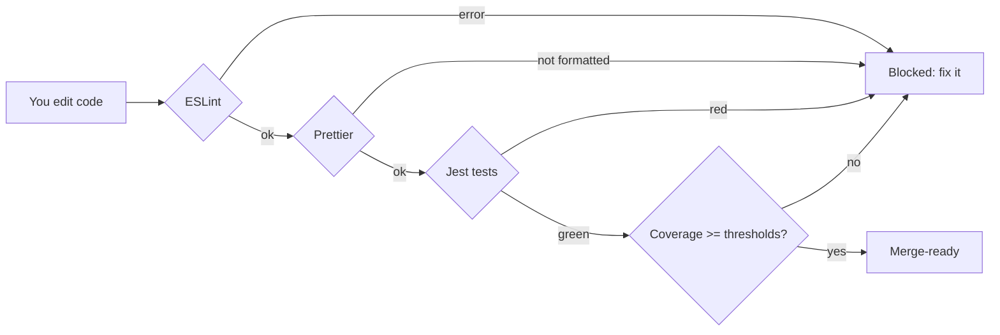

# Coverage and Quality Gates

**What you'll learn:** what **code coverage** measures (lines, statements, branches, functions) and how those four
numbers can disagree, using a tiny worked example built on the real `calcShipping` function; how to read the
coverage table Jest prints and the clickable HTML report in `server/coverage/lcov-report/index.html`; the
thresholds in `server/jest.config.js` that make a run **fail**; what coverage can **not** prove; **mutation
testing** with Stryker as the next step (not in this repo, with pinned setup steps); ESLint and Prettier as
gates; and the **regression rule** that keeps every earlier branch's tests green.

---

## 1. What is a quality gate?

A **quality gate** is an automatic check that says **pass** or **fail** and blocks your work on fail. Nobody has
to remember to run it, and nobody can argue with it.

ShopEase has these gates. You meet each one in this chapter or in [09](./09-ci-cd-automation.md):

| Gate | Command (in `server/`) | Fails when | Runs in |
| --- | --- | --- | --- |
| Tests | `npm test` | any `expect` fails | pre-commit hook, CI |
| Coverage thresholds | `npm run test:coverage` | coverage below 90 / 90 / 90 / 80 % | CI |
| Lint | `npm run lint` | ESLint finds an error | pre-commit (staged files), CI |
| Format | `npm run format:check` | a file is not Prettier-formatted | pre-commit (fixes staged files), CI |
| Regression rule | (a team rule, enforced by the gates above) | an earlier branch's test was changed or deleted to make a new branch pass | code review (you) |



---

## 2. What coverage measures

**Code coverage** is a report of **which parts of your source code ran** while the tests ran. Jest measures it with
a tool called **Istanbul**: before running a file, it adds invisible counters to every statement, branch and
function, then reports how many counters were hit.

| Metric | Counts | Column in the table |
| --- | --- | --- |
| **Statements** | Every executable statement (`const x = …`, `return …`, `if (…)`, a function call) | `% Stmts` |
| **Branches** | Every possible path at a decision: both sides of `if`/`else`, both sides of `? :`, each side of `&&` / `\|\|` / `??`, each `case` of a `switch`, default parameter values | `% Branch` |
| **Functions** | Every function, arrow function and method: was it called at least once? | `% Funcs` |
| **Lines** | Every source line that holds at least one statement: did any statement on it run? | `% Lines` |

### 2.1 A tiny worked example

This is the real free-shipping rule from branch `05-cart-wishlist` onwards, `server/src/utils/pricing.js`:

```js
export function calcShipping(amount) {
  if (amount <= 0) return 0; // nothing to ship → no fee
  // ">=": exactly Rs 5,000 already qualifies for free delivery
  return amount >= PRICING.FREE_SHIPPING_MIN ? 0 : PRICING.SHIPPING_FEE;
}
```

Count what can be covered:

- **Statements: 3** → the `if`, the `return 0` inside it, the last `return`.
- **Branches: 4** → the `if` (true / false) and the `? :` (true / false).
- **Functions: 1** → `calcShipping`.
- **Lines: 2** → the `if` line and the `return … ? … : …` line (the comment line holds no statement).

Now imagine a test file with **only one** test:

```js
it('charges Rs 250 below Rs 5,000', () => {
  expect(calcShipping(1000)).toBe(250);
});
```

Follow `calcShipping(1000)`: the `if` runs (statement hit), its condition is **false** (branch "if-false" hit),
`return 0` never runs, the ternary runs, its condition is **false** (branch "ternary-false" hit).

| Metric | Covered | Result |
| --- | --- | --- |
| Statements | `if`, last `return` (2 of 3) | **66.67 %** |
| Branches | if-false, ternary-false (2 of 4) | **50 %** |
| Functions | `calcShipping` (1 of 1) | **100 %** |
| Lines | both lines had something run (2 of 2) | **100 %** |

**100 % lines, but only 50 % branches.** The line `if (amount <= 0) return 0;` counts as covered because the `if`
on it ran, even though `return 0` never did. That is why **branch coverage is the most honest of the four**.

Add two more tests and everything reaches 100 %:

```js
it('charges nothing for an empty cart', () => expect(calcShipping(0)).toBe(0)); // if-true + return 0
it('is free at exactly Rs 5,000', () => expect(calcShipping(5000)).toBe(0)); // ternary-true
```

The real `server/tests/unit/pricing.test.js` (branch `05-cart-wishlist`) goes further and tests the **edges**:
`4999`, `5000`, `5001`, and also `-5`. Coverage would already be 100 % without `4999` and `5001`; those tests exist
because off-by-one bugs hide exactly at the edge, and coverage cannot see that (section 5).

> **Try it:** on branch `05-cart-wishlist` or later, run only the pricing tests with coverage for that one file:
>
> ```bash
> cd server
> npm test -- tests/unit/pricing.test.js --coverage --collectCoverageFrom=src/utils/pricing.js
> ```
>
> Then comment out the "empty cart" test and run again. Watch `% Branch` drop and `Uncovered Line #s` stay
> empty (the line still counts as covered). Undo your change afterwards.
>
> Narrowing `--collectCoverageFrom` to one file also narrows the 90 % gate to that file, so the run passes or
> fails on that file alone. That is handy while you work on one module.

---

## 3. Reading the coverage output

### 3.1 The table

```bash
cd server
npm run test:coverage
```

`test:coverage` is `jest --coverage` (through `node --experimental-vm-modules`). After the normal test output,
Jest prints a table. The example below is **illustrative** (shortened, made-up numbers) to show the layout;
your real numbers depend on the branch and change as you add code:

```text
----------------------------|---------|----------|---------|---------|-------------------
File                        | % Stmts | % Branch | % Funcs | % Lines | Uncovered Line #s
----------------------------|---------|----------|---------|---------|-------------------
All files                   |   98.12 |    93.40 |   98.75 |   98.30 |
 src                        |     100 |      100 |     100 |     100 |
  app.js                    |     100 |      100 |     100 |     100 |
 src/emails                 |   96.30 |    88.89 |     100 |   96.15 |
  sendEmail.js              |   92.31 |    83.33 |     100 |   92.00 | 39-41
 src/modules/auth           |   99.10 |    95.00 |     100 |   99.05 |
  auth.service.js           |   98.70 |    93.75 |     100 |   98.65 | 112
...
----------------------------|---------|----------|---------|---------|-------------------
```

How to read it:

1. **`All files`** is what the thresholds compare against. Look there first.
2. Then scan down for the **lowest** numbers. Sort mentally by `% Branch`.
3. **`Uncovered Line #s`** lists lines (or ranges like `39-41`) where **no** statement ran. Open the file at those
   lines: that is code no test ever reached. In the illustration, `39-41` in `sendEmail.js` is where the real file's `catch`
   block that logs a failed email lives.
4. A file with high `% Lines` but low `% Branch` has `if`s or `? :` whose second path is never taken (the
   `calcShipping` situation).

**What is counted.** Only files matched by `collectCoverageFrom` in `jest.config.js` appear (section 4). A file
that no test imports still appears, with 0 %, because it is listed there. That is on purpose: forgotten files
cannot hide.

### 3.2 The HTML report

The same run writes a website to `server/coverage/` (folder ignored by git). Open the start page:

```powershell
# PowerShell (Windows)
Start-Process .\coverage\lcov-report\index.html
```

```bash
# Git Bash
start coverage/lcov-report/index.html
# macOS
open coverage/lcov-report/index.html
# Linux
xdg-open coverage/lcov-report/index.html
```

What you see:

- A table of folders. Each row has coloured bars: **green** (high), **yellow** (medium), **red** (low).
- Click a folder, then a file, to see its **source code** with highlights:
  - Lines with a **red background**: statements that never ran.
  - A yellow **`I`** marker before an `if`: the **if** path (condition true) was never taken.
  - A yellow **`E`** marker: the **else** path (condition false) was never taken.
  - Yellow highlight inside an expression: a branch of `? :`, `&&` or `||` was never taken.
  - **`5x`**, **`120x`** in the left margin: how many times that line ran.
- Press **`n`** / **`j`** to jump to the next uncovered block, **`p`** / **`k`** for the previous one.

For `calcShipping` with only the `calcShipping(1000)` test, the HTML report shows an **`I`** before
`if (amount <= 0)` and highlights `return 0` and the `0` after `?`. The table said 100 % lines; the HTML page
shows the truth.

> **Try it:** run `npm run test:coverage`, open the report, find the file with the lowest `% Branch`, click it,
> and find one yellow `I` or `E`. Write down which test would cover it. That is your next test to write.

---

## 4. The thresholds in `jest.config.js`

From `server/jest.config.js` (identical on every branch):

```js
  collectCoverageFrom: [
    'src/**/*.js',
    '!src/server.js', // starts a real server: checked manually, not in tests
    '!src/db/scripts/**', // one-off CLI scripts (seed, indexes)
    '!src/modules/models.js', // only re-exports, nothing to test
  ],
  coverageThreshold: {
    // The test run FAILS if coverage drops below these numbers (an industry "quality gate")
    global: { lines: 90, statements: 90, functions: 90, branches: 80 },
  },
```

| Setting | Meaning |
| --- | --- |
| `collectCoverageFrom` | Which files are measured. `src/**/*.js` = every JS file under `src/`. A leading `!` excludes |
| `!src/server.js` | Calls `app.listen()` and connects to Atlas. Tests use `app.js` directly through Supertest |
| `!src/db/scripts/**` | `seed.js`, `seedAdmin.js`, `syncIndexes.js`: command-line tools. On `10-admin`, `seedStore()` from `seed.js` **is** tested by `tests/integration/seed.test.js`; it is just not counted |
| `!src/modules/models.js` | Only `export … from …` lines |
| `coverageThreshold.global` | Minimums for **all files together**. Below any of them, Jest exits with a non-zero code: the run **fails** even if every test passed |

When the gate fails, the end of the output says so, for example:

```text
Jest: "global" coverage threshold for branches (80%) not met: 78.42%
```

Why **80** for branches but **90** for the rest? Some branches are defensive code that is hard to reach on
purpose (`|| ''` fallbacks, "should never happen" guards). 80 % keeps pressure on without forcing silly tests.

Why not 100 %? The last few percent cost the most and add the least. Teams that demand 100 % tend to get tests
written only to touch lines, without real assertions. Treat 90 % as a **floor**, not a target.

**Thresholds only apply to `test:coverage`.** `npm test` and the pre-commit hook do not collect coverage, so they
cannot fail the gate. CI runs `npm run test:coverage` ([09](./09-ci-cd-automation.md)), so a coverage drop is
caught on push. Run it yourself before you push.

**Not in this repo (optional):** per-file thresholds. Jest also accepts paths or globs inside
`coverageThreshold`, e.g. `'./src/utils/': { branches: 100 }`, to demand more from critical code such as pricing.

---

## 5. What coverage does NOT prove

Coverage answers one question: **"did this code run during the tests?"** It does **not** answer **"was the result
checked?"** or **"is the behaviour correct?"**

| Coverage cannot tell you… | Example |
| --- | --- |
| …whether anything was **asserted** | `it('works', () => { calcShipping(0); calcShipping(5000); calcShipping(1); })` gives 100 % and checks nothing |
| …whether the **edge** is right | `>=` vs `>` at Rs 5,000. A test with `6000` covers the line either way |
| …whether **missing code** should exist | If nobody wrote the "max 5 addresses" check, there is no line to be uncovered |
| …whether **timing** or **concurrency** is right | The `tokenVersion` bug (chapter [08](./08-tdd-and-daily-workflow.md)) sat on fully covered lines |
| …whether **different pieces agree** | Each module 100 % covered, but the frontend sends `qty` and the API expects `quantity` |
| …whether the **real** environment works | Atlas, SMTP, Stripe, Cloudinary: chapter [06](./06-api-testing-postman-bruno.md)'s API tests |

Coverage is great at one thing: showing **what is definitely untested**. Red lines are a fact. Green lines are only
a hint.

---

## 6. Mutation testing: the next step

> **Not in this repo.** Stryker is not installed in ShopEase. Everything below is an optional experiment. Do it
> on a throw-away branch, and keep the setup out of your commits unless you decide to adopt it.

**Mutation testing** measures whether your tests would **notice a bug**. A tool makes many tiny changes to your
source code, one at a time. Each changed copy is a **mutant**. Examples of **mutators** (kinds of change):

| Original | Mutant |
| --- | --- |
| `amount >= 5000` | `amount > 5000`, `amount < 5000`, `true`, `false` |
| `amount <= 0` | `amount < 0` |
| `return 0` | (block removed) |
| `a && b` | `a \|\| b` |
| `'customer'` | `""` |

For each mutant it runs your tests:

- Tests **fail** → the mutant is **killed**. Good: your tests noticed the bug.
- Tests still **pass** → the mutant **survived**. Your tests did not notice. Either add a test or the code is
  redundant.

**Mutation score** = killed ÷ (all valid mutants). It is a much stronger signal than coverage, but slow: every
mutant means another test run.

Worked example: if `pricing.test.js` had only `calcShipping(1000)`, `calcShipping(0)` and `calcShipping(6000)`,
coverage would be **100 %**, yet the mutant `amount > PRICING.FREE_SHIPPING_MIN` would **survive** (6000 is free
either way). The real test file kills it with `expect(calcShipping(5000)).toBe(0)`.

### 6.1 Setup with Stryker (pinned)

**Stryker** is the standard mutation-testing tool for JavaScript. Steps for branch `05-cart-wishlist` or later
(where `src/utils/pricing.js` exists):

**1. Install** (pinned versions, as dev dependencies):

```bash
cd server
npm install --save-dev @stryker-mutator/core@10.1.1 @stryker-mutator/jest-runner@10.1.1
```

**2. Create `server/stryker.config.mjs`:**

```js
// stryker.config.mjs – mutation testing (experiment, not part of the normal gates)
export default {
  packageManager: 'npm',
  testRunner: 'jest',
  // Our Jest runs native ES modules, so it needs the same Node flag as the npm scripts
  testRunnerNodeArgs: ['--experimental-vm-modules'],
  jest: { configFile: 'jest.config.js' },
  // Start SMALL: one file. Mutating all of src/ runs the whole suite thousands of times.
  mutate: ['src/utils/pricing.js'],
  // Run every test for every mutant: slower, but it works with ES modules
  coverageAnalysis: 'off',
  reporters: ['clear-text', 'progress', 'html'],
  concurrency: 2, // each worker starts its own Jest (and in-memory MongoDB): keep it low
  tempDirName: '.stryker-tmp',
};
```

**3. Keep its files out of git and lint.** Add to the root `.gitignore`:

```text
.stryker-tmp/
reports/
```

and add `'.stryker-tmp/**', 'reports/**'` to the `ignores` list at the top of `server/eslint.config.js`, and the same
two folders to `server/.prettierignore`.

**4. Run it:**

```bash
npx stryker run
```

The terminal shows a table per file (`% score`, `# killed`, `# survived`, `# timeout`, `# no cov`). The HTML report
is written to `server/reports/mutation/mutation.html`; each surviving mutant is shown inline in the source.

**5. Read the survivors** like uncovered lines: each one is a test you have not written yet, or code that does
nothing.

Because the global `globalSetup` starts an in-memory MongoDB, even a run on one file takes minutes. Use mutation
testing on **small, critical, pure** code: pricing, coupon maths, state-machine transitions. It is not a gate for
every commit.

---

## 7. Lint and format as gates

### 7.1 ESLint

**ESLint** reads your code without running it (**static analysis**) and reports likely bugs. Config:
`server/eslint.config.js` (branch `main`, same everywhere):

```js
export default [
  // Folders ESLint should never look at
  { ignores: ['node_modules/**', 'coverage/**'] },

  // Base: the recommended JavaScript rules
  js.configs.recommended,

  // Our code runs in Node.js and uses ES modules (import/export)
  {
    files: ['**/*.js'],
    languageOptions: {
      ecmaVersion: 'latest',
      sourceType: 'module',
      globals: { ...globals.node },
    },
    rules: {
      // Allow unused names that start with "_" (e.g. Express's `_req`, `_next`)
      'no-unused-vars': ['error', { argsIgnorePattern: '^_', varsIgnorePattern: '^_' }],
    },
  },

  // Test files also know Jest's globals (describe, it, expect…)
  {
    files: ['tests/**/*.js'],
    ...jest.configs['flat/recommended'],
    languageOptions: { globals: { ...globals.node, ...globals.jest } },
  },

  // Must be LAST so it can switch off conflicting style rules
  prettier,
];
```

The `eslint-plugin-jest` recommended rules are themselves a **test-quality gate**. They catch, for example:

| Rule | Catches |
| --- | --- |
| `jest/no-focused-tests` | A leftover `it.only(...)` / `fit(...)`. It would silently skip every other test in the file |
| `jest/no-disabled-tests` (warning) | `it.skip(...)` / `xit(...)` left behind |
| `jest/no-identical-title` | Two tests with the same name (one is probably a copy-paste mistake) |
| `jest/valid-expect` | `expect(x)` without a matcher, or a missing `await` on `expect(...).resolves` |
| `jest/no-conditional-expect` | `expect` inside an `if`/`catch`, which may never run |

```bash
npm run lint       # check (fails on errors)
npm run lint:fix   # fix what can be fixed safely
```

### 7.2 Prettier

**Prettier** is a **formatter**: it rewrites spacing, quotes, commas and line breaks into one style, so diffs only
show real changes. Config: `server/.prettierrc.json`:

```json
{
  "singleQuote": true,
  "semi": true,
  "trailingComma": "all",
  "printWidth": 100,
  "endOfLine": "lf"
}
```

`endOfLine: "lf"` matters on Windows: files must use Unix line endings, or `format:check` fails in CI. The repo's
`.gitattributes` helps Git keep them that way.

```bash
npm run format:check   # gate: lists files that are not formatted, exits non-zero
npm run format         # fix: rewrites every file
```

ESLint finds **bugs**; Prettier fixes **looks**. `eslint-config-prettier` (last in the ESLint config) switches off
ESLint's style rules so the two never argue.

---

## 8. The regression rule

A **regression** is a bug in something that used to work. ShopEase is built as **stacked branches**: each branch
starts from the previous one, so `07-orders` contains all tests of `main` … `06-coupons` plus its own.

The rule, from `docs/concepts/11-testing-strategy.md`:

> **Regression rule** for this repo: a later branch may **add** tests but must keep every earlier test passing
> **unchanged**.

and from `docs/guides/branch-recipe.md`:

> **Regression rule:** never weaken or delete an earlier branch's tests. All must stay green.

What it means in practice:

| Allowed | Not allowed |
| --- | --- |
| Add new test files and new `it(...)` cases | Delete a test from an earlier branch because it now fails |
| Add new factories to `tests/helpers/factories.js` | Change an existing factory's defaults so old tests mean something else |
| Fix production code so the old test passes again | Loosen an assertion (`toBe(401)` → `toBeGreaterThanOrEqual(400)`) |
| Change an old test **on the branch where it was born**, if the behaviour truly changes, then merge forward | Lower the coverage thresholds |

Why it matters: earlier tests are the only proof that earlier promises (old tokens are revoked, customers cannot
see other customers' addresses, …) still hold after new code arrives. If you change the test, you have changed the
promise.

How to check it: on any branch, `npm test` runs **every** test from every earlier branch. If it is green, the rule
holds. To see whether an old test file was modified on your branch:

```bash
# Which earlier test files did this branch change? (should usually print nothing)
git diff --stat 06-coupons..07-orders -- server/tests/integration/auth.test.js server/tests/integration/users.test.js
```

Chapter [08](./08-tdd-and-daily-workflow.md#6-how-stacked-branches-keep-earlier-tests-green) shows how a bug fix in
an early branch flows forward without breaking the rule.

---

## Common mistakes

- **Chasing 100 %.** Writing a test that calls a function without asserting anything raises coverage and proves
  nothing. Every test needs a real `expect`.
- **Trusting `% Lines`.** It can be 100 % while half the branches never ran. Look at `% Branch` and the `I`/`E`
  markers.
- **Running `npm test` and assuming the gate passed.** Only `npm run test:coverage` checks thresholds.
- **Lowering the thresholds to get a green build.** Write the missing test instead. If code is really untestable
  (like `server.js`), exclude it in `collectCoverageFrom` with a comment that says why.
- **Committing `coverage/`.** It is already in `.gitignore`; if you see it in `git status`, someone removed that
  line.
- **Ignoring a leftover `it.only`.** All other tests in that file are skipped. ESLint's `jest/no-focused-tests`
  catches it, so do not switch that rule off.
- **Running Stryker over the whole `src/` the first time.** It can take hours. Start with one small file.

---

## Check yourself

1. With only the test `calcShipping(1000)`, why is `% Lines` 100 % while `% Branch` is 50 %?
2. Where is the HTML coverage report, and what do the `I` and `E` markers mean?
3. Which four numbers does `jest.config.js` enforce, and which npm script actually checks them?
4. Give two kinds of bugs that 100 % coverage would not catch.
5. What is a "surviving mutant", and what should you do about one?

---

**Next:** [08 – TDD and daily workflow](./08-tdd-and-daily-workflow.md)
