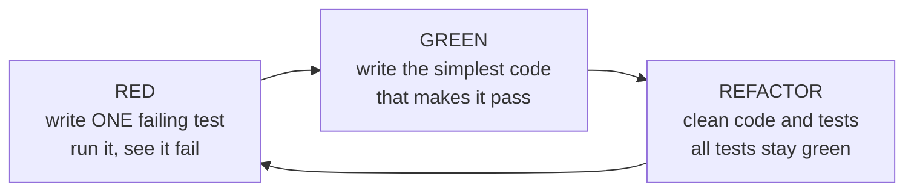
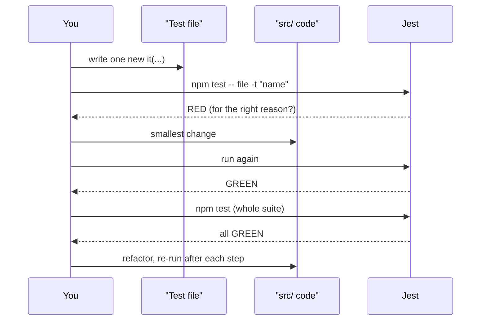
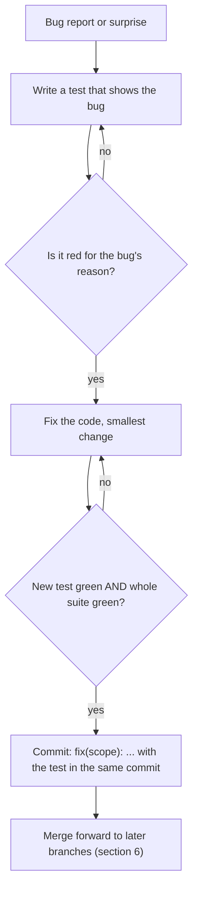
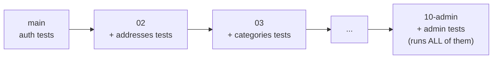

# TDD and the Daily Workflow

**What you'll learn:** what **test-driven development (TDD)** is and the **red → green → refactor** loop; a full
worked TDD example that adds a small new rule to ShopEase (reject very common passwords) with the tests written
**before** the code; the habit "write a failing test for every bug first", told through the real `tokenVersion` bug
that the tests found on `main`; the daily commands (`test:watch`, one file, one test with `-t`, debugging a failing
test, `--runInBand`, `--detectOpenHandles`); how the stacked-branch workflow keeps earlier branches' tests green;
and short checklists to go through before every commit.

---

## 1. TDD in one picture

**Test-driven development** means: you write a test for the behaviour you want **first**, watch it fail, then write
the **smallest** code that makes it pass, then clean up. Repeat in small steps.



| Step | You do | You must see |
| --- | --- | --- |
| **Red** | Write one small test for one behaviour | The test **fails**, and for the **right reason** (the behaviour is missing, not a typo in the test) |
| **Green** | Write just enough production code | That test passes, and every other test still passes |
| **Refactor** | Rename, remove duplication, move code to a better place | Still all green. No new behaviour in this step |

Why bother writing the test first?

- **You prove the test can fail.** A test you have never seen red may be checking nothing (wrong URL, missing
  `await`, assertion on the wrong variable).
- **You design from the outside.** You decide the URL, status code and error message (what the frontend will see)
  before thinking about the inside.
- **You stop when you are done.** When the tests are green, the feature is finished. No gold-plating.
- **The tests already exist** when you refactor or when the next branch builds on top.

TDD is a tool, not a religion. For exploring an unknown library, a quick spike without tests is fine; then throw
the spike away and rebuild it test-first.

---

## 2. Worked example: reject very common passwords

> **Example only.** This rule is **not** in the repo. It is a realistic, small feature you can build on a
> practice branch to learn the loop. All existing APIs used here (`passwordRule`, `validate`, `api()`,
> `uniqueEmail()`, `loggedIn()`, `PASSWORD`) are real code from branch `main`.

### 2.1 The requirement

> Registration, password reset and change password must refuse passwords from a small list of very common
> passwords (like `password1` or `qwerty123`), with **400** and the field error
> `{ field: 'password', message: 'Password is too common, choose another' }`. The check ignores upper/lower case.

Today, `server/src/modules/auth/auth.validation.js` (branch `main`) has one shared password rule:

```js
export const passwordRule = (field = 'password') =>
  body(field)
    .isString()
    .withMessage('Password is required')
    .bail()
    .isLength({ min: 8, max: 64 }) // 64 max: bcrypt only uses the first 72 bytes anyway
    .withMessage('Password must be 8–64 characters')
    .bail()
    .matches(/[A-Za-z]/) // at least one letter
    .withMessage('Password must contain a letter and a number')
    .matches(/\d/) // at least one digit
    .withMessage('Password must contain a letter and a number');
```

It is used by `registerRules`, `resetPasswordRules` and, through `passwordRule('newPassword')`, by
`changePasswordRules` in `users/user.validation.js`. One change there protects all three routes.

### 2.2 Start a practice branch

```bash
git switch main
git switch -c practice/common-passwords     # never practise directly on main
cd server
npm test                                     # start from green: everything must pass first
```

If `npm test` is not green **before** you start, stop and fix that first. Otherwise you cannot tell your failures
from old ones.

### 2.3 Cycle 1 (unit): a helper that recognises common passwords

**RED.** Create `server/tests/unit/commonPasswords.test.js`:

```js
/**
 * UNIT tests for src/utils/commonPasswords.js (a pure function: text in, true/false out).
 */
import { isCommonPassword } from '../../src/utils/commonPasswords.js';

describe('isCommonPassword', () => {
  it.each(['password1', 'qwerty123', 'abc12345'])('flags %s as common', (pw) => {
    expect(isCommonPassword(pw)).toBe(true);
  });

  it('ignores upper and lower case', () => {
    expect(isCommonPassword('PassWord1')).toBe(true);
  });

  it('accepts a password that is not on the list', () => {
    expect(isCommonPassword('river7lamp')).toBe(false);
  });

  it('returns false for anything that is not text', () => {
    expect(isCommonPassword(undefined)).toBe(false);
    expect(isCommonPassword(12345678)).toBe(false);
  });
});
```

Run only this file:

```bash
npm test -- tests/unit/commonPasswords.test.js
```

It fails with something like `Cannot find module '../../src/utils/commonPasswords.js'`. That is red, but **not yet
for the right reason**: the file is missing, the behaviour has not been tested. Create the smallest possible file so
the test can run:

```js
// server/src/utils/commonPasswords.js
export function isCommonPassword() {
  return false;
}
```

Run again. Now `flags password1 as common` and `ignores upper and lower case` fail with
`Expected: true, Received: false`. **This** is the right red: the test runs and the behaviour is missing. Notice
that the two "false" tests already pass; that is fine, they guard the other side.

**GREEN.** Write the real code, as simple as possible:

```js
/**
 * src/utils/commonPasswords.js – a tiny list of passwords attackers try first.
 * Used by passwordRule() in auth.validation.js. Compared in lower case.
 */
const COMMON_PASSWORDS = new Set([
  'password1',
  'passw0rd',
  'qwerty123',
  'abc12345',
  'iloveyou1',
  'welcome1',
  'letmein1',
  'admin123',
]);

export function isCommonPassword(password) {
  if (typeof password !== 'string') return false;
  return COMMON_PASSWORDS.has(password.toLowerCase());
}
```

```bash
npm test -- tests/unit/commonPasswords.test.js     # green
```

Every entry contains a letter and a digit and has at least 8 characters, so each one would pass the **existing**
rules. Entries the existing rules already reject (like `123456`) would be dead weight.

**REFACTOR.** Nothing to clean yet. Move on.

### 2.4 Cycle 2 (integration): register refuses a common password

**RED.** The unit test proves the helper works. It does not prove the **route** uses it. Add a case to the existing
validation table in `server/tests/integration/auth.test.js`, inside `describe('POST /api/auth/register', …)`:

```js
  it.each([
    ['missing name', { name: undefined }, 'name'],
    ['short name', { name: 'A' }, 'name'],
    ['bad email', { email: 'nope' }, 'email'],
    ['short password', { password: 'abc1' }, 'password'],
    ['password without a number', { password: 'abcdefgh' }, 'password'],
    ['password without a letter', { password: '12345678' }, 'password'],
    ['a very common password', { password: 'Password1' }, 'password'], // NEW
  ])('returns 400 for %s', async (_label, change, field) => {
```

and one test that pins the exact message the frontend will show:

```js
  it('names the problem when the password is too common', async () => {
    const res = await api()
      .post('/api/auth/register')
      .send({ ...valid(), password: 'qwerty123' });
    expect(res.status).toBe(400);
    expect(res.body.errors).toEqual([
      { field: 'password', message: 'Password is too common, choose another' },
    ]);
  });
```

Run just these tests by name:

```bash
npm test -- tests/integration/auth.test.js -t "common"
```

Both fail: `Expected: 400, Received: 201`. Right reason: the user was created, the rule is missing.

Note that we **added** rows and tests. We did not change any existing row. That is the regression rule from
[07](./07-coverage-and-quality-gates.md#8-the-regression-rule) in action.

**GREEN.** Add the rule at the end of `passwordRule` in `auth.validation.js`:

```js
import { body } from 'express-validator';
import { isCommonPassword } from '../../utils/commonPasswords.js';

// ...

export const passwordRule = (field = 'password') =>
  body(field)
    .isString()
    .withMessage('Password is required')
    .bail()
    .isLength({ min: 8, max: 64 })
    .withMessage('Password must be 8–64 characters')
    .bail()
    .matches(/[A-Za-z]/)
    .withMessage('Password must contain a letter and a number')
    .matches(/\d/)
    .withMessage('Password must contain a letter and a number')
    .bail() // only check the list when the basic rules passed
    .custom((value) => !isCommonPassword(value)) // a falsy return = invalid
    .withMessage('Password is too common, choose another');
```

In express-validator 7, a `.custom()` validator that returns a falsy value marks the field invalid, and the
`.withMessage()` right after it sets the message.

```bash
npm test -- tests/integration/auth.test.js -t "common"   # green
npm test                                                  # EVERYTHING still green?
```

### 2.5 Cycle 3: the other two routes

The requirement said reset and change password too. Because they share `passwordRule`, they probably already
work. "Probably" is not a test. Add one test to `server/tests/integration/users.test.js`:

```js
  it('returns 400 when the new password is too common', async () => {
    const { auth } = await loggedIn();
    const res = await change(auth, { currentPassword: PASSWORD, newPassword: 'Welcome1' });
    expect(res.status).toBe(400);
    expect(res.body.errors[0]).toEqual({
      field: 'newPassword',
      message: 'Password is too common, choose another',
    });
  });
```

Run it. It is **green immediately**. When a new test passes at once, check that it **can** fail: temporarily remove
`'welcome1'` from the list, run it, see it go red, put the entry back. Now you trust it.

(Do the same for `POST /api/auth/reset-password` in the "Forgot / reset password flow" block of `auth.test.js` as
an exercise.)

### 2.6 Refactor and the trap

**REFACTOR.** Ideas that keep behaviour the same:

- Move the list into `src/config/constants.js` next to the other rules (`LIMITS`, `REGEX`), if you prefer one place
  for business constants.
- Add a header comment in `auth.validation.js` explaining the new step.

Run `npm test` after each small change.

**The trap.** Imagine you add `'secret123'` to the list because it is common. Run `npm test`: the register tests
in `auth.test.js` go red (`valid()` sends it), and so does every later-branch test that registers through the API.
Why? `tests/helpers/factories.js` uses it as the shared test password:

```js
export const PASSWORD = 'secret123'; // a valid password used across tests
```

(`createUser()` saves straight to the database and skips validation, so tests built on `loggedIn()` keep passing,
which is why only some tests fail.) The Postman and Bruno collections also register users with `secret123`, so
`npm run test:api` would break too. The gate just
told you that your change breaks existing promises. The right answer is **not** to edit the old tests; it is to
decide whether that entry is worth it (it is not, here) or to change the shared password on purpose in a separate,
reviewed commit.

### 2.7 Finish

```bash
npm run test:coverage     # the new file is covered 100 %
npm run lint
npm run format:check
git add -A
git commit -m "feat(auth): refuse very common passwords"
```

The pre-commit hook ([09](./09-ci-cd-automation.md)) runs lint-staged and the whole suite again.

If the feature should also be checked against the running server, add a request
**Register – common password → 400** to folder 01 Auth in Postman and Bruno, as shown in
[06](./06-api-testing-postman-bruno.md#8-step-by-step-a-new-request-and-test-for-a-new-endpoint).

---

## 3. The summary of the loop



---

## 4. Write a failing test for every bug first

When you find a bug, the order is:

1. **Reproduce** it in a test. Run it: it must be **red**, and red because of the bug.
2. **Fix** the code. The test turns green.
3. **Keep** the test forever. It is now a **regression test**: if anyone ever brings the bug back, it goes red.

If you fix first and test later, you never see the test fail, so you never know it actually catches the bug.

### 4.1 The real story: old tokens survived a password change

This happened while building `main`. It is recorded in `CHANGELOG.md`:

> **Old login tokens could survive a password change.** The original code saved
> `passwordChangedAt = now − 1 second` and rejected tokens whose `iat` (issued-at time) was older. But JWT `iat`
> is stored in **whole seconds**. A token created less than about a second before the password change still
> looked "newer" and kept working. The new tests caught this.
> **Fix:** a `tokenVersion` counter on the user.

The idea of the **old** code (it came from `auth-server.zip` and is not in the repo; this is a reconstruction from
`docs/concepts/05-jwt-and-sessions.md`):

```js
// OLD idea (reconstructed, not in the repo)
// on password change:
user.passwordChangedAt = Date.now() - 1000; // "1 second ago"
// in protect():
if (user.passwordChangedAt > payload.iat * 1000) throw new ApiError(401, '…'); // iat is in SECONDS
```

The integration test that went red is still in `server/tests/integration/auth.test.js` (branch `main`):

```js
  it('logs out old sessions: tokens issued before the reset stop working', async () => {
    const { user, auth } = await loggedIn();
    await api().post('/api/auth/forgot-password').send({ email: user.email });
    const token = tokenFromLastEmail(user.email);
    await api().post('/api/auth/reset-password').send({ token, password: 'newpass123' });

    const res = await api().get('/api/auth/me').set('Authorization', auth);
    expect(res.status).toBe(401);
    expect(res.body.message).toBe('Password was changed, please log in again');
  });
```

Why it failed: `loggedIn()` signs a token, and the reset happens a few **milliseconds** later. Say the token is
created at 12:00:00.300. Its `iat` is rounded down to 12:00:00.000. The reset then stores
`passwordChangedAt` = 12:00:00.350 − 1 s = 11:59:59.350. The check asks "is 11:59:59.350 later than
12:00:00.000?" **No**, so the old token is **accepted** and the test gets **200** instead of **401**. With a fast
test, that is the case on most runs: only a token created in the last tenth of a second before a full second
would happen to be rejected. A human clicking in Postman takes many seconds between steps and never sees it.

The fix, in `server/src/modules/users/user.model.js` (branch `main`), replaces time with a **counter**:

```js
userSchema.pre('save', async function hashPassword() {
  if (!this.isModified('password') || !this.password) return;
  this.password = await bcrypt.hash(this.password, SALT_ROUNDS);
  // On a CHANGE (not on sign-up): remember when, and bump the token version so every
  // token created before this moment stops working.
  if (!this.isNew) {
    this.passwordChangedAt = new Date();
    this.tokenVersion += 1;
  }
});

// true if a token made with `tokenVersionInJwt` is out of date (password changed since).
// Tokens from before this feature have no version (undefined) → also out of date.
userSchema.methods.isTokenOutdated = function isTokenOutdated(tokenVersionInJwt) {
  return tokenVersionInJwt !== this.tokenVersion;
};
```

and `protect` in `server/src/middleware/auth.middleware.js` uses it:

```js
  if (user.isTokenOutdated(payload.v)) {
    throw new ApiError(401, 'Password was changed, please log in again');
  }
```

Afterwards, more tests were added to pin the fix from every side. A **unit** test with no database
(`server/tests/unit/user.model.test.js`):

```js
  it('isTokenOutdated compares the token version with the user version', () => {
    const user = new User({ name: 'Ali', email: 'a@b.co', password: 'x' });
    expect(user.tokenVersion).toBe(0);
    expect(user.isTokenOutdated(0)).toBe(false); // current token
    expect(user.isTokenOutdated(undefined)).toBe(true); // token without a version

    user.tokenVersion = 1; // password changed once
    expect(user.isTokenOutdated(0)).toBe(true); // old token
    expect(user.isTokenOutdated(1)).toBe(false); // fresh token
  });
```

and **integration** tests for change password (`server/tests/integration/users.test.js`), including the opposite
case, so the counter is not bumped too often:

```js
  it('invalidates the OLD token (other devices are logged out)', async () => {
    const { user, auth } = await loggedIn();
    await change(auth, { currentPassword: PASSWORD, newPassword: 'newpass123' });
    expect((await api().get('/api/auth/me').set('Authorization', auth)).status).toBe(401);

    // How: the password change bumped tokenVersion 0 → 1 and recorded the time
    const saved = await User.findById(user._id);
    expect(saved.tokenVersion).toBe(1);
    expect(saved.passwordChangedAt).toBeInstanceOf(Date);
  });

  it('does NOT bump tokenVersion when other fields change', async () => {
    const { user } = await loggedIn();
    user.name = 'Renamed';
    await user.save();
    expect((await User.findById(user._id)).tokenVersion).toBe(0);
  });
```

Lessons:

1. **A test that fails "sometimes" is often a real bug**, not a "flaky test". Investigate before you add a retry or
   a `setTimeout`.
2. Be careful comparing times with different **precision** (seconds vs milliseconds).
3. Fast automated tests find timing bugs that slow humans never trigger.
4. After the fix, pin it with tests at **more than one level** (unit + integration + the Postman
   "Me – old token after reset → 401" request in [06](./06-api-testing-postman-bruno.md#43-chaining-tokens-pmenvironmentset)).

### 4.2 Your bug routine



---

## 5. The daily loop

### 5.1 Watch mode

```bash
cd server
npm run test:watch
```

`test:watch` is Jest with `--watch`: it stays running and re-runs tests every time you save a file. By default it
runs only tests related to files changed since the last commit (it asks Git). Keys you can press while it waits:

| Key | Does |
| --- | --- |
| `a` | Run **all** tests |
| `f` | Run only the tests that **failed** last time |
| `o` | Back to "only changed files" |
| `p` | Filter by file name (type part of a path, e.g. `users`) |
| `t` | Filter by test name (type part of an `it(...)` name) |
| `Enter` | Run again now |
| `q` | Quit |

Typical setup: editor on the left, watch mode in a terminal on the right, filtered with `p` to the file you work on.

### 5.2 One file, one test

```bash
# One file
npm test -- tests/integration/users.test.js

# All tests whose full name contains a text (describe + it names joined)
npm test -- -t "invalidates the OLD token"

# Both: one test in one file (fastest)
npm test -- tests/integration/users.test.js -t "OLD token"

# Only unit tests / only integration tests
npm run test:unit
npm run test:integration
```

The `--` tells npm "everything after this goes to Jest". `-t` is a **regular expression** match, so characters like
`(`, `)` or `?` in a name need escaping, or just use a shorter plain part of the name.

You can also focus a test in the code with `it.only(...)` or `describe.only(...)`. It is handy, but remove it before
committing: ESLint's `jest/no-focused-tests` rule fails the lint gate if you forget.

### 5.3 Debugging a failing test

Work from cheap to expensive.

**1. Read the failure output.** Jest shows the test name, the `expect` line, **Expected** vs **Received**, and the
file and line. Most failures are solved here.

**2. Print the response.** A status is rarely enough; the body says why:

```js
const res = await change(auth, { currentPassword: PASSWORD, newPassword: 'Welcome1' });
console.log(res.status, JSON.stringify(res.body, null, 2)); // remove after debugging
```

In `NODE_ENV=test` the app does not print errors or request logs (by design), so your own `console.log` is the way
to see inside.

**3. Run that one test alone.** If it passes alone but fails in the full suite, another test is leaking state into
it. Look for missing `afterEach(clearTestDB)` or a variable shared between tests at the top of the file.

**4. Use a real debugger.** Start Jest paused, in one process:

```bash
node --experimental-vm-modules --inspect-brk node_modules/jest/bin/jest.js --runInBand tests/integration/users.test.js -t "OLD token"
```

Then attach: in Chrome open `chrome://inspect` → **Open dedicated DevTools for Node**; or in VS Code open a
**JavaScript Debug Terminal** and run `npm test -- --runInBand tests/integration/users.test.js` there (breakpoints
in the editor then work). Put a `debugger;` statement in the test or source where you want to stop.

### 5.4 `--runInBand`

By default Jest runs test files in **parallel worker processes**. `tests/setup/env.js` gives each worker its own
database (`shopease_test_1`, `shopease_test_2`, …) using `JEST_WORKER_ID`.

`--runInBand` (short: `-i`) runs all files **one after another in a single process**. Use it when:

- debugging (one process to attach to, no interleaved output);
- the machine is slow or low on memory (CI runners, old laptops) and parallel MongoDB work times out;
- you suspect two files interfere with each other (if `-i` fixes it, look for shared state).

```bash
npm test -- --runInBand
```

### 5.5 `--detectOpenHandles`

Sometimes all tests pass but Jest prints:

```text
Jest did not exit one second after the test run has completed.
```

Something is still open: a database connection, a server, a timer. `--detectOpenHandles` tells Jest to track them
and print where each one was created:

```bash
npm test -- --detectOpenHandles tests/integration/users.test.js
```

It makes the run slower, so use it only to investigate. In this project the usual causes are:

| Cause | Fix |
| --- | --- |
| A new test file forgot `afterAll(closeTestDB)` | Add the three lines `beforeAll(connectTestDB)`, `afterEach(clearTestDB)`, `afterAll(closeTestDB)` |
| A test started a real server with `app.listen()` | Use `api()` (Supertest) instead; it needs no real port |
| A `setInterval` / `setTimeout` in code under test | Clear it, or use `jest.useFakeTimers()` in that test |

Do not "fix" it with `--forceExit`. That hides the leak instead of closing it.

---

## 6. How stacked branches keep earlier tests green

ShopEase grows as a stack: `main` → `02-profile-addresses` → … → `10-admin`. Each branch is created from the
previous one, so it contains **all** earlier tests. Running `npm test` on `07-orders` runs the tests of 01 to 07.



What that gives you:

- **Every later branch re-checks every earlier promise.** If `07-orders` code accidentally breaks login, the `main`
  tests fail on `07-orders`.
- **Bugs are fixed where they were born, then merged forward.** From `docs/guides/git-workflow.md`:

```bash
# 1) Fix it where it was born
git checkout 03-categories
# ...fix + test...
git commit -m "fix(categories): ..."

# 2) Carry the fix forward, one step at a time
git checkout 04-products-uploads && git merge 03-categories
git checkout 05-cart-wishlist     && git merge 04-products-uploads
git checkout 06-coupons           && git merge 05-cart-wishlist
# (continue up to the newest branch; run npm test after each merge)
```

The test you wrote **first** (section 4) travels forward with the fix, so every later branch is protected too.
Running `npm test` after each merge is what proves the fix did not collide with later code. The guide uses
**merge**, never rebase, on these branches, because rebasing rewrites commit ids under the branches stacked on top.

- **The regression rule** (chapter [07](./07-coverage-and-quality-gates.md#8-the-regression-rule)) keeps this
  honest: a later branch never edits or deletes an earlier branch's tests to make itself pass.

---

## 7. Checklists

### Before you start a change

- [ ] `git status` is clean (or your work is committed / stashed).
- [ ] You are on the right branch (`git branch --show-current`).
- [ ] `npm test` is **green** right now.

### While you work

- [ ] One small behaviour at a time: red → green → refactor.
- [ ] Every new test was seen **red** at least once.
- [ ] For each new route: happy path, 400, 401, 403, 404, 409 and ownership (from branch 02) where they apply.
- [ ] For each bug: the test that reproduces it comes **first**.

### Before every commit

- [ ] `npm test`: whole suite green (the hook does this too, but find out before you write the message).
- [ ] `npm run test:coverage`: thresholds met (CI checks this; the hook does not).
- [ ] `npm run lint` and `npm run format:check` pass.
- [ ] No `it.only`, `describe.only`, `it.skip` or leftover `console.log` in tests.
- [ ] No earlier branch's test was changed or deleted (regression rule).
- [ ] If you changed an endpoint: Postman/Bruno updated, Swagger docs (`*.docs.js`) updated.
- [ ] `bruno/environments/local.bru` and `.env` are **not** staged.
- [ ] Commit message follows `type(scope): summary`, e.g. `fix(auth): …`, `test(users): …`.

### Before you push

- [ ] Ran the API collection for the module you touched (`npm run test:api -- --folder "…"`) against a running
      server, if the change affects real HTTP behaviour.
- [ ] If the fix belongs to an earlier branch: merged forward through every later branch, `npm test` on each.

---

## Common mistakes

- **Writing the code first and the test "later".** Later rarely comes, and the test you write after the fact tends
  to describe what the code does, not what it should do.
- **Never seeing the test red.** A test that passed at once may test nothing. Break the code on purpose for a moment.
- **Red for the wrong reason.** "Cannot find module" or a typo in the URL is not the behaviour failing. Get the
  test to fail on its `expect` before writing the feature.
- **Huge steps.** Writing five tests and a whole module, then debugging ten failures. One test, one small change.
- **Refactoring while red.** Get to green first; then refactor.
- **Fixing a bug on the newest branch only.** Earlier branches keep the bug. Fix where it was born and merge forward.
- **Adding `--forceExit` or a `setTimeout` to make a test pass.** Both hide a real problem (an open handle, a race).
- **Editing an old test to match new behaviour without asking why it failed.** That is how regressions get shipped.

---

## Check yourself

1. What are the three steps of TDD, and what must you see at the end of each?
2. In the worked example, the first run failed with "Cannot find module". Why is that not yet the "right" red?
3. Why did the old `passwordChangedAt − 1 second` check let an old token through, and why does a counter fix it?
4. When would you use `--runInBand`, and what does `--detectOpenHandles` help you find?
5. You find a bug in `03-categories` while working on `07-orders`. List the steps, including where the test goes.

---

**Next:** [09 – CI/CD automation](./09-ci-cd-automation.md)
