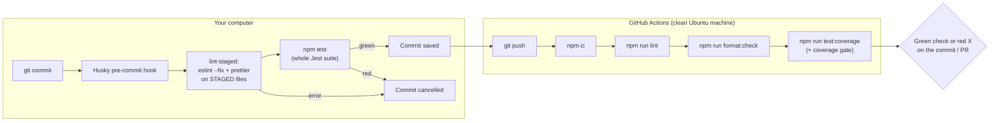
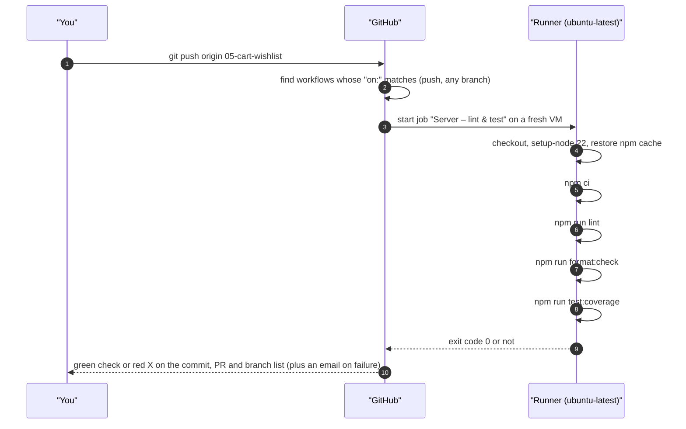

# CI/CD Automation

**What you'll learn:** how the checks from the previous chapters run **by themselves**: locally before every commit
(Husky + lint-staged, explained line by line from `server/.husky/pre-commit` and `server/package.json`), and on
GitHub after every push (the GitHub Actions workflow `.github/workflows/ci.yml`, explained line by line). You will
learn what happens step by step when you push, how to read a failed CI run and reproduce it on your machine, how
secrets work in CI, how to add an **optional** second job that runs the Newman API tests against a real server with
MongoDB and Mailpit containers (full YAML), how to protect branches on GitHub so red code cannot be merged, and how
to add a status badge to the README.

---

## 1. CI and CD in plain words

- **Continuous Integration (CI):** every time code is pushed, a clean machine downloads it, installs it and runs the
  checks (lint, format, tests). If anything fails, everyone sees a red ❌ before the code is merged.
- **Continuous Delivery / Deployment (CD):** after CI is green, the code is automatically prepared for release
  (delivery) or released (deployment). ShopEase does **not** deploy from CI yet; Vercel deployment is described in
  `docs/guides/deployment-vercel.md`. This chapter is about the CI half.

The project has **two layers** of automation:



Why both? The hook gives **fast** feedback (seconds, before you even write the commit message) but you can skip it
or forget to install it. CI is **slower** but runs on a clean machine nobody can skip, and checks coverage too.

---

## 2. Husky and lint-staged

### 2.1 What they are

- A **Git hook** is a script Git runs automatically at a certain moment. A **pre-commit** hook runs when you type
  `git commit`, **before** the commit is created. If the script exits with an error, Git cancels the commit.
- **Husky** is a small tool that keeps hook scripts **in the repo** (so everyone gets the same hooks) and tells Git
  where to find them.
- **lint-staged** runs commands only on the files you **staged** (`git add`ed), not on the whole project. That keeps
  the hook fast.

Both are dev dependencies in `server/package.json`: `"husky": "^9.1.7"` and `"lint-staged": "^17.6.1"`.

### 2.2 How Husky gets installed: the `prepare` script

From `server/package.json` (branch `main`):

```json
"prepare": "cd .. && husky server/.husky || true"
```

| Part | Meaning |
| --- | --- |
| `"prepare"` | A special npm script: npm runs it **automatically after `npm install` / `npm ci`** |
| `cd ..` | Go from `server/` up to the **repo root**, where the `.git` folder is |
| `husky server/.husky` | Tell Git: "my hooks live in `server/.husky`". Husky 9 does this by setting Git's `core.hooksPath` setting and creating a small helper folder `server/.husky/_` |
| `\|\| true` | If that fails (for example where there is no `.git` folder, like some deploy builds), do **not** fail the whole install |

So you never install hooks by hand: running `npm install` in `server/` once is enough.

> **Try it:** from the repo root, run `git config core.hooksPath`. After `npm install` in `server/` it should print
> `server/.husky/_`. If it prints nothing, run `npm install` in `server/` again.

### 2.3 The hook, line by line

`server/.husky/pre-commit` (branch `main`, unchanged on later branches):

```sh
# Husky pre-commit hook: runs automatically before every `git commit`.
# If anything fails, the commit is cancelled, so broken code never gets saved.
cd server
# 1) Lint + format only the files you staged (fast)
npx lint-staged
# 2) Run the whole test suite (unit + integration, in-memory DB)
npm test --silent
```

| Line | What it does |
| --- | --- |
| `# …` | Comments. Git and the shell ignore them |
| `cd server` | Git runs hooks from the **repo root**, but `package.json`, ESLint config and tests live in `server/` |
| `npx lint-staged` | Runs lint-staged (from `server/node_modules`), which reads its config from `server/package.json` (next section). If ESLint finds an error it cannot fix, it exits non-zero and the commit stops here |
| `npm test --silent` | Runs the **whole** Jest suite. `--silent` is an **npm** flag: it hides npm's own header lines, not Jest's output. A failing test exits non-zero and cancels the commit |

The hook is a plain shell script, so it must use **LF** line endings. The repo's `.gitattributes` forces that:

```text
# Keep LF line endings in the repo and in your working folder on every OS.
# (Prettier expects LF, and shell scripts such as the Husky hook break with CRLF.)
* text=auto eol=lf
```

On Windows, Git runs the hook with the `sh` that comes with Git for Windows, so it works from PowerShell,
Git Bash and editors alike.

### 2.4 The lint-staged config, line by line

From `server/package.json`:

```json
"lint-staged": {
  "*.js": [
    "eslint --fix",
    "prettier --write"
  ],
  "*.{json,md,yml}": [
    "prettier --write"
  ]
}
```

| Line | Meaning |
| --- | --- |
| `"lint-staged": { … }` | lint-staged's configuration, kept inside `package.json` |
| `"*.js"` | A **glob** (file pattern). Without a `/` it matches the file **name** in any folder, so `src/app.js` and `tests/unit/utils.test.js` both match |
| `"eslint --fix"` | Run ESLint on those staged files and fix what it safely can. lint-staged adds the file paths to the end of the command. Remaining errors fail the hook |
| `"prettier --write"` | Then format the same files. Commands in one list run **in order** |
| `"*.{json,md,yml}"` | JSON, Markdown and YAML files: only formatting (ESLint does not read them) |

What lint-staged does around those commands:

1. Collects the list of staged files and matches them against the globs.
2. Saves a backup of your **unstaged** changes (so they are not mixed into the commit).
3. Runs the commands.
4. **Adds the fixed files back** to the commit automatically, so the commit contains the formatted version.
5. On failure, restores everything as it was.

The config lives in `server/package.json`, so it only handles files **inside `server/`**. Files at the repo root
(`docs/*.md`, `.github/workflows/ci.yml`) are not formatted by the hook.

### 2.5 When the hook blocks you

```text
✖ eslint --fix:
  /…/server/src/modules/auth/auth.service.js
    12:7  error  'unused' is assigned a value but never used  no-unused-vars
husky - pre-commit script failed (code 1)
```

Fix the reported problem, `git add` the file again, commit again. If tests fail, run the failing file alone
(chapter [08](./08-tdd-and-daily-workflow.md#52-one-file-one-test)).

Git has an option `git commit --no-verify` that skips hooks. Treat it as an emergency exit only (for example to
save work in progress on a private branch): CI will run the same checks on push anyway, and a red CI run is more
public than a blocked commit.

---

## 3. The GitHub Actions workflow, line by line

**GitHub Actions** is GitHub's built-in CI service. A **workflow** is a YAML file in `.github/workflows/`. It
contains **jobs**; each job runs on a fresh virtual machine (a **runner**) and has **steps**.

`.github/workflows/ci.yml` (branch `main`, the same on every branch):

```yaml
# .github/workflows/ci.yml – Continuous Integration (CI).
#
# Once this repo is on GitHub, EVERY push and pull request runs these steps on a clean
# machine. If lint or tests fail, GitHub shows a red ❌, so broken code is caught before
# anyone merges it. Nothing here runs locally; it is dormant until you push to GitHub.
name: CI

on:
  push:
    branches: ['**'] # every branch (each learning step is a branch)
  pull_request:

jobs:
  server:
    name: Server – lint & test
    runs-on: ubuntu-latest
    defaults:
      run:
        working-directory: server # all commands run inside server/
    steps:
      - uses: actions/checkout@v4 # download the code
      - uses: actions/setup-node@v4 # install Node.js
        with:
          node-version: 22
          cache: npm
          cache-dependency-path: server/package-lock.json
      - run: npm ci # clean install exactly what package-lock.json says
      - run: npm run lint # code quality
      - run: npm run format:check # formatting
      - run: npm run test:coverage # unit + integration tests with the coverage gate
```

| Line(s) | Meaning |
| --- | --- |
| `name: CI` | The workflow's name in the **Actions** tab and in the badge |
| `on:` | **Triggers**: which events start the workflow |
| `push:` / `branches: ['**']` | On every push to **any** branch. `'**'` matches names with `/` too (`practice/common-passwords`). Every stacked branch is checked |
| `pull_request:` | Also when a pull request is opened or updated. The run tests the **merge result** of the PR, not just the branch |
| `jobs:` | The list of jobs. They run in parallel unless one `needs` another |
| `server:` | The job's id (used by `needs:` and in the API) |
| `name: Server – lint & test` | The job's display name. Branch protection refers to this name (section 7) |
| `runs-on: ubuntu-latest` | A fresh Ubuntu Linux machine hosted by GitHub. Linux is **case-sensitive** for file names, unlike Windows |
| `defaults: run: working-directory: server` | Every `run:` step starts in `server/` (does not apply to `uses:` steps) |
| `steps:` | Run top to bottom. The first failing step stops the job (later steps are skipped) |
| `uses: actions/checkout@v4` | A ready-made **action** that clones your repo at the pushed commit. `@v4` pins the major version |
| `uses: actions/setup-node@v4` | Installs Node.js |
| `node-version: 22` | Node 22. `package.json` says `"engines": { "node": ">=20" }` |
| `cache: npm` | Caches npm's download cache between runs, so `npm ci` is faster |
| `cache-dependency-path: server/package-lock.json` | The cache key is a hash of this file; when dependencies change, a new cache is made. Needed because the lock file is not at the repo root |
| `run: npm ci` | **Clean install**: deletes `node_modules`, installs exactly what `package-lock.json` says, and **fails** if `package.json` and the lock file disagree. Also runs `prepare` (Husky) |
| `run: npm run lint` | ESLint over the whole project. Any error → red |
| `run: npm run format:check` | `prettier --check .`: fails if any file is not formatted |
| `run: npm run test:coverage` | All Jest tests **with** coverage, so the thresholds in `jest.config.js` apply. `mongodb-memory-server` downloads a MongoDB binary on the first run on each machine (~100 MB) |

Notice what CI does **not** need: no `.env`, no Atlas, no Mailpit, no secrets. `tests/setup/env.js` sets fake
values and the database runs in memory. That is a deliberate design: anyone can fork the repo and CI is green.

---

## 4. What happens when you push



Where to look on GitHub:

- **Code** tab, next to the latest commit message: a yellow dot (running), green ✓ or red ✗.
- **Actions** tab: every run, filterable by branch and workflow.
- **Pull request** page: the "Checks" box at the bottom.

When you open a PR from a branch you also push to, you see **two** runs (one for `push`, one for `pull_request`).
That is expected with these triggers.

---

## 5. Reading a failed CI run

1. **Actions** tab → click the red run → click the job **Server – lint & test**.
2. The failed step has a red ✗ and is expanded. Steps after it are grey (skipped).
3. Scroll to the **bottom** of the failed step's log first: the summary is there (`Tests: 1 failed`, the ESLint
   error list, or `Jest: "global" coverage threshold … not met`). Then scroll up to the first error.
4. Use the gear icon → **Download log archive** for very long logs, or the search box in the log view.

Then **reproduce locally**. Run exactly what CI runs, in the same order:

```bash
cd server
npm ci                   # also catches lock-file problems
npm run lint
npm run format:check
npm run test:coverage
```

Failures that happen in CI but "not on my machine":

| Symptom in the CI log | Usual cause | Fix |
| --- | --- | --- |
| `npm ci can only install packages when your package.json and package-lock.json … are in sync` | You edited `package.json` (or installed a package) but did not commit `package-lock.json` | `npm install`, commit the lock file |
| `Code style issues found in N files` | CRLF line endings or a file not formatted, often one the hook did not touch (outside `server/`, or committed with `--no-verify`) | `npm run format`, commit |
| `Cannot find module '../models/User.model.js'` | Wrong upper/lower case in an import. Windows ignores case, Linux does not | Match the real file name exactly |
| `coverage threshold for branches (80%) not met` | You ran `npm test` locally, which does not check coverage | `npm run test:coverage`, add the missing tests |
| Timeouts in the first test file, `MongoMemoryServer` download errors | Slow binary download on the runner | Re-run the job (**Re-run failed jobs**); if it repeats, see the cache tip below |
| A test fails only in CI, randomly | A real race or test-order dependency | Run locally with `npm test -- --runInBand` and alone; see chapter [08](./08-tdd-and-daily-workflow.md#4-write-a-failing-test-for-every-bug-first) |

**Not in this repo (optional):** cache the MongoDB binary between runs by adding this step before `npm ci`.
`mongodb-memory-server` stores downloads in `~/.cache/mongodb-binaries` on Linux:

```yaml
      - uses: actions/cache@v4
        with:
          path: ~/.cache/mongodb-binaries
          key: mongodb-binaries-${{ runner.os }}-${{ hashFiles('server/package-lock.json') }}
```

---

## 6. Secrets in CI

A **secret** is a value that must not appear in the repo: API keys, passwords, the production `JWT_SECRET`.

**The current workflow needs none.** Tests use fake values from `tests/setup/env.js`.

When a job does need one (for example the optional job below, or a future deploy job):

1. GitHub repo → **Settings** → **Secrets and variables** → **Actions** → **New repository secret**.
2. Name it, e.g. `CI_JWT_SECRET`, paste the value, save. You can never read it back in the UI; you can only replace
   it.
3. Use it in the workflow as an expression:

   ```yaml
   env:
     JWT_SECRET: ${{ secrets.CI_JWT_SECRET }}
   ```

Rules to remember:

- GitHub **masks** secret values in logs (shows `***`), but do not `echo` them anyway; transformed values (base64,
  substrings) are not masked.
- Secrets are **not** given to workflows triggered by pull requests from **forks**. A job that needs a secret will
  fail for outside contributors unless it has a fallback.
- Non-secret settings (URLs, flags) belong in **Variables** (same settings page) and are read with
  `${{ vars.NAME }}`.
- Never put a real secret in `ci.yml`, `.env.example`, a Postman environment or `bruno/environments/local.bru`.
  Those are all committed.
- Use **different** secrets for CI and production. A CI secret only signs throw-away test tokens.

---

## 7. Optional upgrade: run Newman in CI

> **Optional upgrade, not in the repo.** The repo's CI runs only Jest. The job below adds the API tests from
> chapter [06](./06-api-testing-postman-bruno.md#5-newman-the-collection-from-the-terminal) against a real running
> server. Add it under `jobs:` in `.github/workflows/ci.yml` only if you want it; it makes every push take a few
> minutes longer.

What the job must provide, because API tests need a running world:

| Needed | Locally | In this job |
| --- | --- | --- |
| MongoDB with transactions | Atlas (a replica set) | MongoDB 7 in Docker, started as a **one-member replica set** |
| Email | Mailpit via `docker compose up -d` | Mailpit as a **service container** |
| `.env` | `server/.env` | Job-level `env:` values (no file needed: `dotenv` only fills variables that are not set) |
| Admin + catalogue | `npm run seed` | Same command |
| Running API | `npm run dev` | `npm start` in the background, then wait for `/api/health` |

A **service container** is a Docker container GitHub starts next to the job (for databases, mail servers, …) and
stops afterwards. Why is MongoDB not one? From branch `02-profile-addresses` on, the app uses **transactions**
(`address.service.js` uses `mongoose.connection.transaction(...)`), and transactions need a **replica set**. A
replica set needs the `--replSet` start option, and GitHub service containers cannot pass start options to the
container's command. So MongoDB is started with `docker run` in a step instead. (Atlas and the in-memory test
database are already replica sets, which is why you never noticed locally.)

### 7.1 The full job

Paste this under `jobs:`, at the same indentation as `server:`:

```yaml
  api:
    name: Server – API tests (Newman)
    needs: server # only start when lint + Jest passed (saves minutes on red builds)
    runs-on: ubuntu-latest
    defaults:
      run:
        working-directory: server
    services:
      # Fake SMTP server + HTTP API, exactly like docker-compose.yml locally
      mailpit:
        image: axllent/mailpit:latest # pin a version tag for fully repeatable runs
        ports:
          - 8025:8025 # HTTP API (the collection reads tokens here)
          - 1025:1025 # SMTP (the API sends email here)
    env:
      # Everything server/.env would contain. Fake values: this is a throw-away CI world.
      NODE_ENV: development
      PORT: 5000
      MONGO_URI: mongodb://localhost:27017/shopease_ci?replicaSet=rs0
      # Uses the repo secret if you created one, otherwise a CI-only fallback (fork PRs get no secrets)
      JWT_SECRET: ${{ secrets.CI_JWT_SECRET || 'ci-only-jwt-secret-not-used-anywhere-else-0123456789' }}
      JWT_EXPIRES_IN: 1h
      CLIENT_URL: http://localhost:5173
      ADMIN_EMAIL: admin@shopease.pk # must match adminEmail in the Postman environment
      ADMIN_PASSWORD: Admin12345 # must match adminPassword
      SMTP_HOST: localhost
      SMTP_PORT: 1025
      RATE_LIMIT_ENABLED: 'false' # the collection logs in many times
      PAYMENT_CARD_ENABLED: 'false' # folder 08 expects card payments off
      CRON_SECRET: test-cron-secret # must match cronSecret (folder 08)
    steps:
      - uses: actions/checkout@v4
      - uses: actions/setup-node@v4
        with:
          node-version: 22
          cache: npm
          cache-dependency-path: server/package-lock.json

      - name: Start MongoDB 7 as a one-member replica set
        run: |
          docker run -d --name mongo -p 27017:27017 mongo:7.0 --replSet rs0 --bind_ip_all
          # wait until mongod answers
          for i in $(seq 1 30); do
            docker exec mongo mongosh --quiet --eval "db.adminCommand('ping').ok" && break
            sleep 2
          done
          # turn it into a replica set whose only member is reachable as localhost:27017
          docker exec mongo mongosh --quiet --eval "rs.initiate({_id: 'rs0', members: [{_id: 0, host: 'localhost:27017'}]})"
          # wait until it has become PRIMARY (writable)
          for i in $(seq 1 30); do
            [ "$(docker exec mongo mongosh --quiet --eval 'db.hello().isWritablePrimary')" = "true" ] && exit 0
            sleep 2
          done
          echo "MongoDB replica set did not become primary"; exit 1

      - run: npm ci

      - name: Seed the admin and the demo store
        run: npm run seed # on main … 09-reviews there is no "seed" script: use npm run seed:admin

      - name: Start the API in the background and wait for /api/health
        run: |
          nohup npm start > server.log 2>&1 &
          for i in $(seq 1 30); do
            curl -sf http://localhost:5000/api/health && exit 0
            sleep 2
          done
          echo "API did not start. Server log:"; cat server.log; exit 1

      - name: Run the Postman collection with Newman
        run: npm run test:api -- --reporters cli,junit --reporter-junit-export newman/results.xml

      - name: Upload the Newman report and the server log
        if: always() # also (especially) when the tests failed
        uses: actions/upload-artifact@v4
        with:
          name: api-test-results
          path: |
            server/newman/
            server/server.log
```

Line notes for the parts that are new compared with the existing job:

| Line(s) | Meaning |
| --- | --- |
| `needs: server` | Wait for the `server` job and only run if it passed. Without it both jobs start at once |
| `services: mailpit:` | Starts Mailpit for the whole job. `ports` maps container ports to the runner, so `localhost:8025` and `localhost:1025` work from the steps |
| `env:` (job level) | Environment variables for **every** step: the seed script and the server both read them. `src/config/env.js` only requires `MONGO_URI` and `JWT_SECRET`; the rest have defaults but are set explicitly to match the collection |
| `secrets.CI_JWT_SECRET \|\| '…'` | GitHub expression: use the secret if it exists, otherwise the fallback string |
| `docker run … --replSet rs0 --bind_ip_all` | Start MongoDB 7.0 with a replica-set name, listening on all interfaces, port 27017 published to the runner |
| `rs.initiate(…)` | One-time setup that turns the server into a replica set. `host: 'localhost:27017'` must be an address the **API** can reach, which it is, because the API runs on the runner |
| `?replicaSet=rs0` in `MONGO_URI` | Tells the driver to connect to that replica set |
| `nohup npm start > server.log 2>&1 &` | Start the API in the background, writing its output to `server.log`. GitHub stops leftover processes when the job ends |
| `curl -sf …/api/health` | `-s` silent, `-f` fail on HTTP errors. The loop tries for up to a minute |
| `npm run test:api -- …` | The repo's Newman script plus the JUnit reporter (chapter 06). A failed assertion makes Newman exit non-zero, so the step and the job turn red |
| `if: always()` + `upload-artifact` | Keep the JUnit XML and the server log as a downloadable **artifact** on the run page, even after a failure. Paths here are relative to the repo root, because `defaults.run` does not apply to `uses:` steps |

Why `npm start` and not `npm run dev`? `dev` uses `nodemon`, which watches files and restarts; on CI there is
nothing to watch.

If you also want the Bruno collection in CI, add a step after Newman:

```yaml
      - name: Run the Bruno collection
        run: npm run test:bruno
```

### 7.2 Simpler variant for `main` only

On `main` there are no transactions yet, so a plain MongoDB **service container** is enough. Replace the
"Start MongoDB" step with a second service, and drop `?replicaSet=rs0`:

```yaml
    services:
      mailpit:
        image: axllent/mailpit:latest
        ports:
          - 8025:8025
          - 1025:1025
      mongo:
        image: mongo:7.0
        ports:
          - 27017:27017
        # GitHub waits until this health check passes before running the steps
        options: >-
          --health-cmd "mongosh --quiet --eval 'db.runCommand({ ping: 1 })'"
          --health-interval 5s
          --health-timeout 5s
          --health-retries 12
    env:
      MONGO_URI: mongodb://localhost:27017/shopease_ci
      # …the other values as in 7.1…
```

and use `npm run seed:admin` (the `seed` script arrives on a later branch). Because every branch is checked by the
same `ci.yml`, the replica-set version in 7.1 is the one that works on **all** branches.

### 7.3 Optional extras

- Add `workflow_dispatch:` under `on:` to get a **Run workflow** button in the Actions tab.
- Add `concurrency: { group: ci-${{ github.ref }}, cancel-in-progress: true }` at the top level so a new push
  cancels the still-running check of the previous push on the same branch.
- Add `permissions: { contents: read }` at the top level: the workflow only needs to read the code, and the token
  GitHub gives it should not be able to do more.

---

## 8. Branch protection on GitHub

CI only **reports** red; by default, GitHub still lets you merge. **Branch protection** turns the report into a
**rule**.

Setup (repo admin, after the workflow has run **at least once**, so GitHub knows the check names):

1. Repo → **Settings** → **Rules** → **Rulesets** → **New ruleset** → **New branch ruleset**. (Older UI:
   **Settings** → **Branches** → **Add branch protection rule**; the options are the same idea.)
2. **Ruleset name:** `protect-steps`. **Enforcement status:** Active.
3. **Target branches:** add `main` (the default branch). To protect every learning step too, add the pattern
   `[0-9][0-9]-*` (matches `02-profile-addresses` … `10-admin`).
4. Turn on:
   - **Require a pull request before merging** (optional for a solo project; see below).
   - **Require status checks to pass** → **Add checks** → `Server – lint & test` (and `Server – API tests (Newman)`
     if you added the optional job). Tick **Require branches to be up to date before merging**.
   - **Block force pushes**.
   - **Restrict deletions**.
5. **Create**.

What changes: a pull request into a protected branch shows **Merging is blocked** until the required checks are
green.

**Solo stacked-branch workflow:** if you require pull requests, you can no longer `git push` directly to a protected
branch; the "merge forward" steps from chapter [08](./08-tdd-and-daily-workflow.md#6-how-stacked-branches-keep-earlier-tests-green)
then become one small PR per branch. That is more clicks but gives you a CI-checked record of every merge. A middle
way: protect only `main` with "require status checks", and keep pushing directly to the step branches while CI
still checks every push.

---

## 9. Badges

A **status badge** is a small image showing the latest CI result. GitHub generates it for every workflow.

In the root `README.md`, replace `OWNER/REPO` with your GitHub user and repository name:

```markdown
[](https://github.com/OWNER/REPO/actions/workflows/ci.yml)
```

The badge shows the status of the **default branch**. For one specific branch add `?branch=`:

```markdown

```

You can also copy the exact snippet from GitHub: **Actions** → workflow **CI** → **⋯** → **Create status badge**.

Coverage badges need an external service (Codecov, Coveralls) or a custom script; that is **not in this repo**.
The coverage gate in CI already fails the build, which matters more than a badge.

---

## Common mistakes

- **Hooks never run.** `npm install` was never run in `server/` on this clone, so `core.hooksPath` is not set. Run
  it once.
- **`husky - pre-commit script failed` with "cd: server: No such file".** The hook was edited and saved with CRLF
  endings, or Git was started from a strange folder. Keep `.gitattributes` and re-save the hook with LF.
- **Using `git commit --no-verify` as a habit.** CI then catches it publicly, later and slower.
- **Editing `package.json` without committing `package-lock.json`.** `npm ci` in CI fails immediately.
- **Assuming CI uses your `.env`.** It does not exist in CI (it is git-ignored). The Jest job does not need it; the
  optional Newman job sets `env:` itself.
- **Putting a real secret in the workflow file "just for a test".** It is in the git history forever. Use
  **Settings → Secrets**, and rotate any secret that was ever committed.
- **Adding branch protection before the workflow ever ran.** The status check is not listed yet. Push once, then
  add it.
- **Starting the API with `npm run dev` in CI.** Use `npm start`; and always wait for `/api/health` before Newman.

---

## Check yourself

1. Which two commands does `server/.husky/pre-commit` run, and why does it start with `cd server`?
2. What does lint-staged do with a file after `prettier --write` changed it?
3. Name the four `run:` steps of the existing CI job and the one gate that only CI (not the hook) checks.
4. Why does the optional Newman job start MongoDB with `docker run` and `--replSet` instead of a service container?
5. A PR shows "Merging is blocked". Which GitHub setting causes that, and how do you get the PR merged properly?

---

**Next:** [10 – Next-level testing](./10-next-level-testing.md)
