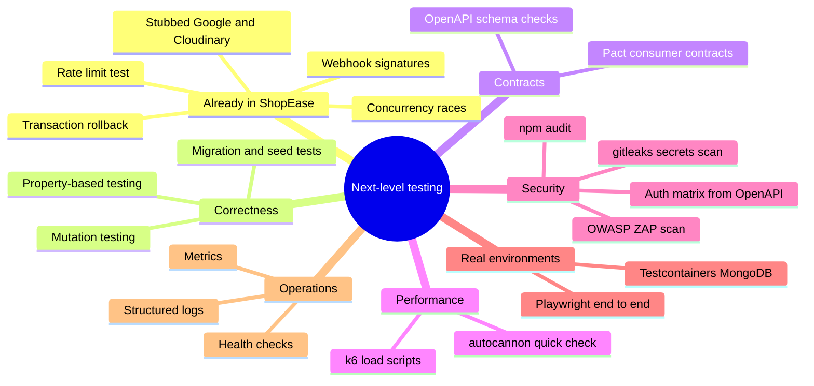
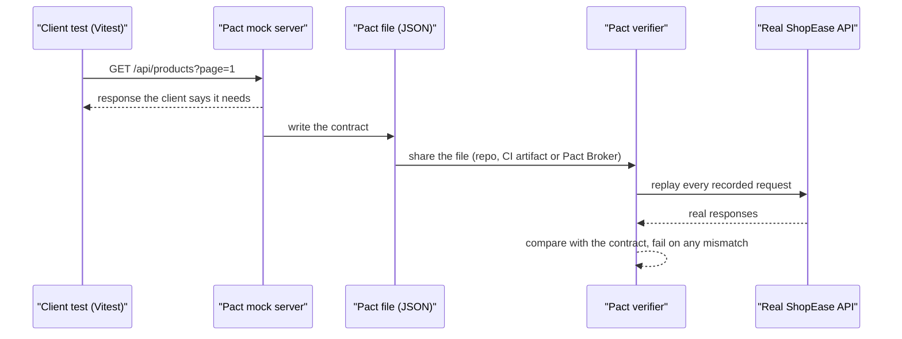
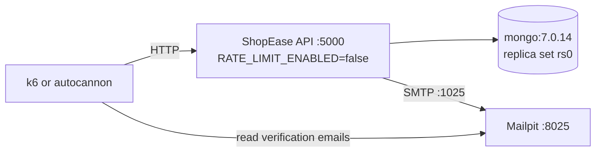

# 10 – Next-level testing

**What you'll learn:** the testing skills that take you past "I can write Jest + Supertest tests" and towards
the work of a backend engineer on a real team. First you will see the advanced patterns that already exist in
ShopEase: concurrency, rollback, webhook signatures and stubbed third-party services. Then you will meet ten
more skills: contract testing, load testing, security testing, Testcontainers, property-based testing, mutation
testing, end-to-end tests across the React client and the API, migration and seed tests, and observability
checks. For each one you get what it is, when it is worth the effort, the tool (with an exact version), complete
setup steps, and a **first test written against ShopEase's real endpoints**. These tests are **not in the repo
yet**. They are exercises for you to add.

---

## How to read this chapter

Everything below that is **not** in the repo carries this label:

> 🧪 **Not in this repo yet — exercise.** You create these files yourself, on your own branch.

Everything else is quoted from a real branch, and the branch and file are named.

**Pinned versions.** Every new tool is installed at an exact version (`--save-exact` or an image tag) so that
your results can be repeated. These were the versions current when this chapter was written. Newer versions are
usually fine. Check what is current with `npm view <package> version`, and read the changelog before you upgrade.

| Tool | Pinned version | Kind |
| --- | --- | --- |
| `ajv` + `ajv-formats` | `8.17.1` + `3.0.1` | npm (dev) |
| `@pact-foundation/pact` | `13.2.0` | npm (dev, client repo) |
| k6 | `grafana/k6:1.0.0` | Docker image (or native install) |
| `autocannon` | `7.15.0` | npx |
| OWASP ZAP | `ghcr.io/zaproxy/zaproxy:2.15.0` | Docker image |
| gitleaks | `zricethezav/gitleaks:v8.21.2` | Docker image (or binary) |
| `testcontainers` + `@testcontainers/mongodb` | `10.16.0` | npm (dev) |
| MongoDB for containers and load tests | `mongo:7.0.14` | Docker image |
| `fast-check` | `3.23.2` | npm (dev) |
| `@stryker-mutator/core` + `@stryker-mutator/jest-runner` | `8.7.1` | npm (dev) |
| `@playwright/test` | `1.49.1` | npm (dev, client repo) |
| `pino` + `pino-http` | `9.5.0` + `10.3.0` | npm |
| `prom-client` | `15.1.3` | npm |

**Where to run commands.** Unless a section says otherwise, run commands from the `server/` folder of
`shopease-learning`. New Jest tests go under `server/tests/`, because `jest.config.js` only finds
`tests/**/*.test.js`:

```js
// main:server/jest.config.js
testMatch: ['<rootDir>/tests/**/*.test.js'], // test files end with .test.js
```

---

## Skills map



---

## 0. Advanced patterns you already have

Before you add anything, notice how far the repo already goes. Most junior projects have none of these.

| Pattern | Branch and file | What it proves |
| --- | --- | --- |
| Concurrency (race conditions) | `07-orders`: `server/tests/integration/orders.transaction.test.js` | Two buyers, one unit left: exactly one order wins |
| Rollback (all-or-nothing) | `07-orders`: same file; `05-cart-wishlist`: `signupTransaction.test.js` | A failure half-way leaves stock, cart and coupon unchanged |
| Signed webhooks | `08-payments`: `server/tests/integration/payments.test.js` | Only a correctly signed Stripe event can mark an order paid |
| Injectable third-party gateway | `08-payments`: `stripeGateway`; `04-products-uploads`: `cloudinaryClient`; `main`: `google.test.js` | Tests never touch the network |
| Turning a feature back on for one file | `main`: `server/tests/integration/rateLimit.test.js` | Limits really answer 429 |

The race test fires two requests **at the same moment** with `Promise.all`:

```js
// 07-orders:server/tests/integration/orders.transaction.test.js
it('two customers, ONE unit left: exactly one order succeeds', async () => {
  const product = await createProduct({ stock: 1 });
  const a = await buyer(product);
  const b = await buyer(product);

  // Fire both requests at the same time
  const results = await Promise.all([place(a.auth, a.body), place(b.auth, b.body)]);
```

The webhook test signs the payload with Stripe's own helper, so the **real** signature check runs:

```js
// 08-payments:server/tests/integration/payments.test.js
function sendWebhook(event, { secret = WEBHOOK_SECRET, signature, body } = {}) {
  const payload = JSON.stringify(event);
  const header = signature ?? Stripe.webhooks.generateTestHeaderString({ payload, secret });
  const req = api().post('/api/payments/webhook').set('Content-Type', 'application/json');
  if (header) req.set('Stripe-Signature', header);
  return req.send(body ?? payload); // a string is sent byte-for-byte
}
```

The rollback test forces a failure with a **spy** (a wrapper around a real function that you can control):

```js
// 05-cart-wishlist:server/tests/integration/signupTransaction.test.js
jest.spyOn(Wishlist, 'create').mockRejectedValueOnce(new Error('disk full'));
```

> **Try it:** read the three files above from their branches without switching branch:
>
> ```bash
> git show 07-orders:server/tests/integration/orders.transaction.test.js | less
> git show 08-payments:server/tests/integration/payments.test.js | less
> ```
>
> In PowerShell, use `| more` instead of `| less`.

Everything that follows builds on these ideas.

---

## 1. Contract testing

### What it is

A **contract** is a written promise about an API: which URLs exist, what they accept and what they return.
ShopEase already has one. It is the OpenAPI document built in `server/src/docs/openapi.js` and served at
`GET /api/docs.json`. **Contract testing** checks automatically that the real responses keep that promise.

There are two styles:

| Style | Who writes the contract | Tool | Fits ShopEase? |
| --- | --- | --- | --- |
| **Provider-side schema validation** | The API (you), as an OpenAPI spec | Ajv (or `jest-openapi`) | Yes, start here |
| **Consumer-driven contracts (CDC)** | Each client writes down what it needs | Pact | Concept now, useful once client and server are released separately |

Today `app.test.js` only checks that every **path is listed** in the spec:

```js
// 10-admin:server/tests/integration/app.test.js
it('serves the OpenAPI spec with every route documented', async () => {
  const res = await api().get('/api/docs.json');
  expect(res.status).toBe(200);
  expect(res.body.openapi).toMatch(/^3\./);
  const paths = Object.keys(res.body.paths);
  expect(paths).toEqual(
    expect.arrayContaining([
      '/auth/register',
```

Nothing checks that the **shape** of each response matches what the spec says. If someone renames `meta.pages`
to `meta.totalPages`, Swagger still documents `pages`, the React client breaks, and every test stays green. A
contract test catches exactly that.

### When to use it

- When another program depends on your JSON shapes: the React client, a mobile app, Postman collections.
- When you change a response shape. The contract test forces you to update the docs in the same commit.
- Not for business rules. "Shipping is Rs 250 below Rs 5,000" belongs in unit and integration tests.

### Tool and setup (provider-side, Ajv)

**Ajv** is a JSON-Schema validator. OpenAPI 3.0 schemas are almost JSON Schema. The one difference that
matters in ShopEase is `nullable: true`, which you will convert with a few lines of code.

> 🧪 **Not in this repo yet — exercise.**

**Step 1. Install** (from `server/`; same command in PowerShell, Git Bash, macOS and Linux):

```bash
npm install --save-dev --save-exact ajv@8.17.1 ajv-formats@3.0.1
```

**Step 2. Create the helper** `server/tests/helpers/openapi.js`:

```js
/**
 * tests/helpers/openapi.js – validate a response body against the OpenAPI spec.
 *
 * Usage: expectToMatchSpec(res, '/products', 'get');
 * The path is written exactly as in the spec (relative to the "/api" server, with {params}).
 */
import Ajv from 'ajv';
import addFormats from 'ajv-formats';
import openapiSpec from '../../src/docs/openapi.js';

// OpenAPI 3.0 says `nullable: true`; JSON Schema says "type can also be null".
// Convert a deep copy of the spec so Ajv understands it. The real spec is never changed.
function toJsonSchema(node) {
  if (Array.isArray(node)) return node.map(toJsonSchema);
  if (!node || typeof node !== 'object') return node;
  const out = Object.fromEntries(Object.entries(node).map(([k, v]) => [k, toJsonSchema(v)]));
  if (out.nullable === true) {
    delete out.nullable;
    if (typeof out.type === 'string') return { ...out, type: [out.type, 'null'] };
    return { anyOf: [out, { type: 'null' }] }; // e.g. { allOf: [...], nullable: true }
  }
  return out;
}

const spec = toJsonSchema(openapiSpec);
// strict: false → ignore OpenAPI-only words such as `example`
const ajv = new Ajv({ strict: false, allErrors: true });
addFormats(ajv); // understands format: 'date-time', 'email', …

const cache = new Map();

function validatorFor(path, method, status) {
  const key = `${method} ${path} ${status}`;
  if (!cache.has(key)) {
    const operation = spec.paths[path]?.[method];
    if (!operation) throw new Error(`The spec has no ${method.toUpperCase()} ${path}`);
    const schema = operation.responses?.[status]?.content?.['application/json']?.schema;
    if (!schema) throw new Error(`The spec documents no JSON body for ${key}`);
    // Put `components` next to the schema, so "#/components/schemas/Product" can be resolved
    cache.set(key, ajv.compile({ ...schema, components: spec.components }));
  }
  return cache.get(key);
}

/** Fails the test with a readable list of differences when the body breaks the contract. */
export function expectToMatchSpec(res, path, method = 'get') {
  const validate = validatorFor(path, method, String(res.status));
  validate(res.body);
  // null = no errors. On failure Jest prints every mismatch (path inside the body + reason).
  expect(validate.errors).toBeNull();
}
```

**Step 3. Write the first contract tests** in `server/tests/integration/contract.test.js`:

```js
/**
 * CONTRACT tests: real responses must match the OpenAPI spec served at /api/docs.json.
 * 🧪 Exercise – not in the repo yet.
 */
import { connectTestDB, clearTestDB, closeTestDB } from '../helpers/db.js';
import {
  api,
  loggedIn,
  createAddress,
  createProduct,
  addToCart,
} from '../helpers/factories.js';
import { expectToMatchSpec } from '../helpers/openapi.js';

beforeAll(connectTestDB);
afterEach(clearTestDB);
afterAll(closeTestDB);

describe('Contract: products', () => {
  it('GET /api/products matches the spec (list + pagination meta)', async () => {
    await createProduct();
    await createProduct({ compareAtPrice: 5000, price: 1000 });

    const res = await api().get('/api/products?limit=2');

    expect(res.status).toBe(200);
    expect(res.body.data).toHaveLength(2); // make sure we validate real items, not []
    expectToMatchSpec(res, '/products', 'get');
  });

  it('GET /api/products/:slug matches the spec', async () => {
    const product = await createProduct();
    const res = await api().get(`/api/products/${product.slug}`);
    expect(res.status).toBe(200);
    expectToMatchSpec(res, '/products/{slugOrId}', 'get');
  });
});

describe('Contract: orders', () => {
  it('POST /api/orders (201) matches the spec', async () => {
    const product = await createProduct({ price: 1500, stock: 5 });
    const { user, auth } = await loggedIn();
    const address = await createAddress(user, { isDefault: true });
    await addToCart(user, product, 2);

    const res = await api()
      .post('/api/orders')
      .set('Authorization', auth)
      .send({ addressId: address._id.toString(), paymentMethod: 'COD' });

    expect(res.status).toBe(201);
    expectToMatchSpec(res, '/orders', 'post');
  });
});
```

**Step 4. Run only this file:**

```bash
npm test -- tests/integration/contract.test.js
```

**Reading a failure.** Ajv reports each mismatch with `instancePath` (where in the body) and `message` (what is
wrong), for example `instancePath: "/data/0/category", message: "must be string"`. Now decide **who is wrong**:
- the code changed by accident → fix the code;
- the code is right and the docs are stale → fix `server/src/modules/<module>/<module>.docs.js`.

Either way, the docs and the code agree again, and the Swagger page stops lying.

> **Try it:** in your contract test, change `expectToMatchSpec(res, '/products', 'get')` to validate the
> `/products/brands` schema instead. Watch it fail and read the error list. Then put it back.

**Make the contract stricter (optional).** By default a JSON Schema object allows **extra** properties, so a
contract test catches *missing* or *wrong-typed* fields, not *leaked* ones (for example a `password` field that
should never be sent). For security-sensitive schemas such as `User`, add `additionalProperties: false` to the
docs schema, and the contract test will fail when an unexpected field appears.

**Alternative tool.** [`jest-openapi`](https://www.npmjs.com/package/jest-openapi) (pin `0.14.2`) adds an
`expect(res).toSatisfyApiSpec()` matcher that reads the request path for you. It is shorter, but it has to map
the spec's relative server URL (`/api`) onto Supertest's request URL. If it cannot find your paths, use the Ajv
helper above: it has fewer moving parts and you control every line.

### Consumer-driven contracts with Pact (concept)

The React client (`shopease-learning-client`) does not call the real API in its tests. It uses **MSW** (Mock
Service Worker) handlers that *pretend* to be the API. That is fast, but there is a hidden risk: the mocks can
**drift** away from what the server really returns, and nothing notices.

**Pact** closes that gap:



1. In the **client** repo, a test describes the request it makes and the minimum response it needs. Pact
   starts a mock server, runs your client code against it and writes a **pact file**.
2. In the **server** repo, a verifier replays every request in that file against the real API and fails if a
   response no longer satisfies the client.

A first consumer test would look like this (in `shopease-learning-client`, after
`npm install --save-dev --save-exact @pact-foundation/pact@13.2.0`):

> 🧪 **Not in this repo yet — exercise (concept sketch).**

```js
// shopease-learning-client: tests/contract/products.pact.test.js
import { PactV3, MatchersV3 } from '@pact-foundation/pact';

const { eachLike, like, integer, string } = MatchersV3;
const provider = new PactV3({ consumer: 'shopease-client', provider: 'shopease-api', dir: './pacts' });

describe('Products API contract', () => {
  it('lists products with pagination meta', async () => {
    provider
      .given('active products exist')
      .uponReceiving('a request for page 1 of the shop')
      .withRequest({ method: 'GET', path: '/api/products', query: { page: '1' } })
      .willRespondWith({
        status: 200,
        headers: { 'Content-Type': 'application/json; charset=utf-8' },
        body: {
          success: true,
          data: eachLike({ _id: string('665f1c2e9b1e8a0012345680'), name: string('Blue Shirt'), price: integer(1999) }),
          meta: like({ page: 1, limit: 12, total: 30, pages: 3 }),
        },
      });

    await provider.executeTest(async (mock) => {
      const res = await fetch(`${mock.url}/api/products?page=1`);
      const body = await res.json();
      expect(body.meta.pages).toBe(3);
    });
  });
});
```

**When is Pact worth it?** When the client and the server are deployed **independently**, by different people,
or when there are several clients (web, mobile). For a solo project that deploys both together, the Ajv contract
test on the server plus keeping MSW handlers close to real responses gives you most of the value for a tenth of
the setup. Learn the idea now; adopt Pact when a second consumer appears.

### Common mistakes

- **Validating an empty list.** `data: []` matches any item schema. Always create data first and assert the
  length, as the test above does.
- **"Fixing" the test instead of the drift.** If the contract fails, change the code or the docs. Never loosen
  the helper.
- **Thinking a contract test replaces integration tests.** It checks shape, not truth. `price: 1` passes the
  schema even when the real price is 1999.

---

## 2. Load and performance testing

### What it is

A **load test** sends many requests at once, for a while, and measures how the API behaves under pressure. You
learn three numbers:

| Number | Meaning | Good first target for ShopEase on a laptop |
| --- | --- | --- |
| **RPS** (requests per second, also called throughput) | How much work the server finishes per second | Just measure it; compare runs |
| **p95 latency** | 95% of requests were faster than this. The slowest 5% are slower | `GET /api/products` < 300 ms, `POST /api/orders` < 800 ms |
| **Error rate** | Share of failed requests (status ≥ 400 or network errors) | < 1% |

Why p95 and not the average? An average hides pain. If 19 requests take 50 ms and 1 takes 4 seconds, the
average is about 250 ms and looks fine, but one customer in twenty waits four seconds. Percentiles show that.

Related words: a **smoke test** is a tiny load (1–2 virtual users) to check the script works. A **load test**
uses the traffic you expect. A **stress test** keeps adding users until something breaks. A **soak test** runs
for hours to find memory leaks.

### When to use it

- Before launch, and before a sale (Eid, 11.11) when traffic jumps.
- After you change a hot query: the product list, text search, the checkout transaction.
- To prove a fix: "p95 of `POST /api/orders` went from 1.4 s to 350 ms after adding the index".

Never point a load test at a server you do not own, and **never** at your Atlas database with real data.

### Prepare a throw-away environment

ShopEase needs a few changes for a load test. Each one has a reason:

| Setting | Why |
| --- | --- |
| A **local MongoDB replica set in Docker** | Orders use transactions, which need a replica set. A throw-away DB means junk orders never reach Atlas. |
| `RATE_LIMIT_ENABLED=false` | `apiLimiter` allows 300 requests per 15 minutes per IP. With it on, you would only measure the 429 page. |
| `npm run seed` | 30 products to browse, and the admin account the order script logs in with |
| Mailpit running (`docker compose up -d` in the repo root) | The order script verifies customers by reading their emails |

```js
// 10-admin:server/src/middleware/rateLimit.middleware.js
export const apiLimiter = make(300); // every /api route: 300 per 15 min
export const authLimiter = make(10); // login, register, reset: 10 per 15 min
```

**Start MongoDB 7 as a one-member replica set** (PowerShell, Git Bash, macOS and Linux):

```bash
docker run -d --name shopease-mongo -p 27017:27017 mongo:7.0.14 --replSet rs0 --bind_ip_all
docker exec shopease-mongo mongosh --quiet --eval "rs.initiate({_id:'rs0',members:[{_id:0,host:'localhost:27017'}]})"
```

**Start the API against it.** `dotenv` does not override variables that are already set, so these win over
your `.env`:

```powershell
# PowerShell (from server/)
$env:MONGO_URI = 'mongodb://127.0.0.1:27017/shopease_load?replicaSet=rs0'
$env:RATE_LIMIT_ENABLED = 'false'
npm run seed
npm start
```

```bash
# Git Bash / macOS / Linux (from server/)
export MONGO_URI='mongodb://127.0.0.1:27017/shopease_load?replicaSet=rs0'
export RATE_LIMIT_ENABLED=false
npm run seed && npm start
```

Use `npm start` (plain `node`), not `npm run dev`. `nodemon` restarts and the coloured `morgan('dev')` logs add
noise to your numbers.



### Quick check with autocannon

**autocannon** is a tiny Node.js load generator. It needs no script: use it for a two-minute "is this fast?"
check.

> 🧪 **Not in this repo yet — exercise.**

```bash
# 20 connections for 20 seconds against the public product list
npx --yes autocannon@7.15.0 -c 20 -d 20 "http://localhost:5000/api/products?limit=12"
```

How to read the output:

| Line or column | Meaning |
| --- | --- |
| **Latency** 50% / 97.5% / 99% | Median and tail latency in ms (add `-l` to print the full percentile table) |
| **Req/Sec** Avg | Throughput (RPS) |
| `N requests in 20.0s` | Total work done |
| `N non 2xx responses` | Errors. If you see 429s, the rate limit is still on |

### Real load test with k6

**k6** runs JavaScript scripts with many **virtual users (VUs)**. Each VU loops over your `default` function.
**Thresholds** turn the test into a pass/fail check: if one is broken, k6 exits with code `99`, so CI can fail
the build.

**Install k6** (pick one):

```bash
# Docker, pinned (works everywhere). Nothing to install except Docker.
docker pull grafana/k6:1.0.0

# Or a native install (newest version)
winget install k6 --source winget      # Windows
brew install k6                         # macOS
```

> 🧪 **Not in this repo yet — exercise.** Create `server/load/products.k6.js`:

```js
/**
 * load/products.k6.js – browse the shop like real visitors: list, sort, search, filter.
 * Run: k6 run load/products.k6.js   (BASE_URL defaults to http://localhost:5000/api)
 */
import http from 'k6/http';
import { check, sleep } from 'k6';

const BASE_URL = __ENV.BASE_URL || 'http://localhost:5000/api';

export const options = {
  scenarios: {
    browse: {
      executor: 'ramping-vus', // slowly add users, hold, then go down
      startVUs: 0,
      stages: [
        { duration: '30s', target: 20 }, // ramp up to 20 users
        { duration: '1m', target: 20 }, // hold
        { duration: '15s', target: 0 }, // ramp down
      ],
    },
  },
  thresholds: {
    http_req_failed: ['rate<0.01'], // < 1% errors
    'http_req_duration{name:GET /products}': ['p(95)<300'], // 95% faster than 300 ms
    checks: ['rate>0.99'],
  },
};

// Real query parameters understood by src/modules/products/product.query.js
const QUERIES = [
  '',
  '?page=2',
  '?sort=price_asc',
  '?keyword=camera',
  '?inStock=true',
  '?minPrice=1000&maxPrice=20000',
  '?brand=SoundMax',
];

export default function () {
  const query = QUERIES[Math.floor(Math.random() * QUERIES.length)];
  // `name` groups all URLs under one label in the results (otherwise each query is its own row)
  const res = http.get(`${BASE_URL}/products${query}`, { tags: { name: 'GET /products' } });
  check(res, {
    'status is 200': (r) => r.status === 200,
    'has data array': (r) => Array.isArray(r.json('data')),
  });
  sleep(1); // "think time": a real visitor reads the page before clicking again
}
```

> 🧪 **Not in this repo yet — exercise.** Create `server/load/orders.k6.js`. Placing an order needs a
> **verified** customer with an address and a cart, so `setup()` (which runs once, before the VUs start)
> builds all of that through the real API and Mailpit:

```js
/**
 * load/orders.k6.js – customers place COD orders at the same time (checkout = a MongoDB transaction).
 * Needs: npm run seed (admin), Mailpit running, RATE_LIMIT_ENABLED=false, a THROW-AWAY database.
 */
import http from 'k6/http';
import { check, sleep, fail } from 'k6';

const BASE_URL = __ENV.BASE_URL || 'http://localhost:5000/api';
const MAILPIT = __ENV.MAILPIT_URL || 'http://localhost:8025';
const ADMIN_EMAIL = __ENV.ADMIN_EMAIL || 'admin@shopease.pk';
const ADMIN_PASSWORD = __ENV.ADMIN_PASSWORD || 'Admin12345';
const CUSTOMERS = Number(__ENV.CUSTOMERS || 10);
const json = { headers: { 'Content-Type': 'application/json' } };
const auth = (token) => ({ headers: { 'Content-Type': 'application/json', Authorization: `Bearer ${token}` } });

export const options = {
  setupTimeout: '2m',
  scenarios: {
    checkout: { executor: 'constant-vus', vus: CUSTOMERS, duration: '1m' },
  },
  thresholds: {
    http_req_failed: ['rate<0.01'],
    'http_req_duration{name:POST /orders}': ['p(95)<800'],
    'checks{check:order placed}': ['rate>0.99'],
  },
};

function post(path, body, params = json) {
  return http.post(`${BASE_URL}${path}`, JSON.stringify(body), params);
}

// The verification link contains ?token=<hex>; read it from the newest email to that address
function verificationToken(email) {
  for (let attempt = 0; attempt < 20; attempt += 1) {
    const search = http.get(`${MAILPIT}/api/v1/search?query=${encodeURIComponent(`to:${email}`)}`);
    const id = search.json('messages.0.ID');
    if (id) {
      const text = http.get(`${MAILPIT}/api/v1/message/${id}`).json('Text');
      const match = /token=([a-f0-9]+)/.exec(text);
      if (match) return match[1];
    }
    sleep(0.5); // the email may need a moment to arrive
  }
  return fail(`no verification email for ${email}`);
}

export function setup() {
  // 1) The admin creates a category and one product with a huge stock (stock is not what we test)
  const admin = post('/auth/admin/login', { email: ADMIN_EMAIL, password: ADMIN_PASSWORD });
  if (admin.status !== 200) fail(`admin login failed: ${admin.status} (did you run npm run seed?)`);
  const adminToken = admin.json('data.token');
  const run = Date.now();
  const category = post('/categories', { name: `Load ${run}` }, auth(adminToken)).json('data._id');
  const product = post(
    '/products',
    {
      name: `Load Test Mug ${run}`,
      description: 'A mug that only exists to be bought by the load test.',
      sku: `LOAD-${run}`,
      price: 1200,
      category,
      stock: 1000000,
      images: [{ url: 'https://res.cloudinary.com/demo/image/upload/sample.jpg', publicId: 'sample' }],
    },
    auth(adminToken),
  );
  if (product.status !== 201) fail(`product create failed: ${product.status} ${product.body}`);

  // 2) One verified customer with an address per VU
  const customers = [];
  for (let i = 0; i < CUSTOMERS; i += 1) {
    const email = `load${run}-${i}@example.com`;
    const password = 'loadtest123';
    post('/auth/register', { name: `Load Customer ${i}`, email, password });
    post('/auth/verify-email', { token: verificationToken(email) });
    const token = post('/auth/login', { email, password }).json('data.token');
    const address = post(
      '/addresses',
      {
        label: 'Home',
        fullName: 'Load Tester',
        phone: '03001234567',
        addressLine1: 'House 12, Street 4, Gulberg III',
        city: 'Lahore',
        province: 'Punjab',
        postalCode: '54000',
      },
      auth(token),
    );
    customers.push({ token, addressId: address.json('data._id') });
  }
  return { productId: product.json('data._id'), customers };
}

export default function (data) {
  // __VU is 1, 2, 3 … so each VU always uses "its" customer (its own cart)
  const me = data.customers[(__VU - 1) % data.customers.length];
  const add = post('/cart/items', { productId: data.productId, quantity: 1 }, auth(me.token));
  check(add, { 'added to cart': (r) => r.status === 200 || r.status === 201 });

  const order = http.post(
    `${BASE_URL}/orders`,
    JSON.stringify({ addressId: me.addressId, paymentMethod: 'COD' }),
    { ...auth(me.token), tags: { name: 'POST /orders' } },
  );
  check(order, { 'order placed': (r) => r.status === 201 });
  sleep(1);
}
```

**Run the scripts** (from `server/`):

```bash
# Native k6
k6 run load/products.k6.js
k6 run -e CUSTOMERS=10 load/orders.k6.js
```

```powershell
# Docker k6 from PowerShell: the container reaches your laptop as host.docker.internal
docker run --rm -v "${PWD}/load:/scripts" -e BASE_URL=http://host.docker.internal:5000/api `
  -e MAILPIT_URL=http://host.docker.internal:8025 grafana/k6:1.0.0 run /scripts/orders.k6.js
```

```bash
# Docker k6 from Git Bash: stop Git Bash from rewriting /scripts into a Windows path
MSYS_NO_PATHCONV=1 docker run --rm -v "$(pwd -W)/load:/scripts" \
  -e BASE_URL=http://host.docker.internal:5000/api -e MAILPIT_URL=http://host.docker.internal:8025 \
  grafana/k6:1.0.0 run /scripts/products.k6.js
```

### Reading k6 results

k6 prints a summary at the end. These lines matter most:

| k6 line | What to read |
| --- | --- |
| `✓ http_req_duration{name:GET /products}` | Threshold result. ✓ passed, ✗ failed |
| `http_req_duration ... p(90)=… p(95)=…` | Latency percentiles. Compare p95 with your target |
| `http_reqs ... 152.3/s` | Throughput (RPS) |
| `http_req_failed ... 0.00%` | Error rate |
| `checks ... 100.00%` | Share of your `check()` assertions that held |
| `vus_max` / `iterations` | How many users ran and how many loops they finished |

If p95 is bad, look for the cause, then re-run and compare:

- Order placement sends a confirmation email. If the request **waits** for SMTP, the email server's speed becomes
  your checkout latency. A load test is how you discover that.
- Slow list queries usually mean a missing index. Use `.explain('executionStats')` in `mongosh` on the query.
- Laptop numbers are only useful **compared with each other**: before vs after a change, on the same machine.

> **Try it:** run `products.k6.js` once with `RATE_LIMIT_ENABLED=false` and once with it `true`. Read the
> `http_req_failed` line both times and explain the difference.

### Common mistakes

- **Load testing with rate limits on.** You measure how fast the server says 429.
- **Load testing Atlas or production.** You pay for it, you fill it with junk, and you may get blocked.
- **No think time (`sleep`).** 20 VUs without `sleep` behave like hundreds of real visitors.
- **Trusting one run.** Run three times and compare medians. Close other heavy programs first.

---

## 3. Security testing

Security testing asks "what could an attacker do?" and turns the answers into repeatable checks. ShopEase
already tests many attacks: NoSQL injection, forged and expired JWTs, IDOR (reading someone else's address or
order gives 404), mass assignment, CSV formula injection and rate limits. This section adds four tools.

### 3.1 Dependency audit with `npm audit`

**What it is.** `npm audit` compares your `package-lock.json` with a public database of known vulnerabilities.
**When:** on every CI run, and before every release.

```bash
npm audit                                   # everything, including dev tools
npm audit --omit=dev --audit-level=high     # only what ships to production; fail on high/critical
```

Read the report like this: **severity** (low → critical), the **package** with the problem, the **path** (which
of your dependencies pulled it in), and whether a fix exists. `npm audit fix` applies safe (semver-compatible)
updates; run `npm test` afterwards. **Never** run `npm audit fix --force` blindly: it may install breaking major
versions.

> 🧪 **Not in this repo yet — exercise.** Add one step to `.github/workflows/ci.yml` after `npm ci`:
>
> ```yaml
> - run: npm audit --omit=dev --audit-level=high # known vulnerabilities in production dependencies
> ```

### 3.2 Authorization matrix generated from the OpenAPI spec

**What it is.** An **authorization matrix** is a table of *who* (anonymous, customer, admin, owner, other
customer) may call *which* route. ShopEase writes these tables by hand per module:

```js
// 07-orders:server/tests/integration/orders.test.js
it.each(all)('%s returns 401 without a token', async (_name, send) => {
```

That is good, but a **new** route can still be forgotten. The spec marks every protected operation with
`security`, so a single test can loop over **all** of them.

> 🧪 **Not in this repo yet — exercise.** Create `server/tests/integration/auth-matrix.test.js`:

```js
/**
 * Every operation the OpenAPI spec marks as secured must answer 401 without credentials.
 * A new route added without `protect` (or documented without `security`) makes this fail.
 * 🧪 Exercise – not in the repo yet.
 */
import mongoose from 'mongoose';
import openapiSpec from '../../src/docs/openapi.js';
import { connectTestDB, closeTestDB } from '../helpers/db.js';
import { api } from '../helpers/factories.js';

beforeAll(connectTestDB);
afterAll(closeTestDB);

const METHODS = ['get', 'post', 'put', 'patch', 'delete'];
const someId = new mongoose.Types.ObjectId().toString();

// [['GET', '/admin/users/{id}'], ['POST', '/orders'], …]
const securedOperations = Object.entries(openapiSpec.paths).flatMap(([path, item]) =>
  METHODS.filter((m) => item[m]?.security?.length).map((m) => [m.toUpperCase(), path]),
);

// "/admin/users/{id}" → "/api/admin/users/665f…" (a valid ObjectId, so only auth can refuse it)
const toUrl = (path) => `/api${path.replace(/\{[^}]+\}/g, someId)}`;

describe('Authorization matrix (from /api/docs.json)', () => {
  it('the spec documents secured operations at all', () => {
    expect(securedOperations.length).toBeGreaterThan(20);
  });

  it.each(securedOperations)('%s %s → 401 without credentials', async (method, path) => {
    const res = await api()[method.toLowerCase()](toUrl(path)).send({});
    expect(res.status).toBe(401);
  });
});
```

If one row answers 400, 403 or 404 instead of 401, investigate. Either the route validates input **before**
checking who you are (it leaks information to anonymous callers), or the docs and the code disagree.

**Next step:** add a role column. Make a small hand-written map such as
`{ '/admin/': 'admin', '/cart': 'customer' }`, log in with `loggedIn()` and `createAdmin()`, and expect `403`
for the wrong role. Keep the IDOR tests ("another customer's id → 404") as they are: they need real data.

A tiny extra attack worth one test: a token that says `"alg": "none"` (no signature at all). `jsonwebtoken`
refuses it, and your test proves it stays that way after upgrades:

```js
// 🧪 Exercise: add to tests/integration/auth.test.js (main branch onward)
it('rejects an unsigned token ("alg": "none")', async () => {
  const user = await createUser();
  const b64 = (o) => Buffer.from(JSON.stringify(o)).toString('base64url');
  const unsigned = `${b64({ alg: 'none', typ: 'JWT' })}.${b64({ id: user._id.toString(), role: 'admin' })}.`;
  const res = await api().get('/api/auth/me').set('Authorization', `Bearer ${unsigned}`);
  expect(res.status).toBe(401);
});
```

### 3.3 OWASP ZAP scan

**What it is.** **OWASP ZAP** (Zed Attack Proxy) is a free scanner that sends unusual and malicious requests and
reports problems such as missing security headers, error pages that leak stack traces, and injection points.

- The **baseline scan** is *passive*: it only looks at responses.
- The **API scan** reads your OpenAPI file, calls every operation, and also runs *active* attacks.

**When:** before a release and after you add routes. Only ever against **your own local server** with a
**throw-away database**: the API scan really sends `POST` and `DELETE` requests with junk data.

> 🧪 **Not in this repo yet — exercise.** Start the API as in [section 2](#prepare-a-throw-away-environment)
> (throw-away DB, `RATE_LIMIT_ENABLED=false`), then:

```powershell
# PowerShell, from server/ — reports land in server/zap/
New-Item -ItemType Directory -Force zap | Out-Null
docker run --rm -v "${PWD}/zap:/zap/wrk:rw" -t ghcr.io/zaproxy/zaproxy:2.15.0 `
  zap-api-scan.py -t http://host.docker.internal:5000/api/docs.json -f openapi -r zap-report.html
```

```bash
# Git Bash / macOS / Linux, from server/ (on Linux add: --add-host=host.docker.internal:host-gateway)
mkdir -p zap
MSYS_NO_PATHCONV=1 docker run --rm -v "$(pwd -W 2>/dev/null || pwd)/zap:/zap/wrk:rw" -t \
  ghcr.io/zaproxy/zaproxy:2.15.0 \
  zap-api-scan.py -t http://host.docker.internal:5000/api/docs.json -f openapi -r zap-report.html
```

To scan **protected** routes as a logged-in admin, log in first (Swagger UI or Bruno), copy the token, and pass
it as a header for every request ZAP makes:

```bash
-e ZAP_AUTH_HEADER=Authorization -e ZAP_AUTH_HEADER_VALUE="Bearer <token>"
```

Open `zap/zap-report.html`. Each alert has a **risk** (High/Medium/Low/Informational), the **URL**, the
**evidence**, and a **solution**. Treat it as a to-do list, but think about each item: a JSON API does not need
some browser-only headers that ZAP suggests. Add `zap/` to `.gitignore`.

### 3.4 Secrets scanning with gitleaks

**What it is.** **gitleaks** searches files and **git history** for things that look like secrets: API keys,
private keys, JWTs, passwords in URLs. A secret pushed to GitHub is public for ever, even after you delete it in
a later commit.

**When:** once now over the whole history, then on every commit (pre-commit hook) and in CI.

> 🧪 **Not in this repo yet — exercise.** From the **repo root** of `shopease-learning`:

```powershell
# PowerShell — scan the whole git history
docker run --rm -v "${PWD}:/repo" zricethezav/gitleaks:v8.21.2 detect --source=/repo -v
```

```bash
# Git Bash / macOS / Linux
MSYS_NO_PATHCONV=1 docker run --rm -v "$(pwd -W 2>/dev/null || pwd):/repo" \
  zricethezav/gitleaks:v8.21.2 detect --source=/repo -v
# Only the working tree, not history:   … detect --source=/repo --no-git -v
```

Expect a real finding in the **history** scan: older commits of `server/bruno/environments/local.bru` contain
`token` and `adminToken` values. Bruno saved those JWTs there during a run, and they were committed by mistake
(the current file was cleaned, but git keeps every old version). They were signed with a throw-away local
development secret, so they are harmless, but they show exactly how secrets slip into git and why cleaning the
current file is not enough: history keeps them. The `--no-git` scan of today's files should come back clean. For a finding you have checked and accepted, add its **fingerprint**
(gitleaks prints it) to a `.gitleaksignore` file in the repo root.

For a **real** leaked key (Stripe, Cloudinary, Atlas): **rotate it first** (create a new key, delete the old
one), then clean up. Removing it from git alone is not enough.

### Common mistakes

- **Running ZAP or k6 against someone else's server.** That can be illegal. Scan only what you own.
- **Ignoring `npm audit` because "it's only dev dependencies".** Use `--omit=dev` to focus, but read the rest.
- **Deleting a leaked secret in a new commit and moving on.** It is still in history. Rotate it.

---

## 4. Testcontainers: a real MongoDB in Docker

### What it is

ShopEase tests run against `mongodb-memory-server`: a real `mongod` binary that the package downloads and starts
for you, as a replica set (needed for transactions):

```js
// main:server/tests/setup/globalSetup.js
const replSet = await MongoMemoryReplSet.create({ replSet: { count: 1 } });
globalThis.__MONGO_REPLSET__ = replSet;
process.env.MONGO_URI_BASE = replSet.getUri();
```

**Testcontainers** is a library that starts real services **in Docker containers** from your test code and
throws them away afterwards. Same idea, but you pick the exact **Docker image**, the same one you run in
production.

### When it matters

| Situation | In-memory server is fine | Use Testcontainers |
| --- | --- | --- |
| Daily TDD loop, fast feedback | ✅ | |
| The binary download is blocked (company proxy, CI without internet) | | ✅ |
| You must match the production MongoDB **version** exactly (Atlas runs 7.0 and you rely on a 7.0 feature) | | ✅ |
| You add Redis, Mailpit, RabbitMQ… later | | ✅ one tool for every service |
| No Docker available | ✅ | |

The cost: Docker must be running, and the first start takes several seconds longer.

### Setup

> 🧪 **Not in this repo yet — exercise.** Keep the in-memory setup as the default and add a **second** Jest
> config for containers.

**Step 1. Install** (from `server/`; Docker Desktop must be running):

```bash
npm install --save-dev --save-exact testcontainers@10.16.0 @testcontainers/mongodb@10.16.0
```

**Step 2.** `server/tests/setup/globalSetup.containers.js`:

```js
/**
 * Starts ONE real MongoDB 7.0 container (a single-member replica set, so transactions work).
 * Used by jest.containers.config.js instead of the in-memory server.
 */
import { MongoDBContainer } from '@testcontainers/mongodb';

export default async function globalSetup() {
  const container = await new MongoDBContainer('mongo:7.0.14').start();
  globalThis.__MONGO_CONTAINER__ = container;
  const url = new URL(container.getConnectionString());
  // The replica set inside the container announces an internal host name; connect directly instead
  url.searchParams.set('directConnection', 'true');
  // tests/setup/env.js turns this base into one database per Jest worker, exactly as before
  process.env.MONGO_URI_BASE = url.toString();
}
```

**Step 3.** `server/tests/setup/globalTeardown.containers.js`:

```js
export default async function globalTeardown() {
  await globalThis.__MONGO_CONTAINER__?.stop();
}
```

**Step 4.** `server/jest.containers.config.js` reuses everything from the normal config:

```js
import base from './jest.config.js';

export default {
  ...base,
  globalSetup: '<rootDir>/tests/setup/globalSetup.containers.js',
  globalTeardown: '<rootDir>/tests/setup/globalTeardown.containers.js',
  testTimeout: 60000, // pulling the image the first time can take a while
};
```

**Step 5.** Add a script to `server/package.json`:

```json
"test:containers": "node --experimental-vm-modules node_modules/jest/bin/jest.js --config jest.containers.config.js"
```

**Step 6. First test**: one that only makes sense against the real image. Create
`server/tests/integration/mongo-version.test.js`:

```js
/**
 * Proves which MongoDB the tests talk to. Under `npm run test:containers` it must be 7.0.x.
 * 🧪 Exercise – not in the repo yet.
 */
import mongoose from 'mongoose';
import { connectTestDB, closeTestDB } from '../helpers/db.js';

beforeAll(connectTestDB);
afterAll(closeTestDB);

it('runs against a MongoDB replica set with transactions', async () => {
  const info = await mongoose.connection.db.admin().serverInfo();
  const hello = await mongoose.connection.db.admin().command({ hello: 1 });
  console.log(`MongoDB ${info.version}, replica set ${hello.setName}`);
  expect(hello.setName).toBeDefined(); // transactions need a replica set
});
```

Run it, then run the hardest existing file against the container too:

```bash
npm run test:containers -- tests/integration/mongo-version.test.js
npm run test:containers -- tests/integration/orders.transaction.test.js
```

### Common mistakes

- **Docker Desktop not started.** The error says it cannot find a container runtime. Start Docker and retry.
- **Making containers the default for every run.** Keep the fast in-memory loop for TDD. Run containers in CI or
  before a release.
- **Leaving containers behind.** Testcontainers starts a small helper container (Ryuk) that removes them even
  if Jest crashes. Do not disable it.

---

## 5. Property-based testing

### What it is

A normal **example-based** test checks examples you picked: `calcShipping(4999)` is 250. A **property-based**
test states a rule that must hold for **every** input ("the total is never negative"). The tool then generates
hundreds of random inputs to try to break it. When it finds a failing input, it **shrinks** it to the smallest
example that still fails, and prints it.

Money code is the perfect target. ShopEase's pricing is pure, integer-only and full of rules:

```js
// 06-coupons:server/src/utils/pricing.js
export function calcTotals(itemsPrice, discountPrice = 0) {
  const afterDiscount = itemsPrice - discountPrice;
  const shippingPrice = itemsPrice > 0 ? calcShipping(afterDiscount) : 0;
  const taxPrice = 0; // prices already include tax (PRICING.TAX_RATE is 0)
```

```js
// 06-coupons:server/src/modules/coupons/coupon.model.js
couponSchema.methods.calculateDiscount = function calculateDiscount(subtotal) {
  let discount =
    this.type === COUPON_TYPES.PERCENTAGE
      ? Math.floor((subtotal * this.value) / 100) // percent of the subtotal, rounded down
      : this.value; // fixed: the amount itself
  if (this.type === COUPON_TYPES.PERCENTAGE && this.maxDiscount) {
    discount = Math.min(discount, this.maxDiscount);
  }
  return Math.min(discount, subtotal);
};
```

### When to use it

- Pure functions with clear rules: money, pagination maths, slug generation, date ranges.
- After you have examples. Properties **add to** the edge-case tests in `pricing.test.js`; they do not replace
  them.

### Setup and first test

> 🧪 **Not in this repo yet — exercise** (branch `06-coupons` or later).

```bash
npm install --save-dev --save-exact fast-check@3.23.2
```

Create `server/tests/unit/money.property.test.js`:

```js
/**
 * PROPERTY-BASED tests for the money rules: fast-check generates hundreds of inputs per rule.
 * 🧪 Exercise – not in the repo yet.
 */
import fc from 'fast-check';
import mongoose from 'mongoose';
import { Coupon } from '../../src/modules/models.js';
import { calcTotals } from '../../src/utils/pricing.js';
import { PRICING } from '../../src/config/constants.js';

// Whole rupees, from Rs 0 to Rs 50 million
const rupees = fc.integer({ min: 0, max: 50_000_000 });

// Any coupon an admin could configure (same limits as the model: 1–90% or Rs 1–100,000)
const anyCoupon = fc.oneof(
  fc.record({
    type: fc.constant('percentage'),
    value: fc.integer({ min: 1, max: 90 }),
    maxDiscount: fc.option(fc.integer({ min: 1, max: 100_000 }), { nil: undefined }),
  }),
  fc.record({ type: fc.constant('fixed'), value: fc.integer({ min: 1, max: 100_000 }) }),
);
// An in-memory coupon (never saved); calculateDiscount only reads type/value/maxDiscount
const toCoupon = (fields) =>
  new Coupon({ code: 'PROP1', createdBy: new mongoose.Types.ObjectId(), ...fields });

describe('calculateDiscount properties', () => {
  it('is a whole number between 0 and the subtotal', () => {
    fc.assert(
      fc.property(anyCoupon, rupees, (fields, subtotal) => {
        const d = toCoupon(fields).calculateDiscount(subtotal);
        return Number.isInteger(d) && d >= 0 && d <= subtotal;
      }),
    );
  });

  it('never goes over maxDiscount', () => {
    fc.assert(
      fc.property(anyCoupon, rupees, (fields, subtotal) => {
        fc.pre(fields.type === 'percentage' && fields.maxDiscount !== undefined); // skip others
        return toCoupon(fields).calculateDiscount(subtotal) <= fields.maxDiscount;
      }),
    );
  });

  it('a bigger cart never gets a smaller discount (monotonic)', () => {
    fc.assert(
      fc.property(anyCoupon, rupees, rupees, (fields, a, b) => {
        const coupon = toCoupon(fields);
        const [small, big] = a <= b ? [a, b] : [b, a];
        return coupon.calculateDiscount(small) <= coupon.calculateDiscount(big);
      }),
    );
  });
});

describe('calcTotals properties', () => {
  // A subtotal and a discount that is never bigger than it (what calculateDiscount guarantees)
  const cart = rupees.chain((items) => fc.tuple(fc.constant(items), fc.integer({ min: 0, max: items })));

  it('total = items - discount + shipping, all whole and never negative', () => {
    fc.assert(
      fc.property(cart, ([items, discount]) => {
        const t = calcTotals(items, discount);
        expect(t.totalPrice).toBe(items - discount + t.shippingPrice + t.taxPrice);
        expect(t.totalPrice).toBeGreaterThanOrEqual(0);
        Object.values(t).forEach((v) => expect(Number.isInteger(v)).toBe(true));
      }),
    );
  });

  it('charges shipping exactly when 0 < amount after discount < Rs 5,000 (BR-02)', () => {
    fc.assert(
      fc.property(cart, ([items, discount]) => {
        const after = items - discount;
        const expected = after > 0 && after < PRICING.FREE_SHIPPING_MIN ? PRICING.SHIPPING_FEE : 0;
        expect(calcTotals(items, discount).shippingPrice).toBe(expected);
      }),
    );
  });
});
```

Run it:

```bash
npm test -- tests/unit/money.property.test.js
```

**Reading a failure.** fast-check prints `Counterexample: [...]`, `Shrunk N time(s)`, and a **seed** and
**path**. Turn the counterexample into a normal example test in `pricing.test.js` (so it is checked for ever),
fix the code, and pass `{ seed, path }` to `fc.assert` while you debug to replay exactly the same inputs.

> **Try it:** break the code on purpose. In `calculateDiscount`, change `Math.floor` to `Math.round`. Run the
> property test and read the counterexample fast-check finds. Then undo the change.

### Common mistakes

- **Re-implementing the function inside the property.** "Discount = floor(subtotal × value / 100)" just copies
  the code. Write rules that are true from the *outside*: bounds, monotonic, totals add up.
- **Generators that are too wide.** Rs 10<sup>15</sup> carts produce noise. Use the model's real limits.
- **Using `fc.pre` to skip most inputs.** If most runs are skipped, build a narrower generator instead.

---

## 6. Mutation testing (brief)

**What it is.** A mutation tool makes small changes to your code on purpose (`>=` becomes `>`, `+` becomes
`-`, a condition becomes `true`). Each changed copy is a **mutant**. It runs your tests against each mutant. If a
test fails, the mutant is **killed** (good). If all tests still pass, the mutant **survived**: your tests did
not notice a real bug. The **mutation score** is the share of mutants killed. It measures what coverage cannot:
whether your assertions actually check anything.

**When:** on small, important, pure code (money, permissions), not the whole repo: every mutant re-runs tests.

> 🧪 **Not in this repo yet — exercise.** Full walkthrough, score targets and how to read the HTML report:
> [07 – Coverage and quality gates](./07-coverage-and-quality-gates.md).

```bash
npm install --save-dev --save-exact @stryker-mutator/core@8.7.1 @stryker-mutator/jest-runner@8.7.1
```

`server/stryker.config.mjs`:

```js
/** Mutation testing for the money helpers. Run: npx stryker run */
export default {
  testRunner: 'jest',
  testRunnerNodeArgs: ['--experimental-vm-modules'], // our tests are native ES modules
  jest: { configFile: 'jest.config.js' },
  coverageAnalysis: 'off',
  mutate: ['src/utils/pricing.js', 'src/utils/pagination.js'],
  reporters: ['clear-text', 'progress', 'html'],
  thresholds: { high: 90, low: 75, break: 70 }, // fail the run below 70%
};
```

Run `npx stryker run`, then open `reports/mutation/mutation.html`. Add `reports/` and `.stryker-tmp/` to
`.gitignore`.

---

## 7. End-to-end tests across frontend and backend (Playwright)

### What it is

An **end-to-end (E2E)** test drives a **real browser** through the **real React app** talking to the **real
API** and database. It proves the pieces fit: CORS, URLs, the JSON shapes the UI expects, redirects after
login. It sits at the top of the testing pyramid: the most realistic, the slowest, and the most fragile, so keep
**few** of them, for the journeys that make money.

**Playwright** controls Chromium, Firefox and WebKit, waits for elements automatically and records a **trace**
(a replayable timeline with screenshots) when a test fails.

### When to use it

- The 3–5 critical journeys: browse → product page; register → verify → login; add to cart → checkout (COD);
  admin login → dashboard.
- Not for validation details or every error code. Supertest already covers those, a hundred times faster.

### Setup (in the client repo)

E2E tests belong in the frontend repo **`shopease-learning-client`**, because they test the UI.

> 🧪 **Not in this repo yet — exercise.** From the root of `shopease-learning-client`:

```bash
npm install --save-dev --save-exact @playwright/test@1.49.1
npx playwright install chromium
```

Prepare the backend as in [section 2](#prepare-a-throw-away-environment): throw-away MongoDB replica set,
`RATE_LIMIT_ENABLED=false`, `npm run seed`, Mailpit running. The client's `.env` must point at it
(`VITE_API_URL=http://localhost:5000/api`, the default in `.env.example`).

Create `playwright.config.js` in the client root. `webServer` starts both servers (or reuses them if they are
already running):

```js
// shopease-learning-client: playwright.config.js
import { defineConfig, devices } from '@playwright/test';

export default defineConfig({
  testDir: './e2e', // NOT tests/: Vitest owns tests/**/*.test.jsx
  fullyParallel: false, // the journeys share one database
  retries: process.env.CI ? 2 : 0,
  reporter: [['list'], ['html', { open: 'never' }]],
  use: {
    baseURL: 'http://localhost:5173',
    trace: 'on-first-retry', // a replayable recording when something fails
  },
  projects: [{ name: 'chromium', use: { ...devices['Desktop Chrome'] } }],
  webServer: [
    {
      command: 'npm start', // the API (env from server/.env + your shell)
      cwd: '../shopease-learning/server',
      url: 'http://localhost:5000/api/health',
      reuseExistingServer: !process.env.CI,
      timeout: 60_000,
    },
    {
      command: 'npm run dev', // Vite on :5173 (strictPort in vite.config.js)
      url: 'http://localhost:5173',
      reuseExistingServer: !process.env.CI,
    },
  ],
});
```

### First tests

> 🧪 **Not in this repo yet — exercise.** `shopease-learning-client/e2e/smoke.spec.js`:

```js
import { test, expect } from '@playwright/test';

const API = 'http://localhost:5000/api';
const ADMIN = {
  email: process.env.E2E_ADMIN_EMAIL || 'admin@shopease.pk', // ADMIN_EMAIL used by npm run seed
  password: process.env.E2E_ADMIN_PASSWORD || 'Admin12345',
};

test('the shop page shows the newest product from the API', async ({ page, request }) => {
  // Ask the API what should be first, so the test does not hard-code seed data
  const res = await request.get(`${API}/products?limit=1`);
  expect(res.ok()).toBeTruthy();
  const { data } = await res.json();

  await page.goto('/shop');
  await expect(page.getByText(data[0].name).first()).toBeVisible();
});

test('an admin logs in and lands in the admin area', async ({ page }) => {
  await page.goto('/admin/login');
  await expect(page.getByRole('heading', { name: 'ShopEase Admin' })).toBeVisible();
  await page.getByLabel('Email').fill(ADMIN.email);
  await page.getByLabel('Password', { exact: true }).fill(ADMIN.password);
  await page.getByRole('button', { name: 'Log in' }).click();
  await expect(page).toHaveURL(/\/admin\/?$/);
});
```

The labels and the heading come from the real pages (`src/pages/admin/AdminLoginPage.jsx` on branch
`17-admin`). The `Input` component links each `<label>` to its `<input>` with `htmlFor`, which is why
`getByLabel` works: accessible markup makes UIs testable.

Run:

```bash
npx playwright test             # headless
npx playwright test --ui        # watch it click, step by step
npx playwright show-report      # the HTML report, with traces of failures
```

**Next journey to write yourself:** register a fresh customer (unique email) → read the verification link from
Mailpit (`GET http://localhost:8025/api/v1/search?query=to:<email>`, then `/api/v1/message/<ID>`, exactly like
the Bruno folders) → open `/verify-email?token=…` → log in → add a product to the cart → `/checkout` → place a
COD order → expect the URL `/order-success/<id>`.

### Common mistakes

- **Testing every validation message through the browser.** Slow and brittle. Push it down to Supertest.
- **CSS selectors like `.btn-primary > span`.** Use roles, labels and text, as users do.
- **`page.waitForTimeout(3000)`.** Playwright already waits for elements. Fixed sleeps make tests slow *and*
  flaky.
- **Sharing one customer between journeys.** Each test registers its own, like the self-contained Bruno folders.

---

## 8. Database migration and seed tests

### What it is

A **seed** fills a database with starting data. A **migration** changes data that already exists when the
schema changes (for example "every old product gets `sold: 0`"). Both run against **real** data, often only
once, and often in production, so a bug is expensive. They deserve tests.

ShopEase already tests its seed (`10-admin:server/tests/integration/seed.test.js`), including the most important
property of a seed, **idempotency**: running it twice changes nothing the second time.

```js
// 10-admin:server/tests/integration/seed.test.js
describe('seedStore()', () => {
  it('creates the admin, 14 categories, 30 products and 2 coupons', async () => {
  // …
  it('is idempotent: a second run creates nothing and keeps the same counts', async () => {
  // …
  it('refuses to promote an existing CUSTOMER with the admin email', async () => {
    // …
    await expect(seedStore()).rejects.toThrow(/belongs to a CUSTOMER/);
```

ShopEase has no migrations yet: `npm run db:indexes` only syncs indexes. The first time you add a field that
old documents do not have, you will need one.

### When to use it

- Every migration gets a test **before** it runs on Atlas.
- Every seed or one-off script that writes data gets an idempotency test.

### First migration test

> 🧪 **Not in this repo yet — exercise.** Write migrations as plain functions with the `up(db)` signature that
> [`migrate-mongo`](https://www.npmjs.com/package/migrate-mongo) (pin `11.0.0` when you adopt it) also uses.
> That way the test does not depend on any tool.

`server/src/db/migrations/2026-01-backfill-product-sold.js`:

```js
/** Products created before the `sold` counter existed get sold: 0. Safe to run twice. */
export async function up(db) {
  const result = await db
    .collection('products')
    .updateMany({ sold: { $exists: false } }, { $set: { sold: 0 } });
  return result.modifiedCount;
}

/** Nothing to undo: 0 is the value the model would have given them anyway. */
export async function down() {}
```

`server/tests/integration/migrations.test.js`:

```js
import mongoose from 'mongoose';
import { connectTestDB, clearTestDB, closeTestDB } from '../helpers/db.js';
import { createProduct } from '../helpers/factories.js';
import { Product } from '../../src/modules/models.js';
import { up } from '../../src/db/migrations/2026-01-backfill-product-sold.js';

beforeAll(connectTestDB);
afterEach(clearTestDB);
afterAll(closeTestDB);

it('backfills sold: 0 on old products only, and is idempotent', async () => {
  const fresh = await createProduct({ sold: 7 }); // a current product: must stay untouched
  const old = await createProduct();
  // Simulate an OLD document: remove the field with the raw driver (Mongoose would add defaults)
  await Product.collection.updateOne({ _id: old._id }, { $unset: { sold: '' } });

  const db = mongoose.connection.db;
  expect(await up(db)).toBe(1); // first run fixes exactly one document
  expect(await up(db)).toBe(0); // second run has nothing left to do

  const rawOld = await Product.collection.findOne({ _id: old._id });
  const rawFresh = await Product.collection.findOne({ _id: fresh._id });
  expect(rawOld.sold).toBe(0);
  expect(rawFresh.sold).toBe(7);
});
```

The key trick: use the **raw collection** (`Product.collection`) to create "old-shaped" documents. Going
through Mongoose would apply today's defaults and hide the problem the migration exists to fix.

### Common mistakes

- **Testing only on an empty database.** Migrations exist for **old** data. Build it first.
- **Non-idempotent migrations** (`$inc` without a guard). A retry after a timeout would apply the change twice.
- **Running a migration on Atlas before a backup.** Take a snapshot first; test on a copy.

---

## 9. Observability checks as testable behaviour

**Observability** means you can tell what the running server is doing from the outside, through **health
checks**, **logs** and **metrics**. Each of these is behaviour, so each can be tested.

### 9.1 Health checks

ShopEase has a health route:

```js
// 10-admin:server/src/app.js
app.get('/api/health', (_req, res) => {
  res.json({
    success: true,
    message: 'ok',
    data: {
      status: 'ok',
      environment: env.NODE_ENV,
      database: DB_STATES[mongoose.connection.readyState] || 'unknown',
      cardPaymentsEnabled: env.PAYMENT_CARD_ENABLED, // lets the frontend hide the card option
    },
  });
});
```

`app.test.js` checks `status` and `environment`, but not `database`, which is the field a monitor actually
needs.

> 🧪 **Not in this repo yet — exercise.** `server/tests/integration/health.test.js`:

```js
import { connectTestDB, closeTestDB } from '../helpers/db.js';
import { api } from '../helpers/factories.js';

beforeAll(connectTestDB);
afterAll(closeTestDB);

it('reports the database as connected, and the card flag as a boolean', async () => {
  const res = await api().get('/api/health');
  expect(res.status).toBe(200);
  expect(res.body.data).toMatchObject({ status: 'ok', database: 'connected' });
  expect(typeof res.body.data.cardPaymentsEnabled).toBe('boolean');
});
```

**Design question to explore:** the route answers **200 even when the database is down**. That is fine for a
**liveness** check ("is the process alive?"). A load balancer also wants a **readiness** check ("can it serve
traffic?") that answers **503** when `database !== 'connected'`. TDD it: write a test that closes the
connection (`await mongoose.disconnect()`), calls `GET /api/health/ready` and expects 503, then implement the
route.

### 9.2 Structured logs

Today ShopEase logs with `morgan`, as plain text, and switches it off in tests:

```js
// 10-admin:server/src/app.js
if (!env.isTest) app.use(morgan(env.isProduction ? 'combined' : 'dev'));
```

**Structured logs** are JSON lines (`{"level":30,"req":{"method":"GET"},"res":{"statusCode":200}}`). Log tools
(Better Stack, Datadog, Grafana Loki) can search and graph them. The behaviour worth testing is: *one line per
request, with the status and duration, and never a password or token*.

> 🧪 **Not in this repo yet — exercise.**

```bash
npm install --save-exact pino@9.5.0 pino-http@10.3.0
```

`server/src/config/logger.js`:

```js
import pino from 'pino';

/** One place that decides what logs look like and what they must NEVER contain. */
export function createLogger(destination) {
  return pino(
    {
      level: process.env.LOG_LEVEL || 'info',
      redact: {
        paths: ['req.headers.authorization', 'req.headers.cookie', 'req.headers["x-cron-secret"]'],
        censor: '[REDACTED]',
      },
    },
    destination, // a stream in tests; stdout (the default) in real life
  );
}
```

`server/tests/unit/logger.test.js`. It uses a tiny test app, the same idea as `products.admin.test.js`:

```js
import express from 'express';
import request from 'supertest';
import pinoHttp from 'pino-http';
import { Writable } from 'node:stream';
import { createLogger } from '../../src/config/logger.js';

// A stream that keeps every log line in memory, parsed as JSON
function memoryStream() {
  const lines = [];
  const stream = new Writable({
    write(chunk, _encoding, done) {
      chunk.toString().trim().split('\n').forEach((l) => lines.push(JSON.parse(l)));
      done();
    },
  });
  return { stream, lines };
}

it('writes one JSON line per request with status and duration, and hides the token', async () => {
  const { stream, lines } = memoryStream();
  const app = express();
  app.use(pinoHttp({ logger: createLogger(stream) }));
  app.get('/api/ping', (_req, res) => res.json({ ok: true }));

  await request(app).get('/api/ping').set('Authorization', 'Bearer super-secret-jwt');
  await new Promise((resolve) => setImmediate(resolve)); // the log is written when the response ends

  expect(lines).toHaveLength(1);
  expect(lines[0]).toMatchObject({ req: { method: 'GET', url: '/api/ping' }, res: { statusCode: 200 } });
  expect(typeof lines[0].responseTime).toBe('number');
  expect(lines[0].req.headers.authorization).toBe('[REDACTED]');
  expect(JSON.stringify(lines)).not.toContain('super-secret-jwt');
});
```

Once it is green, replace `morgan` in `app.js` with `pino-http` and the same logger.

### 9.3 Metrics

**Metrics** are numbers over time: request counts, error counts, latency histograms. **Prometheus** scrapes them
from an endpoint such as `/api/metrics`, and **Grafana** draws them. With `prom-client@15.1.3` you register a
counter, increment it in a middleware, and expose `register.metrics()`.

> 🧪 **Not in this repo yet — exercise.** The behaviour to test: after one `GET /api/health`, the text returned
> by `GET /api/metrics` contains a line like
> `http_requests_total{method="GET",route="/api/health",status="200"} 1`; and `/api/metrics` refuses anonymous
> callers in production (protect it with a secret, like `requireCronSecret` does for the expiry job in
> `08-payments`).

### Common mistakes

- **Logging whole request bodies.** Register and login bodies contain passwords. Log metadata, not bodies.
- **A health check that does heavy work** (counting all orders). Monitors call it every few seconds.
- **Metric labels with unbounded values** (user id, full URL with ids). Use the route pattern, not the URL.

---

## 10. Putting it in CI

Not every check belongs on every commit. A sensible split:

| When | What runs | Why |
| --- | --- | --- |
| Pre-commit (Husky, already set up) | lint-staged + `npm test` | Seconds; protects every commit |
| Every push (CI, already set up) | lint, format, `test:coverage` | Already in `.github/workflows/ci.yml` |
| Every push (add) | contract tests (they are Jest tests: free), `npm audit --omit=dev`, gitleaks | Cheap, high value |
| Pull request / nightly (add) | `test:containers`, Playwright smoke, Stryker on money code | Slower |
| Before a release (manual) | k6 load test, ZAP API scan | Need a running environment |

[09 – CI/CD automation](./09-ci-cd-automation.md) shows how to add jobs; [11 – Practice
roadmap](./11-practice-roadmap.md) turns this table into a plan.

---

## Common mistakes (whole chapter)

- **Adding every tool at once.** Pick one per week. Each tool is only useful once you understand its output.
- **Copying a test without seeing it fail.** Break the code on purpose, watch the test go red, then undo.
- **Treating tool output as truth.** ZAP, `npm audit` and Stryker produce lists for a human to judge.
- **Forgetting the throw-away environment.** Load and security scans write junk data. Never point them at Atlas.

---

## Check yourself

1. The contract test for `GET /api/products` passes with an empty database, even though `price` is documented
   as an integer and the code sends a string. Why, and how does the test in section 1 avoid that trap?
2. A k6 run shows an average of 120 ms and p95 of 2.1 s for `POST /api/orders`. What does that tell you, and
   which ShopEase behaviour would you suspect first?
3. Why must `RATE_LIMIT_ENABLED` be `false` for load and ZAP runs, but stay `true` in production?
4. Name one situation where Testcontainers is worth the extra start-up time over `mongodb-memory-server`.
5. Write one property of `calcTotals` in plain English that is *not* just a copy of its code.

---

**Next:** [11 – Practice roadmap](./11-practice-roadmap.md)
