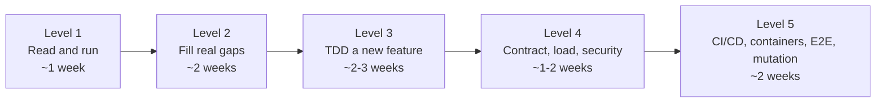

# 11 – Practice roadmap

**What you'll learn:** a concrete, staged plan to turn everything in this handbook into skill, using ShopEase
itself as the practice ground. There are five levels. You start by reading and running the tests that already
exist on each branch. Next you fill **real gaps** in those tests (each one was checked against the
`10-admin` branch). Then you build a new feature test-first, add contract, load and security testing, and
finish with a professional pipeline: CI, Testcontainers, Playwright E2E and a mutation-score target. Every item
has a checkbox, a time estimate and a "what this teaches you" line, so you always know why you are doing it.

---

## How to use this roadmap

- **Copy this file** into your own notes (or a GitHub issue) and tick the boxes as you go.
- **Work on your own branch** (for example `practice/level-2-coupons`) so the learning branches stay clean.
- **One item per session.** Each item is sized for 30 minutes to 3 hours. Finish it (green tests, commit), then
  stop.
- **Red first.** For every new test, make it fail on purpose at least once (break the code, or write the test
  before the code). A test you have never seen fail may not test anything.
- Time estimates are for someone who has read chapters 01–08. Your first items will take longer. That is normal.



| Level | You can say… | Chapters |
| --- | --- | --- |
| 1 | "I can run and explain any test in this repo." | [01](./01-what-is-testing.md)–[06](./06-api-testing-postman-bruno.md) |
| 2 | "I find what is *not* tested and test it." | [04](./04-unit-tests.md), [05](./05-integration-tests.md), [07](./07-coverage-and-quality-gates.md) |
| 3 | "I build features test-first." | [08](./08-tdd-and-daily-workflow.md) |
| 4 | "I test contracts, performance and security, not just logic." | [10](./10-next-level-testing.md) |
| 5 | "I can set up the whole quality pipeline on any project." | [09](./09-ci-cd-automation.md), [10](./10-next-level-testing.md) |

---

## Level 1 – Read and run the existing tests, branch by branch

**Goal:** for every branch, run its tests, read the new test files, and explain in one sentence what each file
protects.

**Setup once:**

```bash
# from server/ on any branch
npm install
npm test            # the first run downloads MongoDB for mongodb-memory-server: be patient
```

To read a branch without leaving your current one, use `git show <branch>:<path>` (see the
[README](./README.md#read-without-switching-branches)). To run its tests, check it out in a second folder with
`git worktree add ../shop-<branch> <branch>`, then `npm install` and `npm test` there. Remove it later with
`git worktree remove ../shop-<branch>`.

For each branch below, do the same four steps:

1. Run all tests: `npm test`.
2. Run only the new files: `npm test -- tests/integration/<file>.test.js`.
3. Read each new file top to bottom: the header comment, the `describe` names, one `it` in full.
4. **Break one thing** in `src/` that the file protects, watch the test fail, read the message, undo.

| ✔ | Branch | New test files to read | Break this on purpose | Time |
| --- | --- | --- | --- | --- |
| [ ] | `main` | `auth.test.js`, `google.test.js`, `users.test.js`, `rateLimit.test.js`, `app.test.js`, `db.test.js`, `unit/middleware.test.js`, `unit/user.model.test.js`, `unit/utils.test.js` | In `user.model.js`, make `isTokenOutdated` always return `false` (old tokens survive a password change) | 3 h |
| [ ] | `02-profile-addresses` | `addresses.test.js`, `profile.test.js`, `unit/address.model.test.js`, `unit/validateObjectId.test.js` | Allow 6 addresses instead of 5 | 2 h |
| [ ] | `03-categories` | `categories.test.js`, `unit/category.model.test.js`, `unit/slugify.test.js` | Remove the "only two levels" rule | 1.5 h |
| [ ] | `04-products-uploads` | `products.test.js`, `uploads.test.js`, `product.model.db.test.js`, `products.admin.test.js`, `category-products.test.js`, `avatar.test.js`, `unit/pagination.test.js`, `unit/product.query.test.js`, `unit/product.model.test.js`, `unit/cloudinary.test.js` | Change the max page size 48 → 100 in `getPagination` | 3 h |
| [ ] | `05-cart-wishlist` | `cart.test.js`, `wishlist.test.js`, `signupTransaction.test.js`, `product-delete-cart.test.js`, `unit/cart.model.test.js`, `unit/pricing.test.js` | In `calcShipping`, change `>=` to `>` | 2 h |
| [ ] | `06-coupons` | `coupons.test.js`, `unit/coupon.model.test.js` | `Math.floor` → `Math.round` in `calculateDiscount` | 1.5 h |
| [ ] | `07-orders` | `orders.test.js`, `orders.transaction.test.js`, `order-history-deletes.test.js`, `unit/order.model.test.js` | Allow `shipped → cancelled` in `ORDER_TRANSITIONS` | 3 h |
| [ ] | `08-payments` | `payments.test.js`, `unit/payment.test.js` | Skip the amount-mismatch check in the webhook handler | 2 h |
| [ ] | `09-reviews` | `reviews.test.js`, `product-delete-reviews.test.js`, `unit/review.model.test.js` | Allow reviews for `shipped` (not yet delivered) orders | 1.5 h |
| [ ] | `10-admin` | `admin.test.js`, `admin-aliases.test.js`, `seed.test.js`, `unit/reporting.test.js` | Remove the CSV formula-injection guard | 2 h |

Also, once per level:

- [ ] Run `npm run test:coverage` on `10-admin` and open `coverage/lcov-report/index.html`. Find the
  least-covered file. **(30 min)** *Teaches:* reading coverage as a map of risk, not a score to game.
- [ ] Run the Bruno or Postman collection for one branch (`npm run test:bruno` or `npm run test:api`, server and
  Mailpit running). **(1 h)** *Teaches:* the difference between in-process tests (Supertest) and tests against
  a running server.

**What Level 1 teaches you:** how a professional test suite is organised (setup, helpers, factories, unit vs
integration), how to read a failure, and that every test exists to protect a specific rule.

---

## Level 2 – Add missing tests (real gaps)

**Goal:** add tests that **do not exist yet**. Each idea below was checked against the `10-admin` test suite:
the suite is thorough, so these are the edges it does **not** cover yet. For each item, first `grep` to confirm
it is still missing on your branch (`git grep -n "<keyword>" -- server/tests`), then write the test, see it
fail (break the code), and make it pass.

Some of these may **find a real bug**. That is the best outcome: write the failing test, then fix the code.

### Platform and auth (`main` onward)

- [ ] **Body too large → 413.** `app.js` sets `express.json({ limit: '100kb' })`. Send a 101 kB JSON body to
  `POST /api/auth/login` and expect `413` with the standard error shape (`success: false`). Nothing tests this
  over HTTP. **(45 min)** *Teaches:* testing framework-level protections, and how `errorHandler` turns
  `err.status` into a response.
- [ ] **Malformed JSON → 400.** Send `'{"email": '` with `Content-Type: application/json` (use `.send()` with
  a string). `middleware.test.js` checks the `entity.parse.failed` mapping in isolation; no test proves it
  through the real app. **(30 min)** *Teaches:* the gap between a unit test of a mapping and the real pipeline.
- [ ] **`"alg": "none"` token → 401** on `GET /api/auth/me` (code in
  [10 §3.2](./10-next-level-testing.md#32-authorization-matrix-generated-from-the-openapi-spec)). Forged and
  expired tokens are tested; unsigned ones are not. **(30 min)** *Teaches:* thinking like an attacker about
  JWTs.
- [ ] **More rate limits.** `rateLimit.test.js` only covers admin login (5). Add: the 11th `POST /api/auth/login`
  → 429 (`authLimiter`, 10), the 6th `POST /api/auth/forgot-password` → 429 (`emailLimiter`, 5 per hour), and
  `ratelimit-remaining` going down by one per request. Follow the file's `await import()` trick. **(1 h)**
  *Teaches:* why test files that change environment variables must import the app *after* setting them.
- [ ] **Health reports the database.** Assert `data.database === 'connected'` and that `cardPaymentsEnabled`
  is a boolean (code in [10 §9.1](./10-next-level-testing.md#91-health-checks)). **(20 min)**
  *Teaches:* monitoring endpoints are an API too.

### Addresses (`02-profile-addresses`)

- [ ] **Race on the 5-address limit.** Create 4 addresses with `createAddress`, then send **two**
  `POST /api/addresses` at the same time with `Promise.all`. Expect exactly one `201` and one `400`, and 5
  addresses in the database. No address test uses `Promise.all`. If you end up with 6, you found a real race:
  fix it (count inside the transaction, or an atomic guard) and keep the test. **(1.5 h)** *Teaches:* "check
  then insert" races, the same family as overselling in `orders.transaction.test.js`.

### Categories (`03-categories`)

- [ ] **`slugify` property test.** For any string (`fc.string()` / `fc.fullUnicodeString()`), the result is
  either empty or matches `REGEX.SLUG` and has no `--`. Start from the cases in `unit/slugify.test.js`.
  **(1 h)** *Teaches:* property-based testing on text ([10 §5](./10-next-level-testing.md#5-property-based-testing)).

### Products and pagination (`04-products-uploads`)

- [ ] **Exact page-size boundary.** `products.test.js` checks that nonsense and huge `limit`s are repaired.
  Add the exact edges: `limit=48` → `meta.limit` 48, `limit=49` → 48, `limit=1` → 1. **(30 min)** *Teaches:*
  boundary-value analysis: test *at* the edge and one step past it.
- [ ] **A huge page number.** `?page=999999999` must answer 200 with `data: []` and correct `meta.total`, never
  a 500. **(20 min)** *Teaches:* what `skip = (page - 1) × limit` does with extreme input.
- [ ] **Reversed price range.** `?minPrice=5000&maxPrice=1000`: decide the correct behaviour (empty list or
  400), write the test, then check the code agrees. **(30 min)** *Teaches:* tests as executable decisions.

### Cart (`05-cart-wishlist`)

- [ ] **Parallel adds past the maximum.** The cart has 6 of a product. Send two `POST /api/cart/items` with
  `quantity: 3` at the same time. The final quantity must never exceed 10 (BR-04). The wishlist has a parallel
  test; the cart does not. **(1 h)** *Teaches:* read-modify-write races on embedded arrays.

### Coupons (`06-coupons`)

- [ ] **Free shipping exactly at Rs 5,000 *after* the discount.** Existing tests use 5,200 − 500 = 4,700. Add
  5,500 − 500 = 5,000 → `shippingPrice` 0, and 5,499 − 500 = 4,999 → 250, both in `calcTotals` and through
  `POST /api/coupons/validate`. **(45 min)** *Teaches:* boundaries that only appear when two rules combine.
- [ ] **Which reason wins.** `checkUsable` returns "the FIRST failing rule". Test a coupon that is disabled
  **and** expired **and** below the minimum: the reason must be `Coupon is not active`. Then expired + below
  minimum → `Coupon expired`. **(30 min)** *Teaches:* testing documented ordering, not just single failures.
- [ ] **Exact admin limits over HTTP.** `unit/coupon.model.test.js` accepts the maximums in the model; add the
  HTTP side: `value: 90` percentage → 201, `91` → 400; fixed `100000` → 201, `100001` → 400. **(30 min)**
  *Teaches:* the validator and the model must agree. Test both layers.
- [ ] **Property tests for discounts and totals** (complete code in
  [10 §5](./10-next-level-testing.md#5-property-based-testing)). **(1.5 h)**

### Orders (`07-orders`)

- [ ] **Page-size cap on `GET /api/orders/my`.** The pagination test uses `page=2&limit=2`. Add `limit=1000`
  and check `meta.limit` is capped (find the cap in the service), plus `limit=0` and `limit=abc`. **(30 min)**
  *Teaches:* every list endpoint needs the same protection as the product list.
- [ ] **Cancel reason length.** `cancelRules` allows 200 characters. Test 200 → 200 OK and 201 → 400 with
  `Reason must be at most 200 characters`. **(20 min)** *Teaches:* covering every validation rule you write.

### Payments (`08-payments`)

- [ ] **Expiry window boundary.** The tests backdate orders by 31 minutes. Add 29 minutes (must **not** expire)
  and 30 minutes + 1 second (must expire), based on `PAYMENTS.UNPAID_CARD_EXPIRY_MS`. **(45 min)**
  *Teaches:* time-based rules: control the clock (the `backdate` helper) instead of waiting.

### Reviews (`09-reviews`)

- [ ] **Accepted edges.** The validation table checks refused values. Add the accepted edges: rating 1 and 5,
  a comment of exactly `REVIEW.COMMENT_MIN` (10) and `COMMENT_MAX` (1000) characters, a title of exactly 80.
  **(30 min)** *Teaches:* "refuses bad" and "accepts good" are two different tests.

### Admin reports (`10-admin`)

- [ ] **Date-range edges over HTTP.** `unit/reporting.test.js` accepts one day and a full leap year in
  `resolvePeriod`; `admin.test.js` only tests reversed and too-long ranges. Add, through
  `GET /api/admin/reports/sales`: `from` = `to` (one day) → 200 with one row; exactly 366 days
  (`from=2024-01-01&to=2024-12-31`) → 200; 367 days → 400. **(45 min)** *Teaches:* proving the unit rule is
  wired into the route.
- [ ] **Order at the last millisecond.** An order at `2026-01-31T23:59:59.999Z` belongs to January 31 (UTC);
  one at `2026-02-01T00:00:00.000Z` does not. **(30 min)** *Teaches:* inclusive vs exclusive ends.
- [ ] **Accepted list limits.** Customers: `limit=1` and `limit=100` → 200 (only 0 and 101 are tested).
  Low stock: `threshold=1000` → 200 (only `-1`, `abc`, `1001` are tested). **(30 min)** *Teaches:* the "valid
  edge" half of boundary testing.

**What Level 2 teaches you:** to read a suite critically, to use boundary-value analysis, to find races, and that
"high coverage" still leaves gaps. Coverage counts lines; it does not count edges or combinations.

---

## Level 3 – TDD a new feature end-to-end

**Goal:** build one feature completely **test-first** (red → green → refactor, see
[08](./08-tdd-and-daily-workflow.md)): model, service, routes, validation, docs, Bruno folder. Pick **one** of the
four below; do a second later.

For each feature, the order is always the same:

1. Write the **acceptance criteria** (below) as `it(...)` titles with empty bodies. Commit.
2. Write the **unit tests** for the model and rules. Red. Implement. Green.
3. Write the **integration tests** for each route (401/403 first, then happy path, then 400/404/409). Red.
   Implement. Green.
4. Add the **OpenAPI docs** and extend the contract test ([10 §1](./10-next-level-testing.md#1-contract-testing)).
5. Add a **Bruno folder** that tells the story over HTTP.
6. Run `npm run test:coverage`: the gate must still pass.

### Option A – Product Q&A (build on `09-reviews`) · ~10 h

Customers ask public questions on a product; admins answer them.

**Acceptance criteria**

- Given a logged-in customer, when they `POST /api/products/:id/questions` with 10–500 characters, then 201 and
  the question is stored unanswered.
- Anonymous users can `GET /api/products/:id/questions` and see only **answered**, visible questions, newest
  first, paginated (default 5, max 20).
- An admin answers with `PATCH /api/admin/questions/:id/answer`; the asker gets an email.
- Admins cannot ask (403); customers cannot answer (403); unknown product → 404; invalid id → 400.
- A customer can ask at most 5 questions per product per day (429-style 400 with a clear message).

**Tests to write first**

- [ ] `tests/unit/question.model.test.js`: required fields, length limits, default `isAnswered: false`.
- [ ] `tests/integration/questions.test.js`: access matrix with `it.each` (copy the shape from
  `reviews.test.js`), create, public list hides unanswered, pagination and limit cap, answer + email in the
  outbox (`tokenFromLastEmail` style: read `outbox`), the daily limit, mass assignment (`isAnswered: true` in
  the body is ignored).
- [ ] Extend `app.test.js` with the new paths.

*What this teaches you:* the full TDD loop on a small, safe feature; reusing factories; testing emails through
the in-memory outbox.

### Option B – Order returns and refunds (build on `08-payments`) · ~16 h

A customer asks to return a delivered order within 7 days; an admin approves; stock goes back; card orders are
refunded through the gateway.

**Acceptance criteria**

- `POST /api/orders/:id/return` is allowed only for the **owner**, only when `status` is `delivered`, and only
  within 7 days of `deliveredAt`. Otherwise 400 (wrong state or too late) or 404 (not my order).
- The order gets a return request `{ reason, requestedAt, status: 'requested' }`; a second request → 409.
- An admin approves with `PATCH /api/admin/orders/:id/return`: stock is restored **once**, `paymentStatus`
  becomes `refunded`, and for CARD orders `stripeGateway` is asked to refund the exact `totalPrice` in paisa.
- Everything happens in **one transaction**: if the refund call fails, stock and status stay unchanged.
- Two simultaneous approvals refund **once**.

**Tests to write first**

- [ ] Unit: the "may return?" rule with `now` as a parameter (like `checkUsable(subtotal, now)`): day 0, day 7
  exactly, day 7 + 1 ms.
- [ ] Integration: owner/other/admin matrix; each refused state from `ORDER_STATUS`; 409 on a second request.
- [ ] A **fake gateway** that records calls, the way `payments.test.js` replaces
  `stripeGateway.createCheckoutSession`; assert the refunded amount.
- [ ] **Rollback:** make the fake refund throw and assert nothing changed (pattern:
  `orders.transaction.test.js`).
- [ ] **Concurrency:** two approvals with `Promise.all` → one 200, one 400/409; stock restored once.

*What this teaches you:* state machines, money and time rules together, injectable gateways, transactions and
races: the hardest and most valuable backend testing skills.

### Option C – Back-in-stock email alerts (build on `05-cart-wishlist` or later) · ~10 h

A customer subscribes to a sold-out product; when an admin raises its stock above 0, every subscriber gets one
email.

**Acceptance criteria**

- `POST /api/products/:id/stock-alerts` subscribes the logged-in customer; subscribing twice is idempotent
  (200, still one subscription). Only for products with `stock === 0` (else 400).
- `PATCH /api/products/:id/stock` that moves stock from 0 to > 0 sends **one** email per subscriber and then
  deletes the subscriptions. A change from 3 to 5 sends nothing.
- `DELETE /api/products/:id/stock-alerts` unsubscribes (idempotent).
- If sending one email fails, the others are still sent and the stock change still succeeds.

**Tests to write first**

- [ ] Integration: subscribe/unsubscribe idempotency (copy the wishlist "add twice" test), 400 when in stock,
  401/403.
- [ ] The trigger: 0 → 5 sends N emails (check `outbox`), 3 → 5 sends none, and subscriptions are gone after.
- [ ] Failure isolation: `jest.spyOn` the email sender to reject **once**; the other emails still go out and
  the response is 200.
- [ ] Parallel stock updates 0 → 5 and 0 → 7: emails are sent **once** per subscriber.

*What this teaches you:* side effects triggered by state changes, testing "exactly once", and failure isolation
with spies.

### Option D – Password-less login with a magic link (build on `main`) · ~10 h

A customer enters their email and receives a one-time login link valid for 15 minutes.

**Acceptance criteria**

- `POST /api/auth/magic-link` always answers 200 with the same message, whether or not the email exists (no
  user enumeration, like `forgot-password`). It is rate limited (`emailLimiter`).
- The email contains `token=<hex>`; only the **hash** of the token is stored (like the reset token in
  `user.model.js`).
- `POST /api/auth/magic-link/verify` with a valid token returns a JWT (same shape as login), marks the email as
  verified, and the token cannot be used again (second use → 400).
- Expired (15 min + 1 ms) → 400. Admin accounts are refused (admins use password login).

**Tests to write first**

- [ ] Integration: enumeration (same status and body for known and unknown emails), `tokenFromLastEmail()` to
  read the link, single use, expired (create the token, then move its expiry into the past in the DB, as
  `auth.test.js` does for reset links), admin refused, the JWT works on `GET /api/auth/me`.
- [ ] Unit: the token is stored hashed (the raw token never appears in the user document).
- [ ] Rate limit: the 6th request within an hour → 429 (in a separate file, like `rateLimit.test.js`).

*What this teaches you:* security-sensitive flows: enumeration, hashing tokens, expiry and single-use, all
proven by tests before a line of code exists.

**What Level 3 teaches you:** to design through tests. You decide behaviour first (acceptance criteria), then
let failing tests drive the code. It is how you will work on a team.

---

## Level 4 – Contract, load and security tests

**Goal:** add the "outside-in" tests from [chapter 10](./10-next-level-testing.md). Do them on `10-admin` (or
your latest branch).

- [ ] **Contract tests with Ajv** for `GET /api/products`, `GET /api/products/{slugOrId}` and
  `POST /api/orders` ([10 §1](./10-next-level-testing.md#1-contract-testing)). **(2 h)** *Teaches:* the docs are
  a promise; tests keep it.
- [ ] **Extend contracts** to every response the React client reads: `GET /api/cart`,
  `POST /api/coupons/validate`, `GET /api/orders/my`, `GET /api/admin/dashboard/stats`. Fix every mismatch you
  find (code or docs). **(3 h)** *Teaches:* drift is real; fixing it is everyday work.
- [ ] **Read about Pact** and write the consumer test sketch in the client repo (optional). **(2 h)** *Teaches:*
  consumer-driven thinking: the client defines what it needs.
- [ ] **Authorization matrix from the spec** (`auth-matrix.test.js`, [10
  §3.2](./10-next-level-testing.md#32-authorization-matrix-generated-from-the-openapi-spec)). Then add the role
  column (403 for the wrong role). **(2 h)** *Teaches:* generating many tests from one source of truth.
- [ ] **autocannon quick check** on `GET /api/products` with rate limits on, then off. Explain the difference.
  **(30 min)** *Teaches:* how a rate limit looks under load.
- [ ] **k6 scripts** `products.k6.js` and `orders.k6.js` against a throw-away replica set. Record p95, RPS and
  error rate in a small table in your notes. **(3 h)** *Teaches:* percentiles, thresholds, setting up realistic
  data through the API.
- [ ] **Find and fix one bottleneck** using k6 numbers (for example: does `POST /api/orders` wait for the
  confirmation email?). Re-run and record before/after. **(3 h)** *Teaches:* measure → change one thing →
  measure again.
- [ ] **`npm audit --omit=dev --audit-level=high`**: read every finding, fix what you can, write down why you
  accept the rest. **(1 h)** *Teaches:* supply-chain risk.
- [ ] **OWASP ZAP API scan** with the admin token; triage the report into "fix", "accept" and "not relevant to a
  JSON API". **(2 h)** *Teaches:* reading scanner output critically.
- [ ] **gitleaks** over the whole history; find the old run tokens in `server/bruno/environments/local.bru`'s
  history (the current file is already clean) and add a `.gitleaksignore` for the accepted fingerprints. **(1 h)** *Teaches:* secrets hygiene; rotate first, clean after.

**What Level 4 teaches you:** that correctness is not the only quality. Contracts, speed and security are
testable too, and each has its own tools and vocabulary.

---

## Level 5 – CI/CD, Testcontainers, Playwright E2E, mutation score

**Goal:** automate everything so quality does not depend on remembering.

- [ ] **Extend CI** (`.github/workflows/ci.yml`): add `npm audit --omit=dev --audit-level=high` and a gitleaks
  step (use the official `gitleaks/gitleaks-action`, pinned to a release tag). **(1.5 h)** *Teaches:* shifting
  security checks left, into every push. See [09](./09-ci-cd-automation.md).
- [ ] **Testcontainers config** (`jest.containers.config.js`, `npm run test:containers`) and a CI job that
  runs it (GitHub's Ubuntu runners have Docker). **(2 h)** *Teaches:* testing against the exact production
  database image; when it is worth the cost.
- [ ] **Playwright E2E** in `shopease-learning-client`: the smoke tests from
  [10 §7](./10-next-level-testing.md#7-end-to-end-tests-across-frontend-and-backend-playwright), then the full
  journey register → verify (Mailpit) → cart → COD checkout → `/order-success/:id`. **(5 h)** *Teaches:* where
  the frontend and backend meet; resilient selectors; traces.
- [ ] **E2E in CI**: a workflow that starts MongoDB (a `services:` container with `mongo:7.0.14`) and Mailpit,
  seeds, starts both apps and runs Playwright; upload the HTML report as an artifact. **(3 h)** *Teaches:*
  orchestrating several services for a test run.
- [ ] **Stryker** on `src/utils/pricing.js`, `src/utils/pagination.js` and the coupon model. **Target: a
  mutation score of at least 80%**, with `break: 70` so the run fails below that. Kill surviving mutants by
  adding assertions, not by excluding code. **(3 h)** *Teaches:* measuring test strength, not just coverage.
  See [07](./07-coverage-and-quality-gates.md).
- [ ] **Nightly workflow** (`on: schedule`) for the slow jobs: Stryker, Testcontainers, Playwright. **(1 h)**
  *Teaches:* fast feedback on every push, deep checks once a day.
- [ ] **Observability tests**: the readiness route (503 when the DB is down) and the structured-logger test
  ([10 §9](./10-next-level-testing.md#9-observability-checks-as-testable-behaviour)). **(3 h)** *Teaches:*
  operations behaviour is behaviour; test it.
- [ ] **Write your own testing README** for a brand-new practice project, from an empty folder, with every gate
  from this roadmap. **(4 h)** *Teaches:* you can now do it without this repo. That is the real goal.

**What Level 5 teaches you:** to build and own the whole quality pipeline: the skill that separates "writes
tests" from "backend engineer".

---

## Tracking your progress

Keep a small log in your notes. One line per finished item is enough:

| Date | Item | Result | What surprised me |
| --- | --- | --- | --- |
| 2026-12-01 | L2 body too large → 413 | Passed first time | `errorHandler` already used `err.status` |
| 2026-12-03 | L2 address race | **Found a bug**: 6 addresses | Count + insert was not atomic |

The "what surprised me" column is where the learning is.

---

## Common mistakes

- **Skipping Level 1.** Writing new tests before reading the existing ones leads to duplicated helpers and
  inconsistent style. Copy the repo's patterns first.
- **Writing a Level 2 test that passes immediately and moving on.** Break the code once to see it fail;
  otherwise you do not know it tests anything.
- **Picking the hardest Level 3 option first.** Option A (Q&A) is a gentle start; Option B (returns) is the
  hardest and most valuable.
- **Treating time estimates as deadlines.** They are a rough guide. Understanding beats speed.
- **Doing Level 4 against Atlas.** Load and security tests always run against a throw-away local database.

---

## Check yourself

1. Why does each Level 2 item start with `git grep` before you write anything?
2. In the address race test, what result would prove a bug, and which existing test file uses the same
   technique?
3. In Option B (returns), why is "two simultaneous approvals refund once" a separate test from "approval
   restores stock"?
4. What is the difference between a coverage target and a mutation-score target, and why does Level 5 ask for
   both?
5. Which Level 4 item would you do first on a project that is about to launch, and why?

---

**Next:** [12 – Cheatsheet](./12-cheatsheet.md)
