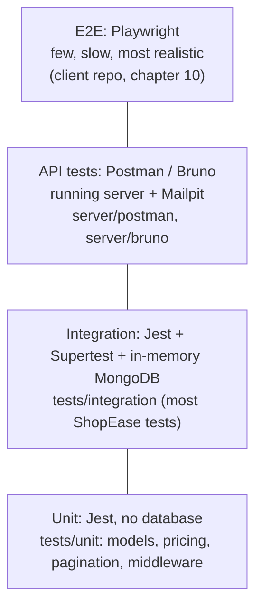

# 12 – Cheatsheet

**What you'll learn:** nothing new. This is the one page to keep open while you work. It collects the npm
scripts, Jest CLI flags, the matchers you will use daily, async and mocking patterns, Supertest snippets, every
ShopEase test helper (and the branch where it first appears), the Newman and Bruno commands, the testing
pyramid, and a troubleshooting table for the errors beginners hit most. Every snippet is either quoted from the
repo (branch named) or uses only APIs the repo already uses.

---

## npm scripts (`server/package.json`)

Run from `server/`. Extra Jest flags go after `--`, for example `npm test -- -t "coupon"`.

| Script | What it runs | Use it when |
| --- | --- | --- |
| `npm test` | All Jest tests (unit + integration, in-memory MongoDB) | Before every commit (the hook runs it anyway) |
| `npm run test:watch` | Jest in watch mode | While coding (TDD loop) |
| `npm run test:unit` | Only `tests/unit` | Fast feedback on pure logic |
| `npm run test:integration` | Only `tests/integration` | After changing routes, services or models |
| `npm run test:coverage` | All tests + coverage report + the 90/90/90/80 gate | Before pushing; what CI runs |
| `npm run test:api` | Newman runs the Postman collection | Server + Mailpit running |
| `npm run test:bruno` | Bruno CLI (`@usebruno/cli@4.3.0`) runs the Bruno collection | Server + Mailpit running |
| `npm run lint` / `lint:fix` | ESLint / ESLint with auto-fix | Before committing (lint-staged does it for staged files) |
| `npm run format` / `format:check` | Prettier write / check | `format:check` is what CI runs |
| `npm run seed` | Admin + 14 categories + 30 products + 2 coupons (idempotent) | Before Bruno folder 10, k6, Playwright |
| `npm run seed:admin` | Only the admin | Fresh database |
| `npm run db:indexes` | Sync model indexes to the database | After adding an index |
| `npm run dev` / `npm start` | API with nodemon / plain node | Manual and API testing |

> **Why not `npx jest`?** The code is ES modules, so Jest must start with `node --experimental-vm-modules`. The
> scripts do that for you.

---

## Jest CLI flags

```bash
npm test -- tests/unit/pricing.test.js          # one file (path or part of a path)
npm test -- coupon                               # every file whose path contains "coupon"
npm test -- -t "free shipping"                   # only tests whose name matches
npm test -- tests/integration/orders.test.js -t "cancel"
```

| Flag | What it does |
| --- | --- |
| `-t "<pattern>"` | Run tests whose `describe` + `it` name matches |
| `--watch` | Re-run on change (git-aware); `npm run test:watch` |
| `--coverage` | Coverage report into `coverage/`; `npm run test:coverage` |
| `-i` / `--runInBand` | One process, one file at a time (easier debugging, clearer logs) |
| `--detectOpenHandles` | Shows what keeps Jest from exiting (open DB connection, timer) |
| `--verbose` | Prints every test name |
| `--silent` | Hides `console.log` from tests (the pre-commit hook uses `npm test --silent`) |
| `--bail` | Stop after the first failing file |
| `-o` / `--onlyChanged` | Only tests related to uncommitted changes |
| `--changedSince=main` | Only tests related to changes since `main` |
| `--listTests` | List the files Jest would run, without running them |
| `--clearCache` | Delete Jest's cache (rarely needed) |

In code: `it.only` / `describe.only` run just that block; `it.skip` skips it; `it.todo('…')` lists a test you
still have to write. **Never commit `.only`.**

---

## Common matchers

| Matcher | Example | Note |
| --- | --- | --- |
| `toBe` | `expect(res.status).toBe(201)` | Exact (`===`): numbers, strings, booleans |
| `toEqual` | `expect(res.body).toEqual({ success: false, message: '…' })` | Deep equality, **every** key |
| `toMatchObject` | `expect(res.body.data).toMatchObject({ value: 500 })` | Only the keys you list (repo favourite) |
| `toHaveLength` | `expect(res.body.data).toHaveLength(2)` | Arrays and strings |
| `toContain` | `expect(res.text).toContain('swagger')` | Item in array / substring |
| `toMatch` | `expect(res.body.openapi).toMatch(/^3\./)` | Regex or substring |
| `toBeDefined` / `toBeUndefined` | `expect(res.headers['x-powered-by']).toBeUndefined()` | |
| `toBeNull` / `toBeTruthy` / `toBeFalsy` | `expect(await Order.findOne()).toBeNull()` | |
| `toBeGreaterThan` / `…OrEqual` / `toBeLessThan` | `expect(meta.total).toBeGreaterThan(0)` | |
| `toThrow` | `expect(() => order.changeStatus('pending')).toThrow('…')` | Wrap sync code in a function |
| `rejects` / `resolves` | `await expect(seedStore()).rejects.toThrow(/CUSTOMER/)` | Promises: always `await` |
| `expect.arrayContaining` | `expect(paths).toEqual(expect.arrayContaining(['/cart']))` | Subset of an array |
| `expect.any(Type)` | `expect(order).toMatchObject({ _id: expect.any(String) })` | Any value of that type |
| `toHaveBeenCalledTimes` / `…With` | `expect(next).toHaveBeenCalledWith()` | Mocks and spies |
| `.not` | `expect(JSON.stringify(user)).not.toContain('password')` | Negates any matcher |

---

## Async test patterns

```js
// ✅ Always await the request (or return it). Without await the test ends before the response.
it('creates a coupon', async () => {
  const res = await api().post('/api/coupons').set('Authorization', adminAuth).send(body);
  expect(res.status).toBe(201);
});

// ✅ Promise rejection: await + rejects
await expect(createProduct({ sku: 'dup-1' })).rejects.toMatchObject({ code: 11000 });

// ✅ Run things truly in parallel (race tests) – 07-orders:orders.transaction.test.js
const results = await Promise.all([place(a.auth, a.body), place(b.auth, b.body)]);
const statuses = results.map((r) => r.status).sort(); // order-independent assertion

// ✅ Several tests, one shape: it.each (used all over the repo for 401/403 tables)
it.each(routes)('%s returns 401 without a token', async (_name, send) => {
  expect((await send(api())).status).toBe(401);
});

// ✅ Lifecycle used by every integration file
beforeAll(connectTestDB);
afterEach(clearTestDB);
afterAll(closeTestDB);

// ❌ forEach with async callbacks: Jest does NOT wait for them
items.forEach(async (i) => { await save(i); });      // use for…of or Promise.all instead
```

---

## Mocks, spies and fake timers

In ES-module tests, the `jest` object must be **imported** (the repo does this):

```js
import { jest } from '@jest/globals';
```

```js
// A fake function that records its calls – 08-payments:tests/unit/payment.test.js
const run = (headers) => {
  const next = jest.fn();
  requireCronSecret({ headers }, {}, next);
  return next.mock.calls[0][0]; // undefined = allowed, ApiError = blocked
};
expect(run({}).statusCode).toBe(401);

// Spy on a real method and force ONE failure – 05-cart-wishlist:signupTransaction.test.js
jest.spyOn(Wishlist, 'create').mockRejectedValueOnce(new Error('disk full'));

// Silence expected error logs – 08-payments:payments.test.js
jest.spyOn(console, 'error').mockImplementation(() => {});

// Always undo spies (the repo does this in afterEach)
afterEach(() => jest.restoreAllMocks());

// Replace a method of an injectable client, then restore it – 04-products-uploads:uploads.test.js
const real = { ...cloudinaryClient };
cloudinaryClient.upload = async (buffer, folder) => ({ secure_url: '…', public_id: `${folder}/fake1` });
afterEach(() => Object.assign(cloudinaryClient, real));
```

**Time.** The repo avoids fake timers. It passes the clock in (`coupon.checkUsable(subtotal, now)`) or moves
data in time (`backdate()` in `payments.test.js`, `passwordResetExpires: new Date(Date.now() - 1000)` in
`auth.test.js`). Prefer that. If you do need fake timers in a test that also talks to MongoDB, leave the I/O
scheduling alone:

```js
jest.useFakeTimers({ now: new Date('2026-06-15T12:00:00Z'), doNotFake: ['nextTick', 'setImmediate'] });
jest.advanceTimersByTime(30 * 60 * 1000); // 30 minutes later
jest.useRealTimers();                    // in afterEach
```

---

## Supertest snippets

```js
import { api, bearer, loggedIn, createAdmin } from '../helpers/factories.js';

// GET, no auth
const res = await api().get('/api/products?sort=price_asc&limit=2&page=2');

// GET / POST with a Bearer token
const { user, auth } = await loggedIn();                          // verified customer
const me = await api().get('/api/auth/me').set('Authorization', auth);
const adminAuth = bearer(await createAdmin());
const created = await api().post('/api/categories').set('Authorization', adminAuth).send({ name: 'Shoes' });

// PATCH / DELETE
await api().patch(`/api/orders/${id}/cancel`).set('Authorization', auth).send({ reason: 'Changed my mind' });
await api().delete(`/api/cart/items/${productId}`).set('Authorization', auth);

// Attach a file (multipart) – 04-products-uploads:uploads.test.js
const PNG = Buffer.from('89504e470d0a1a0a', 'hex');
await api()
  .post('/api/uploads/image?folder=categories')
  .set('Authorization', adminAuth)
  .attach('image', PNG, { filename: 'shirt.png', contentType: 'image/png' });

// Raw body, byte-for-byte (signed webhook) – 08-payments:payments.test.js
const payload = JSON.stringify(event);
await api()
  .post('/api/payments/webhook')
  .set('Content-Type', 'application/json')
  .set('Stripe-Signature', Stripe.webhooks.generateTestHeaderString({ payload, secret }))
  .send(payload); // a STRING is sent exactly as is

// Custom headers (CORS, cron secret)
await api().get('/api/health').set('Origin', 'http://localhost:5173');
await api().get('/api/payments/expire-unpaid').set('x-cron-secret', 'jest-cron-secret');

// What you can read from the response
res.status; res.body; res.text; res.headers['content-type'];
```

---

## The repo's test helpers

### `tests/helpers/db.js` (same on every branch)

| Helper | What it does |
| --- | --- |
| `connectTestDB()` | Connects to this worker's database and builds every model's indexes |
| `clearTestDB()` | Deletes all documents (keeps indexes) **and** empties the email outbox |
| `closeTestDB()` | Drops this worker's database and disconnects |

### `tests/helpers/factories.js`

| Helper | What it gives you | Since branch |
| --- | --- | --- |
| `api()` | `request(app)`: a Supertest client, no port needed | `main` |
| `PASSWORD` | `'secret123'`, the password every factory user has | `main` |
| `uniqueEmail(prefix?)` | A never-repeating email | `main` |
| `createUser(overrides?)` | A **verified** customer saved in the DB | `main` |
| `createAdmin(overrides?)` | An admin | `main` |
| `bearer(user)` | `'Bearer <jwt>'` for that user | `main` |
| `loggedIn(overrides?)` | `{ user, auth }`: create a user and get its header in one line | `main` |
| `tokenFromLastEmail(email)` | The `token=…` from the newest email to that address (in-memory outbox) | `main` |
| `validAddress(overrides?)` | A valid address **body** (for POST/PUT) | `02-profile-addresses` |
| `createAddress(user, overrides?)` | An address saved in the DB (skips HTTP rules) | `02-profile-addresses` |
| `createCategory(overrides?)` | A category with a unique name | `03-categories` |
| `fakeImage(name?)` | `{ url, publicId }` that looks like Cloudinary (nothing uploaded) | `04-products-uploads` |
| `validProduct(categoryId, overrides?)` | A valid product **body**, unique SKU | `04-products-uploads` |
| `createProduct(overrides?)` | An active product (creates a category if needed; price 1000, stock 20) | `04-products-uploads` |
| `addToCart(user, product, qty?)` | Puts a line in the user's cart directly in the DB | `05-cart-wishlist` |
| `createWishlist(user, products?)` | Sets the user's wishlist | `05-cart-wishlist` |
| `uniqueCouponCode(prefix?)` | A valid, unique code (≤ 20 chars) | `06-coupons` |
| `createCoupon(overrides?)` | An active 10% coupon, valid 30 days | `06-coupons` |
| `createOrder(user, overrides?)` | A `pending` COD order with one product line (no stock taken) | `07-orders` |
| `deliverOrder(order)` | Marks it delivered and paid | `07-orders` |
| `createReview(user, product, overrides?)` | A review, with the delivered order it needs | `09-reviews` |

Typical setups:

```js
const { user, auth } = await loggedIn();                        // customer + header
const { auth: unverified } = await loggedIn({ isEmailVerified: false });
const product = await createProduct({ price: 2500, stock: 1 });
const address = await createAddress(user, { isDefault: true });
await addToCart(user, product, 2);
const order = await deliverOrder(await createOrder(user, { product }));
```

---

## Newman (Postman) and Bruno commands

**Before running either:** API running, Mailpit running (`docker compose up -d` in the repo root), admin seeded
(`npm run seed`), `RATE_LIMIT_ENABLED=false`, and `CRON_SECRET=test-cron-secret` in `server/.env`.

```bash
# Postman collection with Newman (from server/)
npm run test:api
npx newman run postman/ShopEase.postman_collection.json \
  -e postman/ShopEase.local.postman_environment.json --folder "06 Coupons"     # one folder
npx newman run postman/ShopEase.postman_collection.json \
  -e postman/ShopEase.local.postman_environment.json --bail                    # stop at first failure
npx newman run postman/ShopEase.postman_collection.json \
  -e postman/ShopEase.local.postman_environment.json -r cli,junit --reporter-junit-export results.xml

# Bruno collection (from server/)
npm run test:bruno                                              # whole collection, env "local"
cd bruno && npx --yes @usebruno/cli@4.3.0 run "06 Coupons" --env local   # one folder
```

In PowerShell, replace the trailing `\` with a backtick `` ` `` or put the command on one line.

---

## Testing pyramid



More tests at the bottom (fast, cheap, precise), fewer at the top (slow, realistic). ShopEase is
integration-heavy on purpose: an API's value lives in routes plus database.

---

## Troubleshooting quick table

| Symptom | Likely cause | Fix |
| --- | --- | --- |
| `SyntaxError: Cannot use import statement outside a module` | Ran `npx jest` directly | Use `npm test` (adds `--experimental-vm-modules`) |
| `ReferenceError: jest is not defined` | ESM tests do not get a global `jest` | `import { jest } from '@jest/globals'` |
| First run hangs or times out at start | `mongodb-memory-server` downloading MongoDB | Wait (once); check proxy/firewall; `testTimeout` is 30 s |
| `Exceeded timeout of 30000 ms` | A missing `await`, or a request that never answers | Await every request; look for un-awaited `Promise`s |
| `Jest did not exit one second after the test run` | Open DB connection or timer | `afterAll(closeTestDB)`; run with `--detectOpenHandles` |
| `E11000 duplicate key error` | Fixed email/SKU/code reused, or data left from a test | Use factories (unique values); `afterEach(clearTestDB)` |
| `Transaction numbers are only allowed on a replica set` | Connected to a single `mongod` | Tests: use the repo's `globalSetup` (replica set). Local: start mongod with `--replSet` |
| `❌ Missing required environment variables` | `MONGO_URI` / `JWT_SECRET` not set | Tests: `tests/setup/env.js` sets them. Dev: fill `server/.env` |
| Test passes alone, fails in the full run | Shared state between tests | Clean in `afterEach`, restore spies, never rely on test order |
| `Jest: "global" coverage threshold for branches (80%) not met` | New code without tests | Run `npm run test:coverage`, open `coverage/lcov-report/index.html`, test the red lines |
| 429 `Too many attempts` in Postman/Bruno/k6 | Rate limits on | `RATE_LIMIT_ENABLED=false` in `.env`, restart the server |
| `ECONNREFUSED 127.0.0.1:5000` in Newman/Bruno | Server not running | `npm run dev` in another terminal |
| Mailpit step finds no email | Mailpit not running or wrong port | `docker compose up -d`; inbox at `http://localhost:8025`; SMTP 1025 |
| Pre-commit hook blocks the commit | Lint, format or a test failed | Read the output; run `npm run lint`, `npm run format`, `npm test` |
| CI red on `format:check` but fine locally | Files not formatted | `npm run format`, commit the result |
| Expected `401` but got `400` / `404` | Route validates before `protect` | Put `protect` first in the route pipeline |
| Webhook test always 400 | Body was parsed before the signature check | Send the payload as a **string**; the route uses `express.raw` before `express.json` |

---

## Common mistakes

- **Copying a snippet without the lifecycle hooks.** Integration snippets need `connectTestDB`, `clearTestDB`
  and `closeTestDB`.
- **Using `toEqual` where `toMatchObject` was meant.** `toEqual` fails when the API adds a harmless field.
- **Forgetting `--` before Jest flags.** `npm test -t coupon` gives the flag to npm, not to Jest.
- **Leaving `.only` in a file.** The rest of the suite silently stops running.

---

## Check yourself

1. What is the difference between `npm test -- coupon` and `npm test -- -t "coupon"`?
2. Which helper gives you a verified customer **and** the `Authorization` header in one line?
3. Why does the webhook test send `JSON.stringify(event)` instead of the object?
4. A test passes alone but fails in the full suite. Name two likely causes.

---

**Next:** back to the [handbook home](./README.md), or start [11 – Practice roadmap](./11-practice-roadmap.md)
Level 1.
