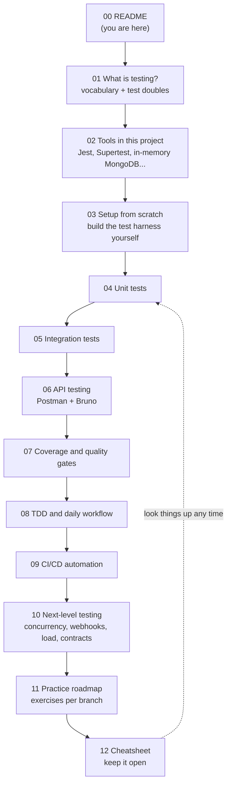

# ShopEase Testing Handbook

**What you'll learn:** what this handbook is, who it is written for, the order to read it in, and which git
branch of the ShopEase project you should have checked out while you read each chapter. By the end of this page
you will know where to start, where every topic lives, and how to use the handbook side by side with the real
code in `server/`.

---

## Who this is for

You are building **ShopEase**, an online store API (Node.js + Express + MongoDB), step by step, one git branch per
feature. You may have **never set up automated tests before**. That is fine. This handbook assumes:

- You can run commands in a terminal (PowerShell or Git Bash on Windows; Terminal on macOS/Linux).
- You know basic JavaScript (functions, `async`/`await`, objects, `import`/`export`).
- You have opened the project at least once and run `npm install` in `server/`.

You do **not** need to know Jest, Supertest, mocks, coverage, CI or anything else with a funny name. Every term is
explained the first time it appears, and the [glossary-style cheatsheet](./12-cheatsheet.md) collects them all.

The goal is bigger than "make the tests pass". The goal is that you grow into a **backend engineer** who:

1. knows *why* a test exists and what it protects,
2. can write unit, integration and API tests without copying blindly,
3. can read a red test run and find the cause quickly,
4. can set up the same safety net (lint, tests, coverage, hooks, CI) on any new project from zero.

---

## Learning path

Read top to bottom the first time. Later, jump straight to the chapter you need.



**Three ways to use it:**

| You want to... | Read |
| --- | --- |
| Understand testing from zero | 01 → 02 → 03, in order |
| Write a test for the feature you are building today | 04 or 05, then 08 |
| Fix a red CI run or a failing pre-commit hook | 07, 09, then 12 |
| Level up after finishing the project | 10 and 11 |

---

## All files

| # | File | One-line description |
| --- | --- | --- |
| 00 | [README.md](./README.md) | Handbook home: audience, learning path, file list, which branch to use per chapter |
| 01 | [01-what-is-testing.md](./01-what-is-testing.md) | Why we test, the kinds of tests, test doubles, flaky vs deterministic, and where each kind lives in this repo |
| 02 | [02-tools-in-this-project.md](./02-tools-in-this-project.md) | Every testing and quality tool in ShopEase, the problem it solves, its config file and its npm script |
| 03 | [03-setup-from-scratch.md](./03-setup-from-scratch.md) | Build the whole test setup yourself on an empty Express project, step by step |
| 04 | [04-unit-tests.md](./04-unit-tests.md) | Writing unit tests for models, middleware and helpers with Jest |
| 05 | [05-integration-tests.md](./05-integration-tests.md) | Testing real HTTP routes with Supertest and the in-memory MongoDB |
| 06 | [06-api-testing-postman-bruno.md](./06-api-testing-postman-bruno.md) | Testing the running server end to end with Postman/Newman, Bruno and Mailpit |
| 07 | [07-coverage-and-quality-gates.md](./07-coverage-and-quality-gates.md) | Reading coverage reports and the gates that block bad code (thresholds, ESLint, Prettier) |
| 08 | [08-tdd-and-daily-workflow.md](./08-tdd-and-daily-workflow.md) | Test-driven development and a realistic day of work with tests, watch mode and hooks |
| 09 | [09-ci-cd-automation.md](./09-ci-cd-automation.md) | Husky + lint-staged locally and GitHub Actions in the cloud |
| 10 | [10-next-level-testing.md](./10-next-level-testing.md) | Concurrency, transactions, webhook signatures, load, contract and E2E testing |
| 11 | [11-practice-roadmap.md](./11-practice-roadmap.md) | Exercises for every branch, from easy to hard, so you practise on real code |
| 12 | [12-cheatsheet.md](./12-cheatsheet.md) | One page of commands, matchers, patterns and fixes for common errors |

---

## How to use this handbook while building the project

ShopEase is built branch by branch. Each branch adds one feature **and its tests**:

```text
main (01 auth) → 02-profile-addresses → 03-categories → 04-products-uploads → 05-cart-wishlist
  → 06-coupons → 07-orders → 08-payments → 09-reviews → 10-admin
```

The test setup itself (`server/jest.config.js`, `server/tests/setup/*`, `server/tests/helpers/db.js`) is the
same on every branch. What grows is the number of tests (9 test files on `main`, 47 on `10-admin`) and the number
of factories in `server/tests/helpers/factories.js`.

### Which branch to be on for each chapter

| Chapter | Branch to have checked out | Why |
| --- | --- | --- |
| 00 README | any | Orientation only |
| 01 What is testing | `main` | All the basic examples (unit, integration, stub, fake) already exist on `main` |
| 02 Tools | `main`, then peek at `04-products-uploads` and `08-payments` | All tools are on `main`; the Cloudinary and Stripe wrappers arrive later |
| 03 Setup from scratch | `main` (read only) + a **new empty folder** | You copy ideas from `main` into your own practice project |
| 04 Unit tests | `main`, later `03-categories` / `06-coupons` | `tests/unit/*` on `main`; `slugify.test.js` and `pricing.test.js` are good later examples |
| 05 Integration tests | `main`, then `05-cart-wishlist` and `07-orders` | Auth routes first; transactions and rollback later |
| 06 API testing | the branch you are working on | Each branch adds one Bruno folder (`01 Auth` on `main` … `10 Admin` on `10-admin`) |
| 07 Coverage and quality gates | any (the gate is identical everywhere) | `jest.config.js` does not change between branches |
| 08 TDD and daily workflow | the branch of the feature you are building | You practise on real work |
| 09 CI/CD | `main` | `.github/workflows/ci.yml` and `server/.husky/pre-commit` live there |
| 10 Next-level testing | `05-cart-wishlist`, `07-orders`, `08-payments` | Transactions, race conditions, Stripe webhook signatures |
| 11 Practice roadmap | each branch in turn | Exercises are grouped by branch |
| 12 Cheatsheet | any | Reference |

> **Try it:** see which branch you are on and how many test files it has.
>
> ```powershell
> # PowerShell or Git Bash, from the repo root
> git branch --show-current
> git ls-files server/tests | Select-String "test.js" | Measure-Object   # PowerShell
> git ls-files server/tests | grep -c "test.js"                         # Git Bash / macOS / Linux
> ```

### Read without switching branches

You can read any file from any branch without checking it out. This is safe even while you have uncommitted work:

```bash
# Show a file from another branch
git show 07-orders:server/tests/integration/orders.transaction.test.js

# List the test files on a branch
git ls-tree -r --name-only 08-payments server/tests
```

### Where things live in the repo

| Path | What it is |
| --- | --- |
| [`server/jest.config.js`](../../server/jest.config.js) | How Jest finds and runs tests, plus the coverage gate |
| [`server/tests/setup/`](../../server/tests/setup/) | `globalSetup.js`, `env.js`, `globalTeardown.js` |
| [`server/tests/helpers/`](../../server/tests/helpers/) | `db.js` (connect/clean/close) and `factories.js` (test data) |
| [`server/tests/unit/`](../../server/tests/unit/) | Unit tests |
| [`server/tests/integration/`](../../server/tests/integration/) | Integration tests |
| [`server/postman/`](../../server/postman/) | Postman collection + environment |
| [`server/bruno/`](../../server/bruno/) | Bruno collection |
| [`.github/workflows/ci.yml`](../../.github/workflows/ci.yml) | GitHub Actions CI |
| [`docs/testing/README.md`](../testing/README.md) | The short testing guide that ships with the repo |
| [`docs/concepts/11-testing-strategy.md`](../concepts/11-testing-strategy.md) | The testing-strategy concept page |

---

## Common mistakes

- **Running `npx jest` instead of `npm test`.** The project uses ES modules, so Jest must start with
  `node --experimental-vm-modules`. The npm scripts do that for you. See [02](./02-tools-in-this-project.md).
- **Reading a chapter on the wrong branch.** If a file mentioned in the text is missing, check the table above;
  it probably arrives on a later branch.
- **Skipping 01 because "I just want to write tests".** Without the vocabulary (stub, fake, isolation) the
  later chapters feel like magic. 01 takes 20 minutes.
- **Copying a test without running it red first.** A test you have never seen fail may not test anything.
  Chapter 08 shows how.

---

## Check yourself

1. Which chapter would you open first if the pre-commit hook blocked your commit?
2. On which branch do the transaction and race-condition tests appear?
3. How can you read `server/tests/integration/payments.test.js` from `08-payments` without switching branches?
4. Why must you use `npm test` rather than `npx jest` in this project?

---

**Next:** [01 – What is testing?](./01-what-is-testing.md)
