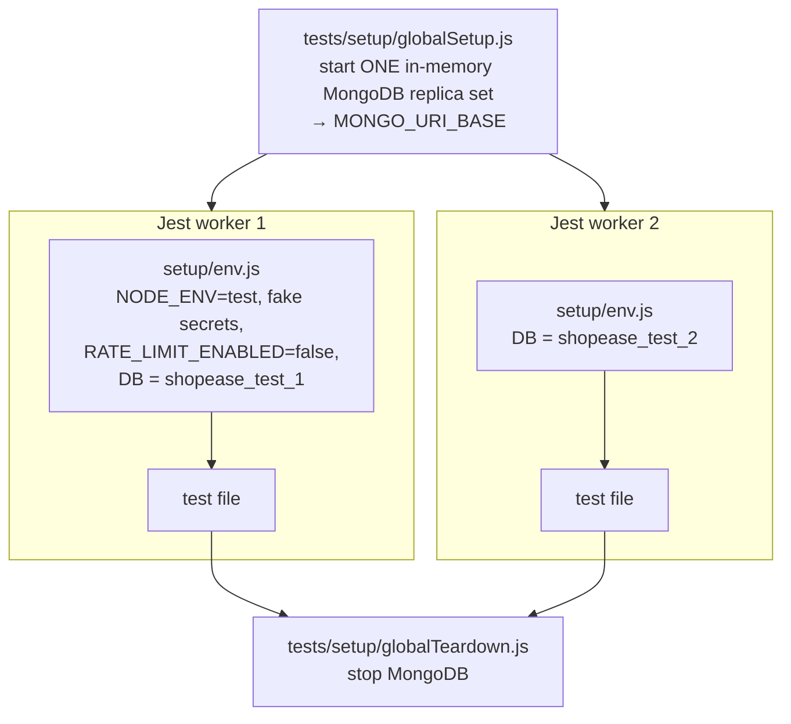

# Testing guide

Three kinds of tests (see [concepts/11-testing-strategy](../concepts/11-testing-strategy.md)):

| Kind | Tool | Needs | Command (in `server/`) |
|---|---|---|---|
| Unit | Jest | nothing | `npm run test:unit` |
| Integration | Jest + Supertest + mongodb-memory-server | nothing (DB is in memory) | `npm run test:integration` |
| API / E2E | Postman + Newman, Bruno | running server, Mailpit, seeded admin | `npm run test:api`, `npm run test:bruno` |

## 1. How the Jest setup works



| File | Job |
|---|---|
| `jest.config.js` | Node environment, no Babel (native ES modules), setup files, coverage gate |
| `tests/setup/globalSetup.js` | Starts a 1-member **replica set** in memory (replica set → transactions work later) |
| `tests/setup/env.js` | Runs before every test file: fake env vars + a **separate database per worker** |
| `tests/setup/globalTeardown.js` | Stops the in-memory MongoDB |
| `tests/helpers/db.js` | `connectTestDB` (connect + build indexes), `clearTestDB` (delete all docs + empty outbox), `closeTestDB` |
| `tests/helpers/factories.js` | `api()`, `createUser()`, `createAdmin()`, `loggedIn()`, `bearer()`, `uniqueEmail()`, `tokenFromLastEmail()`, `PASSWORD`, `validAddress()`, `createAddress(user, overrides)` |

### The email outbox
When `NODE_ENV=test`, `sendEmail()` doesn't send anything. It pushes `{to, subject, html, text}` into the exported `outbox` array. `tokenFromLastEmail(email)` finds the newest email to that address and extracts `token=…` from the link, exactly like a user clicking it.

### Why `--experimental-vm-modules`?
Our code uses ES modules (`import`). Jest needs this Node flag to run them without Babel. The npm scripts already include it, so always use `npm test` (not plain `npx jest`). Because of ESM, the `jest` object must be imported: `import { jest } from '@jest/globals'`.

### First run
`mongodb-memory-server` downloads a MongoDB binary (~100 MB) the first time. That can take a minute. Later runs reuse it.

## 2. Running Jest

```bash
npm test                                   # all tests
npm run test:unit                          # tests/unit only
npm run test:integration                   # tests/integration only
npm test -- tests/integration/users.test.js   # one file
npm test -- -t "admin"                     # tests whose name contains "admin"
npm run test:watch                         # re-run on save
npm run test:coverage                      # + coverage report and the 90% gate
```

### Reading coverage
The table shows, per file, how much ran:
- **% Stmts / % Lines**: statements and lines executed
- **% Branch**: both sides of each `if` / `?:` / `||` taken
- **% Funcs**: functions called
- **Uncovered Line #s**: lines never executed. Look there first.

**Testing concurrency:** `tests/integration/orders.transaction.test.js` fires parallel requests with `Promise.all` (two buyers for the last unit, a coupon with one use left, a double click, a double cancel) against the in-memory replica set, and forces failures mid-transaction to prove the rollback. See [concept 20](../concepts/20-transactions-and-race-conditions.md).

HTML report: `server/coverage/lcov-report/index.html`. The run fails if global coverage is below 90% lines/statements/functions or 80% branches.

## 3. Writing a new test (template)

```js
/**
 * INTEGRATION tests for <METHOD> /api/<path>.
 */
import { connectTestDB, clearTestDB, closeTestDB } from '../helpers/db.js';
import { api, loggedIn, createAdmin, bearer } from '../helpers/factories.js';

beforeAll(connectTestDB);   // connect once per file
afterEach(clearTestDB);     // clean after EVERY test (isolation)
afterAll(closeTestDB);      // drop this worker's DB and disconnect

describe('GET /api/something', () => {
  it('returns 200 for a logged-in customer', async () => {
    const { auth } = await loggedIn();                    // Arrange
    const res = await api().get('/api/something').set('Authorization', auth); // Act
    expect(res.status).toBe(200);                         // Assert
  });

  it('returns 401 without a token', async () => {
    expect((await api().get('/api/something')).status).toBe(401);
  });

  it('returns 403 for the wrong role', async () => { /* ... */ });
});
```

Checklist per endpoint: happy path · 400 · 401 · 403 · 404 · 409 · security cases.

For routes with an `:id` that belongs to a user (branch 02 onwards), also test **ownership**: customer B uses customer A's id → **404**, and A's record is unchanged. See `tests/integration/addresses.test.js` and [concept 14](../concepts/14-authorization-ownership.md).

## 4. Postman

### Prerequisites
1. Mailpit running: `docker compose up -d` (repo root) → http://localhost:8025
2. `server/.env` has `RATE_LIMIT_ENABLED=false` (otherwise repeated runs hit 429)
3. Store seeded: `npm run seed` (admin + catalogue; folder 10 needs it; `npm run seed:admin` creates only the admin)
4. API running: `npm run dev`

### In the Postman app
1. **Import** → select both files in `server/postman/`:
   - `ShopEase.postman_collection.json`
   - `ShopEase.local.postman_environment.json`
2. Top right: choose the environment **"ShopEase – local"**.
3. Open the collection → **Run** (Collection Runner) → **Run ShopEase API**. You can also run one folder (**01 Auth**, **02 Profile & Addresses**, **03 Categories**, **04 Products & Uploads**, **05 Cart & Wishlist**, **06 Coupons**, **07 Orders**, **08 Payments**); each one is self-contained.
4. Each request has a **Tests** tab with the assertions (status codes, saved variables).

### From the terminal (Newman)
```bash
npm run test:api
```

### How the Mailpit steps work
The requests named **"Mailpit – read … email"** call Mailpit's API: `GET {{mailpitUrl}}/api/v1/message/latest`. Their test script:
1. checks the subject (verify / reset),
2. finds `token=<hex>` in the email text,
3. saves it with `pm.environment.set('verifyToken', …)`.

The next request uses `{{verifyToken}}`. This makes the **whole email flow automatic**.

Other variables are set the same way: `email` (random per run), `token`, `oldToken`, `adminToken`, `resetToken`. Folder 02 uses its own: `customerEmail`, `customerToken`, `otherEmail`, `otherToken`, `addressId`, `addressId2`. Folder 03 uses `categoryName`, `categoryNameUpper`, `categoryId`, `categorySlug`, `oldCategorySlug`, `childCategoryId` and needs no email (the register response already holds a token for its 403 checks). Folder 04 uses `productRunId`, `categoryId`, `categorySlug`, `productId`, `productSlug`, `product2Id`, `inactiveId`, `inactiveSlug`, `imageId`, `image2Id`, also needs no email and no Cloudinary keys, and deletes everything it created. Folder 05 uses `cartEmail`, `cartToken`, `mailId`, `cartCategoryName`, `cartSkuA`/`B`/`C`, `categoryId`, `productId`, `productId2`, `inactiveProductId`, and reads its email via Mailpit search by recipient (newest message), not `latest`. Folder 06 does the same with `couponEmail`, `couponToken`, `couponMailId`, `couponCategoryName`, `couponCategoryId`, `couponSku`, `couponProductId`, `couponCode`, `couponCodeLower`, `couponId`, `couponCode2`, `couponId2`. Folder 07 uses variables starting with `order` (e.g. `orderEmail`, `orderToken`, `orderId`, `orderNumber`) and also reads Mailpit by recipient. Folder 08 uses `cronSecret` (must equal `CRON_SECRET` in `.env`, e.g. `test-cron-secret`), `cardEnabled`, `paymentsEmail`, `paymentsToken`, `paymentsMailId`; it needs no Stripe account. Folder 09 uses its own `review*` variables and moves its order to `delivered` with `PATCH /api/admin/orders/:id/status`. `tests/integration/reviews.test.js` shows **exact denormalized-value assertions** and a **parallel race test** (`Promise.all` of two POSTs → `[201, 409]`); see [concept 23](../concepts/23-ratings-aggregation-moderation.md). Folder 10 needs `npm run seed` and uses `adminId`, `admCustomerEmail`, `admCustomerToken`, `admCustomerId`.

Folder 02's request **"Addresses – fill up to 5"** shows another trick: its pre-request script calls `pm.sendRequest(...)` twice to create the 3rd and 4th addresses, so the next request can prove the 6th is refused.

## 5. Bruno

1. Install Bruno (https://www.usebruno.com) → **Open Collection** → select the `server/bruno` folder.
2. Top right: choose environment **local**.
3. Right-click the collection (or a folder such as **02 Profile & Addresses**) → **Run**.

Terminal:
```bash
npm run test:bruno     # runs: cd bruno && npx @usebruno/cli run --env local -r
```

Bruno files (`*.bru`) are plain text: diff them, review them, commit them like code. Scripts use `bru.setEnvVar(...)`, and tests use `test(...)` with `expect(...)`.

## 6. Before every commit (automatic)

The Husky **pre-commit** hook (`server/.husky/pre-commit`) runs:
1. `lint-staged`: ESLint `--fix` + Prettier on the staged files
2. `npm test`: the whole Jest suite

If anything fails, the commit is cancelled. CI (`.github/workflows/ci.yml`) runs lint, format check and coverage tests again on GitHub.
