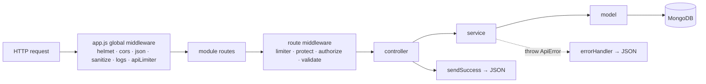

# server/: the ShopEase REST API

Express + MongoDB (Mongoose) API, written in JavaScript ES modules. Node 20+.

## Folder map

| Path                                  | What's inside                                                 |
| ------------------------------------- | ------------------------------------------------------------- |
| [`src/`](src/README.md)               | All application code                                          |
| [`tests/`](tests/README.md)           | Jest unit + integration tests                                 |
| [`postman/`](postman/README.md)       | Postman collection + environment (Newman: `npm run test:api`) |
| [`bruno/`](bruno/README.md)           | Bruno collection (`npm run test:bruno`)                       |
| [`api/`](api/README.md)               | Vercel serverless entry                                       |
| `.husky/pre-commit`                   | Runs lint-staged + tests before every commit                  |
| `package.json`                        | Dependencies, npm scripts, lint-staged config, `allowScripts` |
| `jest.config.js`                      | Test runner config + coverage gate (90%)                      |
| `eslint.config.js`                    | Lint rules (ESLint flat config + Prettier compatibility)      |
| `.prettierrc.json`, `.prettierignore` | Formatting rules                                              |
| `.env.example`                        | Every setting, documented. Copy it to `.env`                  |
| `vercel.json`                         | Sends every URL to `api/index.js` on Vercel                   |

## Run it

```bash
npm install
cp .env.example .env          # PowerShell: Copy-Item .env.example .env
npm run seed                  # admin + categories, products, coupons (seed:admin = admin only)
npm run dev                   # http://localhost:5000/api/health, /api/docs
npm test                      # no database or Mailpit needed
```

All scripts are listed in the [root README](../README.md#npm-scripts-run-inside-server).

## Request lifecycle


