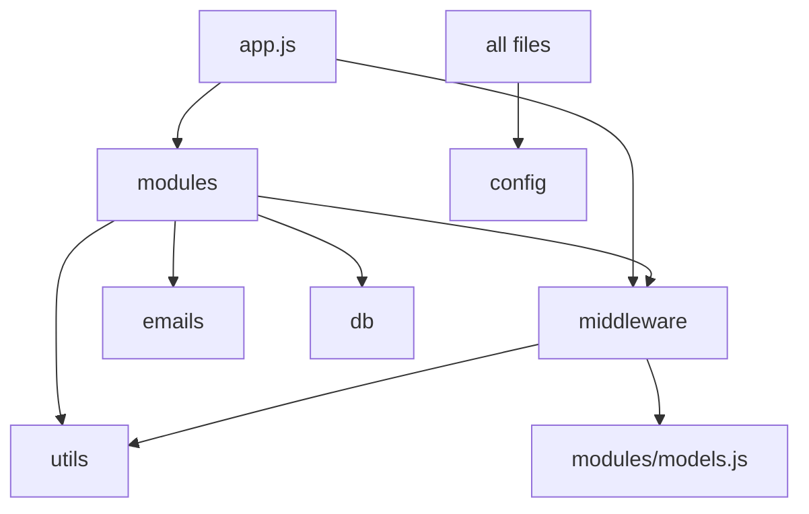

# src/: application code

| Path                                  | Purpose                                                                                                                                                               |
| ------------------------------------- | --------------------------------------------------------------------------------------------------------------------------------------------------------------------- |
| `app.js`                              | Builds the Express app: global middleware in order, health check, Swagger, module routes, 404, error handler. Does **not** listen, so tests and Vercel can import it. |
| `server.js`                           | Local entry: connect to MongoDB → `app.listen(PORT)` → graceful shutdown on Ctrl+C / SIGTERM.                                                                         |
| [`config/`](config/README.md)         | Environment variables, constants, DB connection                                                                                                                       |
| [`middleware/`](middleware/README.md) | Functions that run before controllers (auth guards, validation, limits, errors)                                                                                       |
| [`modules/`](modules/README.md)       | One folder per feature (auth, users, …)                                                                                                                               |
| [`utils/`](utils/README.md)           | Small shared helpers (ApiError, sendSuccess, asyncHandler, generateToken)                                                                                             |
| [`emails/`](emails/README.md)         | Sending emails + email templates                                                                                                                                      |
| [`db/`](db/README.md)                 | Mongoose plugins and CLI scripts (seed, indexes)                                                                                                                      |
| [`docs/`](docs/README.md)             | OpenAPI spec served at `/api/docs`                                                                                                                                    |

## Dependency direction

`config/` depends on nothing in `src/`. Everything may depend on it.
